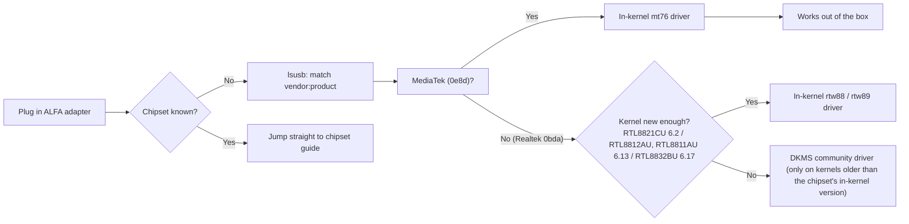

# ALFA Driver Guides — Overview

> **Quick Summary**: Every ALFA wireless adapter on Linux is powered by one of **seven chipsets**, and **all of them are supported by in-kernel drivers** — the three MediaTek chipsets since kernel 4.19 / 5.18, and the four Realtek chipsets (`rtw88` / `rtw89`) from **kernel 6.2 (RTL8821CU), 6.13 (RTL8812AU, RTL8811AU) or 6.17 (RTL8832BU)**. We verified all nine adapters on an ASUS GX10 (Ubuntu 24.04 ARM64, kernel 6.17.0-1014-nvidia): plug in and go, no DKMS. Only **kernels older than the chipset's in-kernel version need a community DKMS driver for the Realtek chipsets**. Find your chipset below and jump to its guide.

## Chipset Map

| Chipset | Adapters | Driver binding | In-kernel? | Guide |
|---------|----------|----------------|------------|-------|
| MT7612U | AWUS036ACM | `mt76x2u` | ✅ In-kernel (4.19+) | [MT7612U guide](/alfa-network/drivers/mt7612u/) |
| MT7610U | AWUS036ACHM | `mt76x0u` | ✅ In-kernel (4.19+) | [MT7610U guide](/alfa-network/drivers/mt7610u/) |
| MT7921AU / MT7921AUN | AWUS036AXM, AWUS036AXML | `mt7921u` | ✅ In-kernel (5.18+); injection did not pass on stock 6.17 | [MT7921AUN guide](/alfa-network/drivers/mt7921aun/) |
| RTL8812AU | AWUS036ACH | `rtw88_8812au` | ✅ In-kernel (6.13+) | [RTL8812AU guide](/alfa-network/drivers/rtl8812au/) |
| RTL8811AU | AWUS036ACS | `rtw88_8821au` | ✅ In-kernel (6.13+) | [RTL8811AU guide](/alfa-network/drivers/rtl8811au/) |
| RTL8832BU | AWUS036AX, AWUS036AXER | `rtw89_8852bu` | ✅ In-kernel (6.17+) | [RTL8832BU guide](/alfa-network/drivers/rtl8832bu/) |
| RTL8821CU | AWUS036EACS | `rtw88_8821cu` | ✅ In-kernel (6.2+) | [RTL8821CU guide](/alfa-network/drivers/rtl8821cu/) |

## How to Pick

1. **Identify the chipset** — run `lsusb` and match the `vendor:product` pair against your adapter's spec sheet.
2. **MediaTek chipset?** You are done — the driver is in the kernel. Go straight to the guide to confirm with `dmesg` / `iw dev` and enable monitor mode.
3. **Realtek chipset?** Check `uname -r`: the in-kernel `rtw88` / `rtw89` driver handles it from kernel 6.2 (RTL8821CU), 6.13 (RTL8812AU, RTL8811AU) or 6.17 (RTL8832BU); on Ubuntu 24.04 that means GA 6.8, HWE 6.14 and 6.17 respectively. Only on **kernels older than that** follow the matching guide to build the community DKMS module (and run `sudo dkms autoinstall` after kernel updates).
4. **Need packet injection?** The MT7921 cards (AWUS036AXM / AXML) did not pass injection on stock kernel 6.17; see the [adapter comparison](/alfa-network/wifi-adapter-comparison/).

The full system walk-throughs live in the [Linux setup guides](/alfa-network/linux-setup-ubuntu/) and the [compatibility matrix](/alfa-network/linux-compatibility-matrix/).
