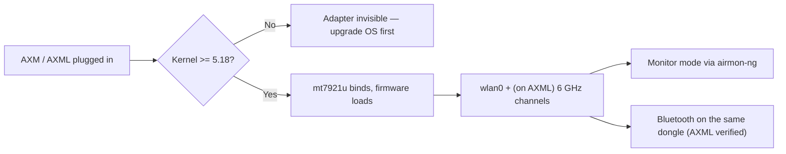

# MT7921AUN Driver Guide (AWUS036AXM / AWUS036AXML)

> **Quick Summary**: The **MediaTek MT7921AU** (AWUS036AXM) and **MT7921AUN** (AWUS036AXML) share one in-kernel driver, `mt7921u`, **mainline since kernel 5.18** — no DKMS. Tested on an ASUS GX10 (Ubuntu 24.04 ARM64, kernel 6.17.0-1014-nvidia): AP (2.4/5 GHz), WPA3-SAE and VIF work, monitor mode receives weakly, the AXML's 6 GHz and Bluetooth were verified — but **packet injection did not pass on the stock 6.17 kernel**, so deauth and handshake capture are not available there.

## Tested on ASUS GX10 / Ubuntu 24.04 ARM64

- Platform: ASUS Ascent GX10 (NVIDIA GB10), Ubuntu 24.04 LTS ARM64, kernel `6.17.0-1014-nvidia`, 2026-11-16 to 2026-11-19. USB ID `0e8d:7961`, driver `mt7921u` (in-kernel).
- Works: AP 2.4 GHz and 5 GHz (80 MHz), WPA3-SAE, VIF, monitor receive (weak, few client/data frames).
- AXML only: **6 GHz verified** (WPA3-SAE AP on ch37 / 6135 MHz, iPhone 15 Pro joined at 802.11ax). **Bluetooth verified** (controller up, 31 BLE + 1 classic device scanned, WiFi + BT coexist).
- AXM: 6 GHz is **inferred from the same chip but not tested**.
- IBSS and mesh are not offered (N/A); active monitor 🟡; P2P not tested.

### Packet injection did not pass on stock kernel 6.17

`aireplay-ng --test` returned `No Answer` / `Found 0 APs`, so deauth and WPA handshake capture are **not available** on this platform with either card. Findings:

- This is **not an inherent chip limitation**. The mt7921 uses a firmware "sniffer mode" for monitor, and the root causes are the firmware sniffer-mode RX behavior plus a **kernel 6.16+ mac80211 chanctx regression** (see morrownr/mt76 #18; the phenomenon is tracked in morrownr/USB-WiFi #387).
- The community reports that patched/git drivers can make active-monitor + injection work, but the firmware still locks the rate (1/6 Mbps, no HT/VHT injection). We did not test such a patched driver.
- `iw` reports 3 dBm TX power in monitor mode and it cannot be raised there; the card still transmits in AP mode (phones connected). If the AP beacon becomes too weak for phones to see the SSID, replug the adapter to reset the power.
- Monitor reception is weak; lock one channel instead of hopping.
- For injection / handshake work use the ACM, ACH, ACS, EACS, AX or AXER instead (see the [adapter comparison](/alfa-network/wifi-adapter-comparison/)).

## Concept: what you get with MT7921AU / MT7921AUN

This is MediaTek's newest radio in the ALFA line, a **2×2:2 802.11ax** design that also includes **Bluetooth** on the same dongle (verified on the AXML; not tested on the AXM). Three things matter for Linux users:

1. **In-kernel driver** (`drivers/net/wireless/mediatek/mt76/mt7921/`) since **Linux 5.18** — no DKMS, no compilation.
2. **Wi-Fi 6E**: the AXML variant opens the **6 GHz band** (channels 1–233 above 5 GHz), which is currently the least congested spectrum available.
3. **Firmware blobs** are required — the driver loads `mt7921` firmware from `linux-firmware`, so keep that package updated.

The main caveat: because the driver needs a **5.18+ kernel**, older OS releases won't see the adapter. Ubuntu 22.04+ and recent Kali are fine; Ubuntu 20.04 is not.



## Prerequisites

- [ ] Linux with kernel **5.18 or newer** (`uname -r`)
- [ ] `linux-firmware` package installed and reasonably recent
- [ ] `sudo` access
- [ ] AWUS036AXM or AWUS036AXML

## Step 1: Kernel check

```bash
uname -r
```

**Expected output** (examples):

```text
6.8.0-51-generic        # Ubuntu 24.04 GA — OK (example)
6.17.0-1014-nvidia      # our GX10 test platform — OK (measured)
5.15.0-91-generic       # Ubuntu 22.04 base — TOO OLD for mt7921u (example)
```

On 5.15 or older: `sudo apt update && sudo apt upgrade` (or install the HWE kernel on Ubuntu 22.04). The driver will not exist on old kernels — this is a hard requirement, not a config detail.

## Step 2: Verify the driver and firmware

Plug in the adapter:

```bash
lsusb | grep 0e8d:7961
sudo dmesg | grep mt7921u | tail -3
```

**Expected output** (measured on the GX10 with an AWUS036AXML; the AXM shows the same lines, only the bus/device numbers and the `wlx` MAC differ):

```text
Bus 004 Device 002: ID 0e8d:7961 MediaTek Inc. Wireless_Device
mt7921u 4-1:1.3: HW/SW Version: 0x8a108a10, Build Time: 20240219110958a
mt7921u 4-1:1.3: WM Firmware Version: ____010000, Build Time: 20240219111038
mt7921u 4-1:1.3 wlx00c0cabd65b9: renamed from wlan0
```

The driver loads `mediatek/WIFI_MT7961_patch_mcu_1_2_hdr.bin` and `mediatek/WIFI_RAM_CODE_MT7961_1.bin` from `linux-firmware`. No `dmesg` line but `lsusb` shows the device? Update firmware:

```bash
sudo apt install linux-firmware
```

then re-plug the adapter.

## Step 3: Confirm interface and bands

```bash
iw dev
iwlist wlan0 freq | grep -E "^          Channel" | sort -u | tail -5
```

**Expected output**: an interface line, and for the AXML the frequency list should include **6 GHz channels** (`Channel 1 ... Channel 233` under "6 GHz band"). If you only see 2.4/5 GHz entries on the AXML, your regulatory domain may be hiding 6 GHz — `sudo iw reg set TW` (use your country code) and bring the interface down/up.

## Step 4: Connect

```bash
nmcli device wifi connect "MySSID" password "my-passphrase"
```

**Expected output**: `Device '<interface>' successfully activated with 'MySSID'.`

## Step 5: Monitor mode

Receive-only on the tested stock 6.17 kernel:

```bash
IF=$(ls /sys/class/net | grep '^wlx' | head -1)
sudo nmcli dev set $IF managed no
sudo ip link set dev $IF down
sudo iw dev $IF set type monitor
sudo ip link set dev $IF up
sudo iw dev $IF set channel 36
sudo timeout 8 tcpdump -l -i $IF -nn -e -c 200
```

**Expected output**: beacons are received on 2.4 and 5 GHz, with fewer frames than the MT7612U/Realtek cards. **Injection (`aireplay-ng --test`) failed on stock kernel 6.17** — see the section above. Do not run `airmon-ng check kill` on a desktop/GX10 (it stops NetworkManager).

> **You might be wondering** — *"Does monitor mode work on 6 GHz?"* On the AXML, 6 GHz client/AP operation was verified. Monitor capture on 6 GHz was **not tested**; if you try it and see nothing, test on 5 GHz first to isolate the driver from the environment.

## Step 6: Bluetooth

The AXML's Bluetooth was verified on the GX10 (controller up, 31 BLE + 1 classic device scanned, Wi-Fi and BT coexist). The AXM's Bluetooth was **not tested**; the commands below apply to both because they share the chip. Pair with:

```bash
bluetoothctl
power on
scan on
pair <MAC>
```

**Expected output**: `Pairing successful` for your device (pairing itself was not part of our test — we verified the controller and scanning). If `bluetoothctl` sees nothing, load the Bluetooth stack module: `sudo modprobe btusb` and retry.

## Troubleshooting

| Symptom | Cause | Fix |
|---|---|---|
| `lsusb` shows nothing | Power (AXML draws more) / cable | Powered hub; USB-C cable with data lines |
| `lsusb` ok, no `wlan0` | Kernel < 5.18, or firmware missing | Upgrade kernel; `sudo apt install linux-firmware`; reboot |
| `dmesg` shows firmware load failure | Stale firmware blob | Update `linux-firmware`, unplug/replug |
| 6 GHz channels missing (AXML) | Regulatory domain unset | `sudo iw reg set <CC>`; bounce the interface |
| BT devices not found | `btusb` not loaded | `sudo modprobe btusb` |
| Monitor mode works on 2.4/5 GHz but not 6 GHz | 6 GHz monitor not tested; or no 6 GHz AP | Retest on 5 GHz; verify a 6 GHz AP is in range |
| Injection / deauth finds 0 APs | Firmware sniffer-mode limitation + kernel 6.16+ chanctx regression (stock 6.17) | Use a different card for injection |
| No `wlx` interface after re-plug (AXML) | Composite WiFi + BT probe stuck | Use a different USB port |

## References

- [AWUS036AXM product page](/alfa-network/products/awus036axm/) and [AWUS036AXML product page](/alfa-network/products/awus036axml/)
- [Ubuntu setup guide](/alfa-network/linux-setup-ubuntu/) and [Kali setup guide](/alfa-network/linux-setup-kali/)
- [Compatibility matrix](/alfa-network/linux-compatibility-matrix/)
- Mainline driver source: `drivers/net/wireless/mediatek/mt76/mt7921/` in the Linux kernel tree
- [linux-firmware](https://git.kernel.org/pub/scm/linux/kernel/git/firmware/linux-firmware.git/) — firmware blobs for MT7921
