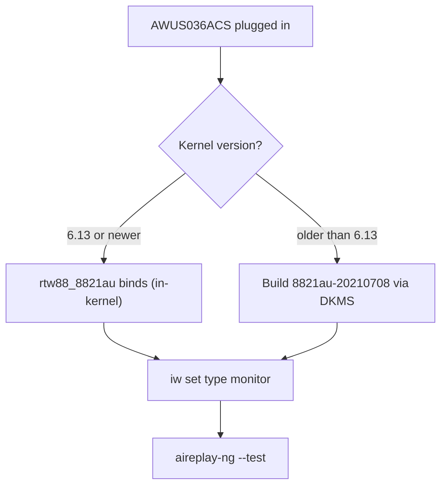

# RTL8811AU Driver Guide (AWUS036ACS)

> **Quick Summary**: The **Realtek RTL8811AU** is the 1×1 AC600 chipset inside the 55 mm **AWUS036ACS** — the pocket-sized monitor-mode companion. On **kernel 6.13 or newer** the in-kernel **`rtw88_8821au`** driver binds automatically (verified on an ASUS GX10, Ubuntu 24.04 ARM64, kernel 6.17.0-1014-nvidia), so no DKMS is needed. Only **older kernels (< 6.13)** need the community `8821au` DKMS driver.

## Concept: same family, one stream

The RTL8811AU is essentially the 1×1 variant of the RTL8812AU family: one spatial stream, 433 Mbps max on 5 GHz, lower power draw, smaller board. ALFA wraps it in the tiny ACS body with one external 2 dBi RP-SMA antenna.

The in-kernel `rtw88_8821au` driver also covers the RTL8821AU variant, so the same module name may appear on similar dongles.

### Tested on ASUS GX10 / Ubuntu 24.04 ARM64

- Platform: ASUS Ascent GX10 (NVIDIA GB10), Ubuntu 24.04 LTS ARM64, kernel `6.17.0-1014-nvidia`, 2026-11-16 to 2026-11-19.
- USB ID `0bda:0811`, driver `rtw88_8821au` (in-kernel), firmware 42.4.0 (H2C version 0).
- Results: monitor 2.4/5 GHz ✅, injection 100 % (2.4 GHz) and 96 % (5 GHz) ✅, AP 2.4/5 GHz ✅, WPA3-SAE ✅ (AP tested on 5 GHz), end-to-end handshake capture ✅, VIF ✅. IBSS, mesh, active monitor and P2P are not supported (`-95`).



## Prerequisites

- [ ] Linux **kernel 6.13 or newer** (`uname -r`) — nothing to build
- [ ] Older kernel (< 6.13) only: `sudo apt install -y build-essential dkms git`
- [ ] `sudo` access
- [ ] AWUS036ACS

## Step 1: Verify the in-kernel driver (kernel ≥ 6.13)

```bash
lsusb | grep -i 0bda:0811
sudo dmesg | grep -i 8821au
iw dev
```

**Expected output**: the `0bda:0811` device, a line like `rtw88_8821au ... Firmware version 42.4.0, H2C version 0`, and an interface (named `wlx` + MAC on the GX10). If so, skip to Step 3.

## Step 2 (kernel < 6.13 only): Clone and build with DKMS

```bash
cd /opt
sudo git clone https://github.com/morrownr/8821au-20210708.git
cd 8821au-20210708
sudo sh install-driver.sh
sudo modprobe 8821au
iw dev
```

**Expected output**: `DKMS: install completed.` and an `Interface wlan0` (or `wlan1`) line. If the adapter only shows up after re-plug, add the module to auto-load:

```bash
echo 8821au | sudo tee /etc/modules-load.d/alfa.conf
```

## Step 3: Monitor mode + injection

Do **not** run `airmon-ng check kill` (it stops NetworkManager). Use `iw`:

```bash
IF=$(ls /sys/class/net | grep '^wlx' | head -1)
sudo nmcli dev set $IF managed no
sudo ip link set dev $IF down
sudo iw dev $IF set type monitor
sudo ip link set dev $IF up
sudo iw dev $IF set channel 6
sudo aireplay-ng --test $IF
```

**Expected output**: `Injection is working!` (measured 30/30 on 2.4 GHz; 29/30 on 5 GHz after `sudo iw reg set US`, restored afterwards).

## Step 4: Back to normal

```bash
sudo ip link set dev $IF down
sudo iw dev $IF set type managed
sudo nmcli dev set $IF managed yes
sudo ip link set dev $IF up
```

## Troubleshooting

| Symptom | Cause | Fix |
|---|---|---|
| (Kernel < 6.13 only) DKMS build fails | Missing headers / too-new kernel | `sudo apt install linux-headers-$(uname -r)`; `cd 8821au-20210708 && git pull && sudo sh install-driver.sh` |
| (Kernel < 6.13 only) Interface only in managed mode | Kernel stub `rtl8811au` grabbed it | `echo "blacklist rtl8811au" \| sudo tee /etc/modprobe.d/alfa-8811au.conf`; reboot |
| Injection 0/30 | Empty channel | `sudo iw $IF set channel 6`; test near an AP |
| 5 GHz injection blocked | Regulatory domain | `sudo iw reg set US` for the test, restore afterwards |
| Throughput lower than expected | 1×1 radio (AC600) — hardware limit | Not a bug; expect ~150–250 Mbps real-world on 5 GHz |
| (Kernel < 6.13 only) Not detected after reboot | Module not auto-loaded | Add `8821au` to `/etc/modules-load.d/alfa.conf` |

## References

- [AWUS036ACS product page](/alfa-network/products/awus036acs/)
- [Kali setup guide](/alfa-network/linux-setup-kali/)
- [Ubuntu setup guide](/alfa-network/linux-setup-ubuntu/)
- [Troubleshooting index](/alfa-network/troubleshooting/)
- Legacy driver repo (kernel < 6.13): [morrownr/8821au-20210708](https://github.com/morrownr/8821au-20210708) (RTL8811AU / RTL8821AU; the former `aircrack-ng/rtl8811au` repository no longer exists)
