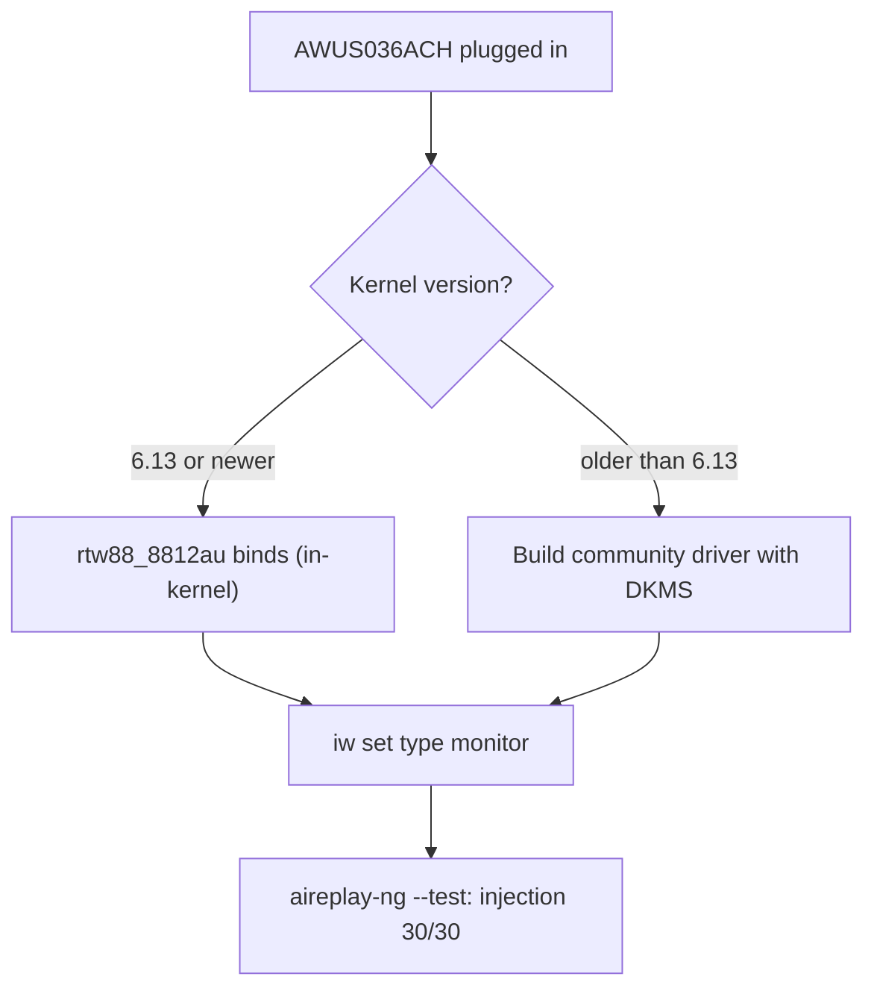

# RTL8812AU Driver Guide (AWUS036ACH)

> **Quick Summary**: The **Realtek RTL8812AU** is the legendary 2×2 dual-band chipset inside the **AWUS036ACH**. On **kernel 6.13 or newer** it is supported by the **in-kernel `rtw88_8812au` driver** — plug it in and it works, no DKMS. We verified this on an ASUS GX10 (Ubuntu 24.04 ARM64, kernel 6.17.0-1014-nvidia). Only on **older kernels (< 6.13)** do you need to build the community `rtl8812au` driver with DKMS.

## Concept: the most famous Wi-Fi hacking chipset

The RTL8812AU drives the AC1200 AWUS036ACH with a high-power (500 mW) radio and two external antennas. Its fame comes from the **aircrack-ng community**: years of pentest work hardened an out-of-tree driver for **monitor mode** and **packet injection**. Those capabilities are now available in the mainline `rtw88_8812au` driver (kernel ≥ 6.13), and the old out-of-tree repositories now point to it.

### Tested on ASUS GX10 / Ubuntu 24.04 ARM64

- Platform: ASUS Ascent GX10 (NVIDIA GB10), Ubuntu 24.04 LTS ARM64, kernel `6.17.0-1014-nvidia`, 2026-11-16 to 2026-11-19.
- USB ID `0bda:8812`, driver `rtw88_8812au` (in-kernel), firmware `rtw88/rtw8812a_fw.bin`. Connected at USB 3.0 (`5000M`).
- Results: monitor 2.4/5 GHz ✅, injection 100 % on both bands ✅, AP 2.4/5 GHz ✅, WPA3-SAE ✅ (`sae_pwe=0`), end-to-end handshake capture ✅, VIF (STA + monitor) ✅. Active monitor, mesh and P2P return `Operation not supported (-95)`.
- Known issue: 5 GHz RX can stall after repeated mode / regdomain changes (0 packets); only a replug recovers it. Test 5 GHz right after plugging in.



## Prerequisites

- [ ] Linux **kernel 6.13 or newer** (`uname -r`; e.g. Ubuntu 24.04 + HWE 6.14 / GX10 6.17 — tested). Nothing else needed.
- [ ] Older kernel (< 6.13) only: build tools and internet — `sudo apt install -y build-essential dkms git`
- [ ] `sudo` access
- [ ] AWUS036ACH

## Step 1: Verify the in-kernel driver (kernel ≥ 6.13)

```bash
uname -r
lsusb | grep 0bda:8812
lsusb -t | grep rtw88_8812au
sudo dmesg | grep -iE 'rtw88_8812au|8812' | tail -5
iw dev
```

**Expected output**: the `0bda:8812` device, `Driver=rtw88_8812au`, and an interface (on the GX10 named `wlx` + MAC). If so, skip the DKMS sections and go to Step 4.

## Step 2 (kernel < 6.13 only): Remove the kernel stub

Some old kernels ship a Realtek stub driver that grabs the adapter and refuses monitor mode. Unload it first:

```bash
sudo modprobe -r rtl8812au 2>/dev/null
```

(If the command errors "not found", great — no stub present.)

## Step 3 (kernel < 6.13 only): Build the community driver with DKMS

```bash
cd /opt
sudo git clone https://github.com/aircrack-ng/rtl8812au.git
cd rtl8812au
sudo make dkms_install
sudo modprobe 8812au
iw dev
```

**Expected output**: `DKMS: install completed.` and an `Interface wlan0` (or `wlan1`). If the stub loads again after reboot, blacklist it and auto-load the real module:

```bash
echo "blacklist rtl8812au" | sudo tee /etc/modprobe.d/alfa-8812au.conf
echo 8812au | sudo tee /etc/modules-load.d/alfa.conf
```

## Step 4: Monitor mode + injection

Do **not** run `airmon-ng check kill` (it stops NetworkManager and can cut your network). Use `iw` on the adapter's `wlx...` interface only:

```bash
IF=$(ls /sys/class/net | grep '^wlx' | head -1)
sudo nmcli dev set $IF managed no
sudo ip link set dev $IF down
sudo iw dev $IF set type monitor
sudo ip link set dev $IF up
sudo iw dev $IF set channel 6
sudo aireplay-ng --test $IF
```

**Expected output**:

```text
Injection is working!
30/30: 100%
```

For 5 GHz injection run `sudo iw reg set US` first and restore your region afterwards. `hcxdumptool` 8.x failed to arm on this card (it needs active monitor); use `airodump-ng` + `aireplay-ng`.

## Step 5: Back to managed mode

```bash
sudo ip link set dev $IF down
sudo iw dev $IF set type managed
sudo nmcli dev set $IF managed yes
sudo ip link set dev $IF up
```

## Troubleshooting

| Symptom | Cause | Fix |
|---|---|---|
| 5 GHz capture shows 0 packets | RX stall after many mode/regdomain changes | Unplug and replug the adapter |
| Only USB 2.0 speed | Plugged into a hub / USB 2.0 port | Use a USB 3.0 port directly |
| (Kernel < 6.13 only) `make dkms_install` fails with "No rule to make target" | Repo snapshot older than your kernel | `sudo git pull && sudo make dkms_install` again |
| (Kernel < 6.13 only) Build fails: missing headers | Headers not installed | `sudo apt install linux-headers-$(uname -r)` |
| (Kernel < 6.13 only) Adapter only in managed mode | Kernel stub grabbed it first | Blacklist `rtl8812au` (Step 3) and reboot |
| Injection `0/30` | Channel with no AP | `sudo iw $IF set channel 6`; test near an AP |
| (Kernel < 6.13 only) Adapter vanishes after reboot | Module not auto-loaded | `echo 8812au \| sudo tee /etc/modules-load.d/alfa.conf` |
| (Kernel < 6.13 only) `dkms status` shows Error after upgrade | Rebuild failed | `sudo dkms autoinstall` |

## References

- [AWUS036ACH product page](/alfa-network/products/awus036ach/)
- [Kali setup guide](/alfa-network/linux-setup-kali/) — full monitor/injection workflow
- [Ubuntu setup guide](/alfa-network/linux-setup-ubuntu/)
- [Troubleshooting index](/alfa-network/troubleshooting/)
- Legacy driver repo (kernel < 6.13): [aircrack-ng/rtl8812au](https://github.com/aircrack-ng/rtl8812au)
