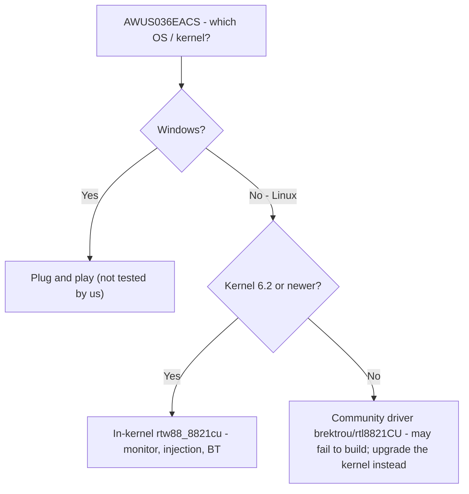

# RTL8821CU Driver Guide (AWUS036EACS)

> **Quick Summary**: The **Realtek RTL8821CU** is the WiFi 5 + Bluetooth 4.2 combo chipset inside the nano **AWUS036EACS**. On **kernel 6.2 or newer** the in-kernel **`rtw88_8821cu`** driver supports it, and on an ASUS GX10 (Ubuntu 24.04 ARM64, kernel 6.17.0-1014-nvidia) it passed **monitor mode, injection at 100 % on 2.4 and 5 GHz, AP, WPA3, handshake capture and Bluetooth**. On **Windows it is reported to be plug-and-play (not tested by us)**. Only kernels older than 6.2 are stuck with an unstable community driver.

## Concept: a combo chipset that grew up

The RTL8821CU was designed for desktop/laptop users who want **WiFi + Bluetooth in one tiny dongle**. It is AC600-class (150 + 433 Mbps) with an integrated 2 dBi antenna and no external RP-SMA connector.

Older versions of this guide called its Linux support unreliable. That was true while only the community driver existed (`brektrou/rtl8821CU`, which frequently breaks on new kernels). Since the mainline `rtw88_8821cu` driver (USB support in kernel 6.2+; we tested 6.17), **the chip works out of the box**.

### Tested on ASUS GX10 / Ubuntu 24.04 ARM64

- Platform: ASUS Ascent GX10 (NVIDIA GB10), Ubuntu 24.04 LTS ARM64, kernel `6.17.0-1014-nvidia`, 2026-11-16 to 2026-11-19.
- USB ID `0bda:c820`, driver `rtw88_8821cu` (in-kernel), firmware 24.11.0 (H2C version 12).
- Results: monitor 2.4/5 GHz ✅, injection 100 % on both bands ✅ (deauth got 79 ACKs), AP 2.4/5 GHz ✅ (5 GHz: 802.11a, 20 MHz tested; VHT80 not tested), WPA3-SAE ✅ (AP tested on 2.4 GHz), end-to-end handshake ✅, VIF 🟡 (passive monitor alongside managed on the same channel; independent dual VIF not supported), Bluetooth ✅. IBSS, mesh, active monitor and P2P are not supported (`-95`).
- Gotcha: it is a composite device. After re-plugging, the WiFi function can hang during probe and no `wlx` interface appears — plug it into a different USB port.



## Prerequisites

- [ ] Linux **kernel 6.2 or newer** (`uname -r`) — nothing to build
- [ ] Older kernel (< 6.2) only: `sudo apt install -y build-essential dkms git` and patience (experimental)
- [ ] `sudo` access

## Step 1: Verify the in-kernel driver (kernel ≥ 6.2)

```bash
lsusb | grep -i 0bda:c820
sudo dmesg | grep -i 8821cu
IF=$(ls /sys/class/net | grep '^wlx' | head -1); echo "IF=$IF"
basename "$(readlink -f /sys/class/net/$IF/device/driver)"
```

**Expected output**: `ID 0bda:c820 Realtek Semiconductor Corp. 802.11ac NIC`, a line like `rtw88_8821cu 3-1:1.2: Firmware version 24.11.0, H2C version 12`, and the driver name `rtw88_8821cu`.

## Step 2: Connect, then monitor mode and injection

```bash
nmcli device wifi connect "MySSID" password "my-passphrase"
sudo nmcli dev set $IF managed no
sudo ip link set dev $IF down
sudo iw dev $IF set type monitor
sudo ip link set dev $IF up
sudo iw dev $IF set channel 6
sudo aireplay-ng --test $IF
```

**Expected output**: `Injection is working!` (measured 30/30 on both 2.4 and 5 GHz; for 5 GHz run `sudo iw reg set US` first and restore afterwards). Do not run `airmon-ng check kill`. `hcxdumptool` 8.x armed on 2.4 GHz but failed to arm on 5 GHz — use `airodump-ng` + `aireplay-ng`. Use only on your own or authorized networks.

## Step 3 (kernel < 6.2 only): Try the community driver

Only for kernels older than 6.2:

```bash
cd /opt
sudo git clone https://github.com/brektrou/rtl8821CU.git
cd rtl8821CU
sudo make dkms_install
sudo modprobe 8821cu
iw dev
```

**Possible outcomes**: `DKMS: install completed.` (older kernels) or `make: *** [Makefile:...] Error 1` (newer kernels). If it fails, upgrade the kernel to 6.2+ instead of fighting the build. Monitor mode and injection with this community driver were not tested by us.

## The recommended path

| Your goal | Recommended adapter |
|---|---|
| Kali / monitor mode / packet injection on kernel ≥ 6.2 | AWUS036EACS works; [AWUS036ACM](/alfa-network/products/awus036acm/), [AWUS036ACH](/alfa-network/products/awus036ach/) are alternatives with external antennas |
| WiFi + Bluetooth in one nano stick | **AWUS036EACS** |
| Old kernel (< 6.2) and no way to upgrade | [AWUS036ACM](/alfa-network/products/awus036acm/) (in-kernel since 4.19) |

## Troubleshooting

| Symptom | Cause | Fix |
|---|---|---|
| `lsusb` shows `0bda:c820` but no `wlx` interface | Composite device WiFi probe stuck after re-plug | Unplug, plug into a different USB port |
| (Kernel < 6.2 only) `make dkms_install` fails | Community driver not maintained for new kernels | Upgrade to kernel ≥ 6.2 and use the in-kernel driver |
| (Kernel < 6.2 only) Adapter unstable, random disconnects | Known community-driver quirk | Use the in-kernel driver on a newer kernel |
| Bluetooth missing | `btusb` not loaded / firmware | `sudo apt install linux-firmware`; `sudo modprobe btusb` |
| Capture stops after many mode switches | RX stall | Unplug and replug |

## References

- [AWUS036EACS product page](/alfa-network/products/awus036eacs/)
- [Adapter comparison](/alfa-network/wifi-adapter-comparison/)
- [Compatibility matrix](/alfa-network/linux-compatibility-matrix/)
- [Troubleshooting index](/alfa-network/troubleshooting/)
- Legacy community driver (kernel < 6.2): [brektrou/rtl8821CU](https://github.com/brektrou/rtl8821CU)
