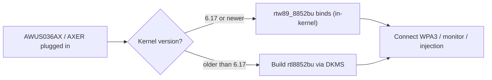

# RTL8832BU Driver Guide (AWUS036AX / AWUS036AXER)

> **Quick Summary**: The **Realtek RTL8832BU** is the Wi-Fi 6 (802.11ax) chipset inside the **AWUS036AX** and its nano sibling the **AWUS036AXER**. On **kernel 6.17 or newer** the in-kernel **`rtw89_8852bu`** driver supports it — no DKMS. On an ASUS GX10 (Ubuntu 24.04 ARM64, kernel 6.17.0-1014-nvidia) both cards passed **monitor mode (2.4 and 5 GHz), injection, AP, WPA3 and handshake capture**. Only **older kernels (< 6.17)** need the community `rtl8852bu` DKMS driver.

## Concept: Wi-Fi 6, the Realtek way

The RTL8832BU is a 2×2 802.11ax radio (AX1800: 574 + 1201 Mbps). Compared to the older AC adapters, the big user-visible win is **WPA3** — modern routers that only speak WPA3 will refuse your old AC dongle but happily accept the AX.

With kernel 6.17+ the mainline `rtw89_8852bu` driver (firmware `rtw89/rtw8852b_fw-1.bin`) handles the chip. Older kernels need the community driver **[`morrownr/rtl8852bu-20250826`](https://github.com/morrownr/rtl8852bu-20250826)**; its installer registers the driver with DKMS so it is rebuilt across kernel updates.

> Earlier versions of this guide stated that monitor mode is not supported. That referred to the old community driver; **on the in-kernel `rtw89_8852bu` driver, monitor mode and injection were verified**. The 88x2bu family (RTL8812BU / RTL8822BU) is a different 802.11ac family — do not use it for the AWUS036AX / AXER.

### Tested on ASUS GX10 / Ubuntu 24.04 ARM64

- Platform: ASUS Ascent GX10 (NVIDIA GB10), Ubuntu 24.04 LTS ARM64, kernel `6.17.0-1014-nvidia`, 2026-11-16 to 2026-11-19.
- USB ID `0bda:b832`, driver `rtw89_8852bu` (in-kernel), firmware `rtw8852b_fw` 0.29.29.5. No Bluetooth interface on our units.
- AWUS036AX: monitor 2.4/5 GHz ✅ (strong), injection 96 % (2.4 GHz) and ✅ on 5 GHz, AP 2.4/5 GHz ✅, WPA3-SAE ✅, handshake ✅, VIF STA+AP ✅.
- AWUS036AXER: same chip and behavior; monitor 2.4/5 GHz ✅ (63 APs + 12 clients in one hop scan), injection 73 % (2.4 GHz) and ✅ on 5 GHz, AP ✅, WPA3 ✅, handshake ✅.
- IBSS, mesh and active monitor are not offered by this driver (N/A). P2P: not tested.



## Prerequisites

- [ ] Linux **kernel 6.17 or newer** (`uname -r`) — nothing to build
- [ ] Older kernel (< 6.17) only: `sudo apt install -y build-essential dkms git`
- [ ] `sudo` access
- [ ] AWUS036AX or AWUS036AXER

## Step 1: Verify the in-kernel driver (kernel ≥ 6.17)

```bash
lsusb | grep -iE '0bda:b832|0bda:1a2b'
sudo dmesg | grep rtw89_8852bu | tail -3
iw dev
```

**Expected output**: `ID 0bda:b832 Realtek Semiconductor Corp. 802.11ax WLAN Adapter` (the AWUS036AXER's `lsusb` description reads `802.11ac WLAN Adapter`; the ID is the same), a firmware line (`rtw89/rtw8852b_fw-1.bin ... Firmware version 0.29.29.5`) and an interface. If `lsusb` shows `0bda:1a2b` (disk mode), run `sudo usb_modeswitch -v 0bda -p 1a2b -K`.

## Step 2 (kernel < 6.17 only): Build the community driver

```bash
cd /opt
sudo git clone https://github.com/morrownr/rtl8852bu-20250826.git
cd rtl8852bu-20250826
sudo sh install-driver.sh
sudo modprobe 8852bu
iw dev
```

**Expected output**: the script builds and installs the driver with DKMS. Answer its prompts and reboot when it asks. Auto-load, if the installer did not set it up:

```bash
echo 8852bu | sudo tee /etc/modules-load.d/alfa.conf
```

Monitor-mode behavior of this community driver was not tested by us.

## Step 3: Connect (WPA3 works out of the box)

```bash
nmcli device wifi connect "MySSID" password "my-passphrase"
IF=$(ls /sys/class/net | grep '^wlx' | head -1)
iw dev $IF link
```

**Expected output**: shows `SSID: MySSID` plus the negotiated rate — on 5 GHz up to about **1201 Mb/s**, or a lower fallback depending on distance (2×2 80 MHz).

## Monitor mode and injection

On the in-kernel driver (kernel ≥ 6.17), monitor mode and injection work:

```bash
sudo nmcli dev set $IF managed no
sudo ip link set dev $IF down
sudo iw dev $IF set type monitor
sudo ip link set dev $IF up
sudo iw dev $IF set channel 36
sudo timeout 8 tcpdump -l -i $IF -nn -e -c 200
sudo aireplay-ng --test $IF
```

Do **not** run `airmon-ng check kill` (it stops NetworkManager). For 5 GHz injection run `sudo iw reg set US` first and restore your region afterwards. `hcxdumptool` 8.x failed to arm (it needs active monitor, which this driver does not offer); use `airodump-ng` + `aireplay-ng`. Use only on your own or authorized networks.

## Troubleshooting

| Symptom | Cause | Fix |
|---|---|---|
| `lsusb` shows `0bda:1a2b` | Card enumerated in disk mode | `sudo usb_modeswitch -v 0bda -p 1a2b -K` |
| (Kernel < 6.17 only) Build fails on a very new kernel | Repo needs the latest commit | `cd /opt/rtl8852bu-20250826 && sudo git pull && sudo sh install-driver.sh` |
| WPA3 network not visible | Driver or wpa_supplicant too old | Update OS / kernel; `sudo apt update && sudo apt upgrade` |
| (Kernel < 6.17 only) Driver stops working after a kernel upgrade | DKMS did not rebuild | `sudo dkms status`, then re-run `sudo sh install-driver.sh` |
| (Kernel < 6.17 only) Another out-of-kernel driver for the same hardware is installed | Conflicting modules | Check `sudo dkms status` and remove the old driver |
| High-speed link but slow transfers | USB 2.0 port bottleneck | Use a USB 3.x port (AX is USB 3.2) |
| Capture shows nothing after many mode switches | RX stall | Unplug and replug |

## References

- [AWUS036AX product page](/alfa-network/products/awus036ax/) and [AWUS036AXER product page](/alfa-network/products/awus036axer/)
- [Kali setup guide](/alfa-network/linux-setup-kali/)
- [Ubuntu setup guide](/alfa-network/linux-setup-ubuntu/)
- [Troubleshooting index](/alfa-network/troubleshooting/)
- Legacy driver repo (kernel < 6.17): [morrownr/rtl8852bu-20250826](https://github.com/morrownr/rtl8852bu-20250826)
