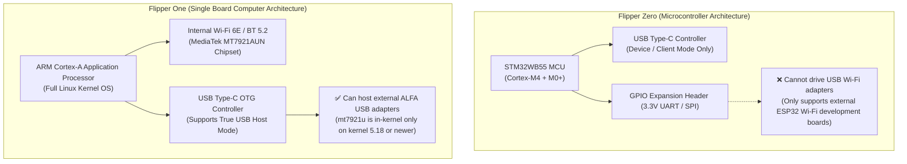

# Flipper One × ALFA Network Compatibility & Selection Guide

> **Quick Summary**: Flipper One is powered by an ARM Cortex-A application processor running full embedded Linux. Its integrated Wi-Fi 6E module is powered by the **MediaTek MT7921AUN** chipset (the exact same silicon inside the **ALFA AWUS036AXML**). This guide analyzes Flipper One's internal radio architecture versus external high-gain ALFA USB adapters, and clarifies why **Flipper Zero (which lacks USB Host mode) cannot support external Wi-Fi adapters**.

> **Test scope**: Yupitek's ALFA compatibility testing was done only on ASUS GX10 / Ubuntu 24.04 ARM64 / kernel 6.17. **Flipper One has not been tested.** Statements on this page about driver availability are inferred from the platform's kernel version and the kernel release in which each driver reached mainline (ACM / ACHM 4.19, AXM / AXML 5.18, EACS 6.2, ACH / ACS 6.13, AX / AXER 6.17), not verified on the hardware. On the GX10 / kernel 6.17 test platform, the AWUS036AXML (MT7921AUN) showed weak monitor mode and failed packet injection (`aireplay-ng` reports `Found 0 APs` / `No Answer`); it works as a client and as an AP (including 6 GHz WPA3-SAE). Only test networks you own or are authorized to test.

## Architectural Differences: Flipper Zero vs. Flipper One



---

## Dual-Radio Operation on Flipper One

By connecting an external ALFA AWUS036AXML via USB-C OTG, you can establish a dual-radio setup:
- **Internal MT7921AUN (`wlan0`)**: Maintains connection to a phone hotspot or local network for SSH/Web management.
- **External ALFA Adapter (`wlan1`)**: Dedicated radio for passive monitor mode and packet capture (AXML monitor mode is weak and injection fails on the GX10 test platform; not tested on Flipper One).

```bash
# Verify USB connection
lsusb

# Enable monitor mode on external adapter
sudo iw dev wlan1 interface add mon0 type monitor
sudo ip link set mon0 up
```
