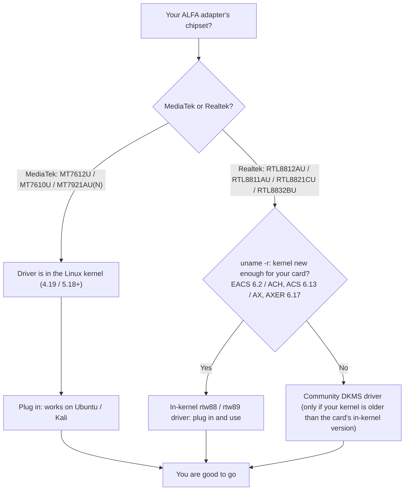

# ALFA Linux Compatibility Matrix

> **Bottom Line Up Front**: All nine ALFA adapters are supported by **in-kernel drivers**. The MediaTek models (AWUS036ACM, ACHM, AXM, AXML) have been in the kernel since 4.19 / 5.18; the Realtek models are supported by the in-kernel `rtw88` / `rtw89` drivers from **kernel 6.2 (EACS), 6.13 (ACH, ACS) and 6.17 (AX, AXER)**. We tested all nine on an ASUS GX10 (Ubuntu 24.04 LTS ARM64, kernel 6.17.0-1014-nvidia): plug in and use, **no DKMS**. The community DKMS drivers are only needed for the Realtek models on kernels older than the version above for that card (ACM, ACHM, AXM and AXML never need DKMS). One caveat: the MT7921 models (AXM, AXML) did **not** pass packet injection on the stock 6.17 kernel.




*💡 Click image to view in high-resolution full-screen lightbox.*
## The matrix

Legend: ✅ works out of the box · 🔧 needs a community DKMS driver · ⚠️ partial / limited · ❌ not supported / failed · ⬜ not tested

| Adapter | Chipset | Driver (in-kernel) | In-kernel since | DKMS needed? | GX10 / Ubuntu 24.04 (kernel 6.17) |
|---|---|---|---|---|---|
| AWUS036ACM | MT7612U | `mt76x2u` | 4.19 | No | ✅ tested |
| AWUS036ACHM | MT7610U | `mt76x0u` | 4.19 | No | ✅ tested |
| AWUS036ACH | RTL8812AU | `rtw88_8812au` | 6.13 | Only on kernel < 6.13 | ✅ tested |
| AWUS036ACS | RTL8811AU | `rtw88_8821au` | 6.13 | Only on kernel < 6.13 | ✅ tested |
| AWUS036EACS | RTL8821CU | `rtw88_8821cu` | 6.2 | Only on kernel < 6.2 | ✅ tested (WiFi + BT) |
| AWUS036AX | RTL8832BU | `rtw89_8852bu` | 6.17 | Only on kernel < 6.17 | ✅ tested |
| AWUS036AXER | RTL8832BU | `rtw89_8852bu` | 6.17 | Only on kernel < 6.17 | ✅ tested |
| AWUS036AXM | MT7921AU | `mt7921u` | 5.18 | No | ✅ AP / WPA3, ❌ injection |
| AWUS036AXML | MT7921AUN | `mt7921u` | 5.18 | No | ✅ AP / WPA3 / 6 GHz / BT, ❌ injection |

### Test results on ASUS GX10 / Ubuntu 24.04 ARM64

Tested 2026-11-16 to 2026-11-19, kernel `6.17.0-1014-nvidia`, against an iPhone 7 Plus (WPA3 also with an iPhone 15 Pro). Injection percentages are `aireplay-ng --test` response rates.

| Adapter | Monitor 2.4 / 5 GHz | Injection 2.4 GHz | Injection 5 GHz | AP 2.4 / 5 GHz | WPA3-SAE AP (band tested) |
|---|---|---|---|---|---|
| AWUS036ACM | ✅ / ✅ | ✅ 63–83 % | ✅ 76 % | ✅ / ✅ | ✅ (2.4 GHz) |
| AWUS036ACHM | ✅ / ✅ | ✅ 96–100 % | ⚠️ broadcast only | ✅ / ✅ | ✅ (2.4 GHz, `sae_pwe=0`) |
| AWUS036ACH | ✅ / ✅ | ✅ 100 % | ✅ 100 % | ✅ / ✅ | ✅ (2.4 GHz) |
| AWUS036ACS | ✅ / ✅ | ✅ 100 % | ✅ 96 % | ✅ / ✅ | ✅ (5 GHz) |
| AWUS036EACS | ✅ / ✅ | ✅ 100 % | ✅ 100 % | ✅ / ✅ | ✅ (2.4 GHz) |
| AWUS036AX | ✅ strong | ✅ 96 % | ✅ works | ✅ / ✅ | ✅ (2.4 GHz) |
| AWUS036AXER | ✅ strong | ✅ 73 % | ✅ works | ✅ / ✅ | ✅ (2.4 GHz) |
| AWUS036AXM | ✅ weak | ❌ failed | ❌ failed | ✅ / ✅ | ✅ (2.4 GHz) |
| AWUS036AXML | ✅ weak | ❌ failed | ❌ failed | ✅ / ✅ | ✅ (2.4 + 6 GHz) |

Why AXM / AXML injection failed: on stock kernel 6.17 `aireplay-ng --test` found 0 APs. It is not an inherent chip limit — the main cause is a mac80211 chanctx regression since kernel 6.16 (community patched drivers can make injection work, but the firmware still locks the injection rate to 1/6 Mbps). Deauth and handshake capture are therefore not available on these two cards on that kernel. 6 GHz was verified only on the AXML; the AXM shares the chip but was **not tested**. P2P (Wi-Fi Direct) was not tested (needs a second device).

### OS support

| Adapter | Ubuntu (kernel new enough, see "In-kernel since") | Ubuntu (older kernel) | Kali Linux | NetHunter / Android |
|---|---|---|---|---|
| AWUS036ACM | ✅ tested | ✅ | ✅ in-kernel, not tested on real hardware | ✅ in-kernel, not tested on real hardware |
| AWUS036ACHM | ✅ tested | ✅ | ✅ in-kernel, not tested on real hardware | ✅ in-kernel, not tested on real hardware |
| AWUS036ACH | ✅ tested | 🔧 DKMS (kernel < 6.13) | ✅ (kernel ≥ 6.13), not tested on real hardware | ⬜ not tested |
| AWUS036ACS | ✅ tested | 🔧 DKMS (kernel < 6.13) | ✅ (kernel ≥ 6.13), not tested on real hardware | ⬜ not tested |
| AWUS036EACS | ✅ tested | 🔧 community driver (kernel < 6.2) | ✅ (kernel ≥ 6.2), not tested on real hardware | ⬜ not tested |
| AWUS036AX | ✅ tested | 🔧 DKMS (kernel < 6.17) | ✅ (kernel ≥ 6.17), not tested on real hardware | ⬜ not tested |
| AWUS036AXER | ✅ tested | 🔧 DKMS (kernel < 6.17) | ✅ (kernel ≥ 6.17), not tested on real hardware | ⬜ not tested |
| AWUS036AXM | ✅ tested (no injection) | ✅ (kernel ≥ 5.18) | ✅ in-kernel, not tested on real hardware | ⬜ not tested |
| AWUS036AXML | ✅ tested (no injection) | ✅ (kernel ≥ 5.18) | ✅ in-kernel, not tested on real hardware | ⬜ not tested |

## What "in-kernel" means for you

When a chipset's driver lives in the Linux kernel, your OS ships it pre-installed. Plug the adapter in and `dmesg` will show it being claimed by the driver — no compilation, no DKMS, no kernel-update breakage. For the Realtek models this is true from **kernel 6.2 (EACS), 6.13 (ACH, ACS) or 6.17 (AX, AXER)** onward; on older kernels the [Kali guide](/alfa-network/linux-setup-kali/) and [Ubuntu guide](/alfa-network/linux-setup-ubuntu/) walk you through the DKMS build (which rebuilds automatically after each kernel update). If something breaks, check the [troubleshooting index](/alfa-network/troubleshooting/).

## Per-OS notes

### Ubuntu (LTS)
**Tested here**: Ubuntu 24.04 LTS ARM64 on the ASUS GX10 with the NVIDIA kernel `6.17.0-1014-nvidia`; all nine adapters worked without DKMS. On Ubuntu 24.04 the GA kernel 6.8 already includes the drivers for ACM, ACHM, AXM, AXML and EACS; the HWE kernel 6.14 adds ACH and ACS; AX and AXER need kernel 6.17 or newer. On older kernels the Realtek models need the DKMS drivers (ACH, ACS below 6.13; EACS below 6.2; AX, AXER below 6.17); the MediaTek models work on 20.04+ (the MT7921 models need kernel 5.18+, i.e. **22.04 with HWE or newer**). Full walkthrough: [Ubuntu setup guide](/alfa-network/linux-setup-ubuntu/).

### Kali Linux
**Not tested on real hardware** by us. Kali tracks recent kernels, so on a Kali kernel of 6.17 or newer (check with `uname -r`) the in-kernel drivers are expected to work for all nine adapters; on an older Kali kernel, use the DKMS routes only for the Realtek models whose in-kernel version is higher than your kernel (ACH, ACS: 6.13; EACS: 6.2; AX, AXER: 6.17). Full walkthrough: [Kali setup guide](/alfa-network/linux-setup-kali/).

### NetHunter / Android
**Not tested on real hardware** by us. NetHunter on a rooted phone with OTG is the most demanding environment: Android kernels vary wildly by phone, so only the **MediaTek in-kernel chipsets** (MT7612U, MT7610U, MT7921AU(N)) are the safer bet, and the Realtek drivers depend on the phone kernel version (Realtek needs ≥ 6.2 for EACS, ≥ 6.13 for ACH and ACS, ≥ 6.17 for AX and AXER, which is rare on phones). See the [NetHunter guide](/alfa-network/linux-setup-nethunter/).

## How to check your kernel

Not sure which kernel you are on? Run:

```bash
uname -r
```

**Expected output** (examples):

```text
6.17.0-1014-nvidia      # ASUS GX10, Ubuntu 24.04 — tested, all nine in-kernel
6.14.0-27-generic       # Ubuntu 24.04 HWE — adds ACH, ACS in-kernel; AX, AXER still need DKMS
6.8.0-51-generic        # Ubuntu 24.04 GA kernel — ACM / ACHM / AXM / AXML / EACS in-kernel; ACH, ACS, AX, AXER need DKMS
5.15.0-91-generic       # Ubuntu 22.04 — Realtek DKMS; mt7921u NOT present (needs 5.18+)
```

Decision rule: **kernel 6.17 or newer** → every ALFA adapter on this page has an in-kernel driver. Below that, compare your kernel with the card's version: EACS 6.2, ACH / ACS 6.13, AX / AXER 6.17 (older → DKMS); ACM / ACHM never need DKMS. **Older than 5.18** → the MT7921 models (AXM / AXML) are not supported at all; update your OS first.

Next: follow the [Ubuntu](/alfa-network/linux-setup-ubuntu/) or [Kali](/alfa-network/linux-setup-kali/) guide for your OS, or jump to a [chipset driver page](/alfa-network/drivers/mt7612u/) for the deep dive.
