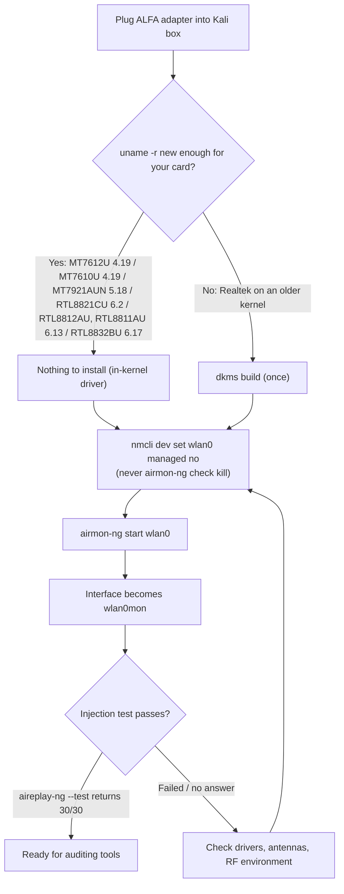

# ALFA Adapters on Kali Linux — Monitor Mode & Packet Injection

> **Learning Objectives**:  By the end of this guide you will have your ALFA adapter in **monitor mode** and **proven that packet injection works** — the two capabilities every Wi-Fi auditing tool (Aircrack-ng, Wifite, Wireshark, Bettercap) depends on.
> **Target Audience**: Beginner–intermediate, Kali users  | **Prerequisites**: Kali Linux installed (any recent version), internet access, your ALFA adapter.

## Concept: why Kali is different

Ubuntu treats Wi-Fi adapters as *polite clients*: they only capture their own traffic. Kali's whole toolchain — Aircrack-ng, Reaver, Wifite — assumes the adapter can do two extra things:

1. **Monitor mode** — capture *every* frame on a channel, not just your connection.
2. **Packet injection** — transmit raw crafted frames (deauth, probe requests, handshake replays).

Not every chipset can do both. On our GX10 tests (kernel 6.17) seven of the nine adapters did both (the ACHM injects on 2.4 GHz and only broadcast on 5 GHz); the **AWUS036AXM / AXML** capture in monitor mode but **failed injection**. When your kernel is new enough every adapter uses its in-kernel driver, so no driver installation is needed. DKMS is only for older kernels.

> **Note**: Kali/NetHunter were not tested on real hardware. The driver advice here is decided by kernel version only.

In-kernel start versions (from the Linux Kernel Driver Database): ACM (MT7612U) and ACHM (MT7610U) 4.19; AXM and AXML (MT7921AUN(N)) 5.18; EACS (RTL8821CU) 6.2; ACH (RTL8812AU) and ACS (RTL8811AU) 6.13; AX and AXER (RTL8832BU) 6.17. Check yours with `uname -r`. A current Kali rolling kernel is normally new enough for all nine; the ASUS GX10 (Ubuntu 24.04, kernel 6.17.0-1014-nvidia) had all nine working without DKMS.



## Prerequisites

- [ ] Kali Linux installed (not tested on real Kali hardware by us; check `uname -r` against the versions above)
- [ ] `sudo` access and an internet connection
- [ ] Your ALFA adapter — check the [compatibility matrix](/alfa-network/linux-compatibility-matrix/) first
- [ ] (Realtek models on an older kernel only: ACH / ACS below 6.13, EACS below 6.2, AX / AXER below 6.17) build tools: `sudo apt install -y build-essential dkms git`

## Step 1: Check what the kernel sees

Plug in the adapter and confirm it is detected:

```bash
lsusb | grep -iE "realtek|mediatek"
iw dev
```

**Expected output**: your adapter listed in `lsusb`, and at least one `Interface wlan0` (or `wlan1`) in `iw dev`.

## Step 2: Install the driver (only for Realtek on an older kernel)

If `uname -r` is at or above your card's in-kernel version (ACM / ACHM 4.19, AXM / AXML 5.18, EACS 6.2, ACH / ACS 6.13, AX / AXER 6.17), **skip to Step 3** — the driver is already in your kernel. Only on an older kernel, for the Realtek chipsets (ACH = RTL8812AU, ACS = RTL8811AU, EACS = RTL8821CU, AX / AXER = RTL8832BU), build the community-maintained driver with DKMS (aircrack-ng for RTL8812AU; morrownr for RTL8811AU and RTL8832BU). The MediaTek chipsets (ACM = MT7612U, ACHM = MT7610U, AXM / AXML = MT7921AUN(N)) never need DKMS.

### RTL8812AU (AWUS036ACH) — kernel < 6.13 only

```bash
sudo apt update
sudo apt install -y build-essential dkms git
cd /opt
sudo git clone https://github.com/aircrack-ng/rtl8812au.git
cd rtl8812au
sudo make dkms_install
```

**Expected output**: ends with `DKMS: install completed.`

> Why the aircrack-ng fork? Kali's kernel rolls fast, and the aircrack-ng maintainers update these drivers within days of every kernel release — essential on a rolling distro. The [RTL8812AU driver page](/alfa-network/drivers/rtl8812au/) has the deep dive.

### RTL8811AU (AWUS036ACS) — kernel < 6.13 only

```bash
cd /opt
sudo git clone https://github.com/morrownr/8821au-20210708.git
cd 8821au-20210708
sudo sh install-driver.sh
```

### RTL8832BU (AWUS036AX / AWUS036AXER) — kernel < 6.17 only

```bash
cd /opt
sudo git clone https://github.com/morrownr/rtl8852bu-20250826.git
cd rtl8852bu-20250826
sudo sh install-driver.sh
```

Re-plug the adapter (or `sudo modprobe <module>`) and confirm an interface appears: `iw dev`.

> The in-kernel `rtw89_8852bu` driver (AWUS036AX / AXER, kernel ≥ 6.17) supports monitor mode with strong reception and injection (96 % / 73 % on 2.4 GHz in our tests). Monitor-mode behavior of the older community DKMS driver was not tested by us. For the best injection rates use the AWUS036EACS or AWUS036ACH (100 % on both bands).

## Step 3: Keep NetworkManager away from the adapter (do not run `airmon-ng check kill`)

NetworkManager can fight for control of the Wi-Fi interface. **Do not run `airmon-ng check kill`**: it kills NetworkManager and wpa_supplicant and drops your whole network connection. Instead, tell NetworkManager to ignore only the ALFA interface:

```bash
sudo nmcli dev set wlan0 managed no
nmcli dev status
```

**Expected output**: the ALFA interface is listed as `unmanaged`; your other connections stay up.

> ⚠️ Operate only on the ALFA adapter's interface (on the GX10 it is named `wlx` + MAC); never touch the built-in Wi-Fi. When you are done, give the interface back with `sudo nmcli dev set wlan0 managed yes`.

## Step 4: Start monitor mode

```bash
sudo airmon-ng start wlan0
```

(Replace `wlan0` with your interface name from Step 1.)

**Expected output**:

```text
PHY	Interface	Driver		Chipset
phy0	wlan0		mt76x2u		MediaTek Inc. MT7612U
		(mac80211 monitor mode vif enabled for [phy0]wlan0 on [phy0]wlan0mon)
		(mac80211 station mode vif disabled for [phy0]wlan0)
```

Your interface is now **wlan0mon**. Verify:

```bash
iwconfig
```

**Expected output**: `wlan0mon  IEEE 802.11  Mode:Monitor  ...`

## Step 5: Prove packet injection works

Injection is the skill-check of every Wi-Fi adapter. Run the Aircrack-ng self-test against nothing (it broadcasts):

```bash
sudo aireplay-ng --test wlan0mon
```

**Expected output**:

```text
12:34:56  Trying broadcast probe requests...
12:34:56  Injection is working!
12:34:56  Found 1 AP
12:34:56  30/30:  100%
```

**`30/30: 100%`** — that is the magic line. It means the adapter injected 30 probe requests and heard all 30, proving both TX and RX work on monitor mode. If you see `Failed` or a low percentage, the adapter is not actually injecting — see the common errors table below. On the MT7921 cards (AWUS036AXM / AXML) this test shows `Found 0 APs` / `No Answer` on stock kernel 6.17: that is the known injection failure, not a mistake in your setup.

## Step 6: Point your tools at it

A quick end-to-end sanity check — capture and count frames for 10 seconds:

```bash
sudo timeout 10 tcpdump -i wlan0mon -c 100
```

**Expected output**: `100 packets captured` (or however many arrived within 10 s — seeing *any* 802.11 frames proves capture works).

When done, return the adapter to normal mode:

```bash
sudo airmon-ng stop wlan0mon
sudo nmcli dev set wlan0 managed yes
```

## Common errors (FAQ)

| Error / symptom | Cause | Fix |
|---|---|---|
| `airmon-ng start` says `No such device` | Interface name is `wlan1` or the driver isn't loaded | Run `iw dev` to find the real name; `sudo modprobe <module>` for Realtek |
| `aireplay-ng --test` → `No such device` | You are still on `wlan0`, not `wlan0mon` | Re-check `iwconfig`; restart monitor mode from Step 4 |
| `Injection is working!` but `0/30` replies | Adapter TX works but RX filter broken (common on some Realtek drivers) | Try channel lock: `sudo iw wlan0mon set channel 6`; retest; upgrade the DKMS driver |
| DKMS build fails with "No rule to make target" | Kali kernel too new for the repo snapshot | `cd /opt/rtl8812au && sudo git pull && sudo make dkms_install` |
| Monitor mode dies after a few minutes | USB power saving / thermal throttle | Use a powered USB hub or USB 3.0 port; `sudo iwconfig wlan0mon txpower 20` |
| `airmon-ng` warns that processes "could cause trouble" | NetworkManager / wpa_supplicant are running | Do **not** run `airmon-ng check kill` (it kills NetworkManager and your network); use `sudo nmcli dev set wlan0 managed no` instead |
| `aireplay-ng --test` shows `Found 0 APs` / `No Answer` on an AWUS036AXM / AXML | Known injection failure of the MT7921 cards on stock kernel 6.17 (mac80211 chanctx regression since 6.16) | Use another card for injection (EACS, ACH, ACS, ACM, AX, AXER); AXM / AXML are fine as AP or client |
| Adapter works in managed mode but `monitor` not listed in `iw` | Driver built without monitor support | Rebuild with aircrack-ng repos (they enable monitor + VIF) |

> **You might be wondering** — *"Is it legal to capture this stuff?"* Monitor mode and injection are technical capabilities, not a license. In most jurisdictions, capturing or injecting on networks you do not own or lack permission to test is illegal. Every course lab assumes you test on **your own AP or a lab network**. Keep it there.

## References

- [Ubuntu version of this guide](/alfa-network/linux-setup-ubuntu/) — client-mode setup
- [NetHunter guide](/alfa-network/linux-setup-nethunter/) — same workflow on Android
- [Chipset driver pages](/alfa-network/drivers/rtl8812au/) — per-chipset details and troubleshooting
- [Troubleshooting index](/alfa-network/troubleshooting/)
- [Aircrack-ng docs](https://www.aircrack-ng.org/doku.php) — official tool documentation
