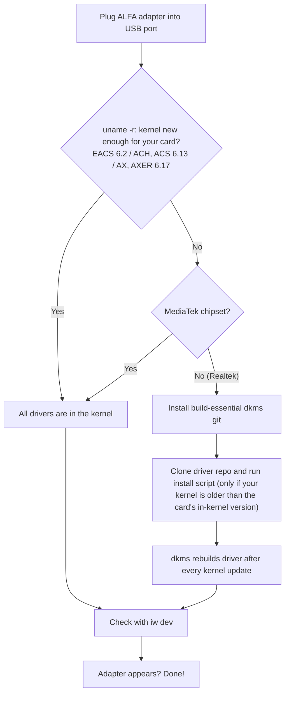

# ALFA Adapters on Ubuntu — Complete Setup Guide

> **Learning Objectives**: By the end of this guide you will have your ALFA adapter visible in Ubuntu (`iw dev`), connected to Wi-Fi, and — for the supported chipsets — able to switch into monitor mode.
> **Target Audience**: Beginner–intermediate | **Prerequisites**: Ubuntu 24.04 LTS (GA kernel 6.8 covers ACM, ACHM, AXM, AXML, EACS; HWE 6.14 adds ACH, ACS; AX and AXER need **kernel 6.17 or newer**; tested on ASUS GX10, Ubuntu 24.04 ARM64, kernel 6.17.0-1014-nvidia, 2026-11-16 to 2026-11-19), an internet connection, and your ALFA adapter. On kernels older than the card's in-kernel version, the Realtek models additionally need DKMS (EACS < 6.2, ACH / ACS < 6.13, AX / AXER < 6.17).

## Concept: two worlds, split by kernel version

Before touching the terminal, understand *why* the setup can differ. The split is by **kernel version**, not by adapter:

1. **Kernel 6.17 or newer: everything is in-kernel.** All nine ALFA adapters are plug-and-play (each card's own minimum: ACM / ACHM 4.19, AXM / AXML 5.18, EACS 6.2, ACH / ACS 6.13, AX / AXER 6.17). MediaTek: **MT7612U** (AWUS036ACM, `mt76x2u`), **MT7610U** (AWUS036ACHM, `mt76x0u`), **MT7921AU/AUN** (AWUS036AXM / AXML, `mt7921u`). Realtek: **RTL8812AU** (ACH, `rtw88_8812au`), **RTL8811AU** (ACS, `rtw88_8821au`), **RTL8821CU** (EACS, `rtw88_8821cu`), **RTL8832BU** (AX / AXER, `rtw89_8852bu`). No DKMS.
2. **Older kernel: only the Realtek models whose in-kernel version is newer than your kernel need DKMS.** The MediaTek models stay in-kernel (mt76x2u / mt76x0u since 4.19, mt7921u since 5.18), and so does the EACS from 6.2. For the other Realtek models you compile a community driver once, and **DKMS** keeps it rebuilt after every kernel update.



## Prerequisites

- [ ] Ubuntu 24.04 LTS with a kernel at or above your card's in-kernel version (check with `lsb_release -a` and `uname -r`; GA 6.8 covers ACM, ACHM, AXM, AXML, EACS; HWE 6.14 adds ACH, ACS; the GX10's `6.17.0-1014-nvidia` covers all nine). Older kernel: see Step 3.
- [ ] Working internet (Wi-Fi or Ethernet) — only needed for DKMS builds or package updates
- [ ] Your ALFA adapter and a USB-A or USB-C cable (AXML uses USB-C)
- [ ] `sudo` access

## Step 1: Identify your chipset

Plug the adapter in, then ask Ubuntu what it sees:

```bash
uname -r
lsusb
```

**Expected output** (look for the MediaTek / Realtek line):

```text
6.17.0-1014-nvidia
Bus 001 Device 004: ID 0e8d:7612 MediaTek Inc. MT7612U 802.11a/b/g/n/ac 2T2R Wireless Adapter
Bus 001 Device 005: ID 0bda:8812 Realtek Semiconductor Corp. RTL8812AU 802.11a/b/g/n/ac 2T2R Wireless Adapter
```

- `0e8d` = MediaTek (in-kernel on every supported kernel)
- `0bda` = Realtek (in-kernel on a new enough kernel: EACS ≥ 6.2, ACH / ACS ≥ 6.13, AX / AXER ≥ 6.17; DKMS on older kernels)
- Not sure? Cross-check the chipset table in the [compatibility matrix](/alfa-network/linux-compatibility-matrix/).

## Step 2: The in-kernel path (kernel at or above your card's in-kernel version, or any MediaTek adapter)

Nothing to install. Verify:

```bash
iw dev
```

**Expected output**:

```text
phy#0
	Interface wlan0
		ifindex 3
		addr 00:c0:ca:xx:xx:xx
		type managed
```

(On the GX10 the interface is named `wlx` + MAC, e.g. `wlx00c0cabf874c`.) See the interface? The driver is live. Connect via the desktop Wi-Fi menu or NetworkManager:

```bash
nmcli device wifi connect "MySSID" password "my-passphrase"
```

**Expected output**: `Device '<interface>' successfully activated with 'MySSID'.`

Skip ahead to [Step 4: verify](#step-4-verify-everything).

## Step 3: The DKMS path (Realtek, only on a kernel older than the card's in-kernel version)

**Only follow this step if `uname -r` shows a kernel older than your card's in-kernel version (ACH / ACS < 6.13, EACS < 6.2, AX / AXER < 6.17)**. On a new enough kernel skip it — the in-kernel `rtw88` / `rtw89` drivers are used automatically, and installing an out-of-tree driver on top of them is unnecessary. The pattern is the same for all: install tools, clone the repo, run the installer.

### 3.1 Install the build tools

```bash
sudo apt update
sudo apt install -y build-essential dkms git
```

**Expected output**: ends with `Setting up dkms ...` and no errors. DKMS is the piece that will recompile the driver after kernel updates.

### 3.2 RTL8812AU (AWUS036ACH) — kernel < 6.13 only

```bash
cd /opt
sudo git clone https://github.com/aircrack-ng/rtl8812au.git
cd rtl8812au
sudo make dkms_install
```

**Expected output**:

```text
DKMS: install completed.
```

The module is now `8812au` and DKMS will rebuild it on every kernel update.

### 3.3 RTL8811AU (AWUS036ACS) — kernel < 6.13 only

```bash
cd /opt
sudo git clone https://github.com/morrownr/8821au-20210708.git
cd 8821au-20210708
sudo sh install-driver.sh
```

**Expected output**: the script builds and installs the driver with DKMS (answer its prompts and reboot when it asks) — module name `8821au`.

### 3.4 RTL8832BU (AWUS036AX / AWUS036AXER) — kernel < 6.17 only

```bash
cd /opt
sudo git clone https://github.com/morrownr/rtl8852bu-20250826.git
cd rtl8852bu-20250826
sudo sh install-driver.sh
```

**Expected output**: the script builds and installs the driver with DKMS (answer its prompts and reboot when it asks) — module name `8852bu`. Monitor-mode behavior of this community driver was not tested by us; the in-kernel `rtw89_8852bu` (kernel ≥ 6.17) was tested and supports monitor mode and injection.

### 3.5 RTL8821CU (AWUS036EACS) — kernel < 6.2 only

Only an unstable community driver exists for kernels below 6.2 (see the [RTL8821CU driver page](/alfa-network/drivers/rtl8821cu/)). Upgrading to kernel 6.2+ (Ubuntu 24.04 GA 6.8 already qualifies) and using the in-kernel `rtw88_8821cu` is strongly preferred.

### 3.6 Re-plug and check

Unplug and re-plug the adapter (or run `sudo modprobe <module>`), then verify:

```bash
iw dev
```

**Expected output**: an `Interface wlan1` (or `wlan0` if it is your only adapter) line appears.

> **You might be wondering** — *"Which module name corresponds to my adapter?"* On an older kernel with DKMS: `8812au` → AWUS036ACH, `8821au` → AWUS036ACS, `8852bu` → AWUS036AX / AXER. The [driver pages](/alfa-network/drivers/rtl8812au/) have deeper per-chipset details.

## Step 4: Verify everything {#step-4-verify-everything}

A health check:

```bash
ip link show | grep -E "^[0-9]+: wl"        # interface exists?
iw dev                                       # interface + phy info
iw reg get | head -20                        # regulatory domain (affects power/channels)
```

**Expected output**:

```text
3: wlx00c0cabf874c: <BROADCAST,MULTICAST,UP,LOWER_UP> mtu 1500 qdisc mq state UP
phy#1
	Interface wlx00c0cabf874c
		ifindex 3
		addr 00:c0:ca:xx:xx:xx
		type managed
```

All three commands producing output = your ALFA adapter is fully operational.

## Advanced: monitor mode

Monitor mode lets the adapter capture every packet on a channel instead of only its own connection. Verified monitor on 2.4 and 5 GHz on the GX10: ACM, ACHM, ACH, ACS, EACS, AX, AXER (strong reception on AX / AXER), and AXM / AXML (weak reception). Use `iw`:

```bash
IF=$(ls /sys/class/net | grep '^wlx' | head -1)
sudo nmcli dev set $IF managed no
sudo ip link set $IF down
sudo iw $IF set monitor none
sudo ip link set $IF up
iw dev
```

**Expected output**: `type monitor` instead of `type managed`.

> ⚠️ **Do not run `airmon-ng check kill`** on a GX10 or any desktop that relies on NetworkManager — it shuts NetworkManager down and drops your network. Operate only on the ALFA adapter's `wlx...` interface.

> ⚠️ **Important**: `type managed` (the default) means the driver filters everything not addressed to you. `type monitor` disables that filter — a huge amount of traffic suddenly becomes visible. Only run this on networks you own or have explicit permission to test. Note that the MT7921 cards (AWUS036AXM / AXML) did **not** pass packet injection on stock kernel 6.17. See the [Kali guide](/alfa-network/linux-setup-kali/) for the full packet-injection workflow.

### Platform notes (ASUS GX10 / Ubuntu ARM64)

- aircrack-ng must be compiled from source on ARM64.
- `hcxdumptool` 8.x failed to arm on every card except the EACS, which armed on 2.4 GHz but not on 5 GHz (it needs active monitor); use `airodump-ng` + `aireplay-ng`.
- Before 5 GHz injection run `sudo iw reg set US`, and restore your region afterwards.

## Common errors (FAQ)

| Error / symptom | Cause | Fix |
|---|---|---|
| `lsusb` shows the adapter but no `wlanX` / `wlx...` interface | Kernel older than the card's in-kernel version with a Realtek card and no DKMS module (or a composite WiFi+BT device that failed to probe) | New enough kernel: re-plug, try a different USB port (EACS / AXML). Older kernel: `sudo modprobe 8812au` (match your chipset), then `dmesg \| tail` |
| (Older kernel only) `make dkms_install` fails with "Kernel preparation unnecessary" | Missing kernel headers | `sudo apt install linux-headers-$(uname -r)` and retry |
| (Older kernel only) Adapter disappears after `apt upgrade` | Kernel updated, DKMS rebuild failed silently | `sudo dkms autoinstall` then reboot |
| (Older kernel only) `iw dev` shows nothing after reboot (Realtek) | Module not in auto-load list | `echo 8812au \| sudo tee /etc/modules-load.d/alfa.conf` |
| Wi-Fi 6E adapter (AXML) not detected on 20.04 | Kernel too old for `mt7921u` | Upgrade Ubuntu / kernel (5.18+ is enough for the AXML) |
| Capture stops receiving after many mode switches | RX stall | Unplug and replug the adapter |

## References

- [Kali Linux version of this guide](/alfa-network/linux-setup-kali/) — monitor mode + packet injection
- [Chipset driver pages](/alfa-network/drivers/mt7612u/) — deep dives per chipset
- [Troubleshooting index](/alfa-network/troubleshooting/) — anything else that goes wrong
- [Compatibility matrix](/alfa-network/linux-compatibility-matrix/) — full OS coverage table
- Legacy driver repos (older kernels only): [rtl8812au](https://github.com/aircrack-ng/rtl8812au), [8821au-20210708](https://github.com/morrownr/8821au-20210708) (RTL8811AU), [rtl8852bu-20250826](https://github.com/morrownr/rtl8852bu-20250826) (RTL8832BU)
