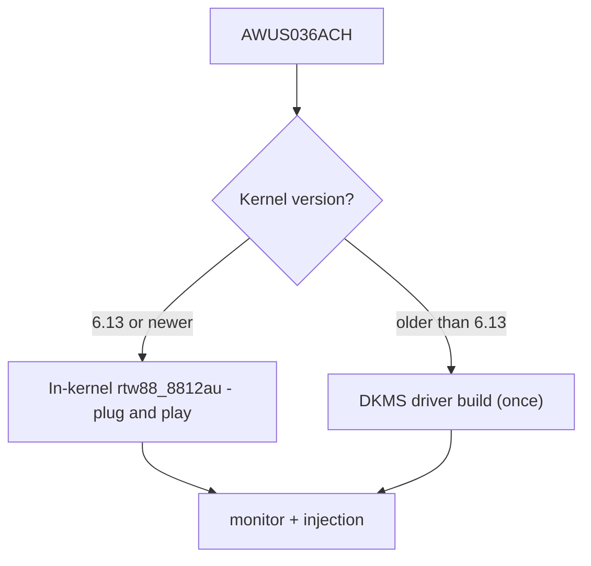

# ALFA AWUS036ACH — High Power AC1200

> **Quick Summary**: The **AWUS036ACH** is ALFA's most famous adapter — a **high-power RTL8812AU AC1200 dual-band** USB 3.0 dongle with two 5 dBi external antennas. On **kernel 6.13 or newer** it is supported by the in-kernel `rtw88_8812au` driver: plug it in and go, no DKMS. Tested on ASUS GX10 / Ubuntu 24.04 ARM64: monitor and injection (100 %) on both bands, end-to-end handshake capture, WPA3 AP (2.4 GHz). Only older kernels (< 6.13) need the community DKMS driver. Use only on your own or authorized networks.

## Specifications Overview (Spec overview)

| Item | Spec |
|---|---|
| Chipset | Realtek RTL8812AU |
| Wi-Fi class | AC1200 (300 + 867 Mbps) |
| Interface | USB 3.0 |
| Bands | 2.4 + 5 GHz |
| Antenna | 2 × external 5 dBi, RP-SMA |
| TX power | High power (500 mW class) |
| Linux driver | `rtw88_8812au` — **in-kernel on kernel ≥ 6.13**; older kernels (< 6.13): community `rtl8812au` DKMS |
| Monitor mode | ✅ 2.4 + 5 GHz (tested on GX10) |
| Packet injection | ✅ 100 % on 2.4 and 5 GHz (tested on GX10) |

## Tested on ASUS GX10 / Ubuntu 24.04 ARM64

**Test environment**: ASUS Ascent GX10 (NVIDIA GB10), Ubuntu 24.04 LTS ARM64, kernel `6.17.0-1014-nvidia`, tested 2026-11-16 to 2026-11-19 against an iPhone 7 Plus (WPA3 also with an iPhone 15 Pro).

| Item | Result |
|---|---|
| Chipset | Realtek RTL8812AU |
| USB ID | `0bda:8812` |
| Kernel driver | `rtw88_8812au` (in-kernel) |
| Firmware | `rtw88/rtw8812a_fw.bin` (linux-firmware) |
| DKMS needed? | No (kernel ≥ 6.13: not needed) |

| Feature | 2.4 GHz | 5 GHz |
|---|---|---|
| Monitor | ✅ | ✅ |
| Injection | ✅ 100 % | ✅ 100 % |
| AP | ✅ | ✅ |
| WPA3-SAE (AP side, `sae_pwe=0`) | ✅ | Not tested |

| Advanced feature | Result |
|---|---|
| WPA handshake capture | ✅ end-to-end (converted to `.22000`) |
| VIF | ✅ STA + monitor |
| Active monitor | ❌ `Operation not supported (-95)` |
| IBSS (ad-hoc) | 🟡 single-device only |
| Mesh (802.11s) | ❌ `-95` |
| Wi-Fi Direct (P2P) | ❌ `-95` |

Verify on your own machine:

```bash
lsusb | grep 0bda:8812
lsusb -t | grep rtw88_8812au
sudo dmesg | grep -iE 'rtw88_8812au|8812' | tail -5
iw phy $(cat /sys/class/net/$(ls /sys/class/net | grep '^wlx' | head -1)/phy80211/name) info | sed -n '/Supported interface modes/,/Band 1/p'
iw dev
```

Full test report: [AWUS036ACH on ASUS GX10 / Ubuntu](https://yupitek.com/en/blog/awus036ach-asus-gx10-ubuntu-test-report/).

**Notes**:
- Plug it into a USB 3.0 port directly (`5000M` in `lsusb -t`), not a USB 2.0 hub.
- 5 GHz RX can stall after repeated mode or regulatory-domain changes (0 packets, only a replug recovers it). Do the 5 GHz tests right after plugging in.
- For 5 GHz injection run `sudo iw reg set US` first and restore your region afterwards.
- AP: disabling 802.11n (pure g / pure a) worked first time with the iPhone 7 Plus. WPA3 needs `sae_pwe=0` for the iPhone 7 Plus.
- 6 GHz: not applicable. Kali and NetHunter: not tested on real hardware.

## Overview

The AWUS036ACH is the adapter that built the "hacker adapter" reputation for ALFA. It pairs the workhorse **RTL8812AU** radio with a genuinely **high-power (500 mW) front-end** and two replaceable 5 dBi antennas, wrapped in the yellow/black ALFA shell you recognize instantly. Years of aircrack-ng community hardening sit behind it, and on kernel 6.13+ that work has landed in the mainline `rtw88_8812au` driver.

On older kernels the RTL8812AU is **not in the Linux kernel**, so a one-time DKMS build is needed — that is the difference between this card on an old OS and the plug-and-play [AWUS036ACM](/alfa-network/products/awus036acm/).

## Install & drivers

**Kernel 6.13 or newer (e.g. Ubuntu 24.04 + HWE 6.14 / GX10 6.17)**: nothing to install. The in-kernel `rtw88_8812au` binds automatically — verify with the commands in the tested section above, or see the [RTL8812AU driver page](/alfa-network/drivers/rtl8812au/).

### Older kernels (< 6.13 only): DKMS

The following build is **only for kernels older than 6.13**. Full walkthrough on the [RTL8812AU driver page](/alfa-network/drivers/rtl8812au/):

```bash
sudo apt install -y build-essential dkms git
cd /opt && sudo git clone https://github.com/aircrack-ng/rtl8812au.git
cd rtl8812au && sudo make dkms_install
sudo modprobe 8812au
```

**Expected output**: `DKMS: install completed.` then an interface in `iw dev`. (This older-kernel path was not run on the GX10.)



## Advanced usage

### Monitor mode + injection

Do not run `airmon-ng check kill` on a GX10/desktop (it stops NetworkManager); use `iw`:

```bash
IF=$(ls /sys/class/net | grep '^wlx' | head -1)
sudo nmcli dev set $IF managed no
sudo ip link set dev $IF down
sudo iw dev $IF set type monitor
sudo ip link set dev $IF up
sudo iw dev $IF set channel 6
sudo aireplay-ng --test --ignore-negative-one $IF
```

**Expected output**: `Injection is working!` and `30/30: 100%`. (`--ignore-negative-one` works around the channel `-1` report seen while a station interface is up; for 5 GHz run `sudo iw reg set US` first.)

### Replace the antennas for more range

The RP-SMA ports accept any [ALFA antenna](/alfa-network/products/apa-m25/) — upgrading to a panel or a higher-gain dipole boosts what the 500 mW radio can reach.

## Compatibility

| Platform | Support | Notes |
|---|---|---|
| Ubuntu 24.04 ARM64 (GX10, kernel 6.17) | ✅ Tested | In-kernel `rtw88_8812au`, no DKMS |
| Linux kernel ≥ 6.13 | ✅ | In-kernel |
| Linux kernel < 6.13 (older Ubuntu/Kali) | 🔧 | Community DKMS driver required |
| Kali Linux | ✅ (not tested on real hardware by us) | In-kernel on kernel ≥ 6.13 |
| NetHunter / Android | 🔧 | Not tested; depends on the phone kernel |
| Windows | Not tested by us | Official driver from ALFA |
| macOS | Not tested by us | Driver needed; Apple Silicon limited |

## Troubleshooting

| Symptom | Cause | Fix |
|---|---|---|
| (Kernel < 6.13 only) DKMS build fails | New kernel vs stale repo | `cd /opt/rtl8812au && sudo git pull && sudo make dkms_install` |
| (Kernel < 6.13 only) Adapter only in managed mode | Kernel stub grabbed it | Blacklist the conflicting module (see [driver page](/alfa-network/drivers/rtl8812au/)) |
| 5 GHz capture shows 0 packets | RX stall after many mode/regdomain changes | Unplug and replug the adapter |
| Injection 0/30 | Empty channel | `sudo iw $IF set channel 6`; test near an AP |
| 5 GHz injection blocked | Regulatory domain | `sudo iw reg set US`, restore afterwards |
| (Kernel < 6.13 only) Vanishes after reboot | Module not auto-loaded | Add `8812au` to `/etc/modules-load.d/alfa.conf` |

## Related resources

- [RTL8812AU driver page](/alfa-network/drivers/rtl8812au/) — setup + deep troubleshooting
- [Kali setup guide](/alfa-network/linux-setup-kali/)
- [AWUS036ACM](/alfa-network/products/awus036acm/) — the MediaTek in-kernel alternative
- [Adapter comparison](/alfa-network/wifi-adapter-comparison/)
- [Compatibility matrix](/alfa-network/linux-compatibility-matrix/)
