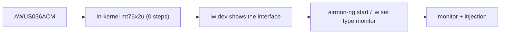

# ALFA AWUS036ACM — The Classic All-Rounder (MT7612U)

> **Quick Summary**: The **AWUS036ACM** is the community's default recommendation: a **high-power MT7612U AC1200** dual-band adapter whose driver (`mt76x2u`) is **built into the Linux kernel**. No DKMS, no compilation — plug it in on Kali or Ubuntu and monitor mode just works. Verified on ASUS GX10 / Ubuntu 24.04 ARM64 (kernel 6.17): monitor and injection on 2.4 and 5 GHz, AP mode, a WPA3-SAE AP (AP side only; WPA3 client not tested) and an end-to-end WPA handshake capture all passed. Use only on your own or authorized networks.

## Specifications Overview (Spec overview)

| Item | Spec |
|---|---|
| Chipset | MediaTek MT7612U |
| Wi-Fi class | AC1200 (300 + 867 Mbps) |
| Interface | USB 3.0 |
| Bands | 2.4 + 5 GHz |
| Antenna | 2 × external 5 dBi, RP-SMA |
| TX power | 19–23 dBm depending on mode (about 100–200 mW), per ALFA's spec sheet |
| Linux driver | `mt76x2u` — **in-kernel since 4.19** |
| Monitor mode | ✅ 2.4 + 5 GHz (tested on GX10) |
| Packet injection | ✅ 2.4 GHz 63–83 %, 5 GHz 76 % (tested on GX10) |

## Tested on ASUS GX10 / Ubuntu 24.04 ARM64

**Test environment**: ASUS Ascent GX10 (NVIDIA GB10), Ubuntu 24.04 LTS ARM64, kernel `6.17.0-1014-nvidia`, tested 2026-11-16 to 2026-11-19 against an iPhone 7 Plus (WPA3 also with an iPhone 15 Pro).

| Item | Result |
|---|---|
| Chipset | MediaTek MT7612U |
| USB ID | `0e8d:7612` |
| Kernel driver | `mt76x2u` (in-kernel) |
| Firmware | `mt7662.bin` + `mt7662_rom_patch.bin` (linux-firmware) |
| DKMS needed? | No (kernel ≥ 4.19: not needed) |

| Feature | 2.4 GHz | 5 GHz |
|---|---|---|
| Monitor | ✅ | ✅ |
| Injection | ✅ 63–83 % | ✅ 76 % |
| AP | ✅ | ✅ (80 MHz) |
| WPA3-SAE (AP side) | ✅ | Not tested |

| Advanced feature | Result |
|---|---|
| WPA handshake capture | ✅ end-to-end on our own network (deauth own iPhone 7 Plus, full 4-way M1–M4, converted to hashcat `.22000`) |
| VIF | ✅ STA+AP / AP+monitor |
| Active monitor | 🟡 can be configured, ACKs not verified |
| IBSS (ad-hoc) | 🟡 single-device only |
| Mesh (802.11s) | 🟡 single-device only |
| Wi-Fi Direct (P2P) | Not tested (needs a second device) |

Verify on your own machine:

```bash
lsusb | grep 0e8d:7612
sudo dmesg | grep mt76x2u | tail -3
iw phy $(cat /sys/class/net/$(ls /sys/class/net | grep '^wlx' | head -1)/phy80211/name) info | sed -n '/Supported interface modes/,/Band 1/p'
iw dev
```

Full test report: [AWUS036ACM on ASUS GX10 / Ubuntu](https://yupitek.com/en/blog/awus036acm-asus-gx10-ubuntu-test-report/).

**Notes**:
- Known quirk: if you connected the adapter to Wi-Fi first and then switched to monitor mode, only the last-used channel was received. Unplug and replug before switching to monitor mode.
- AP on 2.4 GHz works at 20 MHz; HT40 failed to connect in testing.
- On the GX10, `hcxdumptool` 8.x failed to arm (it needs active monitor) — use `airodump-ng` + `aireplay-ng`.
- 6 GHz: not applicable (2.4/5 GHz card). Kali and NetHunter: not tested on real hardware.

## Overview

The AWUS036ACM takes everything the [AWUS036ACH](/alfa-network/products/awus036ach/) is famous for — 2×2 AC1200, high power, dual-band, two external antennas — and removes the one thing that annoyed students about it on older kernels: the **DKMS driver build**. The ACM's MT7612U is a full citizen of the Linux kernel, so:

- Plug in → a `wlx…` (or `wlan0`) interface appears. Zero commands.
- No DKMS → nothing breaks when your kernel updates.
- Monitor mode + injection → work through the stock `mac80211` tooling.

That combination is why it is the answer to "I'm a student, I want one adapter for my security course, I don't want a fight with my OS" — and why this whole wiki uses it as the reference adapter in the [Ubuntu](/alfa-network/linux-setup-ubuntu/) and [Kali](/alfa-network/linux-setup-kali/) guides.

## Install & drivers

Nothing to install — see the [MT7612U driver page](/alfa-network/drivers/mt7612u/) for full details. Quick verify:

```bash
lsusb | grep -i mediatek
iw dev
```

**Expected output**:

```text
Bus 003 Device 003: ID 0e8d:7612 MediaTek Inc. MT7612U 802.11a/b/g/n/ac Wireless Adapter
phy#0
	Interface wlx00c0cabf874c
		ifindex 3
		addr 00:c0:ca:xx:xx:xx
		type managed
```

(The `00:c0:ca` prefix is ALFA's MAC OUI — a handy lab-identification trick. On the GX10 the interface is named `wlx` + MAC, e.g. `wlx00c0cabf874c`.)



## Advanced usage

### Monitor mode + injection

On the GX10, do **not** run `airmon-ng check kill` (it stops NetworkManager); use `iw` instead:

```bash
IF=$(ls /sys/class/net | grep '^wlx' | head -1)
sudo nmcli dev set $IF managed no
sudo ip link set dev $IF down
sudo iw dev $IF set type monitor
sudo ip link set dev $IF up
sudo iw dev $IF set channel 6
sudo aireplay-ng --test $IF
```

**Expected output**: `Injection is working!` (measured 63–83 % on 2.4 GHz, 76 % on 5 GHz).

### Antenna upgrades

Two RP-SMA ports mean you can run a [panel](/alfa-network/products/apa-m25/) for focused long links, or twin high-gain dipoles for omni coverage — and the 2×2 radio will actually use both streams.

### Wireshark capture rig

Combine with the [Raspberry Pi guide](/alfa-network/hardware/raspberry-pi/) to build a headless always-on capture station.

## Compatibility

| Platform | Support | Notes |
|---|---|---|
| Ubuntu 24.04 ARM64 (GX10, kernel 6.17) | ✅ Tested | In-kernel, plug & play |
| Kali Linux | ✅ In-kernel (not tested on real hardware by us) | Zero-setup expected |
| Ubuntu (other versions) | ✅ | In-kernel since mt76x2u 4.19 |
| NetHunter / Android | ✅ In-kernel (not tested on real hardware by us) | The standard NetHunter adapter |
| Windows | Not tested by us | Official driver from ALFA |
| Raspberry Pi / Jetson | Not tested by us | In-kernel driver; only the GX10 was tested |

## Troubleshooting

| Symptom | Cause | Fix |
|---|---|---|
| Not in `lsusb` | Power / cable | Different port / powered hub — [troubleshooting](/alfa-network/troubleshooting/) |
| No interface | Driver not loaded (rare) | `sudo modprobe mt76x2u`; check `dmesg \| grep mt76` |
| Monitor sees only one channel | Adapter was connected to Wi-Fi before switching to monitor | Unplug and replug, then switch to monitor |
| Injection 0/30 | Empty channel / dead RF zone | `sudo iw $IF set channel 6`; test near an AP |
| Scan/monitor stops receiving after many mode switches | RX stall | Unplug and replug |
| WLAN dies on suspend/resume | Known laptop USB quirk | Unplug/replug after resume |

## Related resources

- [MT7612U driver page](/alfa-network/drivers/mt7612u/)
- [Kali setup guide](/alfa-network/linux-setup-kali/)
- [Ubuntu setup guide](/alfa-network/linux-setup-ubuntu/)
- [NetHunter setup guide](/alfa-network/linux-setup-nethunter/)
- [AWUS036AXM](/alfa-network/products/awus036axm/) — the Wi-Fi 6 upgrade (no injection on the tested kernel; Bluetooth not tested)
- [Adapter comparison](/alfa-network/wifi-adapter-comparison/)
