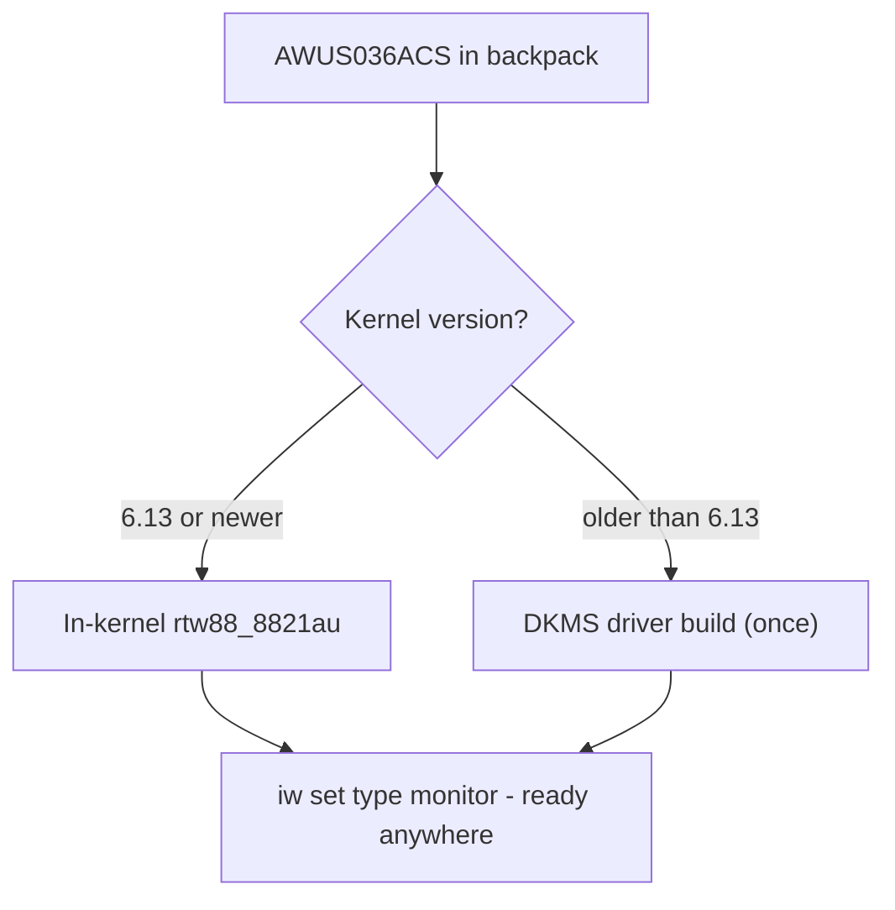

# ALFA AWUS036ACS — Pocket-Size Dual-Band AC600

> **Quick Summary**: The **AWUS036ACS** is the 55 mm pocket ALFA — an **RTL8811AU AC600** dual-band adapter with one fold-out 2 dBi antenna. On **kernel 6.13 or newer** it uses the in-kernel `rtw88_8821au` driver (no DKMS); tested on ASUS GX10 / Ubuntu 24.04 ARM64 with monitor, injection (100 % on 2.4 GHz, 96 % on 5 GHz), AP, a WPA3 AP (5 GHz, AP side only) and end-to-end handshake capture. Only older kernels (< 6.13) need a DKMS build. Use only on your own or authorized networks.

## Specifications Overview (Spec overview)

| Item | Spec |
|---|---|
| Chipset | Realtek RTL8811AU |
| Wi-Fi class | AC600 (150 + 433 Mbps) |
| Interface | USB 2.0 |
| Bands | 2.4 + 5 GHz |
| Antenna | 1 × external 2 dBi dual-band dipole, RP-SMA |
| Body | ~55 mm — pocket sized |
| Linux driver | `rtw88_8821au` — **in-kernel on kernel ≥ 6.13**; older kernels (< 6.13): community `8821au` DKMS |
| Monitor mode | ✅ 2.4 + 5 GHz (tested on GX10) |
| Packet injection | ✅ 2.4 GHz 100 %, 5 GHz 96 % (tested on GX10) |

## Tested on ASUS GX10 / Ubuntu 24.04 ARM64

**Test environment**: ASUS Ascent GX10 (NVIDIA GB10), Ubuntu 24.04 LTS ARM64, kernel `6.17.0-1014-nvidia`, tested 2026-11-16 to 2026-11-19 against an iPhone 7 Plus (WPA3 also with an iPhone 15 Pro).

| Item | Result |
|---|---|
| Chipset | Realtek RTL8811AU |
| USB ID | `0bda:0811` |
| Kernel driver | `rtw88_8821au` (in-kernel) |
| Firmware | 42.4.0 (H2C version 0, from `dmesg`) |
| DKMS needed? | No (kernel ≥ 6.13: not needed) |

| Feature | 2.4 GHz | 5 GHz |
|---|---|---|
| Monitor | ✅ | ✅ |
| Injection | ✅ 100 % | ✅ 96 % |
| AP | ✅ | ✅ (channel width not confirmed) |
| WPA3-SAE (AP side) | Not tested | ✅ |

| Advanced feature | Result |
|---|---|
| WPA handshake capture | ✅ end-to-end (converted to `.22000`) |
| VIF | ✅ |
| Active monitor | ❌ `Operation not supported (-95)` |
| IBSS (ad-hoc) | ❌ listed by `iw` but join failed |
| Mesh (802.11s) | ❌ `-95` |
| Wi-Fi Direct (P2P) | ❌ `-95` |

Verify on your own machine:

```bash
lsusb | grep -i 0bda:0811
sudo dmesg | grep -i 8821au
iw phy $(cat /sys/class/net/$(ls /sys/class/net | grep '^wlx' | head -1)/phy80211/name) info | sed -n '/Supported interface modes/,/Band 1/p'
iw dev
```

Full test report: [AWUS036ACS on ASUS GX10 / Ubuntu](https://yupitek.com/en/blog/awus036acs-asus-gx10-ubuntu-test-report/).

**Notes**:
- Single stream (1×1): HT max RX 150 Mbps, VHT about 433 Mbps theoretical.
- For 5 GHz injection run `sudo iw reg set US` first and restore your region afterwards.
- Do not run `airmon-ng check kill` (it stops NetworkManager); `hcxdumptool` 8.x failed to arm — use `airodump-ng` + `aireplay-ng`.
- AP on 2.4 GHz: one earlier run aborted after the station disconnected (`key not allowed / Failed to set beacon parameters`); the retest ended cleanly and the problem could not be reproduced.
- After many monitor/AP mode switches, scanning can return 0 targets (RX degraded); unplug and replug the adapter to recover.
- 6 GHz: not applicable. Kali and NetHunter: not tested on real hardware.

## Overview

The ACS is what happens when you shrink the classic ALFA formula without losing the essentials. It keeps dual-band, an external antenna and working monitor mode, but wraps them in a **55 mm body** that vanishes in a laptop bag. Its 1×1 RTL8811AU radio is AC600-class — enough for management-frame capture, injection demos and light analysis, and honest about its throughput limits.

On kernel 6.13+ the driver is in the kernel and there is nothing to build. On older kernels (< 6.13) the driver is not in the kernel, so a one-time DKMS build is needed (which handles kernel updates for you afterward). If you run an old kernel and would rather have zero driver work, choose the in-kernel [AWUS036ACM](/alfa-network/products/awus036acm/).

## Install & drivers

**Kernel 6.13 or newer**: nothing to install; the in-kernel `rtw88_8821au` binds automatically. See the [RTL8811AU driver page](/alfa-network/drivers/rtl8811au/).

### Older kernels (< 6.13 only): DKMS

Only for kernels older than 6.13:

```bash
cd /opt && sudo git clone https://github.com/morrownr/8821au-20210708.git
cd 8821au-20210708 && sudo sh install-driver.sh
sudo modprobe 8821au
```

**Expected output**: `DKMS: install completed.` then an interface in `iw dev`. (This older-kernel path was not run on the GX10.)



## Advanced usage

### Monitor mode on the road

```bash
IF=$(ls /sys/class/net | grep '^wlx' | head -1)
sudo nmcli dev set $IF managed no
sudo ip link set dev $IF down
sudo iw dev $IF set type monitor
sudo ip link set dev $IF up
sudo iw dev $IF set channel 6
sudo aireplay-ng --test --ignore-negative-one $IF
```

**Expected output**: `Injection is working!` (measured 100 % on 2.4 GHz and 96 % on 5 GHz against our own AP; for 5 GHz run `sudo iw reg set US` first).

### Travel rig

Pair the fold-out antenna (it stays attached in transit) with a [Jetson](/alfa-network/hardware/jetson/) or laptop for a portable capture/analysis station (we only tested on the GX10). Fold the antenna, drop it in the pocket, done.

## Compatibility

| Platform | Support | Notes |
|---|---|---|
| Ubuntu 24.04 ARM64 (GX10, kernel 6.17) | ✅ Tested | In-kernel, no DKMS |
| Linux kernel ≥ 6.13 | ✅ | In-kernel `rtw88_8821au` |
| Linux kernel < 6.13 | 🔧 | Community DKMS driver required |
| Kali Linux | ✅ (not tested on real hardware by us) | In-kernel on kernel ≥ 6.13 |
| NetHunter / Android | 🔧 | Not tested; Realtek, so not guaranteed |
| Windows | Not tested by us | Official driver from ALFA |
| Raspberry Pi / Jetson | Not tested by us | In-kernel on kernel ≥ 6.13; only the GX10 was tested |

## Troubleshooting

| Symptom | Cause | Fix |
|---|---|---|
| (Kernel < 6.13 only) DKMS build fails | Missing headers / new kernel | `sudo apt install linux-headers-$(uname -r)`; `git pull && make dkms_install` |
| (Kernel < 6.13 only) Managed-mode only | Kernel stub conflict | Blacklist the conflicting module (see [driver page](/alfa-network/drivers/rtl8811au/)) |
| Injection 0/30 | Empty channel | `sudo iw $IF set channel 6` |
| 5 GHz injection blocked | Regulatory domain | `sudo iw reg set US`, restore afterwards |
| 2.4 GHz AP drops after the phone disconnects (`key not allowed / Failed to set beacon parameters`) | Occasional beacon re-key failure, not reproducible on retest | Use a 5 GHz AP; keep an eye on long or frequently reconnecting sessions |
| Scan shows 0 targets after many mode switches | RX degraded | Unplug and replug the adapter |
| Throughput low | 1×1 AC600 hardware | Not a bug |
| (Kernel < 6.13 only) Not detected after reboot | Module not auto-loaded | Add `8821au` to `/etc/modules-load.d/alfa.conf` |

## Related resources

- [RTL8811AU driver page](/alfa-network/drivers/rtl8811au/)
- [Kali setup guide](/alfa-network/linux-setup-kali/)
- [AWUS036ACH](/alfa-network/products/awus036ach/) — the full-size high-power sibling
- [AWUS036ACM](/alfa-network/products/awus036acm/) — MediaTek in-kernel alternative
- [Adapter comparison](/alfa-network/wifi-adapter-comparison/)
