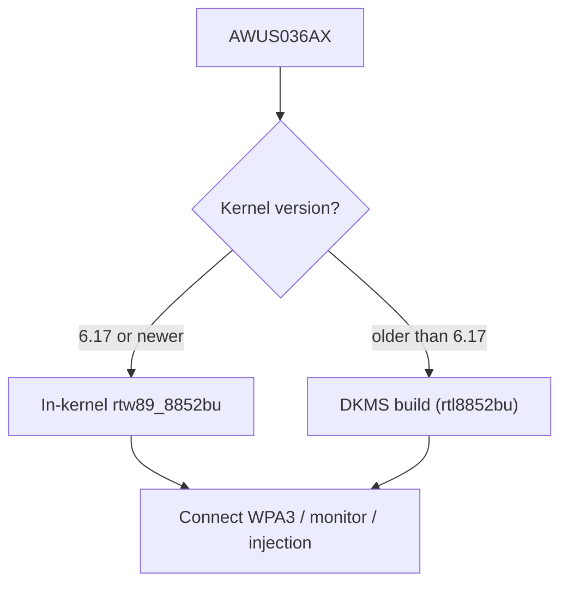

# ALFA AWUS036AX — Wi-Fi 6 Dual-Band AX1800

> **Quick Summary**: The **AWUS036AX** is ALFA's Wi-Fi 6 entry — an **RTL8832BU AX1800** dual-band adapter with **WPA3** support, **2×2 MIMO** and two external antennas. On **kernel 6.17 or newer** it runs on the in-kernel `rtw89_8852bu` driver (no DKMS). Tested on ASUS GX10 / Ubuntu 24.04 ARM64: strong monitor mode on 2.4 and 5 GHz, injection (96 % on 2.4 GHz, working on 5 GHz), AP, a WPA3 AP (AP side only; WPA3 client not tested) and end-to-end handshake capture. Use only on your own or authorized networks.

## Specifications Overview (Spec overview)

| Item | Spec |
|---|---|
| Chipset | Realtek RTL8832BU |
| Wi-Fi class | AX1800 (574 + 1201 Mbps) |
| Interface | USB 3.2 |
| Bands | 2.4 + 5 GHz |
| Antenna | 2 × external dual-band, RP-SMA |
| Security | WPA3 (alongside WPA2/WPA) |
| MIMO | 2×2 |
| Linux driver | `rtw89_8852bu` — **in-kernel on kernel ≥ 6.17**; older kernels (< 6.17): community `rtl8852bu` DKMS |
| Monitor mode | ✅ 2.4 + 5 GHz (tested on GX10) |
| Packet injection | ✅ 2.4 GHz 96 %, 5 GHz working (tested on GX10) |

## Tested on ASUS GX10 / Ubuntu 24.04 ARM64

**Test environment**: ASUS Ascent GX10 (NVIDIA GB10), Ubuntu 24.04 LTS ARM64, kernel `6.17.0-1014-nvidia`, tested 2026-11-16 to 2026-11-19 against an iPhone 7 Plus (WPA3 also with an iPhone 15 Pro).

| Item | Result |
|---|---|
| Chipset | Realtek RTL8832BU |
| USB ID | `0bda:b832` |
| Kernel driver | `rtw89_8852bu` (in-kernel) |
| Firmware | `rtw89/rtw8852b_fw-1.bin` (version 0.29.29.5) |
| DKMS needed? | No (kernel ≥ 6.17: not needed) |

| Feature | 2.4 GHz | 5 GHz |
|---|---|---|
| Monitor | ✅ strong | ✅ strong |
| Injection | ✅ 96 % | ✅ works (per-AP test) |
| AP | ✅ (incl. 802.11n) | ✅ (80 MHz) |

| Advanced feature | Result |
|---|---|
| WPA3-SAE (AP side) | ✅ iPhone 15 Pro connected, `MFP: yes`, `sae_pwe=0`, tested on 2.4 GHz (5 GHz not tested); WPA3 client side not tested |
| WPA handshake capture | ✅ end-to-end (converted to `.22000`) |
| VIF | ✅ STA + AP |
| Active monitor | N/A (driver does not offer it) |
| IBSS (ad-hoc) | N/A |
| Mesh (802.11s) | N/A |
| Wi-Fi Direct (P2P) | Not tested (needs a second device) |

Verify on your own machine:

```bash
lsusb | grep -iE '0bda:b832|0bda:1a2b'
sudo dmesg | grep rtw89_8852bu | tail -3
iw phy $(cat /sys/class/net/$(ls /sys/class/net | grep '^wlx' | head -1)/phy80211/name) info | sed -n '/Supported interface modes/,/Band 1/p'
iw dev
```

If `lsusb` shows `0bda:1a2b` (disk mode), run `sudo usb_modeswitch -v 0bda -p 1a2b -K`. In our test the card enumerated directly as a WLAN device.

Full test report: [AWUS036AX on ASUS GX10 / Ubuntu](https://yupitek.com/en/blog/awus036ax-asus-gx10-ubuntu-test-report/).

**Notes**:
- No Bluetooth interface was present on our unit.
- For 5 GHz injection run `sudo iw reg set US` first and restore your region afterwards.
- Do not run `airmon-ng check kill`; `hcxdumptool` 8.x failed to arm — use `airodump-ng` + `aireplay-ng`.
- 6 GHz: not applicable. Kali and NetHunter: not tested on real hardware.

## Overview

The AWUS036AX is the bridge between ALFA's famous AC generation and the Wi-Fi 6 world. Under the hood is the modern **RTL8832BU** 2×2 ax radio (AX1800), which brings two upgrades students actually notice:

1. **WPA3 support** — the card passed our WPA3-SAE AP test with an iPhone 15 Pro (AP side only; we did not test it as a WPA3 client).
2. **Wi-Fi 6 features** — a 2×2 ax radio (OFDMA and other Wi-Fi 6 features come from the standard; we did not benchmark them).

It keeps the classic ALFA DNA — two external antennas and a high-power front-end — and, unlike older notes claimed, it is **not** client-only on Linux: with the in-kernel driver, monitor mode and injection both work.

## Install & drivers

### Kernel 6.17 or newer

Nothing to install — `rtw89_8852bu` is in the kernel and binds automatically. See the [RTL8832BU driver page](/alfa-network/drivers/rtl8832bu/).

### Older kernels (< 6.17 only): DKMS

Only for kernels older than 6.17:

```bash
cd /opt && sudo git clone https://github.com/morrownr/rtl8852bu-20250826.git
cd rtl8852bu-20250826 && sudo sh install-driver.sh
sudo modprobe 8852bu
```

**Expected output**: the installer finishes (reboot when it asks), then an interface appears in `iw dev`. Note: the community DKMS driver's monitor-mode behavior was not tested here.



## Advanced usage

### Connect to a WPA3-only network (client side not tested by us)

```bash
nmcli device wifi connect "MySSID" password "my-passphrase"
iw dev $(ls /sys/class/net | grep '^wlx' | head -1) link
```

**Expected output**: `Connected` and a link rate on the `iw ... link` line. We did not test the card as a WPA3 client or measure its link rate; the vendor lists up to 1201 Mbps on 5 GHz.

### Monitor mode and injection

```bash
IF=$(ls /sys/class/net | grep '^wlx' | head -1)
sudo nmcli dev set $IF managed no
sudo ip link set dev $IF down
sudo iw dev $IF set type monitor
sudo ip link set dev $IF up
sudo iw dev $IF set channel 6
sudo aireplay-ng --test $IF
```

**Expected output**: `Injection is working!` (2.4 GHz measured 96 %). On 5 GHz (e.g. channel 36) a broadcast test may show `Found 0 APs`, because modern APs do not answer broadcast probes; test one specific AP with `sudo aireplay-ng --test -a <AP-BSSID> $IF`, which printed `Injection is working!`.

## Compatibility

| Platform | Support | Notes |
|---|---|---|
| Ubuntu 24.04 ARM64 (GX10, kernel 6.17) | ✅ Tested | In-kernel, no DKMS |
| Linux kernel ≥ 6.17 | ✅ | In-kernel `rtw89_8852bu` |
| Linux kernel < 6.17 | 🔧 | Community DKMS driver |
| Kali Linux | ✅ (not tested on real hardware by us) | In-kernel on kernel ≥ 6.17 |
| NetHunter / Android | ⚠️ | Not tested; Realtek, may not build on phone kernels |
| Windows | Not tested by us | Official driver from ALFA |
| Raspberry Pi / Jetson | Not tested by us | In-kernel on kernel ≥ 6.17; only the GX10 was tested |

## Troubleshooting

| Symptom | Cause | Fix |
|---|---|---|
| WPA3 network invisible | Driver/wpa_supplicant too old | Update OS / kernel |
| `lsusb` shows `0bda:1a2b` | Card in disk mode | `sudo usb_modeswitch -v 0bda -p 1a2b -K` |
| (Kernel < 6.17 only) DKMS build fails | New kernel vs repo | `cd /opt/rtl8852bu-20250826 && git pull && sudo sh install-driver.sh` |
| Slow transfers despite high link | USB 2.0 port | Use a USB 3.x port (adapter is USB 3.2) |
| Injection 0/30 | Empty channel | `sudo iw $IF set channel 6` |

## Related resources

- [RTL8832BU driver page](/alfa-network/drivers/rtl8832bu/)
- [AWUS036AXER](/alfa-network/products/awus036axer/) — the nano Wi-Fi 6 variant (same chip)
- [AWUS036AXM](/alfa-network/products/awus036axm/) — the MediaTek AX3000 + Bluetooth model (no injection on the tested kernel; Bluetooth not tested)
- [Ubuntu setup guide](/alfa-network/linux-setup-ubuntu/) / [Kali setup guide](/alfa-network/linux-setup-kali/)
- [Adapter comparison](/alfa-network/wifi-adapter-comparison/)
