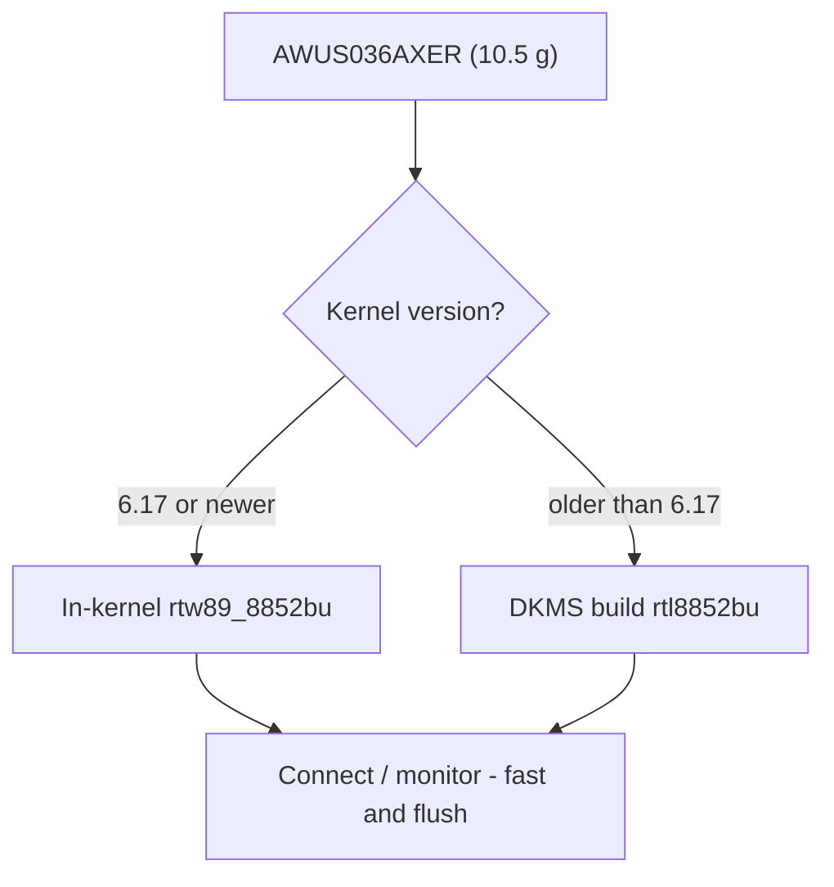

# ALFA AWUS036AXER — Wi-Fi 6 Nano (Internal Antenna)

> **Quick Summary**: The **AWUS036AXER** is ALFA's **10.5 g nano** — the same **RTL8832BU AX1800** Wi-Fi 6 engine as the big AWUS036AX, but with an **internal antenna** and USB 3.2, so it sits flush in the port and disappears. On **kernel 6.17 or newer** it uses the in-kernel `rtw89_8852bu` driver (no DKMS). Tested on ASUS GX10 / Ubuntu 24.04 ARM64: very strong monitor reception (63 APs + 12 clients in a 60 s hop scan), injection 73 % on 2.4 GHz and working on 5 GHz, AP, a WPA3 AP (AP side only; WPA3 client not tested) and end-to-end handshake capture. Use only on your own or authorized networks.

## Specifications Overview (Spec overview)

| Item | Spec |
|---|---|
| Chipset | Realtek RTL8832BU |
| Wi-Fi class | AX1800 (574 + 1201 Mbps) |
| Interface | USB 3.2 |
| Bands | 2.4 + 5 GHz |
| Antenna | **Internal** (no external RP-SMA) |
| Weight | 10.5 g |
| Security | WPA3 |
| MIMO | 2×2 |
| Linux driver | `rtw89_8852bu` — **in-kernel on kernel ≥ 6.17**; older kernels (< 6.17): community `rtl8852bu` DKMS |
| Monitor mode | ✅ 2.4 + 5 GHz (tested on GX10) |
| Packet injection | ✅ 2.4 GHz 73 %, 5 GHz working (tested on GX10) |

## Tested on ASUS GX10 / Ubuntu 24.04 ARM64

**Test environment**: ASUS Ascent GX10 (NVIDIA GB10), Ubuntu 24.04 LTS ARM64, kernel `6.17.0-1014-nvidia`, tested 2026-11-16 to 2026-11-19 against an iPhone 7 Plus (WPA3 also with an iPhone 15 Pro).

| Item | Result |
|---|---|
| Chipset | Realtek RTL8832BU (same as AWUS036AX) |
| USB ID | `0bda:b832` |
| Kernel driver | `rtw89_8852bu` (in-kernel) |
| Firmware | `rtw89/rtw8852b_fw-1.bin` (version 0.29.29.5) |
| DKMS needed? | No (kernel ≥ 6.17: not needed) |

| Feature | 2.4 GHz | 5 GHz |
|---|---|---|
| Monitor | ✅ strong | ✅ strong |
| Injection | ✅ 73 % | ✅ works (per-AP test) |
| AP | ✅ (incl. 802.11n) | ✅ (80 MHz) |

| Advanced feature | Result |
|---|---|
| WPA3-SAE (AP side) | ✅ iPhone 15 Pro connected, `sae_pwe=0`, tested on 2.4 GHz (5 GHz not tested); WPA3 client side not tested |
| WPA handshake capture | ✅ end-to-end (converted to `.22000`) |
| VIF | ✅ STA + AP |
| Active monitor | N/A (driver does not offer it) |
| IBSS (ad-hoc) | N/A |
| Mesh (802.11s) | N/A |
| Wi-Fi Direct (P2P) | Not tested (needs a second device) |

Verify on your own machine:

```bash
lsusb | grep -iE '0bda:b832|0bda:1a2b'
sudo dmesg | grep rtw89_8852bu | tail -3
iw phy $(cat /sys/class/net/$(ls /sys/class/net | grep '^wlx' | head -1)/phy80211/name) info | sed -n '/Supported interface modes/,/Band 1/p'
iw dev
```

If `lsusb` shows `0bda:1a2b` (disk mode), run `sudo usb_modeswitch -v 0bda -p 1a2b -K`.

Full test report: [AWUS036AXER on ASUS GX10 / Ubuntu](https://yupitek.com/en/blog/awus036axer-asus-gx10-ubuntu-test-report/).

**Notes**:
- No Bluetooth interface was present on our unit.
- Despite the internal antenna, the 60 s hop scan found 63 APs and 12 clients, one of the best receive results in the test.
- Do not run `airmon-ng check kill`; `hcxdumptool` 8.x failed to arm — use `airodump-ng` + `aireplay-ng`.
- 6 GHz: not applicable. Kali and NetHunter: not tested on real hardware.

## Overview

The AXER takes the AWUS036AX's radio and strips away the bulk. Instead of two external antennas, it uses an **integrated antenna** folded into a **10.5 g body** — the result plugs into a laptop port and barely protrudes. You keep Wi-Fi 6 speeds, WPA3 and 2×2 MIMO; you trade the external-antenna range extension path and the antenna-upgrade option.

It is a good everyday-carry Wi-Fi 6 adapter for the student in a lecture hall, and in our tests it also works for monitor mode and injection on kernel 6.17+ (injection rate is lower than the AWUS036AX: 73 % vs 96 % on 2.4 GHz).

## Install & drivers

Identical driver story to the [AWUS036AX](/alfa-network/products/awus036ax/) — see the [RTL8832BU driver page](/alfa-network/drivers/rtl8832bu/).

**Kernel 6.17 or newer**: nothing to install.

### Older kernels (< 6.17 only): DKMS

```bash
cd /opt && sudo git clone https://github.com/morrownr/rtl8852bu-20250826.git
cd rtl8852bu-20250826 && sudo sh install-driver.sh
sudo modprobe 8852bu
```

**Expected output**: the installer finishes (reboot when it asks), then an interface appears in `iw dev`.



## Advanced usage

### Client mode (not tested by us)

```bash
nmcli device wifi connect "MySSID" password "my-passphrase"
iw dev $(ls /sys/class/net | grep '^wlx' | head -1) link
```

**Expected output**: connected, with a link rate shown on the `iw ... link` line. We did not test the card as a client or measure its link rate; the vendor lists up to 1201 Mbps on 5 GHz.

### Monitor mode and injection

```bash
IF=$(ls /sys/class/net | grep '^wlx' | head -1)
sudo nmcli dev set $IF managed no
sudo ip link set dev $IF down
sudo iw dev $IF set type monitor
sudo ip link set dev $IF up
sudo iw dev $IF set channel 6
sudo aireplay-ng --test $IF
```

**Expected output**: `Injection is working!` (2.4 GHz measured 73 %). On 5 GHz test one specific AP with `sudo aireplay-ng --test -a <AP-BSSID> $IF`, which printed `Injection is working!`.

## Compatibility

| Platform | Support | Notes |
|---|---|---|
| Ubuntu 24.04 ARM64 (GX10, kernel 6.17) | ✅ Tested | In-kernel, no DKMS |
| Linux kernel ≥ 6.17 | ✅ | In-kernel `rtw89_8852bu` |
| Linux kernel < 6.17 | 🔧 | Community DKMS driver |
| Kali Linux | ✅ (not tested on real hardware by us) | In-kernel on kernel ≥ 6.17 |
| NetHunter / Android | ⚠️ | Not tested; Realtek, internal antenna, low priority |
| Windows | Not tested by us | Official driver from ALFA |
| Raspberry Pi / Jetson | Not tested by us | In-kernel on kernel ≥ 6.17; only the GX10 was tested |

## Troubleshooting

| Symptom | Cause | Fix |
|---|---|---|
| Short range vs external-antenna ALFAs | Internal antenna by design | Expected — use an external-antenna card for long links |
| WPA3 network not visible | Stale OS | Update OS / kernel |
| (Kernel < 6.17 only) DKMS build fails | New kernel | `git pull && sudo sh install-driver.sh` |
| `lsusb` shows `0bda:1a2b` | Disk mode | `sudo usb_modeswitch -v 0bda -p 1a2b -K` |
| Slow on USB 2.0 port | Bandwidth cap | Use a USB 3.x port |

## Related resources

- [RTL8832BU driver page](/alfa-network/drivers/rtl8832bu/)
- [AWUS036AX](/alfa-network/products/awus036ax/) — same engine, external antennas, higher injection rate
- [AWUS036AXM](/alfa-network/products/awus036axm/) — Wi-Fi 6 with a MediaTek chip (no injection on the tested kernel; Bluetooth not tested)
- [Adapter comparison](/alfa-network/wifi-adapter-comparison/)
