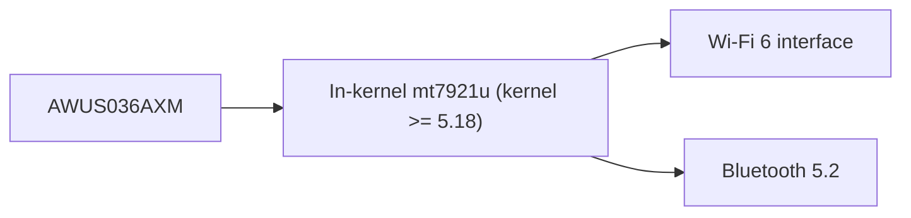

# ALFA AWUS036AXM — Wi-Fi 6 AX3000 + Bluetooth 5.2

> **Quick Summary**: The **AWUS036AXM** is ALFA's flagship Wi-Fi 6 dongle — an **MT7921AU AX3000** dual-band adapter (same `mt7921u` driver as the AXML) with **Bluetooth 5.2**, USB 3.2, two antennas and an **in-kernel driver** (`mt7921u` since Linux 5.18). Tested on ASUS GX10 / Ubuntu 24.04 ARM64: AP (2.4/5 GHz), a WPA3 AP (AP side, 2.4 GHz) and VIF work and monitor mode receives (weakly). Bluetooth and 6 GHz were not tested on this model. **Packet injection did not pass on the stock 6.17 kernel**, so it is not suitable for deauth or handshake capture there. Use only on your own or authorized networks.

## Specifications Overview (Spec overview)

| Item | Spec |
|---|---|
| Chipset | MediaTek MT7921AUN (same `mt7921u` driver family as the AXML's MT7921AUN) |
| Wi-Fi class | AX3000 class — up to 600 / 1200 / 1200 Mbps (2.4 / 5 / 6 GHz), per ALFA's spec sheet |
| Interface | USB 3.2 |
| Bands | 2.4 + 5 GHz tested; 6 GHz inferred from the same chip, not tested on the AXM |
| Antenna | 2 × external 5 dBi, RP-SMA |
| Bluetooth | **BT 5.2** (same dongle; not separately tested on the AXM) |
| MIMO | 2×2 |
| Linux driver | `mt7921u` — **in-kernel since 5.18** |
| Monitor mode | ✅ 2.4 + 5 GHz, weak reception (tested on GX10) |
| Packet injection | ❌ did not pass on stock kernel 6.17 (mac80211 chanctx regression since kernel 6.16; not an inherent chip limit) |

## Tested on ASUS GX10 / Ubuntu 24.04 ARM64

**Test environment**: ASUS Ascent GX10 (NVIDIA GB10), Ubuntu 24.04 LTS ARM64, kernel `6.17.0-1014-nvidia`, tested 2026-11-16 to 2026-11-19 against an iPhone 7 Plus (WPA3 also with an iPhone 15 Pro).

| Item | Result |
|---|---|
| Chipset | MediaTek MT7921AU |
| USB ID | `0e8d:7961` |
| Kernel driver | `mt7921u` (in-kernel) |
| Firmware | `WIFI_RAM_CODE_MT7961` (linux-firmware) |
| DKMS needed? | No (kernel ≥ 5.18: not needed) |

| Feature | 2.4 GHz | 5 GHz |
|---|---|---|
| Monitor | ✅ weak | ✅ weak |
| Injection | ❌ Failed (stock kernel 6.17) | ❌ Failed (stock kernel 6.17) |
| AP | ✅ | ✅ (80 MHz) |

| Advanced feature | Result |
|---|---|
| WPA3-SAE (AP side) | ✅ iPhone 7 Plus connected on 2.4 GHz, `MFP: yes`, `sae_pwe=0`; 5 GHz and WPA3 client side not tested |
| Bluetooth | Not tested |
| 6 GHz | Not tested |
| WPA handshake capture | ❌ not possible, injection failed |
| VIF | ✅ |
| Active monitor | 🟡 accepted by `iw`, ACK not verified |
| IBSS (ad-hoc) | N/A |
| Mesh (802.11s) | N/A |
| Wi-Fi Direct (P2P) | Not tested (needs a second device) |

Verify on your own machine:

```bash
lsusb | grep 0e8d:7961
sudo dmesg | grep mt7921u | tail -3
iw phy $(cat /sys/class/net/$(ls /sys/class/net | grep '^wlx' | head -1)/phy80211/name) info | sed -n '/Supported interface modes/,/Band 1/p'
iw dev
```

Full test report: [AWUS036AXM on ASUS GX10 / Ubuntu](https://yupitek.com/en/blog/awus036axm-asus-gx10-ubuntu-test-report/).

**Notes**:
- Injection: `aireplay-ng --test` found 0 APs (`No Answer`) on stock kernel 6.17, so no deauth and no handshake capture. This is not an inherent chip limit: the main cause is the mac80211 chanctx regression since kernel 6.16 (see the [driver page](/alfa-network/drivers/mt7921aun/)). Community git/patched drivers can make active monitor and injection work, but the firmware still locks the rate (1/6 Mbps, no HT/VHT injection).
- Monitor reception is weak; lock to one channel instead of hopping.
- `iw` reports 3 dBm TX power in monitor mode; this is a reporting artifact (hardware TX measured about 20 dBm).
- 6 GHz: inferred from the same chip as the AXML (which was verified), but **not tested on the AXM**. Kali and NetHunter: not tested on real hardware.
- If you need injection or handshake capture, choose a different card (see the [comparison](/alfa-network/wifi-adapter-comparison/)).

## Overview

The AXM is the modern successor to the beloved [AWUS036ACM](/alfa-network/products/awus036acm/) in terms of speed and features — MediaTek radio, in-kernel driver, no DKMS pain — but with a whole generation of upgrades: **AX3000** speeds (up to 1200 Mbps on 5 GHz, per ALFA's spec sheet), **Bluetooth 5.2** riding on the same USB device, and a newer radio.

For everyday Linux use the appeal is the same as the ACM: **it just works** as a client or AP adapter. Driver in the kernel (5.18+), AP and WPA3 tested, and WiFi and Bluetooth share one USB port (we did not test Bluetooth on the AXM). For security coursework that needs injection, however, note that the MT7921 family did not pass injection on the tested stock kernel — use the ACM or a Realtek card instead.

## Install & drivers

In-kernel since 5.18 — nothing to compile. See the [MT7921AUN driver page](/alfa-network/drivers/mt7921aun/). Verify:

```bash
lsusb | grep -i mediatek
iw dev
bluetoothctl list
```

**Expected output**: the MT7921U line in `lsusb` and an interface in `iw dev`. A Bluetooth controller should appear in `bluetoothctl list` (BT may need `sudo modprobe btusb`); we did not test Bluetooth on the AXM.



## Advanced usage

### Max-speed connect + BT pairing (not tested by us)

```bash
nmcli device wifi connect "MySSID" password "my-passphrase"
bluetoothctl
power on
scan on
pair <MAC>
```

**Expected output**: Wi-Fi activated; `Pairing successful` for your BT device. Neither the client connection nor Bluetooth pairing was tested on the AXM.

### Monitor mode (receive only on the tested kernel)

```bash
IF=$(ls /sys/class/net | grep '^wlx' | head -1)
sudo nmcli dev set $IF managed no
sudo ip link set dev $IF down
sudo iw dev $IF set type monitor
sudo ip link set dev $IF up
sudo iw dev $IF set channel 36
sudo timeout 8 tcpdump -l -i $IF -nn -e -c 200
```

**Expected output**: beacons are received on 2.4 and 5 GHz, but with fewer frames than the ACM or the Realtek cards. Injection (`aireplay-ng --test`) failed on stock kernel 6.17.

## Compatibility

| Platform | Support | Notes |
|---|---|---|
| Ubuntu 24.04 ARM64 (GX10, kernel 6.17) | ✅ Tested for AP / WPA3 / monitor receive | No injection |
| Ubuntu / Kali (other versions) | ✅ In-kernel (kernel 5.18+) | Not tested by us |
| NetHunter / Android | Not tested | Needs a 5.18+ kernel on the phone |
| Windows | Not tested by us | Official driver from ALFA |
| Raspberry Pi / Jetson (JetPack 6) | Not tested by us | In-kernel driver; only the GX10 was tested |

## Troubleshooting

| Symptom | Cause | Fix |
|---|---|---|
| Not detected on Ubuntu 20.04 | Kernel < 5.18 | Upgrade OS / kernel |
| No interface but device seen | Firmware missing | `sudo apt install linux-firmware`; re-plug |
| Bluetooth absent | `btusb` not loaded | `sudo modprobe btusb` |
| AP SSID not visible on the phone | `iw` reports 3 dBm TX power in monitor mode | Unplug and replug the adapter, or move the phone closer |
| Injection / deauth finds 0 APs | mac80211 chanctx regression on stock kernel 6.17 (not an inherent chip limit) | Use a different card for injection (ACM, ACH, ACS, EACS, AX, AXER) |
| Receives almost nothing in monitor mode | Weak monitor-mode RX | Lock a single channel, move closer to the AP |

## Related resources

- [MT7921AUN driver page](/alfa-network/drivers/mt7921aun/)
- [AWUS036AXML](/alfa-network/products/awus036axml/) — the same chip family with a USB-C connector and a verified 6 GHz result
- [AWUS036AX](/alfa-network/products/awus036ax/) — cheaper AX1800 alternative with working injection
- [Ubuntu setup guide](/alfa-network/linux-setup-ubuntu/) / [Kali setup guide](/alfa-network/linux-setup-kali/)
- [Adapter comparison](/alfa-network/wifi-adapter-comparison/)
