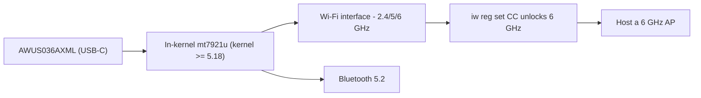

# ALFA AWUS036AXML — Wi-Fi 6E USB-C (6 GHz)

> **Quick Summary**: The **AWUS036AXML** is the only **Wi-Fi 6E** adapter in the ALFA line — an **MT7921AUN AXE3000 tri-band** (2.4/5/**6 GHz**) adapter with **USB-C**, dual 5 dBi antennas and **Bluetooth 5.2**, on an **in-kernel driver** (`mt7921u` since 5.18). Verified on ASUS GX10 / Ubuntu 24.04 ARM64: **6 GHz works** (the AXML ran a WPA3-SAE AP on ch37 / 6135 MHz and an iPhone 15 Pro connected at 802.11ax; the card was not tested as a 6 GHz client), Bluetooth works, AP and WPA3 work. **Packet injection did not pass on stock kernel 6.17**, so do not choose it for deauth or handshake capture. Use only on your own or authorized networks.

## Specifications Overview (Spec overview)

| Item | Spec |
|---|---|
| Chipset | MediaTek MT7921AUN |
| Wi-Fi class | AXE3000 — up to 600 / 1200 / 1200 Mbps (2.4 / 5 / 6 GHz), per ALFA's spec sheet |
| Bands | 2.4 + 5 + **6 GHz** (6 GHz verified on GX10) |
| Interface | **USB-C** |
| Antenna | 2 × external 5 dBi, RP-SMA |
| Bluetooth | BT 5.2 (tested working) |
| MIMO | 2×2 |
| Linux driver | `mt7921u` — **in-kernel since 5.18** |
| Monitor mode | ✅ 2.4 + 5 GHz, weak reception (tested on GX10) |
| Packet injection | ❌ did not pass on stock kernel 6.17 (mac80211 chanctx regression since kernel 6.16; not an inherent chip limit) |

## Tested on ASUS GX10 / Ubuntu 24.04 ARM64

**Test environment**: ASUS Ascent GX10 (NVIDIA GB10), Ubuntu 24.04 LTS ARM64, kernel `6.17.0-1014-nvidia`, tested 2026-11-16 to 2026-11-19 against an iPhone 7 Plus (WPA3 and the 6 GHz test with an iPhone 15 Pro).

| Item | Result |
|---|---|
| Chipset | MediaTek MT7921AUN |
| USB ID | `0e8d:7961` |
| Kernel driver | `mt7921u` (in-kernel) |
| Firmware | `WIFI_RAM_CODE_MT7961` (linux-firmware) |
| DKMS needed? | No (kernel ≥ 5.18: not needed) |

| Feature | 2.4 GHz | 5 GHz |
|---|---|---|
| Monitor | ✅ weak | ✅ weak |
| Injection | ❌ Failed (stock kernel 6.17) | ❌ Failed (stock kernel 6.17) |
| AP | ✅ | ✅ (80 MHz) |

| Advanced feature | Result |
|---|---|
| WPA3-SAE (AP side) | ✅ iPhone 15 Pro connected on 2.4 GHz (`sae_pwe=0`, `MFP: yes`); also on 6 GHz (below); 5 GHz and WPA3 client side not tested |
| 6 GHz | ✅ tested with the AXML as the AP: WPA3-SAE (H2E, `sae_pwe=1`) AP on ch37 / 6135 MHz, iPhone 15 Pro joined at 802.11ax (HE-NSS 2) and got an IP. The office has no 6 GHz AP (a 6 GHz scan found 0 BSS), so 6 GHz client mode and 6 GHz monitor capture were not tested |
| Bluetooth | ✅ tested: controller up (HCI 5.2), 31 BLE + 1 classic device scanned, WiFi + BT coexist |
| WPA handshake capture | ❌ not possible, injection failed |
| VIF | ✅ |
| Active monitor | 🟡 accepted by `iw`, ACK not verified |
| IBSS (ad-hoc) | N/A |
| Mesh (802.11s) | N/A |
| Wi-Fi Direct (P2P) | Not tested (needs a second device) |

Verify on your own machine:

```bash
lsusb | grep 0e8d:7961
sudo dmesg | grep mt7921u | tail -2
iw phy $(cat /sys/class/net/$(ls /sys/class/net | grep '^wlx' | head -1)/phy80211/name) info | sed -n '/Supported interface modes/,/Band 1/p'
iw dev
```

Full test report: [AWUS036AXML on ASUS GX10 / Ubuntu](https://yupitek.com/en/blog/awus036axml-asus-gx10-ubuntu-test-report/).

**Notes**:
- Injection: `aireplay-ng --test` and deauth returned `No Answer` / `No such BSSID available`, so no deauth and no handshake capture. This is not an inherent chip limit: the main cause is the mac80211 chanctx regression since kernel 6.16 (see the [driver page](/alfa-network/drivers/mt7921aun/)). Community git/patched drivers can make active monitor and injection work, but the firmware still locks the rate (1/6 Mbps, no HT/VHT injection). We could not retest a patched driver here because Secure Boot rejected the unsigned modules.
- Monitor reception is weaker than the MT7612U/MT7610U cards; in a later retest an 8 s capture on 2.4 GHz ch6 and 5 GHz ch36 got only 4 and 8 frames and no beacons.
- `iw` reports 3 dBm TX power in monitor mode; this is a reporting artifact.
- AP tests work best right after plugging the card in; after monitor/injection tests the beacon can be too weak for the phone to see the SSID until you replug the card.
- After re-plugging this composite WiFi + BT device, WiFi probing can hang; try a different USB port.
- The 6 GHz result is the exception to the usual "MT7921 = Wi-Fi 6" rule; whether to call it "6E" depends on the marketing definition.
- Kali and NetHunter: not tested on real hardware.

## Overview

The AXE3000 **AXML** is ALFA's statement piece for the 6 GHz era. The **6 GHz band** is currently the least congested spectrum available — no legacy devices, no overlapping lab APs — and this adapter is how you reach it on Linux. Two details make it special:

1. **It is in the kernel.** The `mt7921u` driver has been mainline since 5.18, so on current Ubuntu or Kali you plug it into the **USB-C port** and it works. No DKMS.
2. **USB-C + Bluetooth 5.2.** Modern ultrabooks have USB-C but often weak Wi-Fi; one AXML replaces both Wi-Fi and BT with a proper radio and real antennas.

The natural companions: a [Wi-Fi 6E access point](/alfa-network/products/apa-m25-6e/) on the far end, and the [6 GHz regulatory setup](/alfa-network/drivers/mt7921aun/) to unlock the channels in your region.

## Install & drivers

Nothing to compile — kernel 5.18+ required. See the [MT7921AUN driver page](/alfa-network/drivers/mt7921aun/) for the full 6 GHz setup. Verify:

```bash
lsusb | grep -i mediatek
iw dev
IF=$(ls /sys/class/net | grep '^wlx' | head -1)
iw phy $(cat /sys/class/net/$IF/phy80211/name) info | grep -E "60[0-9]{2}|61[0-9]{2}" | head
```

**Expected output**: the MT7921U line; an interface; and **6 GHz channel entries** in the phy info (in our test, under regulatory domain TW, 5955–6415 MHz / channels 1–93 were enabled at 23 dBm, indoor only, and higher channels were disabled). No 6 GHz entries? Set the regulatory domain:

```bash
sudo iw reg set TW    # your country code
sudo ip link set $IF down && sleep 1 && sudo ip link set $IF up
```



## Advanced usage

### Run a 6 GHz WPA3 AP (what we tested)

The AXML hosted the AP; we did not test it as a 6 GHz client. `/tmp/ap6.conf`:

```ini
interface=<your wlx interface>
driver=nl80211
ssid=YUP-6G-TEST
country_code=TW
ieee80211d=1
hw_mode=a
channel=37
op_class=131
ieee80211ax=1
he_su_beamformer=1
he_su_beamformee=1
he_6ghz_reg_pwr_type=0
wpa=2
wpa_key_mgmt=SAE
rsn_pairwise=CCMP
ieee80211w=2
sae_pwe=1
sae_password=<your passphrase>
```

```bash
sudo nmcli dev set $IF managed no
sudo hostapd -t /tmp/ap6.conf
iw dev $IF info | grep channel   # confirm you are on 6 GHz
```

**Expected output**: `AP-ENABLED` and `channel 37 (6135 MHz)`. In our test an iPhone 15 Pro joined (`AP-STA-CONNECTED`, 4-way handshake complete, DHCP lease) and the association frequency was 6135 MHz, proof the link was on the 6 GHz band. Note that 6 GHz requires `sae_pwe=1` (H2E), unlike the `sae_pwe=0` used on 2.4 GHz for older iPhones.

### Monitor mode (receive only on the tested kernel)

```bash
sudo nmcli dev set $IF managed no
sudo ip link set dev $IF down
sudo iw dev $IF set type monitor
sudo ip link set dev $IF up
sudo iw dev $IF set channel 36
sudo timeout 8 tcpdump -l -i $IF -nn -e -c 200
```

**Expected output**: some beacons on 2.4 and 5 GHz, with far fewer frames than the ACM (and in one retest almost none). Injection failed on stock kernel 6.17. Monitor capture on 6 GHz was not tested.

### Reach further with a tri-band panel

The AXML's stock dipoles are fine, but a [tri-band panel](/alfa-network/products/apa-m25-6e/) is meant to extend range on the 6 GHz band (we did not test any antenna upgrade).

## Compatibility

| Platform | Support | Notes |
|---|---|---|
| Ubuntu 24.04 ARM64 (GX10, kernel 6.17) | ✅ Tested (AP, WPA3 AP, 6 GHz AP, BT, monitor receive) | No injection; client mode not tested |
| Ubuntu / Kali (other versions) | ✅ In-kernel (kernel 5.18+) | Not tested by us |
| NetHunter / Android | Not tested | Needs a 5.18+ kernel on the phone |
| Windows | Not tested by us | Official driver from ALFA |
| Jetson (JetPack 6) | Not tested by us | See the [Jetson guide](/alfa-network/hardware/jetson/) |

## Troubleshooting

| Symptom | Cause | Fix |
|---|---|---|
| Not detected at all | Kernel < 5.18, or USB-C cable is charge-only | Upgrade kernel; use a data cable |
| 6 GHz channels missing | Regulatory domain unset | `sudo iw reg set <CC>`; bounce interface |
| No `wlx` interface after re-plug | WiFi probe stuck on the composite device | Use a different USB port |
| Phone cannot see the AP SSID (beacon too weak) | Card degraded after monitor/injection tests, or `iw` shows 3 dBm TX power | Unplug and replug the adapter, then start the AP first |
| Injection / deauth finds nothing | mac80211 chanctx regression on stock kernel 6.17 (not an inherent chip limit) | Use a different card for injection |
| Bluetooth absent | `btusb` not loaded | `sudo modprobe btusb` |

## Related resources

- [MT7921AUN driver page](/alfa-network/drivers/mt7921aun/)
- [AWUS036AXM](/alfa-network/products/awus036axm/) — the same chip family (6 GHz not tested on the AXM)
- [APA-M25-6E](/alfa-network/products/apa-m25-6e/) — the tri-band panel for this adapter
- [Jetson guide](/alfa-network/hardware/jetson/) — 6 GHz streaming use case (not tested by us)
- [Adapter comparison](/alfa-network/wifi-adapter-comparison/)
