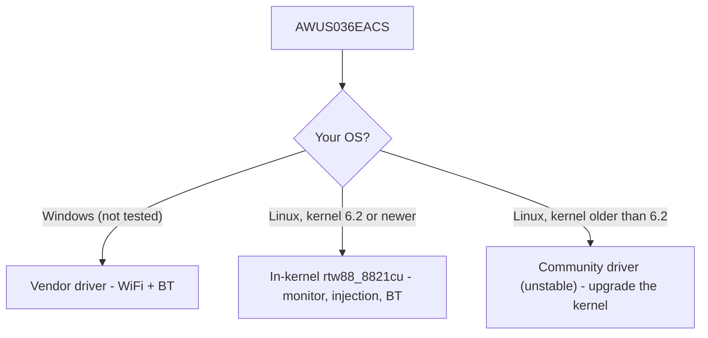

# ALFA AWUS036EACS — Nano WiFi + Bluetooth Combo

> **Quick Summary**: The **AWUS036EACS** is ALFA's **nano WiFi + Bluetooth combo** — an **RTL8821CU AC600** dual-band dongle with integrated **BT 4.2**. On **kernel 6.2 or newer** the in-kernel `rtw88_8821cu` driver supports it and, in our ASUS GX10 / Ubuntu 24.04 ARM64 tests, it delivered monitor mode, injection at 100 % on both bands, AP, a WPA3 AP (2.4 GHz, AP side only), end-to-end handshake capture and working Bluetooth. Plug-and-play on Windows is the vendor's claim; we did not test it. Use only on your own or authorized networks.

## Specifications Overview (Spec overview)

| Item | Spec |
|---|---|
| Chipset | Realtek RTL8821CU |
| Wi-Fi class | AC600 (150 + 433 Mbps) |
| Interface | USB 2.0 |
| Bands | WiFi: 2.4 + 5 GHz ｜ BT: 2.4 GHz |
| Bluetooth | BT 4.2 (tested working on Linux) |
| Antenna | Integrated 2 dBi (no external RP-SMA) |
| Security | WEP / WPA / WPA2 / WPA3-SAE per the vendor spec (WPA2 and WPA3-SAE APs tested on Linux; WEP/WPA not tested) |
| Linux driver | `rtw88_8821cu` — **in-kernel on kernel ≥ 6.2** (see [RTL8821CU driver page](/alfa-network/drivers/rtl8821cu/)) |
| Monitor mode | ✅ 2.4 + 5 GHz (tested on GX10) |
| Packet injection | ✅ 100 % on 2.4 and 5 GHz (tested on GX10) |

## Tested on ASUS GX10 / Ubuntu 24.04 ARM64

**Test environment**: ASUS Ascent GX10 (NVIDIA GB10), Ubuntu 24.04 LTS ARM64, kernel `6.17.0-1014-nvidia`, tested 2026-11-16 to 2026-11-19 against an iPhone 7 Plus (WPA3 also with an iPhone 15 Pro).

| Item | Result |
|---|---|
| Chipset | Realtek RTL8821CU (WiFi + Bluetooth composite) |
| USB ID | `0bda:c820` |
| Kernel driver | `rtw88_8821cu` (in-kernel) |
| Firmware | WiFi 24.11.0 (H2C version 12, from `dmesg`); Bluetooth `rtl_bt/rtl8821c_fw.bin` |
| DKMS needed? | No (kernel ≥ 6.2: not needed) |

| Feature | 2.4 GHz | 5 GHz |
|---|---|---|
| Monitor | ✅ | ✅ |
| Injection | ✅ 100 % | ✅ 100 % |
| AP | ✅ | ✅ (802.11a, 20 MHz tested; VHT80 not tested) |
| WPA3-SAE (AP side) | ✅ | Not tested |

| Advanced feature | Result |
|---|---|
| WPA handshake capture | ✅ end-to-end (79 deauth ACKs, converted to `.22000`) |
| VIF | 🟡 a passive monitor VIF runs alongside the station on the same channel (software monitor); the driver advertises no interface combinations |
| Active monitor | ❌ `Operation not supported (-95)` |
| IBSS (ad-hoc) | ❌ listed by `iw` but join failed |
| Mesh (802.11s) | ❌ `-95` |
| Wi-Fi Direct (P2P) | ❌ `-95` |
| Bluetooth | ✅ works: firmware loads, the controller comes up, BR/EDR and LE scans found devices; WiFi + BT coexist (BR/EDR scan worked while WiFi was connected; an LE scan in that window found 0 devices) |

Verify on your own machine:

```bash
lsusb | grep -i 0bda:c820
sudo dmesg | grep -i 8821cu
iw phy $(cat /sys/class/net/$(ls /sys/class/net | grep '^wlx' | head -1)/phy80211/name) info | sed -n '/Supported interface modes/,/Band 1/p'
iw dev
bluetoothctl list
```

Full test report: [AWUS036EACS on ASUS GX10 / Ubuntu](https://yupitek.com/en/blog/awus036eacs-asus-gx10-ubuntu-test-report/).

**Notes**:
- Composite device: after re-plugging, WiFi probing can hang and no `wlx` interface appears. Try a different USB port.
- After repeated mode switches the WiFi side can stall (RX stops, `ip link set up` returns `Operation already in progress`). Unplug and replug, ideally into another port, and run the next test first thing after plugging in.
- Do not run `airmon-ng check kill`; `hcxdumptool` 8.x failed to arm on 5 GHz (a 2.4 GHz run armed in a later retest) — use `airodump-ng` + `aireplay-ng`.
- For 5 GHz injection run `sudo iw reg set US` first and restore your region afterwards.
- 6 GHz: not applicable. Kali and NetHunter: not tested on real hardware.

## Overview

The EACS is designed for a buyer who wants **WiFi + Bluetooth in one tiny, unobtrusive stick**: a desktop, an embedded industrial PC or a small ARM box. AC600 speeds and a 2 dBi integrated antenna make it a "good enough internet + BT keyboard/mouse" upgrade, and the short integrated antenna means it is best used close to the AP.

Earlier community advice was that the RTL8821CU had no usable Linux driver. That is outdated: the mainline `rtw88_8821cu` driver (kernel ≥ 6.2) works, and in our tests it reached 100 % injection on both bands, level with the AWUS036ACH and ahead of the other ac-class cards we tested. Only kernels older than 6.2 depend on the unstable community driver.

## Install & drivers

### Linux, kernel 6.2 or newer

Nothing to install — the in-kernel `rtw88_8821cu` binds automatically and the Bluetooth part is handled by `btusb`. See the [RTL8821CU driver page](/alfa-network/drivers/rtl8821cu/).

### Linux, older kernels (< 6.2 only)

A community driver (`brektrou/rtl8821CU`) exists and may build on older kernels, but expect instability. Prefer upgrading the kernel; the driver page has the details.

### Windows

On Windows (not tested by us) the driver is expected to install automatically:

1. Plug the adapter into a USB port.
2. Windows installs the RTL8821CU driver automatically. WiFi and Bluetooth both appear in Device Manager.

```powershell
Get-PnpDevice -PresentOnly | Where-Object { $_.Class -eq "Net" }
```

**Expected output** (not verified by us): an `802.11ac NIC` network adapter and a Bluetooth radio listed.



## Compatibility

| Platform | Support | Notes |
|---|---|---|
| Ubuntu 24.04 ARM64 (GX10, kernel 6.17) | ✅ Tested | In-kernel, WiFi + BT |
| Linux kernel ≥ 6.2 | ✅ | In-kernel `rtw88_8821cu` |
| Linux kernel < 6.2 | 🔧 | Community driver only, may be unstable |
| Kali Linux | ✅ (not tested on real hardware by us) | In-kernel on kernel ≥ 6.2 |
| Windows | Not tested by us | Vendor-supplied driver; WiFi + BT expected |
| NetHunter / Android | ❓ | Not tested |
| Raspberry Pi | ❓ | Not tested by us (in-kernel on kernel ≥ 6.2) |
| macOS | Not tested by us | Limited; Apple Silicon unsupported |

## Troubleshooting

| Symptom | Cause | Fix |
|---|---|---|
| `lsusb` shows `0bda:c820` but no `wlx` interface | Composite device WiFi probe stuck after re-plug | Use a different USB port; unplug/replug |
| BT devices not found (Windows; not tested by us) | Driver / service conflict | Check Device Manager; reinstall driver from ALFA support |
| Linux kernel < 6.2: no stable driver | Only a community driver exists | Upgrade to kernel ≥ 6.2 |
| Scan or capture shows 0 packets after many mode switches | WiFi RX stall on the composite device | Unplug and replug (another USB port); run the next test right after plugging in |
| Short range | Integrated 2 dBi antenna | By design; use it near the AP |

## Related resources

- [RTL8821CU driver page](/alfa-network/drivers/rtl8821cu/)
- [AWUS036ACM](/alfa-network/products/awus036acm/) — MediaTek alternative with external antennas
- [AWUS036ACS](/alfa-network/products/awus036acs/) — pocket monitor-mode alternative
- [Adapter comparison](/alfa-network/wifi-adapter-comparison/)
- [Compatibility matrix](/alfa-network/linux-compatibility-matrix/)
