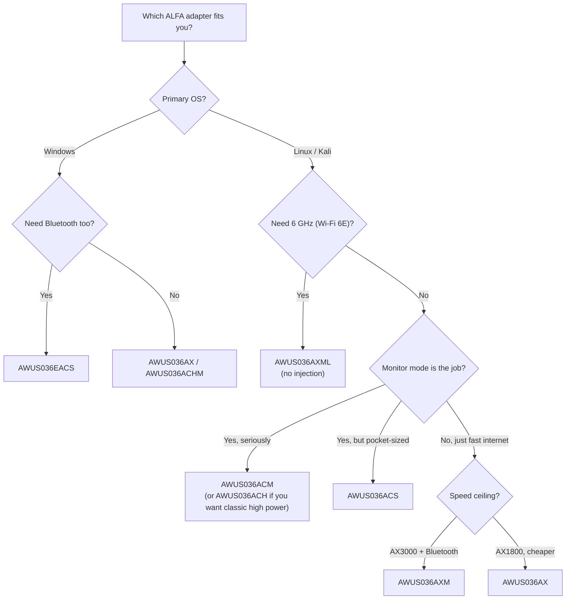

# ALFA Wi-Fi Adapter Comparison

> **Bottom Line Up Front**: If you are a university student using Kali Linux for coursework or lab exercises, buy the **AWUS036ACM** — its MediaTek MT7612U chipset is built into the Linux kernel, monitor mode and injection just work, and it costs less than the flagship models. (For the highest injection rates, the **AWUS036EACS / AWUS036ACH / AWUS036ACS** measured better, see below.) All nine adapters were tested on an ASUS GX10 (Ubuntu 24.04 ARM64, kernel 6.17) and work with in-kernel drivers (Realtek models need kernel 6.2+ for EACS, 6.13+ for ACH / ACS, 6.17+ for AX / AXER; older kernels need DKMS). **Do not buy the AWUS036AXM / AXML for injection, deauth or handshake work** — the MT7921 cards failed injection on the stock 6.17 kernel. If you need Wi-Fi 6E, the **AWUS036AXML** was verified on 6 GHz (the AXM shares the chip but 6 GHz was not tested on it). The **AWUS036EACS** is a WiFi + Bluetooth nano adapter that works in-kernel on Linux kernel 6.2+ (we did not test it on Windows).

*💡 Click image to view in high-resolution full-screen lightbox.*
## The full spec comparison table

All nine adapters, one table. The monitor / injection column reflects our ASUS GX10 / Ubuntu 24.04 ARM64 tests (kernel 6.17.0-1014-nvidia, 2026-11-16 to 2026-11-19). "Monitor mode" means flipping the interface into RFMON so you can capture every packet on a channel — the fundamental requirement for Wireshark, Aircrack-ng, Wifite and similar tools.

| Model | Chipset | Wi-Fi class | Interface | Bands | Max speed | Monitor mode (Linux) | Antenna |
|---|---|---|---|---|---|---|---|
| [AWUS036ACH](/alfa-network/products/awus036ach/) | RTL8812AU | AC1200 | USB 3.0 | 2.4 + 5 GHz | 300 + 867 Mbps | ✅ monitor + injection 100 % on both bands (in-kernel `rtw88_8812au`, kernel ≥ 6.13; DKMS only on older kernels) | 2 × external 5 dBi, RP-SMA |
| [AWUS036ACHM](/alfa-network/products/awus036achm/) | MT7610U | AC600 | USB 2.0 | 2.4 + 5 GHz | 150 + 433 Mbps | ✅ monitor; injection 96–100 % on 2.4 GHz, 5 GHz broadcast only (in-kernel `mt76x0u`) | 1 × detachable 5 dBi, RP-SMA |
| [AWUS036ACM](/alfa-network/products/awus036acm/) | MT7612U | AC1200 | USB 3.0 | 2.4 + 5 GHz | 300 + 867 Mbps | ✅ monitor + injection (63–83 % on 2.4 GHz, 76 % on 5 GHz; in-kernel `mt76x2u`) | 2 × external 5 dBi, RP-SMA |
| [AWUS036ACS](/alfa-network/products/awus036acs/) | RTL8811AU | AC600 | USB 2.0 | 2.4 + 5 GHz | 150 + 433 Mbps | ✅ monitor + injection (100 % on 2.4 GHz, 96 % on 5 GHz; in-kernel `rtw88_8821au`, kernel ≥ 6.13) | 1 × external 2 dBi, RP-SMA (55 mm body) |
| [AWUS036AX](/alfa-network/products/awus036ax/) | RTL8832BU | AX1800 | USB 3.2 | 2.4 + 5 GHz | 574 + 1201 Mbps | ✅ strong monitor; injection 96 % on 2.4 GHz, works on 5 GHz (in-kernel `rtw89_8852bu`, kernel ≥ 6.17) | 2 × external 6 dBi, RP-SMA |
| [AWUS036AXER](/alfa-network/products/awus036axer/) | RTL8832BU | AX1800 | USB 3.2 | 2.4 + 5 GHz | 574 + 1201 Mbps | ✅ strong monitor; injection 73 % on 2.4 GHz, works on 5 GHz (in-kernel `rtw89_8852bu`, kernel ≥ 6.17) | Internal (10.5 g nano body) |
| [AWUS036AXM](/alfa-network/products/awus036axm/) | MT7921AU | AX3000 class | USB 3.2 | 2.4 + 5 GHz tested (6 GHz not tested on the AXM) | up to 600 + 1200 + 1200 Mbps | 🟡 weak monitor; ❌ injection failed on stock 6.17 (in-kernel `mt7921u`) | 2 × external 5 dBi, RP-SMA + BT 5.2 |
| [AWUS036AXML](/alfa-network/products/awus036axml/) | MT7921AUN | AXE3000 | USB-C | 2.4 + 5 + 6 GHz (6 GHz verified) | up to 600 + 1200 + 1200 Mbps | 🟡 weak monitor; ❌ injection failed on stock 6.17 (in-kernel `mt7921u`) | 2 × external 5 dBi, RP-SMA + BT 5.2 |
| [AWUS036EACS](/alfa-network/products/awus036eacs/) | RTL8821CU | AC600 | USB 2.0 | 2.4 + 5 GHz | 150 + 433 Mbps | ✅ monitor + injection 100 % on both bands (in-kernel `rtw88_8821cu`, kernel ≥ 6.2); BT works | Integrated 2 dBi + BT 4.2 |

### Reading the speed numbers

The "+" splits the two bands: **2.4 GHz + 5 GHz** (or + 6 GHz for the AXE models). A "300 + 867" adapter is **AC1200** class: 300 Mbps is the 2.4 GHz ceiling (2 spatial streams × 150 Mbps), 867 Mbps is the 5 GHz ceiling (2 × 433 Mbps). Real-world throughput is typically 50–70 % of the link rate — physics, walls and USB bus overhead eat the rest.

## Which one for you?

### If you want Kali / monitor mode / packet injection → AWUS036ACM

The MT7612U chipset is **in-kernel since Linux 4.19**, which means: plug it in on any recent Kali or Ubuntu, and `ip link` already shows `wlan0`. Monitor mode works through the standard `iw` commands and packet injection works (63–83 % on 2.4 GHz and 76 % on 5 GHz in our test). It also offers 19–23 dBm TX power (about 100–200 mW, per ALFA's spec sheet) with two external antennas — genuinely useful range for lab exercises. If you want the highest injection rates, the **AWUS036EACS / AWUS036ACH** (100 % on both bands) and **AWUS036ACS** (100 % / 96 %) measured better on our GX10 and are in-kernel on a new enough kernel (EACS 6.2, ACH / ACS 6.13). The full workflow is on the [Kali setup guide](/alfa-network/linux-setup-kali/).

### If you want Wi-Fi 6E (6 GHz) → AWUS036AXML

The AXML offers the **6 GHz band** (AXE3000) and we verified it: a WPA3-SAE AP on ch37 / 6135 MHz, joined by an iPhone 15 Pro at 802.11ax. It uses the MediaTek **MT7921AUN**, whose `mt7921u` driver has been mainline since kernel 5.18 — so no DKMS pain — and it is a USB-C model with working Bluetooth. The AXM shares the chip, so 6 GHz is likely but **was not tested on the AXM**. Both are **not** suited to injection / deauth / handshake work (injection failed on stock kernel 6.17). See the [Ubuntu setup guide](/alfa-network/linux-setup-ubuntu/).

### If you want a pure client adapter (fast, stable, no pen-testing) → AWUS036AXM or AWUS036AX

The AXM is the faster-class of the two (AX3000, up to 1200 Mbps on 5 GHz per ALFA's spec) and adds **Bluetooth 5.2** per the spec sheet — one dongle for WiFi + BT (Bluetooth was not tested on the AXM). The AX gives you Wi-Fi 6 + WPA3 with a more classic ALFA look and slightly lower price. On kernel 6.17+ the AX uses the in-kernel `rtw89_8852bu` driver and also passed monitor mode and injection in our tests. The AXM only receives weakly in monitor mode and failed injection, so it is a client/AP card, not a testing tool.

### If you travel with a laptop / want a pocket adapter → AWUS036ACS or AWUS036AXER

The ACS (55 mm body) and the AXER (10.5 g, internal antenna) disappear in a backpack. The ACS is the budget monitor-mode companion (injection 100 % / 96 %); the AXER is the Wi-Fi 6 nano for everyday use and, in our hop scan, found 63 APs and 12 clients despite its internal antenna.

### If you need WiFi + Bluetooth in one tiny stick → AWUS036EACS

The EACS (RTL8821CU) works on **Linux kernel 6.2+** through the in-kernel `rtw88_8821cu` driver (we did not test Windows): in our tests it reached 100 % injection on both bands, passed AP/WPA3/handshake capture and its Bluetooth worked. The integrated 2 dBi antenna means short range, and after re-plugging the composite device may need a different USB port. On kernels older than 6.2 only an unstable community driver exists.

## If you cannot decide — buy the ACM

The AWUS036ACM is the community consensus pick: in-kernel driver, monitor mode + injection verified on our GX10 tests, dual-band, high power, and well within a student budget. You will find it referenced all over the [troubleshooting](/alfa-network/troubleshooting/) and [driver](/alfa-network/drivers/mt7612u/) pages as the "boring, reliable option" — and in this world, boring means *it just works*.

Next: check your OS in the [compatibility matrix](/alfa-network/linux-compatibility-matrix/), or dive straight into the [Ubuntu](/alfa-network/linux-setup-ubuntu/) / [Kali](/alfa-network/linux-setup-kali/) setup guides.
