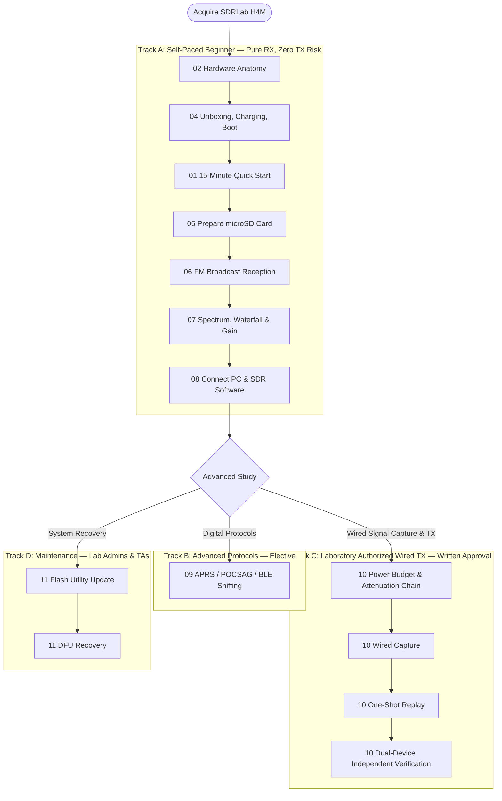
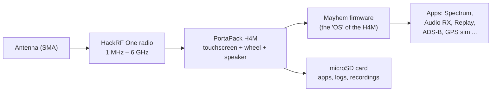

# SDRLab H4M (HackRF PortaPack) — Complete Guide

> **One-liner**: The H4M is the current-generation PortaPack for HackRF One — a 3.2-inch touchscreen extension enclosure that turns a 1 MHz–6 GHz SDR transceiver into a **standalone handheld radio laboratory** powered by an internal battery, requiring no computer. Mayhem firmware turns it into an audio receiver, spectrum analyzer, signal recorder, protocol monitor, and experimental transmitter.
>
> **Applicable Hardware**: SDRLab H4M (HackRF One compatible RF board mated with PortaPack H4M front panel).  
> **Target Audience**: Engineering graduate students, laboratory researchers, and RF engineers.  
> **Reference Firmware**: PortaPack-Mayhem v2.4.0 official release (hardware target `hackrf`).  
> **Manual Version**: 03 | **Updated**: 2026-10-03 | **Platform**: doc.yupitek.com (Official English Edition)

:::warning Critical Hardware Model Differentiation
SDRLab H4M and H4M Pro differ significantly in RF architecture, PCB layout, power management (integrated Li-Po pouch vs. user-installed 18650 cell), and clock routing. **Never cross-flash H4M Pro firmware (`firmware_hpro.bin`), SD asset packs, or flashing procedures onto an H4M**, as doing so may cause device malfunction or brick the unit. This manual is strictly for the H4M. If you own an H4M Pro, refer to the H4M Pro Manual.
:::

---

## Table of Contents

- [00 Read Me First: 5 Safety Principles and Learning Roadmap](#00-read-me-first-5-safety-principles-and-learning-roadmap)
- [01 15-Minute Quick Start (First Success: Tuning FM Broadcast)](#01-15-minute-quick-start-first-success-tuning-fm-broadcast)
- [02 Hardware Anatomy and Control Interface](#02-hardware-anatomy-and-control-interface)
- [03 Bill of Materials and Required Equipment](#03-bill-of-materials-and-required-equipment)
- [04 Unboxing, Charging, and First Boot Self-Check](#04-unboxing-charging-and-first-boot-self-check)
- [05 Preparing the microSD Card and Deploying Asset Packs](#05-preparing-the-microsd-card-and-deploying-asset-packs)
- [06 First Signal Reception: Public FM Broadcast (Detailed Tutorial)](#06-first-signal-reception-public-fm-broadcast-detailed-tutorial)
- [07 Understanding Spectrum, Waterfall, Gain Staging, and Scanning](#07-understanding-spectrum-waterfall-gain-staging-and-scanning)
- [08 Connecting to a Computer (Tethered SDR Mode)](#08-connecting-to-a-computer-tethered-sdr-mode)
- [09 Elective Advanced Reception: APRS, POCSAG, and BLE Sniffing](#09-elective-advanced-reception-aprs-pocsag-and-ble-sniffing)
- [10 Laboratory Authorized Wired Capture, One-Shot Replay, and TX Experiments](#10-laboratory-authorized-wired-capture-one-shot-replay-and-tx-experiments)
- [11 Advanced Maintenance: Firmware Updates and DFU Recovery](#11-advanced-maintenance-firmware-updates-and-dfu-recovery)
- [12 Troubleshooting and Frequently Asked Questions (FAQ)](#12-troubleshooting-and-frequently-asked-questions-faq)
- [13 Core Technical Glossary and Concept Reference](#13-core-technical-glossary-and-concept-reference)
- [14 Learning Verification Checklist and Standard Lab Worksheet](#14-learning-verification-checklist-and-standard-lab-worksheet)
- [Appendix A: Frequency Band Allocation and Station Query Guide](#appendix-a-frequency-band-allocation-and-station-query-guide)
- [Appendix B: Complete Hardware Accessory Specifications](#appendix-b-complete-hardware-accessory-specifications)
- [Appendix C: RF Power Budget and Attenuation Chain Calculation Worksheet](#appendix-c-rf-power-budget-and-attenuation-chain-calculation-worksheet)
- [Appendix D: Official Resources and Extended Reading](#appendix-d-official-resources-and-extended-reading)

---

## 00 Read Me First: 5 Safety Principles and Learning Roadmap

Software-Defined Radio (SDR) is an extraordinarily versatile instrument for telecommunications research. Before powering on the device, all operators must adhere to these five mandatory safety rules:


:::warning Safety First: The 5 Golden Rules
1. **Begin with Pure Reception (RX-Only)**: The first half of this manual focuses exclusively on signal observation, waterfall analysis, and demodulation. Never transmit during initial learning.
2. **Transmission (TX) and Replay Require Written Laboratory Authorization**: Open-air over-the-air (OTA) transmission without a valid radio license is strictly illegal. All transmission exercises must take place inside a closed, coaxial wired link and receive prior written approval from your laboratory director.
3. **Antennas Are For Reception Only**: Whenever an antenna is connected to the SMA port, disable all transmit and replay functions.
4. **Keep Bias-Tee and RF Amp OFF by Default**: Standard reception does not require internal pre-amplification (RF Amp) or coaxial DC phantom power (Bias-Tee). Leaving them enabled risks burning sensitive front-end low-noise amplifiers (LNA).
5. **Shut Down Immediately Upon Anomalies**: If the unit overheats, shows excessive noise, or exhibits erratic behavior, immediately toggle the power switch OFF and consult your laboratory supervisor.
:::

### Legal Boundaries and Regulatory Limits

1. **Reception Limits**: Intercepting and decoding publicly broadcasted signals (such as commercial FM radio, NOAA weather satellites, and ADS-B beacon transmissions) is legally permitted for academic and research purposes. However, intercepting, recording, decrypting, or disclosing private communications (police, military, aviation voice trunking, cellular, or private paging) is prohibited under telecommunications and privacy laws.
2. **Transmission Limits**: Transmitting within amateur bands requires a valid amateur radio operator license. Transmitting on ISM bands must adhere to strict effective isotropic radiated power (EIRP) limits. In Great Scott Gadgets documentation, the maximum safe input power at the HackRF One antenna port is **-5 dBm**. Exceeding -5 dBm will permanently destroy the front-end amplifier! In all experimental setups, maintain input power below **-10 dBm**.

### Learning Roadmap



### Core Physical Quantities: Understanding dB and dBm

In radio frequency engineering, signal levels span dozens of orders of magnitude. We quantify ratios and power using logarithmic decibel scales:

- **dB (Decibel)**: Expresses a **relative ratio** between two power levels:
  t```text
dB = 10 * log10(P1 / P2)
```}
ight)
  - +3 dB represents a doubling of power (`2 imes`); -3 dB cuts power in half ($0.5 imes$).
  - +10 dB represents a 10-fold increase (`10 imes`); +30 dB represents a 1,000-fold increase (`1,000 imes`).
  - An attenuator labeled 30 dB reduces signal power to $1/1000$ of its original level.
- **dBm (Decibel-milliwatts)**: Expresses an **absolute power level** referenced to **1 milliwatt (1 mW)** across a 50 Ω load:
  ```text
P(dBm) = 10 * log10(P(mW) / 1 mW)
```}
ight)
  - 0 dBm = 1 mW.
  - $`+10 dBm` = 10 mW$ (typical maximum output of HackRF One).
  - $-5 dBm pprox 0.316 mW$ (**maximum safe input limit** before front-end LNA damage).
  - -30 dBm = 0.001 mW (typical strong laboratory signal).
- **Core Link Equation**:
  ```text
P_RX(dBm) = P_TX(dBm) - Attenuation_total(dB) - Cable_Loss(dB)
```

---

## 01 15-Minute Quick Start (First Success: Tuning FM Broadcast)

This section provides the shortest path to verify that your hardware, antenna, and audio output are fully functional.


| Step | Core Action | Expected Result |
|:---:|---|---|
| **Step 1** | Thread the telescopic antenna onto the `ANT` port finger-tight | Secure mechanical connection, 50 Ω interface |
| **Step 2** | Insert the prepared FAT32 microSD card into the bottom slot | Tactile click as card seats |
| **Step 3** | Slide the physical `POWER` switch to ON | LCD illuminates, Mayhem main menu loads |
| **Step 4** | Use the rotary dial and directional keys to navigate to **Receive** → **Audio** | Audio receiver interface appears |
| **Step 5** | Set `mode` to **WFM**, enter your local FM frequency, and gently raise `volume` | Crisp broadcast audio from speaker, visible spectrum peak |

### Step-by-Step Quick Start Guide

1. **Mount Antenna**: Thread the SMA telescopic antenna onto the SMA female port labeled `ANT` on the left edge. Tighten finger-tight; do not over-torque with tools. Extend the antenna sections to approximately 75 cm (quarter-wavelength for ~100 MHz FM broadcast).
2. **Power Up**: Slide the power toggle switch to ON. The 3.2-inch color display will show the Mayhem boot screen and status bar (displaying time, SD card presence, and battery voltage).
3. **Select App**: Rotate the jog wheel to highlight **Receive**, press the center button (or tap the touchscreen), then select **Audio**.
4. **Tune Frequency**: Highlight the frequency field. Use the wheel or directional keys to input a known local commercial FM station (e.g., 99.7 MHz or 100.7 MHz).
5. **Adjust Parameters**:
   - Set **Modulation Mode** to `WFM` (Wideband FM).
   - Set **LNA Gain** to `16 dB` and **VGA Gain** to `20 dB`. Leave **AMP** `OFF`.
   - Gradually increase `VOL` (volume) from 0 until audio plays through the built-in speaker.
6. **Congratulations**: You have successfully captured, downconverted, digitized, and demodulated real-world radio waves using your standalone SDRLab H4M!

---

## 02 Hardware Anatomy and Control Interface


### System Concept: How the H4M Operates



The HackRF One digitizes the RF spectrum via direct sampling and complex downconversion; the PortaPack extension board provides the human-machine interface; and the Mayhem open-source firmware executes DSP applications natively on the NXP LPC43xx dual-core ARM processor. No PC is required.

### What's in the Box

| Item | Typical Content | Description |
|---|---|---|
| PortaPack H4M | Extension enclosure with 3.2″ matte LCD, rotary encoder, speaker, microphone | Upper acrylic protective layer and control assembly |
| HackRF One (or R10C) | Core SDR transceiver board | 1 MHz – 6 GHz half-duplex transceiver |
| Antennas | Telescopic wideband antenna (40–6000 MHz) + band-specific antennas | High-gain rubber duck and telescopic variants |
| Cables | USB-C high-speed data cable, SMA male-to-male RG316 coaxial cable | Power/data connection and wired loopback testing |
| Extras (kit-dependent) | 20 dB LNA amplifier module, rechargeable battery, protective case | Laboratory advanced kit accessories |

### Specifications at a Glance

#### HackRF One (The Radio Core)

| Parameter | Specification |
|---|---|
| Frequency Range | 1 MHz – 6 GHz |
| Operating Mode | Half-duplex transceiver |
| Sample Rates | 2 – 20 Msps (quadrature I/Q) |
| ADC / DAC Resolution | 8-bit I / 8-bit Q |
| Host Interface | High-Speed USB 2.0 (USB-C connector) |
| Antenna Port | SMA female, 50 Ω impedance |
| Antenna Port DC Bias | Software-controlled Bias-Tee, max 50 mA @ 3.3 V (Default: OFF) |
| Maximum Safe RX Input | **-5 dBm** (exceeding causes permanent LNA burnout!) |
| Maximum TX Output | +10 dBm (10 mW); typical 0 to +5 dBm |
| Clock Synchronization | CLK IN / CLK OUT (SMA), support for high-precision 0.1–0.5 PPM TCXO |

#### PortaPack H4M (Enclosure & Human-Machine Interface)

| Parameter | Specification |
|---|---|
| Display | 3.2-inch 240×320 resistive matte LCD touchscreen |
| Controls | 4 directional navigation buttons, 360° rotary encoder with center push, dedicated power switch |
| Audio System | Built-in 1W speaker, integrated microphone with toggle switch, 3.5 mm TRRS headphone jack |
| Storage Interface | Push-push microSD card slot (FAT32 formatted, required for apps, logs, recordings) |
| Battery Module | 2,500 mAh rechargeable Li-Po cell with dedicated charge controller IC |
| Charging Interface | USB-C port, hardware ON/OFF slide switch |
| Expansion Interface | 3.3V GPIO header with I2C bus support for external sensors and GPS modules |
| Enclosure Construction | Black-and-white graffiti patterned transparent acrylic sandwich casing |

#### Key Improvements on H4M over Legacy H2

- **USB-C Interface**: Replaced fragile Micro-USB with robust USB-C.
- **Physical Power Switch**: Features a true hardware power cutoff to eliminate parasitic battery drain during storage.
- **Integrated Audio Subsystem**: Onboard speaker and microphone with automatic routing.
- **I2C Expansion**: GPIO header allows direct connection of external peripherals such as GPS modules.
- **Flat Form Factor**: Ergonomic slim design for field transport.

### Two-Layer Architecture


1. **Lower Layer (HackRF One Core)**: Houses the Maxim MAX2837 wideband transceiver, MAX5864 baseband ADC/DAC, RFFC5072 mixer, and NXP LPC43xx ARM Cortex-M4/M0 microcontrollers.
2. **Upper Layer (PortaPack H4M Board)**: Houses the 3.2-inch LCD screen, audio codec (WM8731 or AK4951), rotary encoder, directional buttons, and microSD slot.

### Receiving Antenna Selection Guide


1. **Telescopic Antenna (40 MHz – 1 GHz)**: Ideal for general exploration, FM broadcast, VHF airband, and UHF amateur radio. Adjust length according to wavelength: `L(m) = 75 / f(MHz)`.
2. **Rubber Duck ISM Antenna (433 MHz / 915 MHz)**: Compact and tuned for Sub-GHz ISM remotes, IoT sensors, and weather stations.
3. **2.4 GHz / 5.8 GHz Dual-Band Wi-Fi Antenna**: Dedicated to Wi-Fi and Bluetooth channel monitoring.

---

## 03 Bill of Materials and Required Equipment

### 1. Self-Prepared BOM for Pure Reception (Required for Each Student)


- **MicroSD Card**: 16 GB to 32 GB, Class 10 / UHS-I / A1 rating from reputable manufacturers.


- **USB-C Data Cable**: High-quality shielded cable capable of USB 2.0 High-Speed data transfer (not charge-only cables).
- **Computer Host**: Windows 10/11, Ubuntu Linux 22.04/24.04 LTS, Kali Linux, or macOS.

### 2. Laboratory Wired RF Safety Kit (Mandatory for Section 10 Experiments)


:::warning Mandatory Equipment Verification
Never initiate wired loopback transmission experiments without verifying the attenuation chain with a calibrated power meter or spectrum analyzer.
:::

1. **Coaxial Fixed Attenuators (SMA 50 Ω)**: Minimum **50 dB total attenuation** (e.g., 30 dB + 20 dB, rated for ≥ 2W, DC–6 GHz).
2. **DC Block (SMA 50 Ω)**: Rated 10 MHz – 6 GHz to block accidental DC phantom power.
3. **50 Ω RF Dummy Load (SMA Male)**: Rated ≥ 2W, DC–6 GHz, used for impedance termination.
4. **RG316 / RG174 SMA Male-to-Male Coaxial Cables**: 50 Ω double-shielded cables.

### 3. Official Software and Asset Download Channels


- **Mayhem Firmware Repository**: [portapack-mayhem/mayhem-firmware](https://github.com/portapack-mayhem/mayhem-firmware/releases)
  - Firmware Binary: `portapack-h1_h2-mayhem.bin` or `.ppfw.tar`
  - SD Asset Package: `COPY_TO_SDCARD.zip` (matching exact release tag)
- **Host Tools**: `hackrf` package (`sudo apt install hackrf` on Debian/Ubuntu/Kali; `brew install hackrf` on macOS).

---

## 04 Unboxing, Charging, and First Boot Self-Check

### 4.1 Charging Safety and Power Management


1. **Charging Parameters**: Standard 5V USB-C charger (5V / 1A to 2A). Fast-charge USB-PD chargers that do not support 5V fallback should be avoided.
2. **Charging Procedure**:
   - Turn the H4M power switch to **OFF** during charging for maximum safety.
   - The charging indicator LED will illuminate RED during charging and transition to GREEN/BLUE when full.
3. **Battery Maintenance**: Never store the device completely discharged. Recharge to ~50% (approx. 3.85V) for long-term storage.

### 4.2 First Boot Self-Check

1. Slide the `POWER` switch to ON.
2. Observe display startup sequence. Mayhem splash screen should appear within 3 seconds.
3. Check the status bar at the top: battery indicator should show healthy voltage (≥ 3.7V), SD icon should indicate presence if inserted.
4. Verify firmware version:


   - Navigate to `Settings` -> `About`. Verify that the hardware target string reads `hackrf` (NOT `hpro`).

---

## 05 Preparing the microSD Card and Deploying Asset Packs


### 5.1 Formatting the Card as FAT32

Mayhem firmware requires the card to be formatted as standard **FAT32** with Master Boot Record (MBR) partition table.

- **Windows**: Use the official SD Association *SD Card Formatter*, or Rufus/GUIFormat for cards > 32 GB.
- **Linux**:
  ```bash
  sudo mkfs.vfat -F 32 -n "MAYHEM" /dev/sdX1
  ```
- **macOS**:
  ```bash
  diskutil eraseDisk FAT32 MAYHEM MBRFormat /dev/diskN
  ```

### 5.2 Extracting the Asset Package

1. Download `COPY_TO_SDCARD_*.zip` corresponding to your flashed firmware version.
2. Extract the contents directly to the root of the microSD card.
3. Expected root directory layout:
   ```
   MAYHEM_ROOT/
   ├── APPS/             # Executable Mayhem application modules
   ├── BITOFS/           # Digital bitstream data
   ├── FREQMAN/          # Frequency manager database files (.TXT)
   ├── MAPS/             # Offline map tiles for ADS-B and APRS tracking
   ├── SETTINGS/         # Persistent system configuration
   ├── SPLASH/           # Custom startup splash images
   └── WHIP/             # Antenna resonance database
   ```

---

## 06 First Signal Reception: Public FM Broadcast (Detailed Tutorial)

1. **Hardware Preparation**: Attach telescopic antenna to `ANT` SMA port, fully extend.
2. **Open Application**: Select **Receive** → **Audio**.
3. **Parameter Configuration**:
   - `FREQ`: Tune to a strong local FM station (e.g., `100.700 MHz`).
   - `MOD`: Select `WFM` (Wideband FM).
   - `BW`: Set to `200k` (optimal for stereo commercial broadcast).
   - `LNA Gain`: `16 dB` to `24 dB`.
   - `VGA Gain`: `20 dB` to `28 dB`.
   - `AMP`: `OFF` (Never enable RF Amp on strong broadcast stations).
4. **Volume Control**: Tap or scroll to `VOL`, slowly increase from 0 to 45. Broadcast audio will play through the onboard speaker.
5. **Observation**: Notice the prominent spectrum peak centered in the display and the bright line cascading through the waterfall display.

---

## 07 Understanding Spectrum, Waterfall, Gain Staging, and Scanning

### 7.1 Spectrum Display and Waterfall Principles


- **Spectrum Plot (Upper Half)**: Displays **Frequency (X-axis)** versus **Instantaneous Power Amplitude (Y-axis)**. Signal peaks represent active radio transmissions.
- **Waterfall Display (Lower Half)**: Displays **Frequency (X-axis)** versus **Time (Y-axis scrolling downward)**, with power mapped to **Color Intensity** (deep blue represents noise floor, yellow/red represents high-power transmissions).

### 7.2 Gain Staging and Overload Detection


The HackRF One receive signal path features three gain stages:
1. **RF Amplifier (AMP)**: 0 dB or +14 dB broad-spectrum pre-amplifier located directly before the mixer. **Default: OFF**.
2. **LNA Gain (Low-Noise Amplifier)**: 0 dB to 40 dB in 8 dB steps. Set to moderate levels (16–24 dB) for clear reception.
3. **VGA Gain (Baseband Variable Gain Amplifier)**: 0 dB to 62 dB in 2 dB steps. Amplifies the baseband analog signal before the ADC.

#### Signal State Determination Guide


- **Under-Gain**: Weak signals blend into the blue noise floor; increase LNA gain.
- **Optimal Dynamic Range**: Signal peaks clearly visible 20–40 dB above noise floor without distortion.
- **ADC Overload**: Noise floor rises across the entire band, ghost signals appear across harmonics; immediately reduce LNA and VGA gains.

---

## 08 Connecting to a Computer (Tethered SDR Mode)

### Four System Operating Modes


| Mode | Entry Procedure | Use Case | Remarks |
|---|---|---|---|
| **PortaPack Standalone** | Normal power-on with switch | Handheld field operation | No computer connection |
| **HackRF USB Mode** | Select `HackRF Mode` in main menu | Tethered operation with GQRX, SDR++, GNU Radio | PortaPack UI suspends, LCD displays USB screen |
| **SPI Flash Mode** | Connect via USB while held in HackRF mode | Updating firmware via `hackrf_spiflash` | Used for standard firmware reflashing |
| **DFU Mode** | Hold DFU button while powering on / plugging USB | Firmware unbricking and low-level recovery | LPC43xx ROM bootloader |

### Command-Line Spectrum Check (as Plain HackRF)

After switching to HackRF mode and connecting via USB to a PC:

```bash
hackrf_transfer -s 8M -f 100M -g 20 -r /dev/null
```

If the device streams continuously without dropped samples, the core radio hardware and USB controller are functioning properly.

### Cross-Platform Software Compatibility Matrix

| Operating System | Support Status | Recommended Tools |
|---|---|---|
| **Standalone (PortaPack)** | ✅ Native | Mayhem firmware applications (Audio, Spectrum, Recon, Capture) |
| **Linux (Ubuntu / Kali)** | ✅ Full | `hackrf` CLI tools, GQRX, GNU Radio, SDR++, SatDump |
| **macOS (Apple Silicon / Intel)** | ✅ Full | Homebrew `hackrf`, GQRX, CubicSDR, SDR++ |
| **Windows 10 / 11** | ✅ Full | SDR# (SDRSharp) with HackRF plugin, SDR++, zadig driver tool |

---

## 09 Elective Advanced Reception: APRS, POCSAG, and BLE Sniffing

1. **APRS (Automatic Packet Reporting System)**:
   - Frequency: `144.390 MHz` (North America) / `144.800 MHz` (Europe) / `144.640 MHz` (Taiwan).
   - Application: Select **Receive** → **APRS**. Decodes amateur radio GPS packets and telemetry directly to the screen.
2. **POCSAG Paging Decryption**:
   - Frequencies: Standard VHF/UHF paging allocations.
   - Application: Select **Receive** → **POCSAG**. Demonstrates legacy FSK numeric and alphanumeric packet decoding.
3. **Bluetooth Low Energy (BLE) Observation**:
   - Frequencies: BLE Advertising Channels (37: `2402 MHz`, 38: `2426 MHz`, 39: `2480 MHz`).
   - Application: Select **Receive** → **BLE RX**. Monitors nearby BLE beacon advertisements.

---

## 10 Laboratory Authorized Wired Capture, One-Shot Replay, and TX Experiments


:::danger Absolutely No Over-The-Air Transmission
All transmission experiments described in this section are permitted **ONLY inside a closed, double-shielded coaxial link with a minimum 50 dB attenuation chain**. Transmitting over antennas into open space without a government license is a criminal violation of telecommunications laws.
:::

### 10.1 IQ Signal Fundamentals and C16 Format


SDR captures baseband signals as orthogonal complex samples: `s(t) = I(t) + j*Q(t)`.
- **C16 Format**: Interleaved signed 16-bit little-endian integers `[I0, Q0, I1, Q1, ...]`. Each sample consumes 4 bytes (`2 bytes  I + 2 bytes  Q`).
- **Metadata Pairing**: Each `.C16` recording is automatically accompanied by a `.TXT` metadata file specifying the exact center frequency and sampling rate.


#### Sampling Rate and Storage Throughput Table

```text
Data Rate (Bytes/s) = Sample Rate (Samples/s) * 4 Bytes
```

| Sample Rate | Effective Bandwidth | Data Throughput | 5-Second File Size | SD Card Assessment |
|:---:|:---:|:---:|:---:|---|
| **250 kHz** | ~200 kHz | 1.0 MB/s | 5.0 MB | 🟢 Negligible load, all cards pass |
| **500 kHz** | ~400 kHz | 2.0 MB/s | 10.0 MB | 🟢 Recommended laboratory starting rate |
| **1.0 MHz** | ~800 kHz | 4.0 MB/s | 20.0 MB | 🟡 Requires certified A1 class card |
| **2.0 MHz** | ~1.6 MHz | 8.0 MB/s | 40.0 MB | 🟠 High latency cards will drop samples |

### 10.2 RF Power Budget and Attenuation Chain Calculation


When connecting the TX output of Device A to the RX input of Device B:
- Maximum TX Output: $P_TX = `+10 dBm`$
- Maximum Safe RX Input: `P_RX,max = -5 dBm`
- Target Safety Limit: `P_RX,safe ≤ -10 dBm`
- Minimum Required Attenuation:
  t```text
Attn_min = P_TX - P_RX,safe = +10 dBm - (-10 dBm) = 20 dB
```
- **Laboratory Mandate**: Standard safety practice requires **50 dB attenuation** (30 dB + 20 dB inline fixed attenuators + DC Block). This ensures that even at full +10 dBm TX power, the received power is `-40 dBm`, completely eliminating any risk of LNA damage.

### 10.3 Wired Capture Workflow


1. Connect target source to H4M ANT port through the certified attenuation chain and DC block.
2. Select **Capture** application in Mayhem.
3. Set center frequency, sample rate to `500 kHz`, and LNA/VGA gains to low values.
4. Name the session and tap **Record**. Keep captures under 5 seconds to prevent buffer overflows.

### 10.4 Strict One-Shot Replay Workflow


1. Verify coaxial wired link with 50 dB attenuation connected between H4M transmitter and spectrum analyzer receiver.
2. Open **Replay** application and select the single `.C16` file.
3. ⚠️ **Safety Verification**: Ensure the on-screen **Loop** toggle is set to **OFF**. Infinite looping risks overheating the RF transmitter!
4. Tap **Play** once. The progress bar will advance through the file and automatically terminate transmission.
5. Immediately disconnect coaxial cables to return the system to quiescent state.


---

## 11 Advanced Maintenance: Firmware Updates and DFU Recovery


### 11.1 Updating via Built-in Flash Utility (Recommended)

1. Download the latest `.ppfw.tar` package (hardware target: `hackrf`) from Mayhem releases.
2. Copy the file to the root of the FAT32 microSD card.
3. Insert card into H4M, power on, and navigate to **Utilities** → **Flash Utility**.
4. Select the `.ppfw.tar` file, confirm the target is `hackrf`, and proceed. The device will program the SPI flash and reboot automatically.

### 11.2 WebUSB One-Click Update (Browser-Based)

Connect H4M via USB-C to a computer running Chrome/Edge, navigate to [https://hackrf.app/](https://hackrf.app/), switch H4M to HackRF mode, click *Connect Device*, and follow on-screen prompts.

### 11.3 DFU Mode Low-Level Recovery (Unbricking)

If a bad flash results in a black screen:
1. Locate the `DFU` tactile button on the HackRF One board.
2. Hold down the `DFU` button while plugging in the USB-C cable to the PC, then release.
3. Verify device enumeration with `dfu-util -l`.
4. Reflash firmware:
   ```bash
   dfu-util -d 1fc9:000c --download portapack-h1_h2-mayhem.bin -s 0x18000000:leave
   ```

---

## 12 Troubleshooting and Frequently Asked Questions (FAQ)

### Troubleshooting Decision Matrix


| Symptom | Probable Cause | Corrective Action |
|---|---|---|
| Black screen upon boot | Battery completely depleted / Sleep lock | Charge via 5V/2A for 30 min; check USB-C cable; enter DFU mode to test |
| Apps menu empty | MicroSD card missing, unformatted, or corrupted | Reformat card as FAT32; extract matching `COPY_TO_SDCARD` assets to root |
| No audio from speaker | Volume set to 0 / Headphones plugged in / Wrong mode | Unplug 3.5mm jack; increase volume; confirm modulation is set to `WFM` |
| Host PC cannot see HackRF | Unit is in standalone PortaPack mode | Select `HackRF Mode` in Mayhem main menu before running host software |
| Elevated noise floor across all bands | Antenna disconnected / Severe LNA overload | Connect 50 Ω antenna; disable RF Amp; reduce LNA/VGA gains |

### Frequently Asked Questions (FAQ)

**Q1: Why cannot my H4M transmit and receive simultaneously?**


> **Answer**: This is a fundamental physical constraint of the HackRF One RF architecture. The HackRF uses a **half-duplex transceiver** design featuring a single high-frequency mixer and baseband ADC/DAC pair switched between RX and TX modes via solid-state RF switches. It cannot transmit and receive at the same instant.

**Q2: Does a higher spectrum peak indicate higher absolute transmit power?**  
> **Answer**: No. Without calibrated laboratory signal generator reference measurements, the on-screen spectrum display indicates relative digital amplitude (dBFS) across the ADC, not absolute power (dBm).

**Q3: Can recorded `.C16` files be played directly in media players?**  
> **Answer**: No. `.C16` files contain raw quadrature baseband vector samples (`I` and `Q`), not demodulated acoustic waveforms. They must be demodulated via Mayhem Replay, GNU Radio, or Python.

---

## 13 Core Technical Glossary and Concept Reference

| Term | Category | Definition |
|---|---|---|
| **Software-Defined Radio (SDR)** | Architecture | A radio communication system where components that have been traditionally implemented in analog hardware (mixers, filters, modulators) are implemented by software on embedded systems or PCs. |
| **PortaPack** | Hardware | An add-on expansion board featuring an LCD, audio codec, and controls that converts a HackRF into a standalone handheld instrument. |
| **Mayhem** | Firmware | The leading open-source community firmware for PortaPack devices, providing dozens of RF analysis and decoding tools. |
| **Half-Duplex** | Operation | Bi-directional communication where transmission and reception occur on shared circuitry, but not simultaneously. |
| **Quadrature (I/Q) Sampling** | DSP | Representing an RF signal using two orthogonal carrier components: In-phase (`I`) and Quadrature (`Q`, shifted by 90°), preserving both amplitude and phase information. |
| **Gain Staging** | RF Engineering | The deliberate distribution of gain across cascade amplification stages (LNA, mixer, VGA) to maximize dynamic range while preventing ADC saturation. |
| **Attenuation Chain** | RF Safety | A series of passive RF attenuators inserted between a transmitter and receiver to reduce signal power to safe, non-destructive levels. |
| **Dummy Load** | Hardware | A shielded 50 Ω resistive termination used in place of an antenna to absorb RF energy without radiating electromagnetic fields. |
| **DC Block** | Hardware | A passive coaxial capacitor that blocks DC voltages while allowing RF signals to pass with minimal insertion loss. |
| **Bias-Tee** | Hardware | A circuit that injects DC power onto a coaxial RF cable to power active antennas or low-noise preamplifiers. |

---

## 14 Learning Verification Checklist and Standard Lab Worksheet

### Self-Assessment Verification Questions


1. [ ] Can you explain the physical difference between dB and dBm, and state the absolute damage threshold for HackRF One?
2. [ ] Can you explain why the internal RF Amp must remain OFF during standard FM broadcast reception?
3. [ ] Can you locate the `HackRF Mode` entry in Mayhem to connect the device to GQRX or SDR++?
4. [ ] In a wired loopback experiment, how many dB of attenuation are required to safely reduce a +10 dBm TX signal below -10 dBm?
5. [ ] What is the purpose of the `.TXT` file generated alongside every `.C16` recording?

---

## Appendix A: Frequency Band Allocation and Station Query Guide


| Frequency Range | Service / Allocation | Modulation | Description |
|---|---|---|---|
| **88.0 – 108.0 MHz** | Commercial FM Broadcast | WFM | High-power public broadcast stations |
| **118.0 – 137.0 MHz** | Civil Aviation VHF Communications | AM | Air traffic control and aircraft voice |
| **144.0 – 148.0 MHz** | 2m Amateur Radio Band | NFM / APRS | Amateur voice repeaters and digital packets |
| **430.0 – 440.0 MHz** | 70cm Amateur Radio Band | NFM | Amateur repeaters and telemetry |
| **433.05 – 434.79 MHz** | Sub-GHz ISM Band | ASK / FSK | Remote keyless entry, tire pressure, IoT sensors |
| **868.0 – 868.6 MHz** | European SRD / IoT Band | FSK / LoRa | Smart meters, smart city wireless sensors |
| **902.0 – 928.0 MHz** | North American ISM Band | FSK / LoRa | Wireless consumer devices, FHSS systems |
| **1090.0 MHz** | ADS-B Commercial Aviation Mode-S | PPM | Aircraft position and flight data beacons |
| **2400.0 – 2483.5 MHz** | 2.4 GHz ISM Band | DSSS / OFDM / GFSK | Wi-Fi (802.11b/g/n), Bluetooth, Zigbee |

---

## Appendix B: Complete Hardware Accessory Specifications

- **Attenuators**: 50 Ω SMA Fixed Attenuator Kit (10 dB, 20 dB, 30 dB), 2W continuous power, DC–6 GHz bandwidth, VSWR ≤ 1.25.
- **DC Block**: SMA Inner DC Block, 50 Ω, 10 MHz – 6 GHz, 50V max voltage.
- **Dummy Load**: 50 Ω SMA Male Termination, 2W power, DC–6 GHz.
- **Cables**: High-flexibility RG316 coaxial cables with gold-plated SMA male connectors.

---

## Appendix C: RF Power Budget and Attenuation Chain Calculation Worksheet

```
[Transmitter: H4M-A] 
  TX Power: +10 dBm
       │
       ▼
  [Inline 30 dB Attenuator]  ──> Level: -20 dBm
       │
       ▼
  [Inline 20 dB Attenuator]  ──> Level: -40 dBm
       │
       ▼
  [DC Block (0.5 dB Loss)]   ──> Level: -40.5 dBm
       │
       ▼
  [Coaxial Cable (0.5 dB Loss)] ──> Level: -41 dBm
       │
       ▼
[Receiver: H4M-B]
  Input Level: -41 dBm  (Well below safe -10 dBm threshold!)
```

---

## Appendix D: Official Resources and Extended Reading

### Related Yupitek Wiki Guides

- [SDR Software Guide](/sdrlab/sdr-software/) — HackRF toolchain, GQRX, SDR++, and SatDump integration.
- [Firmware & Drivers](/sdrlab/firmware/) — Mayhem architecture and historical release notes.
- [SDRLAB Quickstart Guide](/sdrlab/quickstart/) — First-30-minutes setup checklist.
- [SDRLAB Troubleshooting Hub](/sdrlab/troubleshooting/) — Hardware, USB driver, and buffer overrun resolutions.

### Official Open-Source Repositories

1. **Great Scott Gadgets HackRF One**: [github.com/greatscottgadgets/hackrf](https://github.com/greatscottgadgets/hackrf)
2. **PortaPack-Mayhem Firmware**: [github.com/portapack-mayhem/mayhem-firmware](https://github.com/portapack-mayhem/mayhem-firmware)
3. **HackRF WebUSB Tool**: [hackrf.app](https://hackrf.app/)
