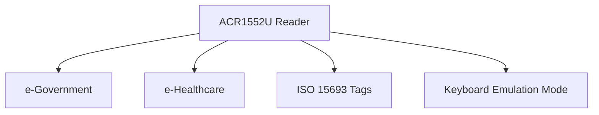

# ACR1552U — USB NFC Reader IV (4th Generation) Complete Guide

> **Quick Summary**: The ACR1552U is ACS's 4th-generation multi-protocol USB reader. Delivering up to **848 kbps** data rates, extended **ISO 15693** vicinity tag support, built-in **Keyboard Emulation mode**, and a hardware **SAM slot**, it is suited to e-Government, e-Healthcare, transportation, and access control applications.

Compared with the ACR122U and ACR1252U, the ACR1552U adds ISO 15693 support, up to 848 kbps, and Keyboard Emulation mode.

## Unboxing & Hardware Overview

- **Dimensions & Weight**: 98.0 × 65.0 × 12.8 mm, white casing, 89 g (±5 g).
- **Antenna**: 50 × 40 mm antenna with an **operating range of up to 70 mm** (depending on tag type).
- **Interface Variants**: Available in USB Type-A (`ACR1552U-M1`) and USB Type-C (`ACR1552U-MF`).
- **SAM Security Slot**: 1 × ISO 7816 Class A (5V) SIM-sized slot supporting up to 1,250 kbps.
- **Programmable Indicators**: Blue/Green bi-color LED and programmable audio buzzer.

## Specifications Overview

| Item | Specification |
|---|---|
| Generation | 4th Generation (USB NFC Reader IV) |
| Supported Protocols & Tags | **ISO 14443 Types A & B (Parts 1–4), ISO 15693, ISO/IEC 18092 NFC**, MIFARE®, FeliCa, SRI/SRIX, CTS, Innovatron, Picopass, Topaz |
| Operating Frequency | 13.56 MHz |
| Baud Rates | **106 / 212 / 424 / 848 kbps** (ISO 14443); 26 / 53 kbps (ISO 15693) |
| Operating Distance | Up to **70 mm** (depending on tag type) |
| NFC Operating Modes | Smart Card Reader/Writer, **Keyboard Emulation**, Card Emulation |
| SAM Slot | 1 × ISO 7816 Class A (5V) SIM slot (T=0, T=1 protocols, 13.4–1,250 kbps) |
| Extended APDU | ✅ Extended contactless APDU commands |
| Host Interface | USB 2.0 Full Speed (12 Mbps), CCID compliant |
| Dimensions / Weight | 98.0 × 65.0 × 12.8 mm / 89 g (±5 g) |
| Certifications | ISO 14443, ISO 15693, PC/SC, CCID, CE, FCC, RoHS, REACH, Microsoft WHQL |
| OS Compatibility | Windows, Linux, macOS, Android |
| Official Documentation | [ACR1552U Product Page](https://www.acs.com.hk/en/products/575/acr1552u-usb-nfc-reader-iv/), API Reference (PDF) |

## Comparison: ACR122U vs ACR1252U vs ACR1552U

| Feature | ACR122U | ACR1252U | **ACR1552U** |
|---|---|---|---|
| Max ISO 14443 Speed | 424 kbps | 424 kbps | **848 kbps** |
| Max Read Distance | 50 mm | 50 mm | **70 mm** |
| ISO 15693 Vicinity Support | ❌ | ❌ | **✅ Supported** |
| Keyboard Emulation Mode | ❌ | ❌ | **✅ Supported** |
| SAM Security Slot | ❌ | ✅ | **✅ High-speed SAM** |
| Extended APDU | — | — | **✅ Supported** |

## Application Architectures



## Installation & Setup (Linux + macOS)

The ACR1552U communicates over standard USB CCID PC/SC protocols.

### Step 1: Install PC/SC Packages (Linux)

```bash
sudo apt update
sudo apt install -y pcscd pcsc-tools libpcsclite-dev libccid
```

### Step 2: Verify USB Enumeration

```bash
lsusb | grep -i "Advanced Card Systems"
```

The reader should appear as an Advanced Card Systems device.

### Step 3: Run `pcsc_scan`

```bash
pcsc_scan
```

Presenting an ISO 15693 tag or ISO 14443 badge will display the ATR and protocol type in real time.

## Quickstart: Python pyscard Script

```python
from smartcard.System import readers
from smartcard.util import toHexString

r = readers()
if not r:
    print("No PC/SC readers found.")
    exit(1)

reader = r[0]
print(f"Using Reader: {reader}")

conn = reader.createConnection()
conn.connect()

# Query ISO 14443 UID
GET_UID = [0xFF, 0xCA, 0x00, 0x00, 0x00]
data, sw1, sw2 = conn.transmit(GET_UID)

if sw1 == 0x90 and sw2 == 0x00:
    print(f"Card Serial / UID: {toHexString(data)}")
else:
    print(f"Status: {sw1:02X} {sw2:02X}")
```

## Troubleshooting

### 1. ISO 15693 tags not responding to standard APDU
- **Cause**: ISO 15693 tags utilize distinct command structures from ISO 14443 Type A cards.
- **Fix**: Consult the ACS ACR1552U Reference Manual for specific ISO 15693 transparent command wrapper formats.

### 2. Keyboard Emulation not outputting keystrokes
- **Cause**: Reader is configured in standard PC/SC mode rather than HID Keyboard Emulation mode.
- **Fix**: Refer to the ACS ACR1552U Reference Manual for how to enable Keyboard Emulation mode and configure its output.

### 3. SAM communication errors
- **Cause**: SAM card mismatch or improper seating.
- **Fix**: Ensure standard ISO 7816 Class A (5V) SIM form-factor SAM is properly inserted.

## Related Resources

- [ACS Overview](/acs/)
- [ACR122U Guide](/acs/products/acr122u/)
- [ACR1252U Guide](/acs/products/acr1252u/)
