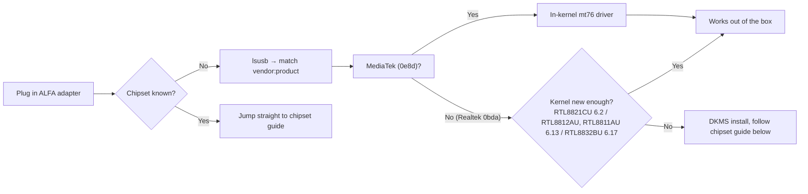

# ALFA 驱动指南——总览

> **一句话定位（One-liner）**：Linux 上的每一款 ALFA 无线网卡适配器都由**七种芯片组**之一驱动——**内核够新时全部由内核内置驱动支持，插上即用**（ASUS GX10、Ubuntu 24.04、kernel 6.17.0-1014-nvidia 实测，9 款全部内置）。只有当内核低于该芯片组的内置起始版本（RTL8821CU 6.2、RTL8812AU / RTL8811AU 6.13、RTL8832BU 6.17）时，Realtek 芯片组才需要社区 **DKMS** 构建。在下面找到你的芯片组并跳到对应指南。

## 芯片组地图

| 芯片组 | 网卡适配器 | 驱动绑定 | 内核内置？ | 指南 |
|---------|----------|----------------|------------|-------|
| MT7612U | AWUS036ACM | `mt76x2u` | ✅ 内置（4.19+） | [MT7612U 指南](/alfa-network/drivers/mt7612u/) |
| MT7610U | AWUS036ACHM | `mt76x0u` | ✅ 内置（4.19+） | [MT7610U 指南](/alfa-network/drivers/mt7610u/) |
| MT7921AU / MT7921AUN | AWUS036AXM、AWUS036AXML | `mt7921u` | ✅ 内置（5.18+）；stock 6.17 上数据包注入未通过 | [MT7921AUN 指南](/alfa-network/drivers/mt7921aun/) |
| RTL8812AU | AWUS036ACH | `rtw88_8812au` | ✅ 内置（6.13+） | [RTL8812AU 指南](/alfa-network/drivers/rtl8812au/) |
| RTL8811AU | AWUS036ACS | `rtw88_8821au` | ✅ 内置（6.13+） | [RTL8811AU 指南](/alfa-network/drivers/rtl8811au/) |
| RTL8832BU | AWUS036AX、AWUS036AXER | `rtw89_8852bu` | ✅ 内置（6.17+） | [RTL8832BU 指南](/alfa-network/drivers/rtl8832bu/) |
| RTL8821CU | AWUS036EACS | `rtw88_8821cu` | ✅ 内置（6.2+） | [RTL8821CU 指南](/alfa-network/drivers/rtl8821cu/) |

## 如何选择

1. **识别芯片组**——运行 `lsusb` 并把 `vendor:product` 对与你的网卡适配器规格表匹配。
2. **MediaTek 芯片组？** 你完成了——驱动在内核里（MT7612U、MT7610U 自 4.19，MT7921AU / AUN 自 5.18）。直接去对应指南，用 `dmesg` / `iw dev` 确认并启用监听模式。
3. **Realtek 芯片组？** 先用 `uname -r` 确认内核：**内核够新则无需安装，插上即用**（RTL8821CU ≥ 6.2、RTL8812AU / RTL8811AU ≥ 6.13、RTL8832BU ≥ 6.17；Ubuntu 24.04 上分别对应 GA 6.8、HWE 6.14、6.17）；仅内核低于上述版本时才按照对应指南构建 DKMS 模块（此时内核更新后需要 `sudo dkms autoinstall`）。

> 注：MT7921（AXM / AXML）在 stock kernel 6.17 上数据包注入测试未通过，详见 [MT7921AUN 指南](/alfa-network/drivers/mt7921aun/)。

完整的系统级教程在 [Linux 设置指南](/alfa-network/linux-setup-ubuntu/)和[兼容性矩阵](/alfa-network/linux-compatibility-matrix/)中。