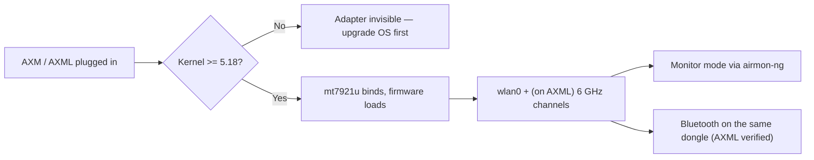

# MT7921AUN 驱动指南（AWUS036AXM / AWUS036AXML）

> **一句话定位（One-liner）**：**MediaTek MT7921AU / MT7921AUN** 驱动 **AWUS036AXM**（MT7921AU，AX3000）和 **AWUS036AXML**（MT7921AUN，带 6 GHz 的 AXE3000）；两者同为 `mt7921u` 驱动。它的 `mt7921u` 驱动**自内核 5.18 起进入主线**——是备受喜爱的 MT7612U 的现代继任者，也是本产品线在 Linux 上通往 6 GHz 的路径（实测 AXML 可运作于 6 GHz，AXM 同芯片但未单独实测）。**注意：在 stock kernel 6.17 上，数据包注入测试未通过**——详见下方「数据包注入未通过」一节。

## 实测摘要与数据包注入未通过

**实测平台**：ASUS GX10、Ubuntu 24.04 ARM64、kernel 6.17.0-1014-nvidia；USB ID `0e8d:7961`。

| 项目 | AXM / AXML 实测 |
|---|---|
| Monitor 2.4 GHz / 5 GHz | ✅（接收较弱） / ✅（接收较弱） |
| 注入 2.4 GHz / 5 GHz | 未通过（stock kernel 6.17，固件限制） |
| AP 2.4 GHz / 5 GHz | ✅ / ✅（80 MHz） |
| WPA3-SAE（AP 端） | AXM ✅（2.4 GHz）；AXML ✅（2.4 + 6 GHz） |
| VIF | ✅ |
| WPA handshake 抓取 | ❌（注入未通过，无法 deauth） |
| IBSS / Mesh | N/A；Active monitor 🟡；P2P 未测试 |
| 6 GHz | AXML ✅ 实测（6 GHz WPA3-SAE AP，ch37 / 6135 MHz，iPhone 15 Pro 以 802.11ax 连上）；AXM 推测同样可用，未测试 |
| 蓝牙 | AXML ✅ 实测可用（控制器 UP、扫到 31 个 BLE + 1 个经典蓝牙设备，Wi-Fi 与蓝牙可共存）；AXM 未测试 |

**注入为何未通过**：`aireplay-ng --test` 回 `No Answer` / `Found 0 APs`。原因是 mt7921 以固件「sniffer 模式」实现 monitor，其接收行为不可靠（送出数据包后收不到 AP 的回应），再加上 kernel 6.16+ mac80211 chanctx 回归；**并非芯片先天限制**。社区在同型号上以 git / patched 驱动可让 active-monitor + 注入运作，但固件仍锁定速率。因此 AXM / AXML 在本平台不适合 deauth、handshake 抓取等注入用途；monitor 模式下 `iw` 回报 txpower 3 dBm 且无法调高；但 AP 模式下手机仍可连上（实际有发射）。若 AP beacon 弱到手机看不到 SSID，拔插网卡可重置功率。

## 概念：MT7921AUN 给你带来什么

这是 ALFA 产品线中 MediaTek 最新的无线电，一款 **2×2:2 802.11ax** 设计，同一适配器上还包含**蓝牙**（AXML 已实测；AXM 未测试）。对 Linux 用户有三件事很重要：

1. **内核内置驱动**（`drivers/net/wireless/mediatek/mt76/mt7921/`），自 **Linux 5.18** 起——无需 DKMS、无需编译。
2. **Wi-Fi 6E**：AXML 变体打开 **6 GHz 频段**（5 GHz 以上的信道 1–233），这是目前可用频谱中拥塞最少的部分。
3. **需要固件 blob**——驱动从 `linux-firmware` 加载 `mt7921` 固件，所以请保持该软件包更新。

主要注意事项：由于驱动需要 **5.18+ 内核**，较旧的操作系统版本看不到这款网卡适配器。Ubuntu 22.04+（kernel 5.15 需 HWE）和较新的 Kali 没问题；Ubuntu 20.04 不行；Ubuntu 24.04 + kernel 6.17 已实测。



## 前置需求

- [ ] 内核 **5.18 或更新**的 Linux（`uname -r`）
- [ ] 已安装且版本较新的 `linux-firmware` 软件包
- [ ] `sudo` 权限
- [ ] AWUS036AXM 或 AWUS036AXML

## 第 1 步：内核检查

```bash
uname -r
```

**预期输出**（示例）：

```text
6.8.0-51-generic        # Ubuntu 24.04 GA — OK（示例）
6.17.0-1014-nvidia      # 本次 GX10 测试平台 — OK（实测）
5.15.0-91-generic       # Ubuntu 22.04 base — TOO OLD for mt7921u（示例）
```

在 5.15 或更旧版本上：`sudo apt update && sudo apt upgrade`（或在 Ubuntu 22.04 上安装 HWE 内核）。旧内核上驱动不存在——这是硬性要求，不是配置细节。

## 第 2 步：验证驱动和固件

插上网卡适配器：

```bash
lsusb | grep 0e8d:7961
sudo dmesg | grep mt7921u | tail -3
```

**预期输出**（GX10 以 AWUS036AXML 实测；AXM 的输出相同，仅总线／设备编号与 `wlx` MAC 不同）：

```text
Bus 004 Device 002: ID 0e8d:7961 MediaTek Inc. Wireless_Device
mt7921u 4-1:1.3: HW/SW Version: 0x8a108a10, Build Time: 20240219110958a
mt7921u 4-1:1.3: WM Firmware Version: ____010000, Build Time: 20240219111038
mt7921u 4-1:1.3 wlx00c0cabd65b9: renamed from wlan0
```

驱动会从 `linux-firmware` 加载 `mediatek/WIFI_MT7961_patch_mcu_1_2_hdr.bin` 和 `mediatek/WIFI_RAM_CODE_MT7961_1.bin`。没有 `dmesg` 行但 `lsusb` 显示设备？更新固件：

```bash
sudo apt install linux-firmware
```

然后重新插拔网卡适配器。

## 第 3 步：确认接口和频段

```bash
iw dev
iwlist wlan0 freq | grep -E "^          Channel" | sort -u | tail -5
```

**预期输出**：一个接口行；对于 AXML，频率列表应包含 **6 GHz 信道**（「6 GHz band」下的 `Channel 1 ... Channel 233`）。如果 AXML 上只看到 2.4/5 GHz 条目，可能是你的法规域隐藏了 6 GHz——`sudo iw reg set TW`（使用你的国家代码）并让接口 down/up。

## 第 4 步：连接

```bash
nmcli device wifi connect "MySSID" password "my-passphrase"
```

**预期输出**：`Device 'wlan0' successfully activated with 'MySSID'.`

## 第 5 步：监听模式

在 stock 6.17 内核上仅能被动接收：

```bash
IF=$(ls /sys/class/net | grep '^wlx' | head -1)
sudo nmcli dev set $IF managed no
sudo ip link set dev $IF down
sudo iw dev $IF set type monitor
sudo ip link set dev $IF up
sudo iw dev $IF set channel 36
sudo timeout 8 tcpdump -l -i $IF -nn -e -c 200
```

**预期输出**：2.4 GHz 与 5 GHz 均可收到 beacon，但帧数比 MT7612U / Realtek 网卡少。**`aireplay-ng --test` 在 stock kernel 6.17 上不会得到 `30/30`**，而是 `No Answer` / `Found 0 APs`（见上方说明）。在桌面机／GX10 上切勿执行 `airmon-ng check kill`（会停掉 NetworkManager）；hcxdumptool 8.x 在全部网卡上无法启动（failed to arm）。

> **你可能想知道**——*「监听模式在 6 GHz 上能用吗？」* 在 AXML 上，6 GHz 的客户端／AP 运作已实测；6 GHz 上的监听抓包**未测试**。如果你试了却什么都收不到，先在 5 GHz 上测试，把驱动问题与环境问题区分开。

## 第 6 步：蓝牙

AXML 的蓝牙已在 GX10 实测（控制器 UP、扫描正常）；AXM 的蓝牙**未测试**，以下命令因两者同芯片而适用。配对：

```bash
bluetoothctl
power on
scan on
pair <MAC>
```

**预期输出**：你的设备显示 `Pairing successful`（配对本身不在我们的测试范围内，我们验证的是控制器与扫描）。如果 `bluetoothctl` 什么都看不到，加载蓝牙协议栈模块：`sudo modprobe btusb` 并重试。

## 故障排查

| 症状 | 原因 | 修复 |
|---|---|---|
| `lsusb` 什么都没有 | 供电（AXML 耗电更大）/ 线缆 | 带供电的集线器；带数据线的 USB-C 线缆 |
| `lsusb` 正常，没有 `wlan0` | 内核 < 5.18，或固件缺失 | 升级内核；`sudo apt install linux-firmware`；重启 |
| `dmesg` 显示固件加载失败 | 固件 blob 过旧 | 更新 `linux-firmware`，拔插重试 |
| 6 GHz 信道缺失（AXML） | 法规域未设置 | `sudo iw reg set <CC>`；让接口 bounce |
| 找不到 BT 设备 | `btusb` 未加载 | `sudo modprobe btusb` |
| 注入 `No Answer` / `Found 0 APs` | stock kernel 6.17 上 mt7921u 注入未通过（固件 sniffer 模式 + mac80211 chanctx 回归） | 非信道问题；需要注入请改用 ACM / ACH / EACS 等网卡 |
| 重新插拔后 Wi-Fi probe 卡死（AXML） | 蓝牙 + Wi-Fi 组合设备 | 换一个 USB 口 |
| 监听模式在 2.4/5 GHz 正常但 6 GHz 不行 | 6 GHz 监听未测试，或没有 6 GHz 接入点 | 在 5 GHz 重测；确认范围内有 6 GHz 接入点 |

## 参考

- [AWUS036AXM 产品页面](/alfa-network/products/awus036axm/)和 [AWUS036AXML 产品页面](/alfa-network/products/awus036axml/)
- [Ubuntu 设置指南](/alfa-network/linux-setup-ubuntu/)和 [Kali 设置指南](/alfa-network/linux-setup-kali/)
- [兼容性矩阵](/alfa-network/linux-compatibility-matrix/)
- 主线驱动源码：Linux 内核树中的 `drivers/net/wireless/mediatek/mt76/mt7921/`
- [linux-firmware](https://git.kernel.org/pub/scm/linux/kernel/git/firmware/linux-firmware.git/)——MT7921 的固件 blob