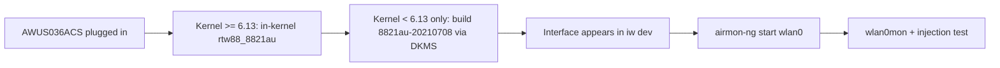

# RTL8811AU 驱动指南（AWUS036ACS）

> **一句话摘要**：**Realtek RTL8811AU** 是 55 mm **AWUS036ACS** 内部的 1×1 AC600 芯片——口袋尺寸的监听模式好伙伴。**kernel ≥ 6.13 起，内核已内置 `rtw88_8821au` 驱动**，插上即用（ASUS GX10、Ubuntu 24.04、kernel 6.17.0-1014-nvidia 实测，USB ID `0bda:0811`，固件 42.4.0，免安装、免 DKMS）。只有旧内核（< 6.13）才需要像它的大哥 RTL8812AU 一样，通过 DKMS 安装社区驱动。

## 内核内置驱动（kernel ≥ 6.13）

确认方法：

```bash
lsusb | grep -iE '0bda:0811'
sudo dmesg | grep -i 8821au
iw dev
```

`dmesg` 预期可看到 `rtw88_8821au ... Firmware version 42.4.0, H2C version 0`。实测结果：2.4 / 5 GHz monitor 均 ✅；注入 2.4 GHz 100%、5 GHz 96%（5 GHz 注入前先 `sudo iw reg set US`，测完还原）；AP 2.4 / 5 GHz ✅（频宽未确认）；WPA3-SAE ✅（AP 于 5 GHz 实测）；handshake 端到端 ✅。IBSS、Mesh、Active monitor、P2P 均不支持（`-95`）。以下「步骤 1～2」的 DKMS 流程**仅适用于 kernel < 6.13**。

## 概念：同一家族，单一流

RTL8811AU 基本上是 RTL8812AU 家族的 1×1 版本：单一空间流、5 GHz 最高 433 Mbps、耗电较低、电路板较小。ALFA 将它包进小巧的 ACS 机身，搭配一支外置 2 dBi RP-SMA 天线——你可以在能藏进铅笔盒的体积中，获得经典的 ALFA 渗透测试功能。

就驱动而言，在旧内核上与 RTL8812AU 的情况并无不同：**内核内没有支持监听模式的驱动**，因此需使用社区的 `8821au-20210708` DKMS 驱动（**仅适用 kernel < 6.13**）。请注意，此驱动也涵盖 RTL8821AU 变体，所以如果你在类似的网卡上看到 `dkms status` 显示相同的模块名称，不必惊慌。



## 前置需求

- [ ] kernel ≥ 6.13（如 Ubuntu 24.04 + HWE 6.14 / GX10 6.17）：不需要以下 DKMS 前置需求
- [ ] 仅 kernel < 6.13：`sudo apt install -y build-essential dkms git`
- [ ] `sudo` 权限
- [ ] AWUS036ACS

## 步骤 1（仅适用 kernel < 6.13）：克隆并构建

```bash
cd /opt
sudo git clone https://github.com/morrownr/8821au-20210708.git
cd 8821au-20210708
sudo sh install-driver.sh
```

**预期输出**（示例；DKMS 路径未在我们的 GX10 上测试）：

```text
DKMS: install completed.
```

## 步骤 2（仅适用 kernel < 6.13）：加载并验证

```bash
sudo modprobe 8821au
iw dev
```

**预期输出**：一行 `Interface wlan0`（或 `wlan1`）。如果网卡重新插拔后才出现，请将模块加入自动加载：

```bash
echo 8821au | sudo tee /etc/modules-load.d/alfa.conf
```

## 步骤 3：监听模式 + 数据包注入

切勿执行 `airmon-ng check kill`（会关闭 NetworkManager）：

```bash
IF=$(ls /sys/class/net | grep '^wlx' | head -1)
sudo nmcli dev set $IF managed no
sudo ip link set dev $IF down
sudo iw dev $IF set type monitor
sudo ip link set dev $IF up
sudo iw dev $IF set channel 6
sudo aireplay-ng --test $IF
```

**预期输出**（GX10 实测）：

```text
Injection is working!
30/30: 100%
```

GX10 实测：2.4 GHz 30/30（100%）、5 GHz 29/30（96%）。

## 步骤 4：恢复正常

```bash
sudo ip link set dev $IF down
sudo iw dev $IF set type managed
sudo nmcli dev set $IF managed yes
sudo ip link set dev $IF up
```

## 故障排查

| 症状 | 原因 | 修复 |
|---|---|---|
| （仅 kernel < 6.13）DKMS 构建失败 | 缺少头文件 / 内核太新 | `sudo apt install linux-headers-$(uname -r)`；`cd 8821au-20210708 && git pull && sudo sh install-driver.sh` |
| （仅 kernel < 6.13）接口只有 managed 模式 | 内核内的 `rtl8811au` stub 抢先绑定 | `echo "blacklist rtl8811au" \| sudo tee /etc/modprobe.d/alfa-8811au.conf`；重启 |
| 注入 0/30 | 空信道 | `sudo iw $IF set channel 6`；在 AP 附近测试 |
| 吞吐量低于预期 | 1×1 无线电（AC600）——硬件限制 | 并非 bug；5 GHz 实际预期约 150–250 Mbps |
| （仅 kernel < 6.13，DKMS 方式）重启后检测不到 | 模块未自动加载 | 将 `8821au` 加入 `/etc/modules-load.d/alfa.conf` |

## 参考

- [AWUS036ACS 产品页面](/alfa-network/products/awus036acs/)
- [Kali 设置指南](/alfa-network/linux-setup-kali/)
- [Ubuntu 设置指南](/alfa-network/linux-setup-ubuntu/)
- [故障排查索引](/alfa-network/troubleshooting/)
- 驱动 repo：[morrownr/8821au-20210708](https://github.com/morrownr/8821au-20210708)（RTL8811AU / RTL8821AU；先前的 `aircrack-ng/rtl8811au` repository 已不存在）
