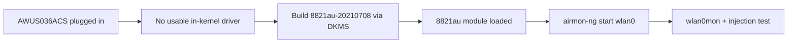

# RTL8811AU 驱动程序指南（AWUS036ACS）

> **一句话摘要**：**Realtek RTL8811AU** 是 55 mm **AWUS036ACS** 内部的 1×1 AC433 芯片——口袋尺寸的监听模式好伙伴。就像它的大哥 RTL8812AU 一样，需要通过 DKMS 安装社区的 `rtl8811au` 驱动程序，但建置流程完全相同。

## 概念：同一家族，单一串流

RTL8811AU 基本上是 RTL8812AU 家族的 1×1 版本：单一空间串流、5 GHz 最高 433 Mbps、耗电较低、电路板较小。ALFA 将它包进小巧的 ACS 机身，搭配一支外置 2 dBi RP-SMA 天线——你可以在能藏进铅笔盒的体积中，获得经典的 ALFA 渗透测试功能。

就驱动程序而言，与 RTL8812AU 的情况并无不同：**内核内没有支持监听模式的驱动程序**，因此我们使用社区的 `8821au-20210708` DKMS 驱动程序。请注意，此驱动程序也涵盖 RTL8821AU 变体，所以如果你在类似的网卡上看到 `dkms status` 显示相同的模块名称，不必惊慌。



## 前置需求

- [ ] Linux（Ubuntu 20.04+ / Kali / Debian）
- [ ] `sudo apt install -y build-essential dkms git`
- [ ] `sudo` 权限
- [ ] AWUS036ACS

## 步骤 1：拷贝并建置

```bash
cd /opt
sudo git clone https://github.com/morrownr/8821au-20210708.git
cd 8821au-20210708
sudo sh install-driver.sh
```

**预期输出**：

```text
DKMS: install completed.
```

## 步骤 2：加载并验证

```bash
sudo modprobe 8821au
iw dev
```

**预期输出**：一行 `Interface wlan0`（或 `wlan1`）。如果网卡重新插拔后才出现，请将模块加入自动加载：

```bash
echo 8821au | sudo tee /etc/modules-load.d/alfa.conf
```

## 步骤 3：监听模式 + 封包注入

```bash
sudo airmon-ng check kill
sudo airmon-ng start wlan0
sudo aireplay-ng --test wlan0mon
```

**预期输出**：

```text
PHY	Interface	Driver		Chipset
phy0	wlan0		8821au		Realtek Semiconductor Corp. RTL8811AU
...
12:34:56  Injection is working!
12:34:56  30/30:  100%
```

## 步骤 4：恢复正常

```bash
sudo airmon-ng stop wlan0mon
sudo systemctl restart NetworkManager
```

## 疑难排解

| 症状 | 原因 | 修复 |
|---|---|---|
| DKMS 建置失败 | 缺少标头档 / 内核太新 | `sudo apt install linux-headers-$(uname -r)`；`cd 8821au-20210708 && git pull && sudo sh install-driver.sh` |
| 接口只有 managed 模式 | 内核内的 `rtl8811au` stub 抢先绑定 | `echo "blacklist rtl8811au" \| sudo tee /etc/modprobe.d/alfa-8811au.conf`；重启 |
| 注入 0/30 | 空频道 | `sudo iw wlan0mon set channel 6`；在 AP 附近测试 |
| 传输量低于预期 | 1×1 无线电（AC433）——硬件限制 | 并非 bug；5 GHz 实际预期约 150–250 Mbps |
| 重启后侦测不到 | 模块未自动加载 | 将 `8821au` 加入 `/etc/modules-load.d/alfa.conf` |

## 参考数据

- [AWUS036ACS 产品页面](/alfa-network/products/awus036acs/)
- [Kali 设置指南](/alfa-network/linux-setup-kali/)
- [Ubuntu 设置指南](/alfa-network/linux-setup-ubuntu/)
- [疑难排解索引](/alfa-network/troubleshooting/)
- 驱动程序 repo：[morrownr/8821au-20210708](https://github.com/morrownr/8821au-20210708)（RTL8811AU / RTL8821AU；先前的 `aircrack-ng/rtl8811au` repository 已不存在）
