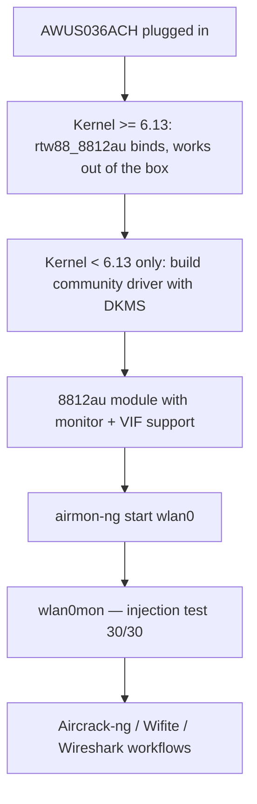

# RTL8812AU 驱动指南（AWUS036ACH）

> **一句话定位（One-liner）**：**Realtek RTL8812AU** 是 **AWUS036ACH** 内部传奇的 2×2 双频芯片组——你看过的每个 Kali 教程里都有的那款网卡适配器。**kernel ≥ 6.13 起，内核已内置 `rtw88_8812au` 驱动**，插上即用（ASUS GX10、Ubuntu 24.04、kernel 6.17.0-1014-nvidia 实测，USB ID `0bda:8812`，免安装、免 DKMS）。只有在旧内核（< 6.13）上，才需要用 DKMS 构建一次 `rtl8812au` 社区驱动。

## 内核内置驱动（kernel ≥ 6.13）

在 kernel ≥ 6.13 上，驱动名为 `rtw88_8812au`，固件 `rtw88/rtw8812a_fw.bin` 系统已附带，无需任何安装。确认方法：

```bash
lsusb | grep 0bda:8812
lsusb -t | grep rtw88_8812au
iw dev
```

实测结果：2.4 / 5 GHz monitor 均 ✅；注入 2.4 GHz 100%、5 GHz 100%；AP 2.4 / 5 GHz ✅；WPA3-SAE ✅；VIF（STA+monitor）✅；handshake 端到端 ✅。不支持 Active monitor、Mesh、P2P（回 `Operation not supported (-95)`）。已知问题：5 GHz RX 可能卡死，需拔插网卡。以下「第 1～3 步」的 DKMS 流程**仅适用于 kernel < 6.13**。

## 概念：最著名的 Wi-Fi 黑客芯片组

RTL8812AU 以高功率（500 mW）无线电和两根外置天线驱动 AC1200 的 AWUS036ACH。它的名声来自 **aircrack-ng 社区**：多年的渗透测试工作把树外驱动打磨得正好满足 Kali 需要的两件事——**监听模式**和**数据包注入**。

在旧内核上，它不在内核里：Realtek 当时没有上游干净的驱动，内核只保留一个没有监听支持的桩模块（`staging/` 中的 `rtl8812au`），社区驱动（`aircrack-ng/rtl8812au`）取代了它。代价是**你必须构建一次**——之后 DKMS 系统会在每次内核更新时自动重新编译。**kernel ≥ 6.13 的主线驱动 `rtw88_8812au` 出现后，这些步骤不再需要。**



## 前置需求

- [ ] kernel ≥ 6.13（如 Ubuntu 24.04 + HWE 6.14 / GX10 6.17）：不需要以下 DKMS 前置需求
- [ ] 仅 kernel < 6.13：构建工具 + 网络：`sudo apt install -y build-essential dkms git`
- [ ] `sudo` 权限
- [ ] AWUS036ACH

## 第 1 步（仅适用 kernel < 6.13）：移除（无用的）内核桩模块

某些发行版自带一个 Realtek 桩驱动，会抢占网卡适配器并拒绝监听模式。先卸载它：

```bash
sudo modprobe -r rtl8812au 2>/dev/null
```

（如果命令报错「not found」，很好——没有桩模块。`2>/dev/null` 隐藏了噪音。）

## 第 2 步（仅适用 kernel < 6.13）：用 DKMS 构建社区驱动

```bash
cd /opt
sudo git clone https://github.com/aircrack-ng/rtl8812au.git
cd rtl8812au
sudo make dkms_install
```

**预期输出**（示例；DKMS 路径未在我们的 GX10 上测试）：

```text
Kernel preparation unnecessary for this kernel.  Skipping...
...
DKMS: install completed.
```

验证模块已在 DKMS 注册：

```bash
dkms status
```

**预期输出**（示例）：

```text
rtl8812au/5.6.4.2, 6.8.0-51-generic, aarch64: installed
```

## 第 3 步（仅适用 kernel < 6.13）：加载它

```bash
sudo modprobe 8812au
iw dev
```

**预期输出**：出现 `Interface wlan0`（或 `wlan1`）。如果重启后桩模块又加载了，把它加入黑名单：

```bash
echo "blacklist rtl8812au" | sudo tee /etc/modprobe.d/alfa-8812au.conf
```

并把真正的模块加入自动加载：

```bash
echo 8812au | sudo tee /etc/modules-load.d/alfa.conf
```

## 第 4 步：监听模式 + 注入

切勿执行 `airmon-ng check kill`（会关闭 NetworkManager）；只对该网卡的 `wlx...` 接口使用 `iw`：

```bash
IF=$(ls /sys/class/net | grep '^wlx' | head -1)
sudo nmcli dev set $IF managed no
sudo ip link set dev $IF down
sudo iw dev $IF set type monitor
sudo ip link set dev $IF up
sudo iw dev $IF set channel 6
sudo aireplay-ng --test $IF
```

**预期输出**（GX10 实测）：

```text
Injection is working!
30/30: 100%
```

5 GHz 注入前先 `sudo iw reg set US`，测完还原。那行 `30/30` 就是 AWUS036ACH 在做它最出名的事。注意：hcxdumptool 8.x 需要 active-monitor，在本卡上 failed to arm，请改用 airodump-ng + aireplay-ng。

## 第 5 步：回到 managed 模式

```bash
sudo ip link set dev $IF down
sudo iw dev $IF set type managed
sudo nmcli dev set $IF managed yes
sudo ip link set dev $IF up
```

## 故障排查

| 症状 | 原因 | 修复 |
|---|---|---|
| （仅 kernel < 6.13）`make dkms_install` 失败并提示 "No rule to make target" | 仓库快照比你的新内核旧 | 再次 `sudo git pull && sudo make dkms_install` |
| （仅 kernel < 6.13）构建失败：缺少头文件 | 未安装头文件 | `sudo apt install linux-headers-$(uname -r)` |
| （仅 kernel < 6.13）网卡适配器只能在 managed 模式 | 内核桩模块先抢占了它 | 黑名单 `rtl8812au`（第 3 步）并重启 |
| 注入 `0/30` | 信道没有接入点 | `sudo iw $IF set channel 6`；在接入点附近测试 |
| 5 GHz 收不到任何数据包（内置驱动） | 反复切换模式 / regdomain 后 RX 卡死 | 拔下再重新插上，之后优先做 5 GHz |
| （仅 kernel < 6.13，DKMS 方式）重启后网卡适配器消失 | 模块未自动加载 | `echo 8812au \| sudo tee /etc/modules-load.d/alfa.conf` |
| （仅 kernel < 6.13）升级后 `dkms status` 显示 Error | 重建静默失败 | `sudo dkms autoinstall` |

## 参考

- [AWUS036ACH 产品页面](/alfa-network/products/awus036ach/)
- [Kali 设置指南](/alfa-network/linux-setup-kali/)——完整的监听/注入工作流
- [Ubuntu 设置指南](/alfa-network/linux-setup-ubuntu/)
- [故障排查索引](/alfa-network/troubleshooting/)
- 驱动仓库：[aircrack-ng/rtl8812au](https://github.com/aircrack-ng/rtl8812au)