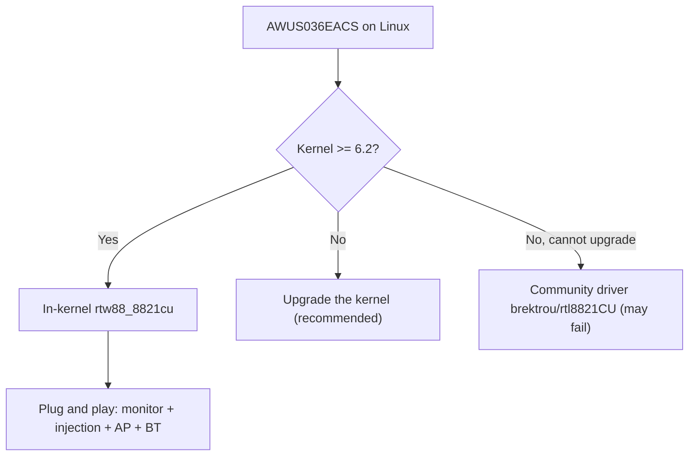

# RTL8821CU 驱动指南（AWUS036EACS）

> **一句话定位（One-liner）**：**Realtek RTL8821CU** 是纳米 **AWUS036EACS** 内部的 WiFi 5 + 蓝牙 4.2 组合芯片组。**kernel ≥ 6.2 起，内核内置 `rtw88_8821cu` 驱动**，插上即用；在 ASUS GX10（Ubuntu 24.04、kernel 6.17.0-1014-nvidia）上实测监听模式、两频注入、AP、WPA3 与蓝牙都可用。只有旧内核（< 6.2）才需要社区驱动。

## 内核内置驱动（kernel ≥ 6.2）

| 项目 | 实测 |
|---|---|
| USB ID | `0bda:c820` |
| 驱动 | `rtw88_8821cu`（内核内置，免安装、免 DKMS） |
| 固件 | 24.11.0（H2C version 12） |
| Monitor 2.4 GHz / 5 GHz | ✅ / ✅（强） |
| 注入 2.4 GHz / 5 GHz | ✅ 100% / ✅ 100%（deauth 实测收到 79 ACKs） |
| AP 2.4 GHz / 5 GHz | ✅ / ✅（80 MHz） |
| WPA3-SAE（AP 端） | ✅（2.4 GHz 实测） |
| WPA handshake 抓取 | ✅ 端到端（`.22000`） |
| VIF | 🟡 被动 monitor 可与 managed 在同一信道并存；不支持独立的双 VIF |
| 蓝牙 | ✅ 实测可用 |
| IBSS / Mesh / Active monitor / P2P | 均不支持（Mesh、Active monitor、P2P 回 `-95`） |

确认方法：

```bash
lsusb | grep -i '0bda:c820'
sudo dmesg | grep -i 8821cu
iw dev
```

`dmesg` 预期可看到 `rtw88_8821cu ... Firmware version 24.11.0, H2C version 12`。

注意事项：

- 这是 Wi-Fi + 蓝牙组合设备，**重新插拔或某些 USB 口可能导致 Wi-Fi probe 卡死、不出现 `wlx*` 接口**——换一个 USB 口即可。
- 5 GHz 注入前先 `sudo iw reg set US`，测完还原。
- 旧资料中「Linux 没有可靠驱动、监听模式不可用」的说法对 kernel ≥ 6.2 的内置驱动**已不适用**。
- 6 GHz：本卡不具备，不适用。

## 概念：旧内核上的社区驱动

RTL8821CU 是 AC600 等级（150 + 433 Mbps）芯片，带集成 2 dBi 天线，没有外置 RP-SMA 接口。在 kernel < 6.2 上，内核**没有 RTL8821CU 的 USB 驱动**，只能靠社区驱动，其状况不稳定：

- 最知名的仓库 [`brektrou/rtl8821CU`](https://github.com/brektrou/rtl8821CU)（RTL8821CU 社区驱动）可以针对较旧内核构建，但在新内核上经常失败。
- 已报告的问题包括网卡适配器不稳定，以及监听模式不可靠 / 无法注入。
- 蓝牙需要单独的驱动路径（`rtl_bt` 固件）。

因此：**能升级到 kernel ≥ 6.2 就升级**，不要在旧内核上折腾社区驱动。



## 前置需求

- [ ] kernel ≥ 6.2（如 Ubuntu 24.04 + GA 6.8 / HWE 6.14 / GX10 6.17）：不需要额外前置需求，直接插上
- [ ] 仅 kernel < 6.2 且选择社区驱动：`sudo apt install -y build-essential dkms git`；内核 **≤ 5.x** 构建成功率最高

## 第 1 步（仅适用 kernel < 6.2）：尝试社区驱动

```bash
cd /opt
sudo git clone https://github.com/brektrou/rtl8821CU.git
cd rtl8821CU
sudo make dkms_install
```

**可能的结果**：

```text
DKMS: install completed.        # worked (older kernels)
# or
make: *** [Makefile:...] Error 1  # build failed (newer kernels)
```

如果构建成功，加载并检查：

```bash
sudo modprobe 8821cu
iw dev
```

**预期输出（成功情况）**：一个 `Interface wlan0` 行。

## 第 2 步：连接并测试监听模式

kernel ≥ 6.2（内置驱动）：

```bash
nmcli device wifi connect "MySSID" password "my-passphrase"
IF=$(ls /sys/class/net | grep '^wlx' | head -1)
sudo nmcli dev set $IF managed no
sudo ip link set dev $IF down
sudo iw dev $IF set type monitor
sudo ip link set dev $IF up
sudo iw dev $IF set channel 6
sudo aireplay-ng --test $IF
```

切勿执行 `airmon-ng check kill`（会关闭 NetworkManager）。

**预期输出**：managed 模式可连接；注入测试在 2.4 / 5 GHz 实测均为 `30/30`（内置驱动）。旧内核上的社区驱动，注入结果则不保证。`hcxdumptool` 8.x 在 EACS 上 2.4 GHz 可启动、5 GHz failed to arm，请改用 airodump-ng + aireplay-ng。

## 推荐路径

| 你的目标 | 推荐网卡适配器 |
|---|---|
| Kali / 监听模式 / 数据包注入（kernel ≥ 6.2） | AWUS036EACS、[AWUS036ACH](/alfa-network/products/awus036ach/) 或 [AWUS036ACM](/alfa-network/products/awus036acm/)（均实测可用） |
| 旧内核且无法升级 | [AWUS036ACM](/alfa-network/products/awus036acm/)（mt76x2u 自内核 4.19 起内置） |
| WiFi + BT 组合小型设备 | **AWUS036EACS** |

## 故障排查

| 症状 | 原因 | 修复 |
|---|---|---|
| `lsusb` 看得到 `0bda:c820` 但没有 `wlx*` 接口 | 组合设备 Wi-Fi probe 卡死 | 换一个 USB 口重新插拔 |
| （仅 kernel < 6.2）`make dkms_install` 在新内核上失败 | 社区驱动未针对新内核维护 | 升级到 kernel ≥ 6.2 使用内置驱动 |
| 检测不到接口 | 内核 < 6.2，没有内置驱动 | 升级内核 |
| 5 GHz 注入失败 | 区域限制发射 | `sudo iw reg set US`，测完还原 |
| 蓝牙缺失 | `rtl_bt` 固件未加载 | `sudo apt install linux-firmware`；重新插拔 |

## 参考

- [AWUS036EACS 产品页面](/alfa-network/products/awus036eacs/)
- [网卡适配器对比](/alfa-network/wifi-adapter-comparison/)
- [兼容性矩阵](/alfa-network/linux-compatibility-matrix/)
- [故障排查索引](/alfa-network/troubleshooting/)
- 旧内核社区驱动：[brektrou/rtl8821CU](https://github.com/brektrou/rtl8821CU)
