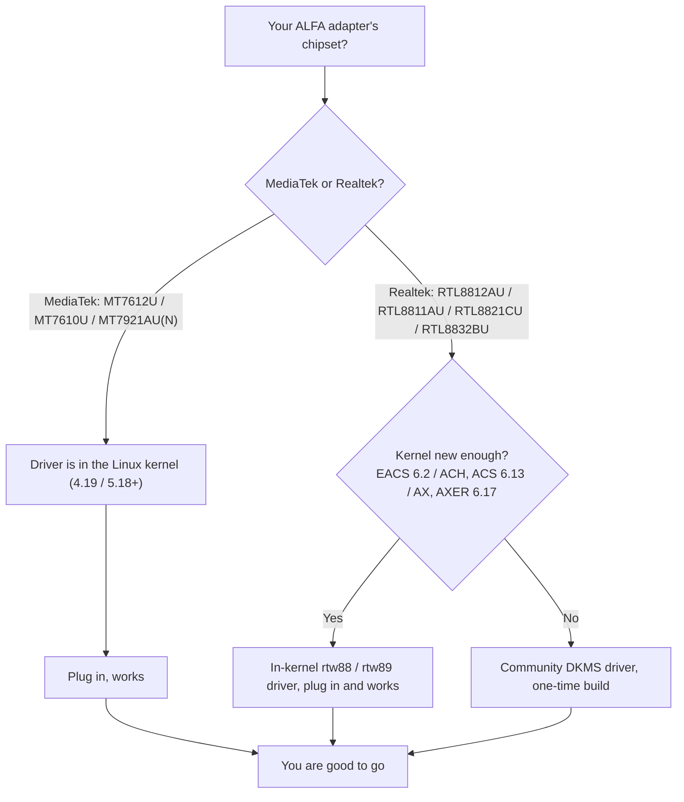

# ALFA Linux 兼容性矩阵

> **结论先行（Bottom line）**：**内核够新（kernel ≥ 6.17）时，9 款网卡适配器全部由内核内置驱动支持，插上即用，不需要 DKMS**（ASUS GX10、Ubuntu 24.04 LTS ARM64、kernel 6.17.0-1014-nvidia 实测，测试日期 2026-11-16～11-19）。MediaTek 系列的驱动更早就在内核里（`mt76x2u` / `mt76x0u` 自 4.19、`mt7921u` 自 5.18）；Realtek 系列依型号需要 EACS kernel ≥ 6.2、ACH / ACS ≥ 6.13、AX / AXER ≥ 6.17，**只有在内核低于该版本时才需要社区 DKMS 驱动**（ACM、ACHM、AXM、AXML 不需要 DKMS）。注意：**AXM / AXML（MT7921）在 stock kernel 6.17 上封包注入未通过**，不适合注入/渗透用途。




*💡 点击上方图片可开启高分辨率放大灯箱，清晰检视三条驱动路径图解。*

## 矩阵

图例：✅ 通过 · 🟡 部分 / 单机 · ⚠️ 有限制 · ❌ 不支持 / 失败 · N/A 驱动不具此模式 · 「未测试」= 未实测

### 驱动与 DKMS 需求

| 网卡适配器 | 芯片组 | 驱动 | 内核内置起始版本 | 是否需要 DKMS | GX10 / Ubuntu 24.04 实测 |
|---|---|---|---|---|---|
| AWUS036ACM | MT7612U | `mt76x2u` | 4.19 | 否 | ✅ 插上即用 |
| AWUS036ACHM | MT7610U | `mt76x0u` | 4.19 | 否 | ✅ 插上即用 |
| AWUS036ACH | RTL8812AU | `rtw88_8812au` | 6.13 | 仅 kernel < 6.13 | ✅ 插上即用 |
| AWUS036ACS | RTL8811AU | `rtw88_8821au` | 6.13 | 仅 kernel < 6.13 | ✅ 插上即用 |
| AWUS036EACS | RTL8821CU | `rtw88_8821cu` | 6.2 | 仅 kernel < 6.2 | ✅ 插上即用（含蓝牙） |
| AWUS036AX | RTL8832BU | `rtw89_8852bu` | 6.17 | 仅 kernel < 6.17 | ✅ 插上即用 |
| AWUS036AXER | RTL8832BU | `rtw89_8852bu` | 6.17 | 仅 kernel < 6.17 | ✅ 插上即用 |
| AWUS036AXM | MT7921AUN | `mt7921u` | 5.18 | 否 | ✅ 插上即用 |
| AWUS036AXML | MT7921AUN | `mt7921u` | 5.18 | 否 | ✅ 插上即用（含蓝牙） |

### 实测功能简表（Monitor / Injection / AP / WPA3）

| 网卡适配器 | Monitor 2.4G / 5G | Injection 2.4G | Injection 5G | AP 2.4G / 5G | WPA3-SAE AP（实测频段） |
|---|---|---|---|---|---|
| AWUS036ACM | ✅ / ✅ | ✅ 63–83% | ✅ 76% | ✅ / ✅ | ✅（2.4 GHz） |
| AWUS036ACHM | ✅ / ✅ | ✅ 96–100% | ⚠️ 仅广播 | ✅ / ✅ | ✅（2.4 GHz，须 `sae_pwe=0`） |
| AWUS036ACH | ✅ / ✅ | ✅ 100% | ✅ 100% | ✅ / ✅ | ✅（2.4 GHz） |
| AWUS036ACS | ✅ / ✅ | ✅ 100% | ✅ 96% | ✅ / ✅ | ✅（5 GHz） |
| AWUS036EACS | ✅ / ✅ | ✅ 100% | ✅ 100% | ✅ / ✅ | ✅（2.4 GHz） |
| AWUS036AX | ✅ 强 / ✅ 强 | ✅ 96% | ✅ | ✅ / ✅ | ✅（2.4 GHz） |
| AWUS036AXER | ✅ 强 / ✅ 强 | ✅ 73% | ✅ | ✅ / ✅ | ✅（2.4 GHz） |
| AWUS036AXM | ✅ 弱 / ✅ 弱 | ❌ 未通过 | ❌ 未通过 | ✅ / ✅ | ✅（2.4 GHz） |
| AWUS036AXML | ✅ 弱 / ✅ 弱 | ❌ 未通过 | ❌ 未通过 | ✅ / ✅ | ✅（2.4 + 6 GHz） |

> AXM / AXML 的注入未通过是在 stock kernel 6.17 上的结果（主因是 kernel 6.16 起的 mac80211 chanctx 回归，并非芯片先天限制；社区修补版驱动可让注入运作，但固件仍把速率锁在 1/6 Mbps）；因此无法 deauth 与抓取 handshake。6 GHz：仅 AXML 实测可运作（6 GHz WPA3-SAE AP，ch37 / 6135 MHz）；AXM 推测同样可用，**未测试**。

### 各操作系统支持

| 网卡适配器 | Ubuntu 24.04（GX10 实测） | Kali Linux | NetHunter / Android |
|---|---|---|---|
| AWUS036ACM | ✅ | 未实机测试 | 未实机测试 |
| AWUS036ACHM | ✅ | 未实机测试 | 未实机测试 |
| AWUS036ACH | ✅ | 未实机测试（kernel ≥ 6.13，否则 DKMS） | 未实机测试 |
| AWUS036ACS | ✅ | 未实机测试（kernel ≥ 6.13，否则 DKMS） | 未实机测试 |
| AWUS036EACS | ✅ | 未实机测试（kernel ≥ 6.2，否则 DKMS） | 未实机测试 |
| AWUS036AX | ✅ | 未实机测试（kernel ≥ 6.17，否则 DKMS） | 未实机测试 |
| AWUS036AXER | ✅ | 未实机测试（kernel ≥ 6.17，否则 DKMS） | 未实机测试 |
| AWUS036AXM | ✅ | 未实机测试 | 未实机测试 |
| AWUS036AXML | ✅ | 未实机测试 | 未实机测试 |

## 「内核内置」对你意味着什么

当芯片组的驱动程序位于 Linux 内核中时，你的操作系统会预装它。插上网卡适配器，`dmesg` 会显示它被驱动程序认领——无需编译、无需 DKMS、不会因内核更新而损坏。**Realtek 的 rtw88 / rtw89 驱动已陆续进入主线（EACS 自 6.2、ACH / ACS 自 6.13、AX / AXER 自 6.17）**，所以在内核够新时，MediaTek 与 Realtek 网卡适配器之间原有的可靠性差异已基本消失。

对于内核低于内置版本的 Realtek 型号，[Kali 指南](/alfa-network/linux-setup-kali/)和 [Ubuntu 指南](/alfa-network/linux-setup-ubuntu/)会带你完成 DKMS 构建（**仅适用旧内核**）。DKMS 会在每次内核更新后自动重建驱动程序，所以「更新后停止工作」不应该发生——如果发生了，请查看[故障排查索引](/alfa-network/troubleshooting/)。

## 各操作系统说明

### Ubuntu（LTS）

实测平台：Ubuntu 24.04 LTS ARM64（ASUS GX10，kernel 6.17.0-1014-nvidia），9 张卡全部插上即用。Ubuntu 24.04 的 GA 内核 6.8 已内置 ACM、ACHM、AXM、AXML、EACS 的驱动；HWE 6.14 再加上 ACH、ACS；AX 和 AXER 需要 kernel 6.17 或更新。内核更旧时，Realtek 型号需要 DKMS，MT7921（AXM / AXML）需要 **22.04 HWE 或更新版本**（内核 ≥ 5.18）。完整教程：[Ubuntu 设置指南](/alfa-network/linux-setup-ubuntu/)。

### Kali Linux

**未实机测试**（本次仅在 Ubuntu GX10 上实测）。从内核版本推断：Kali（滚动发行版）的内核通常较新，kernel ≥ 6.17 时九款应与 Ubuntu 一样内置驱动（更旧的内核则依各型号版本：EACS 6.2、ACH / ACS 6.13、AX / AXER 6.17）；若是旧内核且 DKMS 构建失败，请使用 **aircrack-ng** 维护的驱动仓库（如 `aircrack-ng/rtl8812au`），它们会跟进新内核。完整教程：[Kali 设置指南](/alfa-network/linux-setup-kali/)。

### NetHunter / Android

**未实机测试**。在已 root 的手机上通过 OTG 运行 NetHunter 是最苛刻的环境：Android 内核因手机而异，所以只有手机内核已包含对应驱动的情况才可靠（MediaTek mt76 系列最稳妥）。Realtek DKMS 驱动需要在 NetHunter chroot 内有匹配的工具链，而且常常在手机原厂内核上失败——请谨慎操作，参见 [NetHunter 指南](/alfa-network/linux-setup-nethunter/)。

## 如何检查你的内核

不确定你用的是哪个内核？运行：

```bash
uname -r
```

**预期输出**（示例）：

```text
6.17.0-1014-nvidia      # ASUS GX10 实测：全部 9 张卡内置驱动
6.8.0-51-generic        # Ubuntu 24.04 GA 内核：ACM / ACHM / AXM / AXML / EACS 内置；ACH、ACS、AX、AXER 需 DKMS
5.15.0-91-generic       # Ubuntu 22.04：< 5.18，mt7921u 不存在，需更新内核
```

判断方法：**kernel ≥ 6.17 —— 全部 9 款网卡插上即用**；低于 6.17 时对照各型号版本（EACS 6.2、ACH / ACS 6.13、AX / AXER 6.17，更旧则需 DKMS；ACM / ACHM 4.19、AXM / AXML 5.18）；kernel < 5.18 —— 先升级操作系统，驱动程序不会凭空出现。

下一步：按照你的操作系统选择 [Ubuntu](/alfa-network/linux-setup-ubuntu/) 或 [Kali](/alfa-network/linux-setup-kali/) 指南，或跳到[芯片组驱动页面](/alfa-network/drivers/mt7612u/)深入了解。
