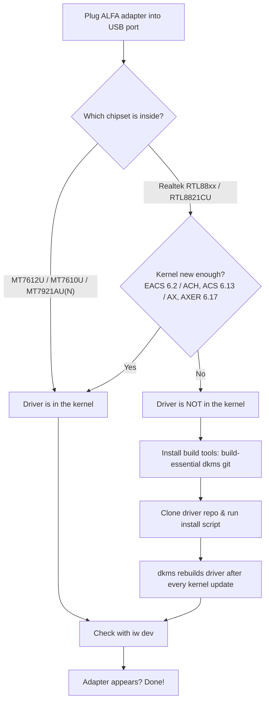

# ALFA 网卡适配器在 Ubuntu 上——完整设置指南

> **学习目标（Learning goal）**：学完本指南，你的 ALFA 网卡适配器将在 Ubuntu 中可见（`iw dev`）、能连接 Wi-Fi，并且——对于受支持的芯片组——能够切换进监听模式。
> **适用对象**：初学者–中级 ｜ **前置需求**：Ubuntu 24.04（GA 内核 6.8 涵盖 ACM、ACHM、AXM、AXML、EACS；HWE 6.14 再加上 ACH、ACS；AX 和 AXER 需要 kernel 6.17 或更新；实测：Ubuntu 24.04 LTS ARM64、kernel 6.17.0-1014-nvidia）；内核低于该型号内置版本时（EACS < 6.2、ACH / ACS < 6.13、AX / AXER < 6.17）另需为 Realtek 型号安装 DKMS；以及你的 ALFA 网卡适配器。

## 概念：两类驱动程序

在碰终端之前，先理解*为什么*设置取决于你的内核版本。现在是这样的两个世界：

1. **kernel ≥ 6.17：全部内置**（各型号最低版本：ACM / ACHM 4.19、AXM / AXML 5.18、EACS 6.2、ACH / ACS 6.13、AX / AXER 6.17）——9 款网卡的驱动程序都已经在内核里，插上 → 就能用，不需要 DKMS（本指南在 ASUS GX10、Ubuntu 24.04 LTS ARM64、kernel 6.17.0-1014-nvidia 上实测）。MediaTek 系列更早就内置：**MT7612U**（AWUS036ACM）、**MT7610U**（AWUS036ACHM）自 4.19，**MT7921AU / MT7921AUN**（AWUS036AXM / AWUS036AXML）自 5.18（需 Ubuntu 22.04 HWE 或更新版本）。
2. **旧内核：只有内核低于内置版本的 Realtek 才需要 DKMS**——**RTL8812AU**（AWUS036ACH）、**RTL8811AU**（AWUS036ACS）在 kernel < 6.13，**RTL8832BU**（AWUS036AX / AWUS036AXER）在 kernel < 6.17，**RTL8821CU**（AWUS036EACS）在 kernel < 6.2 时没有内置驱动，需要编译一次，之后 **DKMS** 会在每次内核更新后保持重建。



## 前置需求

- [ ] Ubuntu 24.04 或更新，且内核不低于你的网卡的内置版本（用 `lsb_release -a` 与 `uname -r` 检查；GA 6.8 涵盖 ACM、ACHM、AXM、AXML、EACS；HWE 6.14 再加上 ACH、ACS；GX10 的 6.17 涵盖全部 9 款）；内核更旧时只有 Realtek 型号需要 DKMS
- [ ] 可用的网络（Wi-Fi 或以太网）以下载软件包
- [ ] 你的 ALFA 网卡适配器和一根 USB-A 或 USB-C 线缆（AXML 使用 USB-C）
- [ ] `sudo` 权限

## 第 1 步：识别你的芯片组

插上网卡适配器，然后询问 Ubuntu 它看到了什么：

```bash
lsusb
```

**预期输出**（查找 MediaTek / Realtek 条目）：

```text
Bus 001 Device 004: ID 0e8d:7612 MediaTek Inc. MT7612U 802.11a/b/g/n/ac 2T2R Wireless Adapter
Bus 001 Device 005: ID 0bda:8812 Realtek Semiconductor Corp. RTL8812AU 802.11a/b/g/n/ac 2T2R Wireless Adapter
```

- `0e8d` = MediaTek（内核内置路径）
- `0bda` = Realtek（内核够新时内置：EACS ≥ 6.2、ACH / ACS ≥ 6.13、AX / AXER ≥ 6.17；更旧的内核走 DKMS 路径）
- 不确定？对照[兼容性矩阵](/alfa-network/linux-compatibility-matrix/)中的芯片组表。

## 第 2 步：内核内置路径（内核不低于你的网卡的内置版本；MediaTek 更早即可）

如果你的内核不低于该网卡的内置版本（或网卡适配器使用 MediaTek 芯片组），无需安装任何东西。验证：

```bash
uname -r
dmesg | grep -iE 'mt76|mt7921u|rtw88|rtw89' | tail -5
```

**预期输出**：`uname -r` 不低于该网卡的内置版本（如 `6.17.0-1014-nvidia`），`dmesg` 可见对应驱动（`mt76x2u`、`mt76x0u`、`mt7921u`、`rtw88_8812au`、`rtw88_8821au`、`rtw88_8821cu`、`rtw89_8852bu`）认领了网卡。再确认接口：

```bash
iw dev
```

**预期输出**：

```text
phy#0
	Interface wlan0
		ifindex 3
		addr 00:c0:ca:xx:xx:xx
		type managed
```

看到 `wlan0` 了？恭喜——驱动程序已生效。通过桌面 Wi-Fi 菜单或 NetworkManager 连接：

```bash
nmcli device wifi connect "MySSID" password "my-passphrase"
```

**预期输出**：`Device 'wlan0' successfully activated with 'MySSID'.`

跳到[第 4 步：验证一切](#step-4-verify-everything)。

## 第 3 步：DKMS 路径（**仅适用内核低于该网卡内置版本的 Realtek**——一次性构建）

**内核够新请跳过本步骤**。仅当你的内核低于该网卡的内置版本（`uname -r` 确认；ACH / ACS < 6.13、AX / AXER < 6.17）时，才需要为 RTL8812AU（AWUS036ACH）、RTL8811AU（AWUS036ACS）和 RTL8832BU（AWUS036AX / AXER）构建一次驱动程序（RTL8821CU / AWUS036EACS 的社区驱动不稳定，建议直接升级内核）。三者遵循相同模式——安装工具、克隆仓库、运行安装程序。

### 3.1 安装构建工具

```bash
sudo apt update
sudo apt install -y build-essential dkms git
```

**预期输出**：以 `Setting up dkms ...` 结尾且无错误。DKMS 就是那个会在内核更新后重新编译驱动的组件。

### 3.2 RTL8812AU（AWUS036ACH）

久经考验的仓库由 aircrack-ng 项目维护：

```bash
cd /opt
sudo git clone https://github.com/aircrack-ng/rtl8812au.git
cd rtl8812au
sudo make dkms_install
```

**预期输出**：

```text
DKMS: install completed.
```

模块现在是 `8812au`，DKMS 会在每次内核更新时重建它——你可以忘记它的存在。

### 3.3 RTL8811AU（AWUS036ACS）

```bash
cd /opt
sudo git clone https://github.com/morrownr/8821au-20210708.git
cd 8821au-20210708
sudo sh install-driver.sh
```

**预期输出**：脚本使用 DKMS 构建并安装驱动（按提示操作，并在要求时重启）——模块名 `8821au`。

### 3.4 RTL8832BU（AWUS036AX / AWUS036AXER）

```bash
cd /opt
sudo git clone https://github.com/morrownr/rtl8852bu-20250826.git
cd rtl8852bu-20250826
sudo sh install-driver.sh
```

**预期输出**：脚本使用 DKMS 构建并安装驱动（按提示操作，并在要求时重启）——模块名 `8852bu`。注意：这是旧内核（< 6.17）的 DKMS 驱动；kernel ≥ 6.17 的内置 `rtw89_8852bu` 实测支持监听模式与注入。

拔下再插上网卡适配器（或运行 `sudo modprobe <module>`），然后验证：

```bash
iw dev
```

**预期输出**：出现 `Interface wlan1`（如果它是你唯一的网卡适配器则为 `wlan0`）条目。

> **你可能想知道**——*「哪个模块名对应我的网卡适配器？」* 匹配你的芯片组：`8812au` → AWUS036ACH，`8821au` → AWUS036ACS，`8852bu` → AWUS036AX / AXER。[驱动页面](/alfa-network/drivers/rtl8812au/)有更深入的芯片组细节。

## 第 4 步：验证一切 {#step-4-verify-everything}

三项命令的健康检查（内置驱动时接口名通常为 `wlx<MAC>`，以下以 `wlan1` 为例）：

```bash
ip link show | grep -E "^[0-9]+: wl"        # interface exists?
iw dev                                       # interface + phy info
iw reg get | head -20                        # regulatory domain (affects power/channels)
```

**预期输出**：

```text
3: wlan1: <BROADCAST,MULTICAST,UP,LOWER_UP> mtu 1500 qdisc mq state UP
phy#1
	Interface wlan1
		ifindex 3
		addr 00:c0:ca:xx:xx:xx
		type managed
```

三条命令都有输出 = 你的 ALFA 网卡适配器完全正常。

## 进阶：监听模式（受支持芯片组）

监听模式让网卡适配器捕获信道上的每一个数据包，而不仅仅是自己的连接。在内核内置驱动上，这是两条命令的事（请勿执行 `airmon-ng check kill`，会关闭 NetworkManager）：

> 实测注意：九款在 2.4 / 5 GHz 均可进监听模式（AX / AXER 接收强）；AXM / AXML（mt7921u）接收较弱，且在 stock kernel 6.17 上封包注入未通过（ACHM 在 5 GHz 仅广播帧）；hcxdumptool 8.x 除 EACS（2.4 GHz 可启动、5 GHz 失败）外，其余网卡均 failed to arm，请改用 airodump-ng + aireplay-ng；ARM64 的 aircrack-ng 需自原始码编译；5 GHz 注入前先 `sudo iw reg set US`，测完还原。

```bash
sudo ip link set wlan1 down
sudo iw wlan1 set monitor none
sudo ip link set wlan1 up
iw dev
```

**预期输出**：`type monitor` 而不是 `type managed`。

> ⚠️ **重要**：`type managed`（默认）意味着驱动程序会过滤掉所有不是发给你的数据。`type monitor` 会关闭该过滤器——突然会有大量流量变得可见。只在你拥有或已获明确授权测试的网络上运行。完整的 packet injection（数据包注入）工作流见 [Kali 指南](/alfa-network/linux-setup-kali/)。

## 常见错误（FAQ）

| 错误 / 症状 | 原因 | 修复 |
|---|---|---|
| `lsusb` 显示网卡适配器但没有 `wlanX` 接口 | 内核低于该网卡内置版本且 DKMS 模块未加载（Realtek）；或 EACS / AXML 重插后 probe 卡死 | 旧内核：`sudo modprobe 8812au`（匹配你的芯片组），再看 `dmesg \| tail`；EACS / AXML 请换一个 USB 口 |
| （仅旧内核）`make dkms_install` 失败并提示 "Kernel preparation unnecessary" | 缺少内核头文件 | `sudo apt install linux-headers-$(uname -r)` 然后重试 |
| （仅旧内核，DKMS）`apt upgrade` 后网卡适配器消失 | 内核更新，DKMS 重建静默失败 | `sudo dkms autoinstall` 然后重启 |
| 重启后 `iw dev` 什么都没有（Realtek，仅旧内核的 DKMS 方式） | 模块不在自动加载列表中 | `echo 8812au \| sudo tee /etc/modules-load.d/alfa.conf` |
| 网卡适配器（AXM / AXML）在 Ubuntu 20.04 上检测不到 | 内核太旧，不支持 `mt7921u` | 升级内核到 5.18 以上（Ubuntu 22.04 HWE 或更新版本） |

## 参考

- [本指南的 Kali Linux 版本](/alfa-network/linux-setup-kali/)——监听模式 + 数据包注入
- [芯片组驱动页面](/alfa-network/drivers/mt7612u/)——各芯片组深度解析
- [故障排查索引](/alfa-network/troubleshooting/)——其他任何出错的情况
- [兼容性矩阵](/alfa-network/linux-compatibility-matrix/)——完整操作系统覆盖表
- aircrack-ng 驱动仓库：[rtl8812au](https://github.com/aircrack-ng/rtl8812au)、[8821au-20210708](https://github.com/morrownr/8821au-20210708) (RTL8811AU)、[rtl8852bu-20250826](https://github.com/morrownr/rtl8852bu-20250826) (RTL8832BU)