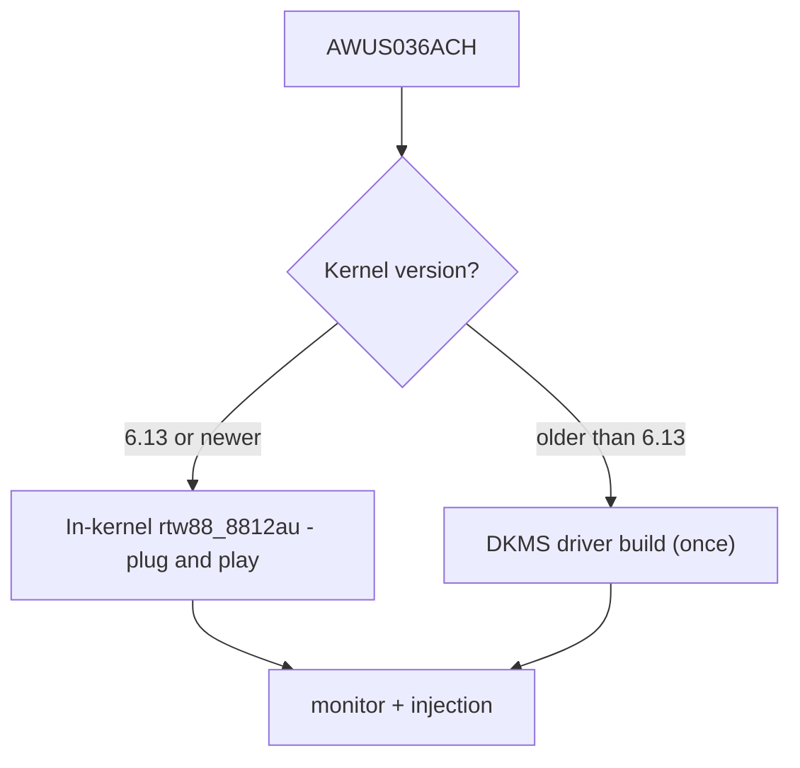

# ALFA AWUS036ACH——高功率 AC1200

> **一句话定位（Quick Summary）**：**AWUS036ACH** 是 ALFA 最有名的网卡适配器——一支**高功率 RTL8812AU AC1200 双频** USB 3.0 dongle，配两支 5 dBi 外置天线。在 **kernel 6.13 或更新版本**由内置的 `rtw88_8812au` 驱动支持：插上即可用，不需 DKMS。已在 ASUS GX10 / Ubuntu 24.04 ARM64 实测：双频监听与注入（100%）、端到端 handshake 捕获、WPA3 AP（2.4 GHz）。只有较旧的 kernel（< 6.13）才需要社区 DKMS 驱动。仅限在自有或已授权的网络使用。

## 规格总览 (Spec overview)

| 项目 | 规格 |
|---|---|
| 芯片 | Realtek RTL8812AU |
| Wi-Fi 等级 | AC1200（300 + 867 Mbps） |
| 接口 | USB 3.0 |
| 频段 | 2.4 + 5 GHz |
| 天线 | 2 × 外置 5 dBi，RP-SMA |
| TX 功率 | 高功率（500 mW 等级） |
| Linux 驱动 | `rtw88_8812au`——**kernel ≥ 6.13 内置**；较旧的 kernel（< 6.13）：社区 `rtl8812au` DKMS |
| 监听模式 | ✅ 2.4 + 5 GHz（GX10 实测） |
| 数据包注入 | ✅ 2.4 与 5 GHz 皆 100%（GX10 实测） |

## 实测：ASUS GX10 / Ubuntu 24.04 ARM64

**测试环境**：ASUS Ascent GX10（NVIDIA GB10）、Ubuntu 24.04 LTS ARM64、kernel `6.17.0-1014-nvidia`，测试日期 2026-11-16 至 2026-11-19，测试设备为 iPhone 7 Plus（WPA3 另用 iPhone 15 Pro）。

| 项目 | 结果 |
|---|---|
| 芯片 | Realtek RTL8812AU |
| USB ID | `0bda:8812` |
| 内核驱动 | `rtw88_8812au`（内置于内核） |
| 固件 | `rtw88/rtw8812a_fw.bin`（linux-firmware） |
| 是否需要 DKMS | 否（kernel ≥ 6.13 不需要） |

| 功能 | 2.4 GHz | 5 GHz |
|---|---|---|
| Monitor | ✅ | ✅ |
| Injection | ✅ 100% | ✅ 100% |
| AP 热点 | ✅ | ✅ |
| WPA3-SAE（AP 端，`sae_pwe=0`） | ✅ | 未测试 |

| 高级功能 | 结果 |
|---|---|
| WPA handshake 捕获 | ✅ 端到端（已转出 `.22000`） |
| VIF | ✅ STA + monitor |
| Active monitor | ❌ `Operation not supported (-95)` |
| IBSS（Ad-hoc） | 🟡 仅单机验证 |
| Mesh（802.11s） | ❌ `-95` |
| Wi-Fi Direct（P2P） | ❌ `-95` |

在你自己的机器上验证：

```bash
lsusb | grep 0bda:8812
lsusb -t | grep rtw88_8812au
sudo dmesg | grep -iE 'rtw88_8812au|8812' | tail -5
iw phy $(cat /sys/class/net/$(ls /sys/class/net | grep '^wlx' | head -1)/phy80211/name) info | sed -n '/Supported interface modes/,/Band 1/p'
iw dev
```

完整测试报告：[AWUS036ACH 于 ASUS GX10 / Ubuntu 的实测报告](https://yupitek.com/zh-cn/blog/awus036ach-asus-gx10-ubuntu-test-report/)。

**备注**：
- 请直接插在 USB 3.0 端口（`lsusb -t` 显示 `5000M`），不要接 USB 2.0 hub。
- 反复切换模式或法规网域后，5 GHz RX 可能卡死（收到 0 个数据包，只有重新插拔才能恢复）。请在刚插上卡之后立刻做 5 GHz 测试。
- 5 GHz 注入前请先运行 `sudo iw reg set US`，测完再还原你原本的区域设置。
- AP：停用 802.11n（纯 g / 纯 a）后，iPhone 7 Plus 第一次就连上。WPA3 需要 `sae_pwe=0` 才能让 iPhone 7 Plus 连上。
- 6 GHz：不适用。Kali 与 NetHunter：未实机测试。

## 总览

AWUS036ACH 是替 ALFA 打下「黑客网卡适配器」名声的那一支。它把老牌的 **RTL8812AU** 射频搭配真正的**高功率（500 mW）前端**与两支可更换的 5 dBi 天线，装在你一眼就认得的黄黑色 ALFA 外壳里。背后是 aircrack-ng 社区多年的打磨，而在 kernel 6.13 以后，这些成果已进入主线的 `rtw88_8812au` 驱动。

在较旧的 kernel 上，RTL8812AU **不在 Linux 内核里**，因此需要做一次性的 DKMS 建置——这就是这张卡在旧操作系统上，与即插即用的 [AWUS036ACM](/alfa-network/products/awus036acm/) 之间的差别。

## 安装与驱动

**Kernel 6.13 或更新版本（例如 Ubuntu 24.04 + HWE 6.14 / GX10 的 6.17）**：不需要安装任何东西。内置的 `rtw88_8812au` 会自动绑定——请用上方实测区块的命令验证，或参考 [RTL8812AU 驱动页面](/alfa-network/drivers/rtl8812au/)。

### 较旧的 kernel（仅限 < 6.13）：DKMS

以下建置**只适用于 6.13 以前的 kernel**。完整步骤请见 [RTL8812AU 驱动页面](/alfa-network/drivers/rtl8812au/)：

```bash
sudo apt install -y build-essential dkms git
cd /opt && sudo git clone https://github.com/aircrack-ng/rtl8812au.git
cd rtl8812au && sudo make dkms_install
sudo modprobe 8812au
```

**预期输出**：`DKMS: install completed.`，然后 `iw dev` 中出现接口。（这条旧 kernel 路径未在 GX10 上运行过。）



## 高级使用

### 监听模式 + 注入

在 GX10／桌机上不要运行 `airmon-ng check kill`（会关闭 NetworkManager），请改用 `iw`：

```bash
IF=$(ls /sys/class/net | grep '^wlx' | head -1)
sudo nmcli dev set $IF managed no
sudo ip link set dev $IF down
sudo iw dev $IF set type monitor
sudo ip link set dev $IF up
sudo iw dev $IF set channel 6
sudo aireplay-ng --test --ignore-negative-one $IF
```

**预期输出**：`Injection is working!` 与 `30/30: 100%`。（`--ignore-negative-one` 用来避开 station 接口开着时，频道被回报为 `-1` 的现象；5 GHz 请先运行 `sudo iw reg set US`。）

### 更换天线以增加距离

RP-SMA 端口可接任何 [ALFA 天线](/alfa-network/products/apa-m25/)——换成面板天线或更高增益的偶极天线，可扩大这颗 500 mW 射频的覆盖距离。

## 兼容性

| 平台 | 支持 | 注意事项 |
|---|---|---|
| Ubuntu 24.04 ARM64（GX10，kernel 6.17） | ✅ 已实测 | 内置 `rtw88_8812au`，不需 DKMS |
| Linux kernel ≥ 6.13 | ✅ | 内置于内核 |
| Linux kernel < 6.13（较旧的 Ubuntu/Kali） | 🔧 | 需要社区 DKMS 驱动 |
| Kali Linux | ✅（我们未实机测试） | kernel ≥ 6.13 时内置于内核 |
| NetHunter / Android | 🔧 | 未测试；取决于手机的 kernel |
| Windows | 我们未测试 | ALFA 官方驱动 |
| macOS | 我们未测试 | 需要驱动；Apple Silicon 支持有限 |

## 疑难排解

| 症状 | 原因 | 修复 |
|---|---|---|
| （仅 kernel < 6.13）DKMS 建置失败 | 新 kernel 与过期的原代码库不兼容 | `cd /opt/rtl8812au && sudo git pull && sudo make dkms_install` |
| （仅 kernel < 6.13）卡只能在 managed 模式 | 内核的替代驱动先占用了它 | 将冲突的模块列入黑名单（见[驱动页面](/alfa-network/drivers/rtl8812au/)） |
| 5 GHz 捕获收到 0 个数据包 | 多次切换模式／法规网域后 RX 卡死 | 拔下再插回 |
| 注入 0/30 | 空频道 | `sudo iw $IF set channel 6`；在 AP 附近测试 |
| 5 GHz 注入被挡 | 法规网域 | `sudo iw reg set US`，之后还原 |
| （仅 kernel < 6.13）重开机后消失 | 模块未自动加载 | 将 `8812au` 加到 `/etc/modules-load.d/alfa.conf` |

## 相关资源

- [RTL8812AU 驱动页面](/alfa-network/drivers/rtl8812au/)——设置与深入疑难排解
- [Kali 设置指南](/alfa-network/linux-setup-kali/)
- [AWUS036ACM](/alfa-network/products/awus036acm/)——MediaTek 内置驱动的替代款
- [网卡适配器比较](/alfa-network/wifi-adapter-comparison/)
- [兼容性矩阵](/alfa-network/linux-compatibility-matrix/)
