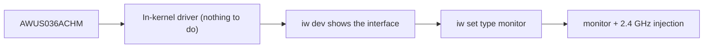

# ALFA AWUS036ACHM——平价双频 AC600

> **一句话定位（Quick Summary）**：**AWUS036ACHM** 是平价双频 ALFA——一支 **MT7610U AC600** 网卡适配器，配一支可拆卸的 5 dBi 双频天线，而且关键的是**内置于内核的驱动**（自 Linux 4.19 起的 `mt76x0u`）。已在 ASUS GX10 / Ubuntu 24.04 ARM64（kernel 6.17）实测：2.4/5 GHz 监听、2.4 GHz 注入（96–100%）、AP 模式、WPA3 热点（仅 AP 端；WPA3 客户端未测试），以及在自有网络上的端到端 WPA handshake 捕获皆可用。仅限在自有或已授权的网络使用。

## 规格总览 (Spec overview)

| 项目 | 规格 |
|---|---|
| 芯片 | MediaTek MT7610U |
| Wi-Fi 等级 | AC600（150 + 433 Mbps） |
| 接口 | USB 2.0 |
| 频段 | 2.4 + 5 GHz |
| 天线 | 1 × 可拆卸 5 dBi 双频偶极天线，RP-SMA |
| Linux 驱动 | `mt76x0u`——**自 4.19 起内置于内核** |
| 监听模式 | ✅ 2.4 + 5 GHz（GX10 实测） |
| 数据包注入 | ✅ 2.4 GHz 96–100%；5 GHz 仅广播（GX10 实测） |

## 实测：ASUS GX10 / Ubuntu 24.04 ARM64

**测试环境**：ASUS Ascent GX10（NVIDIA GB10）、Ubuntu 24.04 LTS ARM64、kernel `6.17.0-1014-nvidia`，测试日期 2026-11-16 至 2026-11-19，测试设备为 iPhone 7 Plus（WPA3 另用 iPhone 15 Pro）。

| 项目 | 结果 |
|---|---|
| 芯片 | MediaTek MT7610U |
| USB ID | `0e8d:7610` |
| 内核驱动 | `mt76x0u`（内置于内核） |
| 固件 | `mt7610u.bin`（linux-firmware） |
| 是否需要 DKMS | 否（kernel ≥ 4.19 内置，不需要） |

| 功能 | 2.4 GHz | 5 GHz |
|---|---|---|
| Monitor | ✅ | ✅ |
| Injection | ✅ 96–100% | ⚠️ 仅广播 |
| AP 热点 | ✅（纯 802.11g） | ✅（纯 802.11a，20 MHz） |
| WPA3-SAE（AP 端） | ✅（`sae_pwe=0`） | 未测试 |

| 高级功能 | 结果 |
|---|---|
| WPA handshake 捕获 | ✅ 于自有网络端到端实测（在 5 GHz ch36 捕获：deauth 自有 iPhone 7 Plus、捕获完整 4-way M1–M4、转出 hashcat `.22000`） |
| VIF | ✅ |
| Active monitor | 🟡 可设置，ACK 未验证 |
| IBSS（Ad-hoc） | 🟡 仅单机验证 |
| Mesh（802.11s） | 🟡 仅单机验证 |
| Wi-Fi Direct（P2P） | 未测试（需第二台设备） |

在你自己的机器上验证：

```bash
lsusb | grep 0e8d:7610
sudo dmesg | grep mt76x0u | tail -3
iw phy $(cat /sys/class/net/$(ls /sys/class/net | grep '^wlx' | head -1)/phy80211/name) info | sed -n '/Supported interface modes/,/Band 1/p'
iw dev
```

完整测试报告：[AWUS036ACHM 于 ASUS GX10 / Ubuntu 的实测报告](https://yupitek.com/zh-cn/blog/awus036achm-asus-gx10-ubuntu-test-report/)。

**备注**：
- 单天线 1×1 网卡适配器（AC600 等级）。我们未将它与 ACM 做吞吐量对比；STA+AP VIF 测试在 5 GHz 连接下的下载速度为 198 Mbit/s。
- 开 AP 时要停用 802.11n：2.4 GHz 用纯 `hw_mode=g`，5 GHz 用纯 `hw_mode=a`。若保留 `ieee80211n=1`，iPhone 会关联失败并显示「密码错误」。
- WPA3 需要 `sae_pwe=0`；使用 `sae_pwe=2` 时 iPhone 7 Plus 连不上。
- 5 GHz 逐台注入回应率未取得（广播注入可用）。
- 6 GHz：不适用。Kali 与 NetHunter：未实机测试。

## 总览

ACHM 是 [AWUS036ACM](/alfa-network/products/awus036acm/) 的「小弟」。它使用 **1×1 MT7610U** 射频，所以 AC600 的速度上限大约只有 ACM 的 AC1200 的一半——但在大学生真正需要它做的两件事上，它的表现毫不逊色：

1. **它在内核里。** 没有 DKMS、不需编译、不会「升级后坏掉」。在 Ubuntu 或 Kali 上插上，接口就存在。
2. **监听模式 + 注入可用**，走的是标准 `mac80211` 路径，要感谢 MediaTek 的主线驱动。

如果你的课程作业是「捕获并分析 Wi-Fi 管理帧」或「示范数据包注入」，ACHM 能以 ALFA 产品线中最低的价格完成。若你想要 2×2 射频，以及有实测数据的逐台 5 GHz 注入回应率（ACM 为 76%；ACHM 未取得），再改买 [ACM](/alfa-network/products/awus036acm/)。

## 安装与驱动

因为驱动在内核里，**不需要安装任何东西**——请见 [MT7610U 驱动页面](/alfa-network/drivers/mt7610u/)。验证：

```bash
lsusb | grep -i mediatek
iw dev
```

**预期输出**：

```text
Bus 003 Device 005: ID 0e8d:7610 MediaTek Inc. WiFi
phy#0
	Interface wlx00c0cababcd2
		ifindex 3
		type managed
```



## 高级使用

### 监听模式（不需安装）

在桌机／GX10 上不要运行 `airmon-ng check kill`（会关闭 NetworkManager），请改用 `iw`：

```bash
IF=$(ls /sys/class/net | grep '^wlx' | head -1)
sudo nmcli dev set $IF managed no
sudo ip link set dev $IF down
sudo iw dev $IF set type monitor
sudo ip link set dev $IF up
sudo iw dev $IF set channel 6
sudo aireplay-ng --test $IF
```

**预期输出**：`Injection is working!`（实测 2.4 GHz 为 96–100%）。

### 天线升级

如果原厂偶极天线不够用，RP-SMA 端口可以接 [ALFA 天线](/alfa-network/products/apa-m25/)——但要注意 1×1 射频无法用两支天线做 MIMO，所以为了距离请只接一支高增益天线。

## 兼容性

| 平台 | 支持 | 注意事项 |
|---|---|---|
| Ubuntu 24.04 ARM64（GX10，kernel 6.17） | ✅ 已实测 | 内置 `mt76x0u` |
| Kali Linux | ✅ 内置于内核（我们未实机测试） | |
| Ubuntu（其他版本） | ✅ | 自 4.19 起内置于内核 |
| NetHunter / Android | ✅ 内置于内核（我们未实机测试） | |
| Windows | 我们未测试 | ALFA 官方驱动 |
| Raspberry Pi / Jetson | 我们未测试 | 内置于内核驱动；仅在 GX10 上实测 |

## 疑难排解

| 症状 | 原因 | 修复 |
|---|---|---|
| 不在 `lsusb` 中 | 电源 / 数据线 | 换端口 / 使用有供电的 hub——[疑难排解](/alfa-network/troubleshooting/) |
| 没有接口 | 驱动未加载（罕见） | `sudo modprobe mt76x0u` |
| 吞吐量低于 2×2 的卡 | 1×1 硬件（AC600 等级） | 不是故障；我们未做吞吐量对比 |
| 注入失败 | 空频道 | `sudo iw $IF set channel 6` |
| iPhone 无法加入你的 AP（显示「密码错误」） | 激活了 802.11n | 使用纯 `hw_mode=g` / `hw_mode=a` |
| iPhone 7 Plus 无法加入 WPA3 AP | `sae_pwe=2` | 改设 `sae_pwe=0` |

## 相关资源

- [MT7610U 驱动页面](/alfa-network/drivers/mt7610u/)
- [Ubuntu 设置指南](/alfa-network/linux-setup-ubuntu/)与 [Kali 设置指南](/alfa-network/linux-setup-kali/)
- [AWUS036ACM](/alfa-network/products/awus036acm/)——速度更快的兄弟款
- [网卡适配器比较](/alfa-network/wifi-adapter-comparison/)
