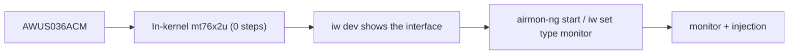

# ALFA AWUS036ACM——经典全能款（MT7612U）

> **一句话定位（Quick Summary）**：**AWUS036ACM** 是社区的默认推荐：一支**高功率 MT7612U AC1200** 双频网卡适配器，驱动（`mt76x2u`）**内置于 Linux 内核**。没有 DKMS、不需编译——在 Kali 或 Ubuntu 上插上，监听模式（monitor mode）就能用。已在 ASUS GX10 / Ubuntu 24.04 ARM64（kernel 6.17）实测：2.4 与 5 GHz 的监听与数据包注入、AP 模式、WPA3-SAE 热点（仅 AP 端；WPA3 客户端未测试）以及端到端 WPA handshake 捕获皆通过。仅限在自有或已授权的网络使用。

## 规格总览 (Spec overview)

| 项目 | 规格 |
|---|---|
| 芯片 | MediaTek MT7612U |
| Wi-Fi 等级 | AC1200（300 + 867 Mbps） |
| 接口 | USB 3.0 |
| 频段 | 2.4 + 5 GHz |
| 天线 | 2 × 外置 5 dBi，RP-SMA |
| TX 功率 | 依模式而异为 19–23 dBm（约 100–200 mW），依 ALFA 规格表 |
| Linux 驱动 | `mt76x2u`——**自 4.19 起内置于内核** |
| 监听模式 | ✅ 2.4 + 5 GHz（GX10 实测） |
| 数据包注入 | ✅ 2.4 GHz 63–83%、5 GHz 76%（GX10 实测） |

## 实测：ASUS GX10 / Ubuntu 24.04 ARM64

**测试环境**：ASUS Ascent GX10（NVIDIA GB10）、Ubuntu 24.04 LTS ARM64、kernel `6.17.0-1014-nvidia`，测试日期 2026-11-16 至 2026-11-19，测试设备为 iPhone 7 Plus（WPA3 另用 iPhone 15 Pro）。

| 项目 | 结果 |
|---|---|
| 芯片 | MediaTek MT7612U |
| USB ID | `0e8d:7612` |
| 内核驱动 | `mt76x2u`（内置于内核） |
| 固件 | `mt7662.bin` + `mt7662_rom_patch.bin`（linux-firmware） |
| 是否需要 DKMS | 否（kernel ≥ 4.19 内置，不需要） |

| 功能 | 2.4 GHz | 5 GHz |
|---|---|---|
| Monitor | ✅ | ✅ |
| Injection | ✅ 63–83% | ✅ 76% |
| AP 热点 | ✅ | ✅（80 MHz） |
| WPA3-SAE（AP 端） | ✅ | 未测试 |

| 高级功能 | 结果 |
|---|---|
| WPA handshake 捕获 | ✅ 于自有网络端到端实测（deauth 自有 iPhone 7 Plus、捕获完整 4-way M1–M4、转出 hashcat `.22000`） |
| VIF | ✅ STA+AP / AP+monitor |
| Active monitor | 🟡 可设置，ACK 未验证 |
| IBSS（Ad-hoc） | 🟡 仅单机验证 |
| Mesh（802.11s） | 🟡 仅单机验证 |
| Wi-Fi Direct（P2P） | 未测试（需第二台设备） |

在你自己的机器上验证：

```bash
lsusb | grep 0e8d:7612
sudo dmesg | grep mt76x2u | tail -3
iw phy $(cat /sys/class/net/$(ls /sys/class/net | grep '^wlx' | head -1)/phy80211/name) info | sed -n '/Supported interface modes/,/Band 1/p'
iw dev
```

完整测试报告：[AWUS036ACM 于 ASUS GX10 / Ubuntu 的实测报告](https://yupitek.com/zh-cn/blog/awus036acm-asus-gx10-ubuntu-test-report/)。

**备注**：
- 已知问题：若先用这张卡连过 Wi-Fi 再切到监听模式，只收得到上次连接的那个频道。切换到监听模式前请先拔下再插回。
- 2.4 GHz 开 AP 时以 20 MHz 工作正常；实测 HT40 无法连接。
- 在 GX10 上，`hcxdumptool` 8.x 无法启动（arm 失败，需要 active monitor）——请改用 `airodump-ng` + `aireplay-ng`。
- 6 GHz：不适用（本卡为 2.4/5 GHz 双频）。Kali 与 NetHunter：未实机测试。

## 总览

AWUS036ACM 把 [AWUS036ACH](/alfa-network/products/awus036ach/) 出名的一切——2×2 AC1200、高功率、双频、两支外置天线——拿来，并移除学生在旧版内核上最讨厌的一件事：**DKMS 驱动建置**。ACM 的 MT7612U 是 Linux 内核的正式成员，所以：

- 插上 → 出现 `wlx…`（或 `wlan0`）接口。零命令。
- 没有 DKMS → 内核更新时不会有东西坏掉。
- 监听模式 + 注入 → 通过原厂 `mac80211` 工具工作。

这个组合就是为什么它是「我是学生、我想要一支网卡适配器上信息安全课、我不想跟操作系统搏斗」的答案——也是为什么这本 wiki 在 [Ubuntu](/alfa-network/linux-setup-ubuntu/) 与 [Kali](/alfa-network/linux-setup-kali/) 指南中把它当成参考网卡适配器。

## 安装与驱动

不需要安装任何东西——完整细节请见 [MT7612U 驱动页面](/alfa-network/drivers/mt7612u/)。快速验证：

```bash
lsusb | grep -i mediatek
iw dev
```

**预期输出**：

```text
Bus 003 Device 003: ID 0e8d:7612 MediaTek Inc. MT7612U 802.11a/b/g/n/ac Wireless Adapter
phy#0
	Interface wlx00c0cabf874c
		ifindex 3
		addr 00:c0:ca:xx:xx:xx
		type managed
```

（`00:c0:ca` 前缀是 ALFA 的 MAC OUI——一个方便的实验室识别技巧。在 GX10 上接口名称为 `wlx` + MAC，例如 `wlx00c0cabf874c`。）



## 高级使用

### 监听模式 + 注入

在 GX10 上，**不要**运行 `airmon-ng check kill`（会关闭 NetworkManager），请改用 `iw`：

```bash
IF=$(ls /sys/class/net | grep '^wlx' | head -1)
sudo nmcli dev set $IF managed no
sudo ip link set dev $IF down
sudo iw dev $IF set type monitor
sudo ip link set dev $IF up
sudo iw dev $IF set channel 6
sudo aireplay-ng --test $IF
```

**预期输出**：`Injection is working!`（实测 2.4 GHz 为 63–83%、5 GHz 为 76%）。

### 天线升级

两个 RP-SMA 端口代表你可以用[面板天线](/alfa-network/products/apa-m25/)做聚焦的长距离链接，或用双高增益偶极天线做全向覆盖——而且 2×2 射频真的会用到两个空间流。

### Wireshark 捕获设备

搭配 [Raspberry Pi 指南](/alfa-network/hardware/raspberry-pi/) 创建无头、常开的捕获站。

## 兼容性

| 平台 | 支持 | 注意事项 |
|---|---|---|
| Ubuntu 24.04 ARM64（GX10，kernel 6.17） | ✅ 已实测 | 内置于内核，即插即用 |
| Kali Linux | ✅ 内置于内核（我们未实机测试） | 预期免设置 |
| Ubuntu（其他版本） | ✅ | 自 mt76x2u 4.19 起内置于内核 |
| NetHunter / Android | ✅ 内置于内核（我们未实机测试） | 标准的 NetHunter 网卡适配器 |
| Windows | 我们未测试 | ALFA 官方驱动 |
| Raspberry Pi / Jetson | 我们未测试 | 内置于内核驱动；仅在 GX10 上实测 |

## 疑难排解

| 症状 | 原因 | 修复 |
|---|---|---|
| 不在 `lsusb` 中 | 电源 / 数据线 | 换端口 / 使用有供电的 hub——[疑难排解](/alfa-network/troubleshooting/) |
| 没有接口 | 驱动未加载（罕见） | `sudo modprobe mt76x2u`；检查 `dmesg \| grep mt76` |
| 监听模式只收得到一个频道 | 切到监听模式前，这张卡曾连过 Wi-Fi | 拔下再插回，然后再切换到监听模式 |
| 注入 0/30 | 空频道 / 无 RF 区域 | `sudo iw $IF set channel 6`；在 AP 附近测试；5 GHz 注入前先 `sudo iw reg set US`，测完还原为 `sudo iw reg set TW` |
| 反复切换模式后，扫描/监听收不到数据包 | RX stall | 拔下再插回 |
| 暂停/恢复时 WLAN 失效 | 已知的笔记本 USB 问题 | 恢复后拔下再插回 |

## 相关资源

- [MT7612U 驱动页面](/alfa-network/drivers/mt7612u/)
- [Kali 设置指南](/alfa-network/linux-setup-kali/)
- [Ubuntu 设置指南](/alfa-network/linux-setup-ubuntu/)
- [NetHunter 设置指南](/alfa-network/linux-setup-nethunter/)
- [AWUS036AXM](/alfa-network/products/awus036axm/)——Wi-Fi 6 升级款（实测内核下无法注入；蓝牙未测试）
- [网卡适配器比较](/alfa-network/wifi-adapter-comparison/)
