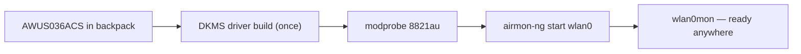

# ALFA AWUS036ACS——口袋尺寸双频 AC433

> **一句话摘要**：**AWUS036ACS** 是 55 mm 的口袋型 ALFA——一款 **RTL8811AU AC433** 双频网卡，配备一支可折叠的 2 dBi 天线，并以 DKMS 驱动支持监听模式。你会随身携带它，因为「你永远不知道什么时候会想看看某个 Wi-Fi。」

## 规格总览 (Spec overview)

| 项目 | 规格 |
|---|---|
| 芯片 | Realtek RTL8811AU |
| Wi-Fi 等级 | AC433（150 + 433 Mbps） |
| 接口 | USB 2.0 |
| 频段 | 2.4 + 5 GHz |
| 天线 | 1 × 外置 2 dBi 双频偶极天线，RP-SMA |
| 机身 | 约 55 mm——口袋尺寸 |
| Linux 驱动程序 | `8821au`（DKMS，非内核内置） |
| 监听模式 | ✅ 良好 |
| 封包注入 | ✅ 良好 |

## 总览

ACS 是在不失去关键要素的前提下，将经典 ALFA 配方缩小的成果。它保留了双频、外置天线与可用的监听模式，却装进能消失在笔电包里的 **55 mm 机身**。其 1×1 RTL8811AU 无线电属于 AC433 等级——足以进行管理框架截取、注入示范与轻量分析，并坦白呈现其传输量的限制。

取舍与其他 Realtek 系列 ALFA 相同：驱动程序**不在内核内**，因此需要进行一次性的 DKMS 建置（之后内核更新时由它自动处理）。如果你希望完全不用处理驱动程序，可以多花一点钱选择内核内置驱动的 [AWUS036ACM](/alfa-network/products/awus036acm/)。

## 安装与驱动程序

完整细节请见 [RTL8811AU 驱动程序页面](/alfa-network/drivers/rtl8811au/)。简短版本：

```bash
cd /opt && sudo git clone https://github.com/morrownr/8821au-20210708.git
cd 8821au-20210708 && sudo sh install-driver.sh
sudo modprobe 8821au
```

**预期输出**：`DKMS: install completed.`，之后 `iw dev` 中会出现一个接口。



## 高端用法

### 外出时的监听模式

```bash
sudo airmon-ng check kill
sudo airmon-ng start wlan0
sudo aireplay-ng --test wlan0mon
```

**预期输出**：`wlan0mon` + `30/30: 100%`。

### 旅行装备

将可折叠天线（运送途中保持接上）搭配 [Jetson](/alfa-network/hardware/jetson/) 或笔电，即可组成可携式截取/分析工作站。折起天线、放进口袋，就完成了。

## 兼容性

| 平台 | 支持 | 备注 |
|---|---|---|
| Kali Linux | ✅ | DKMS；aircrack-ng repo |
| Ubuntu | ✅ | DKMS |
| NetHunter / Android | 🔧 | Realtek，因此不保证可用 |
| Windows | ✅ | 官方驱动程序 |
| Raspberry Pi / Jetson | ✅ | ARM64 上建置 DKMS |

## 疑难排解

| 症状 | 原因 | 修复 |
|---|---|---|
| DKMS 建置失败 | 缺少标头档 / 新内核 | `sudo apt install linux-headers-$(uname -r)`；`git pull && make dkms_install` |
| 仅有 managed 模式 | 内核 stub 冲突 | 将 `rtl8811au` 加入黑名单（请参阅[驱动程序页面](/alfa-network/drivers/rtl8811au/)） |
| 注入 0/30 | 空频道 | `sudo iw wlan0mon set channel 6` |
| 传输量偏低 | 1×1 AC433 硬件 | 并非 bug |
| 重启后侦测不到 | 模块未自动加载 | 将 `8821au` 加入 `/etc/modules-load.d/alfa.conf` |

## 相关资源

- [RTL8811AU 驱动程序页面](/alfa-network/drivers/rtl8811au/)
- [Kali 设置指南](/alfa-network/linux-setup-kali/)
- [AWUS036ACH](/alfa-network/products/awus036ach/)——全尺寸高功率兄弟机型
- [AWUS036ACM](/alfa-network/products/awus036acm/)——内核内置驱动的替代方案
- [网卡比较](/alfa-network/wifi-adapter-comparison/)
