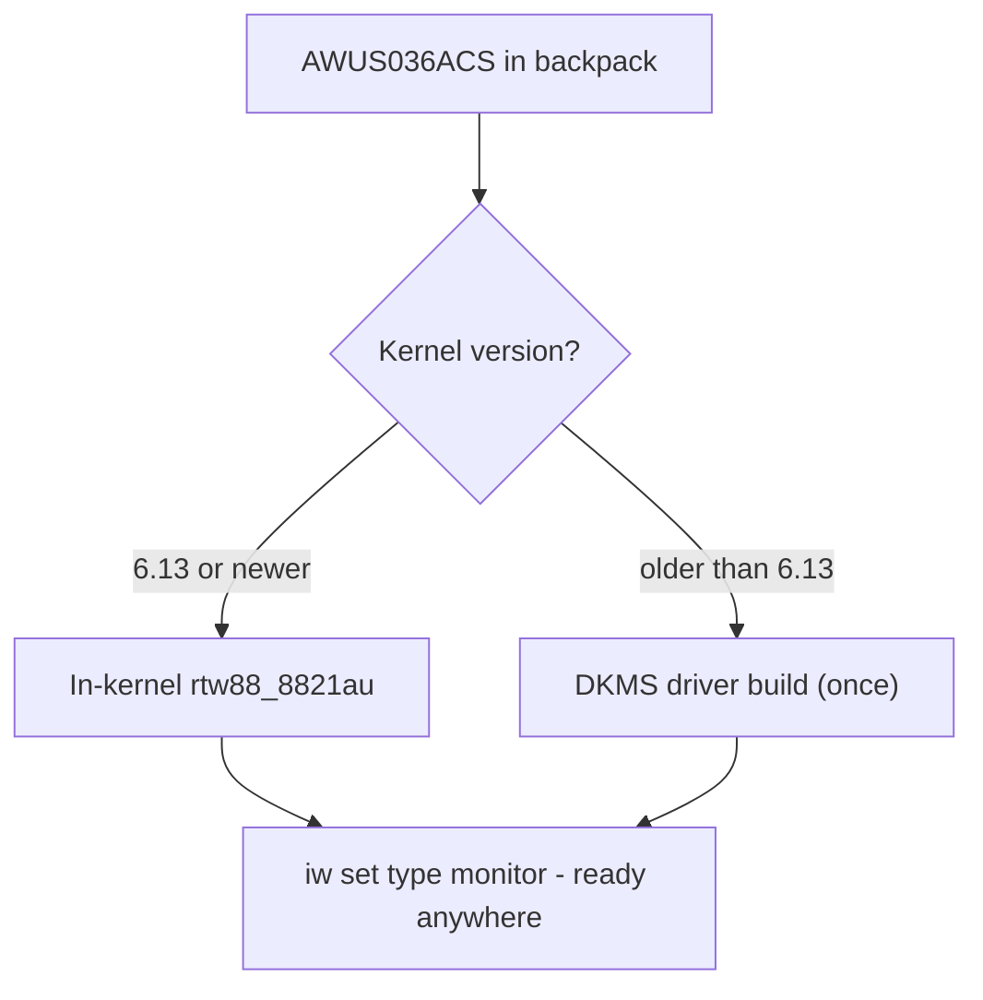

# ALFA AWUS036ACS——口袋尺寸双频 AC600

> **一句话定位（Quick Summary）**：**AWUS036ACS** 是 55 mm 的口袋型 ALFA——一款 **RTL8811AU AC600** 双频网卡适配器，配备一支可折叠的 2 dBi 天线。在 **kernel 6.13 或更新版本**使用内置的 `rtw88_8821au` 驱动（不需 DKMS）；已在 ASUS GX10 / Ubuntu 24.04 ARM64 实测：监听、注入（2.4 GHz 100%、5 GHz 96%）、AP、WPA3 AP（5 GHz，仅 AP 端）与端到端 handshake 捕获。只有较旧的 kernel（< 6.13）才需要 DKMS 建置。仅限在自有或已授权的网络使用。

## 规格总览 (Spec overview)

| 项目 | 规格 |
|---|---|
| 芯片 | Realtek RTL8811AU |
| Wi-Fi 等级 | AC600（150 + 433 Mbps） |
| 接口 | USB 2.0 |
| 频段 | 2.4 + 5 GHz |
| 天线 | 1 × 外置 2 dBi 双频偶极天线，RP-SMA |
| 机身 | 约 55 mm——口袋尺寸 |
| Linux 驱动 | `rtw88_8821au`——**kernel ≥ 6.13 内置**；较旧的 kernel（< 6.13）：社区 `8821au` DKMS |
| 监听模式 | ✅ 2.4 + 5 GHz（GX10 实测） |
| 数据包注入 | ✅ 2.4 GHz 100%、5 GHz 96%（GX10 实测） |

## 实测：ASUS GX10 / Ubuntu 24.04 ARM64

**测试环境**：ASUS Ascent GX10（NVIDIA GB10）、Ubuntu 24.04 LTS ARM64、kernel `6.17.0-1014-nvidia`，测试日期 2026-11-16 至 2026-11-19，测试设备为 iPhone 7 Plus（WPA3 另用 iPhone 15 Pro）。

| 项目 | 结果 |
|---|---|
| 芯片 | Realtek RTL8811AU |
| USB ID | `0bda:0811` |
| 内核驱动 | `rtw88_8821au`（内置于内核） |
| 固件 | 42.4.0（H2C version 0，取自 `dmesg`） |
| 是否需要 DKMS | 否（kernel ≥ 6.13 不需要） |

| 功能 | 2.4 GHz | 5 GHz |
|---|---|---|
| Monitor | ✅ | ✅ |
| Injection | ✅ 100% | ✅ 96% |
| AP 热点 | ✅ | ✅（频宽未确认） |
| WPA3-SAE（AP 端） | 未测试 | ✅ |

| 高级功能 | 结果 |
|---|---|
| WPA handshake 捕获 | ✅ 端到端（已转出 `.22000`） |
| VIF | ✅ |
| Active monitor | ❌ `Operation not supported (-95)` |
| IBSS（Ad-hoc） | ❌ `iw` 有列出但加入失败 |
| Mesh（802.11s） | ❌ `-95` |
| Wi-Fi Direct（P2P） | ❌ `-95` |

在你自己的机器上验证：

```bash
lsusb | grep -i 0bda:0811
sudo dmesg | grep -i 8821au
iw phy $(cat /sys/class/net/$(ls /sys/class/net | grep '^wlx' | head -1)/phy80211/name) info | sed -n '/Supported interface modes/,/Band 1/p'
iw dev
```

完整测试报告：[AWUS036ACS 于 ASUS GX10 / Ubuntu 的实测报告](https://yupitek.com/zh-cn/blog/awus036acs-asus-gx10-ubuntu-test-report/)。

**备注**：
- 单空间流（1×1）：HT 最大 RX 150 Mbps，VHT 理论上约 433 Mbps。
- 5 GHz 注入前请先运行 `sudo iw reg set US`，测完再还原你原本的区域设置。
- 请勿运行 `airmon-ng check kill`（会关闭 NetworkManager）；`hcxdumptool` 8.x 无法启动（arm 失败）——请改用 `airodump-ng` + `aireplay-ng`。
- 2.4 GHz AP：较早的一轮测试曾在手机断线后中止（`key not allowed / Failed to set beacon parameters`）；重测时正常收尾，无法重现该问题。
- 多次切换监听／AP 模式后，扫描可能扫到 0 个目标（RX 状态变差）；拔下再插回即可恢复。
- 6 GHz：不适用。Kali 与 NetHunter：未实机测试。

## 总览

ACS 是把经典 ALFA 公式缩小、却不牺牲要点的产物。它保留了双频、外置天线与可用的监听模式，却包在一个丢进笔记本包就消失的 **55 mm 机身**里。它的 1×1 RTL8811AU 射频属于 AC600 等级——足够做管理帧捕获、注入示范与轻量分析，并且老实面对它的吞吐量上限。

在 kernel 6.13 以后，驱动已在内核里，没有东西需要编译。在较旧的 kernel（< 6.13）上，驱动不在内核里，所以需要做一次性的 DKMS 建置（之后内核更新时会自动处理）。如果你用的是旧 kernel，又希望完全不用处理驱动，请选择内置驱动的 [AWUS036ACM](/alfa-network/products/awus036acm/)。

## 安装与驱动

**Kernel 6.13 或更新版本**：不需要安装任何东西；内置的 `rtw88_8821au` 会自动绑定。请见 [RTL8811AU 驱动页面](/alfa-network/drivers/rtl8811au/)。

### 较旧的 kernel（仅限 < 6.13）：DKMS

仅适用于 6.13 以前的 kernel：

```bash
cd /opt && sudo git clone https://github.com/morrownr/8821au-20210708.git
cd 8821au-20210708 && sudo sh install-driver.sh
sudo modprobe 8821au
```

**预期输出**：`DKMS: install completed.`，然后 `iw dev` 中出现接口。（这条旧 kernel 路径未在 GX10 上运行过。）



## 高级使用

### 在外面使用监听模式

```bash
IF=$(ls /sys/class/net | grep '^wlx' | head -1)
sudo nmcli dev set $IF managed no
sudo ip link set dev $IF down
sudo iw dev $IF set type monitor
sudo ip link set dev $IF up
sudo iw dev $IF set channel 6
sudo aireplay-ng --test --ignore-negative-one $IF
```

**预期输出**：`Injection is working!`（对我们自己的 AP 实测 2.4 GHz 为 100%、5 GHz 为 96%；5 GHz 请先运行 `sudo iw reg set US`）。

### 旅行装备

将可折叠天线（运送时保持装着）搭配 [Jetson](/alfa-network/hardware/jetson/) 或笔记本，组成便携式捕获／分析站（我们仅在 GX10 上实测）。把天线折好、放进口袋，就完成了。

## 兼容性

| 平台 | 支持 | 注意事项 |
|---|---|---|
| Ubuntu 24.04 ARM64（GX10，kernel 6.17） | ✅ 已实测 | 内置于内核，不需 DKMS |
| Linux kernel ≥ 6.13 | ✅ | 内置 `rtw88_8821au` |
| Linux kernel < 6.13 | 🔧 | 需要社区 DKMS 驱动 |
| Kali Linux | ✅（我们未实机测试） | kernel ≥ 6.13 时内置于内核 |
| NetHunter / Android | 🔧 | 未测试；属 Realtek 芯片，不保证可用 |
| Windows | 我们未测试 | ALFA 官方驱动 |
| Raspberry Pi / Jetson | 我们未测试 | kernel ≥ 6.13 时内置于内核；仅在 GX10 上实测 |

## 疑难排解

| 症状 | 原因 | 修复 |
|---|---|---|
| （仅 kernel < 6.13）DKMS 建置失败 | 缺少 headers／新 kernel | `sudo apt install linux-headers-$(uname -r)`；`git pull && make dkms_install` |
| （仅 kernel < 6.13）只能在 managed 模式 | 内核的替代驱动冲突 | 将冲突的模块列入黑名单（见[驱动页面](/alfa-network/drivers/rtl8811au/)） |
| 注入 0/30 | 空频道 | `sudo iw $IF set channel 6` |
| 5 GHz 注入被挡 | 法规网域 | `sudo iw reg set US`，之后还原 |
| 手机断线后 2.4 GHz AP 中止（`key not allowed / Failed to set beacon parameters`） | 偶发的 beacon re-key 失败，重测无法重现 | 改用 5 GHz AP；长时间或频繁重连的情境请留意 |
| 多次切换模式后扫描扫到 0 个目标 | RX 状态变差 | 拔下再插回 |
| 吞吐量偏低 | 1×1 AC600 硬件 | 不是故障 |
| （仅 kernel < 6.13）重开机后侦测不到 | 模块未自动加载 | 将 `8821au` 加到 `/etc/modules-load.d/alfa.conf` |

## 相关资源

- [RTL8811AU 驱动页面](/alfa-network/drivers/rtl8811au/)
- [Kali 设置指南](/alfa-network/linux-setup-kali/)
- [AWUS036ACH](/alfa-network/products/awus036ach/)——全尺寸高功率兄弟款
- [AWUS036ACM](/alfa-network/products/awus036acm/)——MediaTek 内置驱动的替代款
- [网卡适配器比较](/alfa-network/wifi-adapter-comparison/)
