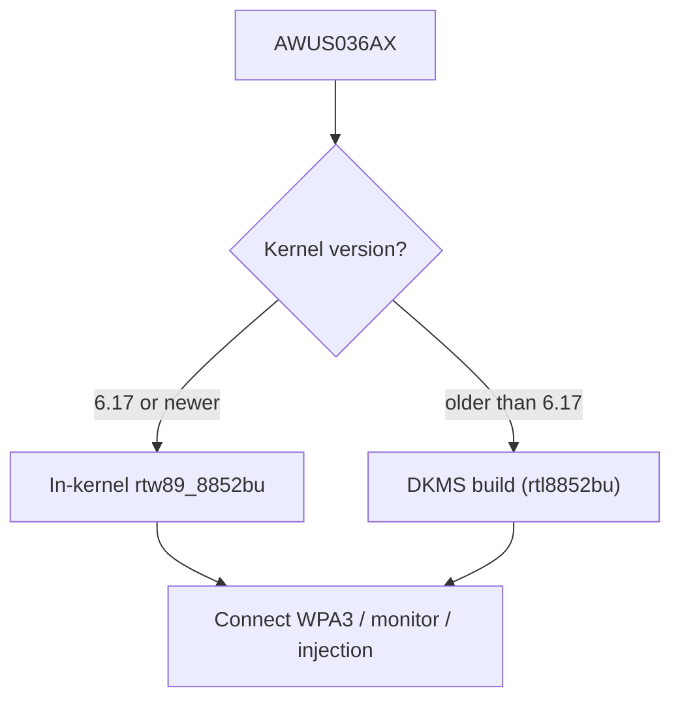

# ALFA AWUS036AX——Wi-Fi 6 双频 AX1800

> **一句话定位（Quick Summary）**：**AWUS036AX** 是 ALFA 的 Wi-Fi 6 入门款——一款 **RTL8832BU AX1800** 双频网卡适配器，支持 **WPA3**、**2×2 MIMO**，并配备两支外置天线。在 **kernel 6.17 或更新版本**使用内置的 `rtw89_8852bu` 驱动（不需 DKMS）。已在 ASUS GX10 / Ubuntu 24.04 ARM64 实测：2.4 与 5 GHz 监听接收强、注入（2.4 GHz 为 96%，5 GHz 可用）、AP、WPA3 AP（仅 AP 端；WPA3 客户端未测试）与端到端 handshake 捕获。仅限在自有或已授权的网络使用。

## 规格总览 (Spec overview)

| 项目 | 规格 |
|---|---|
| 芯片 | Realtek RTL8832BU |
| Wi-Fi 等级 | AX1800（574 + 1201 Mbps） |
| 接口 | USB 3.2 |
| 频段 | 2.4 + 5 GHz |
| 天线 | 2 × 外置双频，RP-SMA |
| 安全性 | WPA3（同时支持 WPA2/WPA） |
| MIMO | 2×2 |
| Linux 驱动 | `rtw89_8852bu`——**kernel ≥ 6.17 内置**；较旧的 kernel（< 6.17）：社区 `rtl8852bu` DKMS |
| 监听模式 | ✅ 2.4 + 5 GHz（GX10 实测） |
| 数据包注入 | ✅ 2.4 GHz 96%、5 GHz 可用（GX10 实测） |

## 实测：ASUS GX10 / Ubuntu 24.04 ARM64

**测试环境**：ASUS Ascent GX10（NVIDIA GB10）、Ubuntu 24.04 LTS ARM64、kernel `6.17.0-1014-nvidia`，测试日期 2026-11-16 至 2026-11-19，测试设备为 iPhone 7 Plus（WPA3 另用 iPhone 15 Pro）。

| 项目 | 结果 |
|---|---|
| 芯片 | Realtek RTL8832BU |
| USB ID | `0bda:b832` |
| 内核驱动 | `rtw89_8852bu`（内置于内核） |
| 固件 | `rtw89/rtw8852b_fw-1.bin`（版本 0.29.29.5） |
| 是否需要 DKMS | 否（kernel ≥ 6.17 不需要） |

| 功能 | 2.4 GHz | 5 GHz |
|---|---|---|
| Monitor | ✅ 强 | ✅ 强 |
| Injection | ✅ 96% | ✅ 可用（指定 AP 逐台测试） |
| AP 热点 | ✅（含 802.11n） | ✅（80 MHz） |

| 高级功能 | 结果 |
|---|---|
| WPA3-SAE（AP 端） | ✅ iPhone 15 Pro 连入，`MFP: yes`，`sae_pwe=0`，于 2.4 GHz 实测（5 GHz 未测试）；WPA3 客户端未测试 |
| WPA handshake 捕获 | ✅ 端到端（已转出 `.22000`） |
| VIF | ✅ STA + AP |
| Active monitor | N/A（驱动未提供） |
| IBSS（Ad-hoc） | N/A |
| Mesh（802.11s） | N/A |
| Wi-Fi Direct（P2P） | 未测试（需第二台设备） |

在你自己的机器上验证：

```bash
lsusb | grep -iE '0bda:b832|0bda:1a2b'
sudo dmesg | grep rtw89_8852bu | tail -3
iw phy $(cat /sys/class/net/$(ls /sys/class/net | grep '^wlx' | head -1)/phy80211/name) info | sed -n '/Supported interface modes/,/Band 1/p'
iw dev
```

若 `lsusb` 显示 `0bda:1a2b`（光盘模式），请运行 `sudo usb_modeswitch -v 0bda -p 1a2b -K`。在我们的测试中，这张卡是直接以 WLAN 设备枚举的。

完整测试报告：[AWUS036AX 于 ASUS GX10 / Ubuntu 的实测报告](https://yupitek.com/zh-cn/blog/awus036ax-asus-gx10-ubuntu-test-report/)。

**备注**：
- 我们这一张卡上没有出现蓝牙接口。
- 5 GHz 注入前请先运行 `sudo iw reg set US`，测完再还原你原本的区域设置。
- 请勿运行 `airmon-ng check kill`；`hcxdumptool` 8.x 无法启动（arm 失败）——请改用 `airodump-ng` + `aireplay-ng`。
- 6 GHz：不适用。Kali 与 NetHunter：未实机测试。

## 总览

AWUS036AX 是 ALFA 著名的 AC 世代与 Wi-Fi 6 世界之间的桥梁。底层是新一代的 **RTL8832BU** 2×2 ax 射频（AX1800），带来两项学生真正会注意到的升级：

1. **WPA3 支持**——这张卡通过了我们以 iPhone 15 Pro 进行的 WPA3-SAE AP 测试（仅 AP 端；我们未将它当作 WPA3 客户端测试）。
2. **Wi-Fi 6 功能**——2×2 ax 射频（OFDMA 等 Wi-Fi 6 功能来自标准本身；我们未做性能测试）。

它保留了经典的 ALFA 血统——两支外置天线与高功率前端——而且与旧的说法不同，它在 Linux 上**并非**只能当客户端：使用内置驱动时，监听模式与数据包注入都能工作。

## 安装与驱动

### Kernel 6.17 或更新版本

不需要安装任何东西——`rtw89_8852bu` 在内核里，会自动绑定。请见 [RTL8832BU 驱动页面](/alfa-network/drivers/rtl8832bu/)。

### 较旧的 kernel（仅限 < 6.17）：DKMS

仅适用于 6.17 以前的 kernel：

```bash
cd /opt && sudo git clone https://github.com/morrownr/rtl8852bu-20250826.git
cd rtl8852bu-20250826 && sudo sh install-driver.sh
sudo modprobe 8852bu
```

**预期输出**：安装程序完成（若提示请重开机），然后 `iw dev` 中出现接口。注意：社区 DKMS 驱动的监听模式行为，我们未在此测试。



## 高级使用

### 连接到仅支持 WPA3 的网络（客户端我们未测试）

```bash
nmcli device wifi connect "MySSID" password "my-passphrase"
iw dev $(ls /sys/class/net | grep '^wlx' | head -1) link
```

**预期输出**：`Connected`，以及 `iw ... link` 输出中的连接速率。我们未将这张卡当作 WPA3 客户端测试，也未量测连接速率；原厂标示 5 GHz 最高 1201 Mbps。

### 监听模式与注入

```bash
IF=$(ls /sys/class/net | grep '^wlx' | head -1)
sudo nmcli dev set $IF managed no
sudo ip link set dev $IF down
sudo iw dev $IF set type monitor
sudo ip link set dev $IF up
sudo iw dev $IF set channel 6
sudo aireplay-ng --test $IF
```

**预期输出**：`Injection is working!`（2.4 GHz 实测为 96%）。在 5 GHz（例如 channel 36）上，广播测试可能显示 `Found 0 APs`，因为现代 AP 不回应广播 probe；请改用 `sudo aireplay-ng --test -a <AP-BSSID> $IF` 对指定 AP 测试，实测会显示 `Injection is working!`。

## 兼容性

| 平台 | 支持 | 注意事项 |
|---|---|---|
| Ubuntu 24.04 ARM64（GX10，kernel 6.17） | ✅ 已实测 | 内置于内核，不需 DKMS |
| Linux kernel ≥ 6.17 | ✅ | 内置 `rtw89_8852bu` |
| Linux kernel < 6.17 | 🔧 | 社区 DKMS 驱动 |
| Kali Linux | ✅（我们未实机测试） | kernel ≥ 6.17 时内置于内核 |
| NetHunter / Android | ⚠️ | 未测试；属 Realtek 芯片，在手机 kernel 上可能无法编译 |
| Windows | 我们未测试 | ALFA 官方驱动 |
| Raspberry Pi / Jetson | 我们未测试 | kernel ≥ 6.17 时内置于内核；仅在 GX10 上实测 |

## 疑难排解

| 症状 | 原因 | 修复 |
|---|---|---|
| 看不到 WPA3 网络 | 驱动／wpa_supplicant 太旧 | 更新操作系统／kernel |
| `lsusb` 显示 `0bda:1a2b` | 卡处于光盘模式 | `sudo usb_modeswitch -v 0bda -p 1a2b -K` |
| （仅 kernel < 6.17）DKMS 建置失败 | 新 kernel 与原代码库不兼容 | `cd /opt/rtl8852bu-20250826 && git pull && sudo sh install-driver.sh` |
| 连接速率很高但传输很慢 | USB 2.0 端口 | 改用 USB 3.x 端口（本卡为 USB 3.2） |
| 注入 0/30 | 空频道 | `sudo iw $IF set channel 6` |

## 相关资源

- [RTL8832BU 驱动页面](/alfa-network/drivers/rtl8832bu/)
- [AWUS036AXER](/alfa-network/products/awus036axer/)——nano Wi-Fi 6 款（相同芯片）
- [AWUS036AXM](/alfa-network/products/awus036axm/)——MediaTek AX3000 + 蓝牙款（实测内核下无法注入；蓝牙未测试）
- [Ubuntu 设置指南](/alfa-network/linux-setup-ubuntu/) / [Kali 设置指南](/alfa-network/linux-setup-kali/)
- [网卡适配器比较](/alfa-network/wifi-adapter-comparison/)
