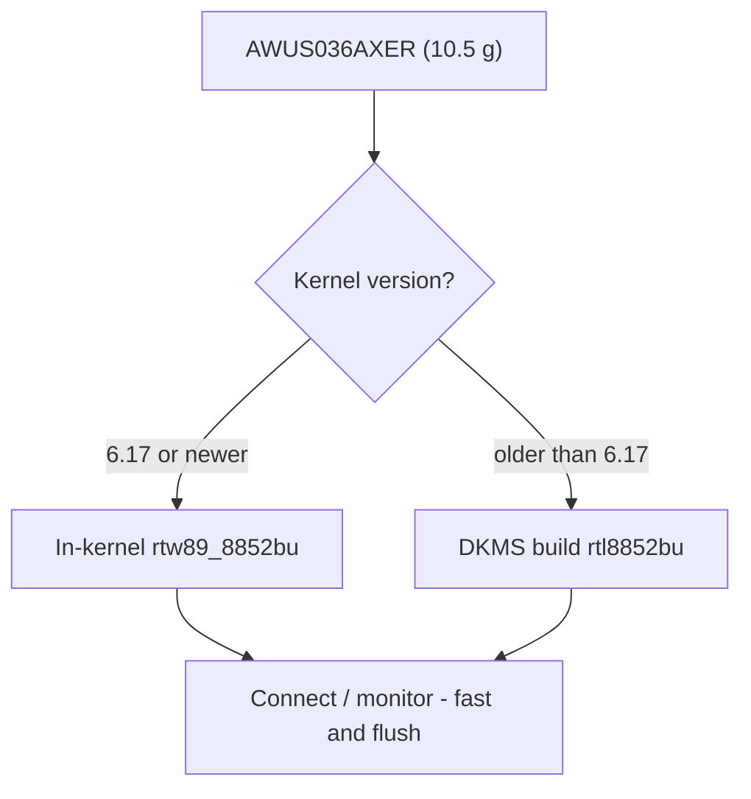

# ALFA AWUS036AXER——Wi-Fi 6 Nano（内置天线）

> **一句话定位（Quick Summary）**：**AWUS036AXER** 是 ALFA 的 **10.5 g nano** 机种——与大型 AWUS036AX 采用相同的 **RTL8832BU AX1800** Wi-Fi 6 引擎，但配备**内置天线**与 USB 3.2，插入后几乎与端口齐平、毫不显眼。在 **kernel 6.17 或更新版本**使用内置的 `rtw89_8852bu` 驱动（不需 DKMS）。已在 ASUS GX10 / Ubuntu 24.04 ARM64 实测：监听接收极强（60 秒跳频扫描找到 63 个 AP + 12 个客户端）、2.4 GHz 注入 73%、5 GHz 注入可用、AP、WPA3 AP（仅 AP 端；WPA3 客户端未测试）与端到端 handshake 捕获。仅限在自有或已授权的网络使用。

## 规格总览 (Spec overview)

| 项目 | 规格 |
|---|---|
| 芯片 | Realtek RTL8832BU |
| Wi-Fi 等级 | AX1800（574 + 1201 Mbps） |
| 接口 | USB 3.2 |
| 频段 | 2.4 + 5 GHz |
| 天线 | **内置**（无外置 RP-SMA） |
| 重量 | 10.5 g |
| 安全性 | WPA3 |
| MIMO | 2×2 |
| Linux 驱动 | `rtw89_8852bu`——**kernel ≥ 6.17 内置**；较旧的 kernel（< 6.17）：社区 `rtl8852bu` DKMS |
| 监听模式 | ✅ 2.4 + 5 GHz（GX10 实测） |
| 数据包注入 | ✅ 2.4 GHz 73%、5 GHz 可用（GX10 实测） |

## 实测：ASUS GX10 / Ubuntu 24.04 ARM64

**测试环境**：ASUS Ascent GX10（NVIDIA GB10）、Ubuntu 24.04 LTS ARM64、kernel `6.17.0-1014-nvidia`，测试日期 2026-11-16 至 2026-11-19，测试设备为 iPhone 7 Plus（WPA3 另用 iPhone 15 Pro）。

| 项目 | 结果 |
|---|---|
| 芯片 | Realtek RTL8832BU（与 AWUS036AX 相同） |
| USB ID | `0bda:b832` |
| 内核驱动 | `rtw89_8852bu`（内置于内核） |
| 固件 | `rtw89/rtw8852b_fw-1.bin`（版本 0.29.29.5） |
| 是否需要 DKMS | 否（kernel ≥ 6.17 不需要） |

| 功能 | 2.4 GHz | 5 GHz |
|---|---|---|
| Monitor | ✅ 强 | ✅ 强 |
| Injection | ✅ 73% | ✅ 可用（指定 AP 逐台测试） |
| AP 热点 | ✅（含 802.11n） | ✅（80 MHz） |

| 高级功能 | 结果 |
|---|---|
| WPA3-SAE（AP 端） | ✅ iPhone 15 Pro 连入，`sae_pwe=0`，于 2.4 GHz 实测（5 GHz 未测试）；WPA3 客户端未测试 |
| WPA handshake 捕获 | ✅ 端到端（已转出 `.22000`） |
| VIF | ✅ STA + AP |
| Active monitor | N/A（驱动未提供） |
| IBSS（Ad-hoc） | N/A |
| Mesh（802.11s） | N/A |
| Wi-Fi Direct（P2P） | 未测试（需第二台设备） |

在你自己的机器上验证：

```bash
lsusb | grep -iE '0bda:b832|0bda:1a2b'
sudo dmesg | grep rtw89_8852bu | tail -3
iw phy $(cat /sys/class/net/$(ls /sys/class/net | grep '^wlx' | head -1)/phy80211/name) info | sed -n '/Supported interface modes/,/Band 1/p'
iw dev
```

若 `lsusb` 显示 `0bda:1a2b`（光盘模式），请运行 `sudo usb_modeswitch -v 0bda -p 1a2b -K`。

完整测试报告：[AWUS036AXER 于 ASUS GX10 / Ubuntu 的实测报告](https://yupitek.com/zh-cn/blog/awus036axer-asus-gx10-ubuntu-test-report/)。

**备注**：
- 我们这一张卡上没有出现蓝牙接口。
- 尽管是内置天线，60 秒跳频扫描仍找到 63 个 AP 与 12 个客户端，是这次测试中接收表现最好的结果之一。
- 请勿运行 `airmon-ng check kill`；`hcxdumptool` 8.x 无法启动（arm 失败）——请改用 `airodump-ng` + `aireplay-ng`。
- 6 GHz：不适用。Kali 与 NetHunter：未实机测试。

## 总览

AXER 沿用 AWUS036AX 的射频，并去掉了体积。它不使用两支外置天线，而是把**内置天线**收进 **10.5 g 的机身**——插进笔记本端口后几乎不凸出。你保有 Wi-Fi 6 速度、WPA3 与 2×2 MIMO；代价是失去用外置天线延伸距离的途径，以及升级天线的选项。

对于坐在阶梯教室里的学生，它是一支很适合日常随身携带的 Wi-Fi 6 网卡适配器；在我们的测试中，它在 kernel 6.17+ 上也能做监听模式与注入（注入成功率低于 AWUS036AX：2.4 GHz 为 73% 对 96%）。

## 安装与驱动

驱动的状况与 [AWUS036AX](/alfa-network/products/awus036ax/) 相同——请见 [RTL8832BU 驱动页面](/alfa-network/drivers/rtl8832bu/)。

**Kernel 6.17 或更新版本**：不需要安装任何东西。

### 较旧的 kernel（仅限 < 6.17）：DKMS

```bash
cd /opt && sudo git clone https://github.com/morrownr/rtl8852bu-20250826.git
cd rtl8852bu-20250826 && sudo sh install-driver.sh
sudo modprobe 8852bu
```

**预期输出**：安装程序完成（若提示请重开机），然后 `iw dev` 中出现接口。



## 高级使用

### 客户端模式（我们未测试）

```bash
nmcli device wifi connect "MySSID" password "my-passphrase"
iw dev $(ls /sys/class/net | grep '^wlx' | head -1) link
```

**预期输出**：已连接，并在 `iw ... link` 输出中显示连接速率。我们未将这张卡当作客户端测试，也未量测连接速率；原厂标示 5 GHz 最高 1201 Mbps。

### 监听模式与注入

```bash
IF=$(ls /sys/class/net | grep '^wlx' | head -1)
sudo nmcli dev set $IF managed no
sudo ip link set dev $IF down
sudo iw dev $IF set type monitor
sudo ip link set dev $IF up
sudo iw dev $IF set channel 6
sudo aireplay-ng --test $IF
```

**预期输出**：`Injection is working!`（2.4 GHz 实测为 73%）。在 5 GHz 请用 `sudo aireplay-ng --test -a <AP-BSSID> $IF` 对指定 AP 测试，实测会显示 `Injection is working!`。

## 兼容性

| 平台 | 支持 | 注意事项 |
|---|---|---|
| Ubuntu 24.04 ARM64（GX10，kernel 6.17） | ✅ 已实测 | 内置于内核，不需 DKMS |
| Linux kernel ≥ 6.17 | ✅ | 内置 `rtw89_8852bu` |
| Linux kernel < 6.17 | 🔧 | 社区 DKMS 驱动 |
| Kali Linux | ✅（我们未实机测试） | kernel ≥ 6.17 时内置于内核 |
| NetHunter / Android | ⚠️ | 未测试；属 Realtek 芯片、内置天线，优先度低 |
| Windows | 我们未测试 | ALFA 官方驱动 |
| Raspberry Pi / Jetson | 我们未测试 | kernel ≥ 6.17 时内置于内核；仅在 GX10 上实测 |

## 疑难排解

| 症状 | 原因 | 修复 |
|---|---|---|
| 距离比外置天线的 ALFA 短 | 设计上就是内置天线 | 属预期——长距离连接请改用外置天线的卡 |
| 看不到 WPA3 网络 | 操作系统太旧 | 更新操作系统／kernel |
| （仅 kernel < 6.17）DKMS 建置失败 | 新 kernel | `git pull && sudo sh install-driver.sh` |
| `lsusb` 显示 `0bda:1a2b` | 光盘模式 | `sudo usb_modeswitch -v 0bda -p 1a2b -K` |
| 在 USB 2.0 端口上很慢 | 带宽上限 | 改用 USB 3.x 端口 |

## 相关资源

- [RTL8832BU 驱动页面](/alfa-network/drivers/rtl8832bu/)
- [AWUS036AX](/alfa-network/products/awus036ax/)——相同引擎、外置天线、注入成功率更高
- [AWUS036AXM](/alfa-network/products/awus036axm/)——采用 MediaTek 芯片的 Wi-Fi 6 款（实测内核下无法注入；蓝牙未测试）
- [网卡适配器比较](/alfa-network/wifi-adapter-comparison/)
