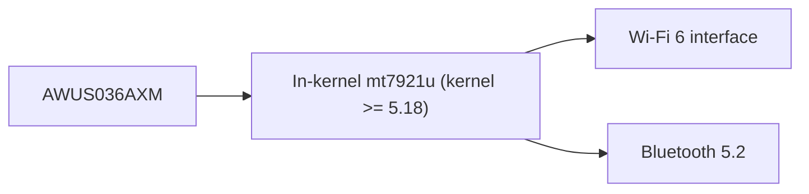

# ALFA AWUS036AXM——Wi-Fi 6 AX3000 + 蓝牙 5.2

> **一句话定位（Quick Summary）**：**AWUS036AXM** 是 ALFA 的旗舰 Wi-Fi 6 dongle——一支 **MT7921AU AX3000** 双频网卡适配器（与 AXML 使用相同的 `mt7921u` 驱动），含 **蓝牙 5.2**、USB 3.2、两支天线，而且关键的是**内置于内核的驱动**（自 Linux 5.18 起的 `mt7921u`）。已在 ASUS GX10 / Ubuntu 24.04 ARM64 实测：AP（2.4/5 GHz）、WPA3 AP（AP 端，2.4 GHz）与 VIF 可用，监听模式可接收（但接收较弱）。**数据包注入在 stock 6.17 kernel 上未通过**，因此在该环境下不适合做 deauth 或 handshake 捕获。蓝牙与 6 GHz 在这个型号上未测试。仅限在自有或已授权的网络使用。

## 规格总览 (Spec overview)

| 项目 | 规格 |
|---|---|
| 芯片 | MediaTek MT7921AUN（与 AXML 的 MT7921AUN 属同一个 `mt7921u` 驱动家族） |
| Wi-Fi 等级 | AX3000 等级——最高 600 / 1200 / 1200 Mbps（2.4 / 5 / 6 GHz），依 ALFA 规格表 |
| 接口 | USB 3.2 |
| 频段 | 2.4 + 5 GHz 已测试；6 GHz 由同芯片推测，AXM 上未测试 |
| 天线 | 2 × 外置 5 dBi，RP-SMA |
| 蓝牙 | **BT 5.2**（同一支 dongle；AXM 上未单独测试） |
| MIMO | 2×2 |
| Linux 驱动 | `mt7921u`——**自 5.18 起内置于内核** |
| 监听模式 | ✅ 2.4 + 5 GHz，接收较弱（GX10 实测） |
| 数据包注入 | ❌ 在 stock kernel 6.17 未通过（kernel 6.16 起的 mac80211 chanctx 回归；并非芯片先天限制） |

## 实测：ASUS GX10 / Ubuntu 24.04 ARM64

**测试环境**：ASUS Ascent GX10（NVIDIA GB10）、Ubuntu 24.04 LTS ARM64、kernel `6.17.0-1014-nvidia`，测试日期 2026-11-16 至 2026-11-19，测试设备为 iPhone 7 Plus（WPA3 另用 iPhone 15 Pro）。

| 项目 | 结果 |
|---|---|
| 芯片 | MediaTek MT7921AU |
| USB ID | `0e8d:7961` |
| 内核驱动 | `mt7921u`（内置于内核） |
| 固件 | `WIFI_RAM_CODE_MT7961`（linux-firmware） |
| 是否需要 DKMS | 否（kernel ≥ 5.18 不需要） |

| 功能 | 2.4 GHz | 5 GHz |
|---|---|---|
| Monitor | ✅ 弱 | ✅ 弱 |
| Injection | ❌ 失败（stock kernel 6.17） | ❌ 失败（stock kernel 6.17） |
| AP 热点 | ✅ | ✅（80 MHz） |

| 高级功能 | 结果 |
|---|---|
| WPA3-SAE（AP 端） | ✅ iPhone 7 Plus 在 2.4 GHz 连入，`MFP: yes`，`sae_pwe=0`；5 GHz 与 WPA3 客户端未测试 |
| 蓝牙 | 未测试 |
| 6 GHz | 未测试 |
| WPA handshake 捕获 | ❌ 无法进行，注入失败 |
| VIF | ✅ |
| Active monitor | 🟡 `iw` 接受设置，ACK 未验证 |
| IBSS（Ad-hoc） | N/A |
| Mesh（802.11s） | N/A |
| Wi-Fi Direct（P2P） | 未测试（需第二台设备） |

在你自己的机器上验证：

```bash
lsusb | grep 0e8d:7961
sudo dmesg | grep mt7921u | tail -3
iw phy $(cat /sys/class/net/$(ls /sys/class/net | grep '^wlx' | head -1)/phy80211/name) info | sed -n '/Supported interface modes/,/Band 1/p'
iw dev
```

完整测试报告：[AWUS036AXM 于 ASUS GX10 / Ubuntu 的实测报告](https://yupitek.com/zh-cn/blog/awus036axm-asus-gx10-ubuntu-test-report/)。

**备注**：
- 注入：在 stock kernel 6.17 上，`aireplay-ng --test` 找到 0 个 AP（`No Answer`），因此无法 deauth，也无法捕获 handshake。这并非芯片先天限制：主因是 kernel 6.16 起的 mac80211 chanctx 回归（见[驱动页面](/alfa-network/drivers/mt7921aun/)）。社区以 git／patched 驱动可让 active monitor 与注入工作，但固件仍锁定速率（1/6 Mbps，无法注入 HT/VHT）。
- 监听模式接收较弱；请锁定单一频道，不要跳频。
- `iw` 在监听模式下回报 TX 功率为 3 dBm；这是回报上的假象（硬件实际 TX 量测约 20 dBm）。
- 6 GHz：由与 AXML 相同的芯片推测（AXML 已实测验证），但**AXM 本身未测试**。Kali 与 NetHunter：未实机测试。
- 若你需要注入或 handshake 捕获，请选择其他卡（见[比较页](/alfa-network/wifi-adapter-comparison/)）。

## 总览

就速度与功能而言，AXM 是备受喜爱的 [AWUS036ACM](/alfa-network/products/awus036acm/) 的现代接班人——MediaTek 射频、内置驱动、没有 DKMS 的麻烦——但整整升级了一个世代：**AX3000** 速度（5 GHz 最高 1200 Mbps，依 ALFA 规格表）、同一支 USB 设备上的**蓝牙 5.2**，以及更新的射频。

就日常 Linux 使用而言，它的吸引力和 ACM 相同：作为客户端或 AP 网卡适配器，**它就是能用**。驱动在内核里（5.18+）、AP 与 WPA3 已测试，而且 WiFi 与蓝牙共用同一个 USB 端口（我们未测试 AXM 的蓝牙）。不过，若你的信息安全课程需要注入，请注意 MT7921 系列在所测试的 stock kernel 上注入未通过——请改用 ACM 或 Realtek 的卡。

## 安装与驱动

自 5.18 起内置于内核——不需要编译。请见 [MT7921AUN 驱动页面](/alfa-network/drivers/mt7921aun/)。验证：

```bash
lsusb | grep -i mediatek
iw dev
bluetoothctl list
```

**预期输出**：`lsusb` 中的 MT7921U 那一行，以及 `iw dev` 中的一个接口。`bluetoothctl list` 中应出现一个蓝牙控制器（蓝牙可能需要 `sudo modprobe btusb`）；我们未测试 AXM 的蓝牙。



## 高级使用

### 最高速连接 + 蓝牙配对（我们未测试）

```bash
nmcli device wifi connect "MySSID" password "my-passphrase"
bluetoothctl
power on
scan on
pair <MAC>
```

**预期输出**：Wi-Fi 已激活；你的蓝牙设备显示 `Pairing successful`。AXM 上的客户端连接与蓝牙配对都未测试。

### 监听模式（在所测试的 kernel 上仅能接收）

```bash
IF=$(ls /sys/class/net | grep '^wlx' | head -1)
sudo nmcli dev set $IF managed no
sudo ip link set dev $IF down
sudo iw dev $IF set type monitor
sudo ip link set dev $IF up
sudo iw dev $IF set channel 36
sudo timeout 8 tcpdump -l -i $IF -nn -e -c 200
```

**预期输出**：2.4 与 5 GHz 都收得到 beacon，但帧数量比 ACM 或 Realtek 的卡少。注入（`aireplay-ng --test`）在 stock kernel 6.17 上失败。

## 兼容性

| 平台 | 支持 | 注意事项 |
|---|---|---|
| Ubuntu 24.04 ARM64（GX10，kernel 6.17） | ✅ AP / WPA3 / 监听接收已实测 | 无法注入 |
| Ubuntu / Kali（其他版本） | ✅ 内置于内核（kernel 5.18+） | 我们未测试 |
| NetHunter / Android | 未测试 | 手机上需要 5.18+ 的 kernel |
| Windows | 我们未测试 | ALFA 官方驱动 |
| Raspberry Pi / Jetson（JetPack 6） | 我们未测试 | 内置于内核驱动；仅在 GX10 上实测 |

## 疑难排解

| 症状 | 原因 | 修复 |
|---|---|---|
| 在 Ubuntu 20.04 上侦测不到 | Kernel < 5.18 | 升级操作系统／kernel |
| 看得到设备但没有接口 | 缺少固件 | `sudo apt install linux-firmware`；重新插拔 |
| 没有蓝牙 | 未加载 `btusb` | `sudo modprobe btusb` |
| 手机看不到 AP 的 SSID | `iw` 在监听模式下回报 TX 功率为 3 dBm | 拔下再插回，或把手机靠近 |
| 注入／deauth 找到 0 个 AP | stock kernel 6.17 上的 mac80211 chanctx 回归（并非芯片先天限制） | 注入请改用其他卡（ACM、ACH、ACS、EACS、AX、AXER） |
| 监听模式几乎收不到数据包 | 监听模式的 RX 较弱 | 锁定单一频道，靠近 AP |

## 相关资源

- [MT7921AUN 驱动页面](/alfa-network/drivers/mt7921aun/)
- [AWUS036AXML](/alfa-network/products/awus036axml/)——同芯片家族，采用 USB-C 接头，且已有验证过的 6 GHz 结果
- [AWUS036AX](/alfa-network/products/awus036ax/)——较便宜、注入可用的 AX1800 替代款
- [Ubuntu 设置指南](/alfa-network/linux-setup-ubuntu/) / [Kali 设置指南](/alfa-network/linux-setup-kali/)
- [网卡适配器比较](/alfa-network/wifi-adapter-comparison/)
