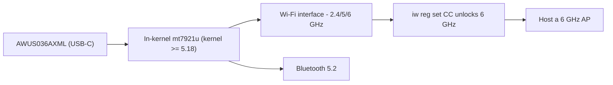

# ALFA AWUS036AXML——Wi-Fi 6E USB-C（6 GHz）

> **一句话定位（Quick Summary）**：**AWUS036AXML** 是 ALFA 产品线中唯一的 **Wi-Fi 6E** 网卡适配器——一支 **MT7921AUN AXE3000 三频**（2.4/5/**6 GHz**）网卡适配器，配 **USB-C**、双 5 dBi 天线与**蓝牙 5.2**，使用**内置于内核的驱动**（自 5.18 起的 `mt7921u`）。已在 ASUS GX10 / Ubuntu 24.04 ARM64 实测：**6 GHz 可用**（AXML 架设了 ch37 / 6135 MHz 的 WPA3-SAE AP，iPhone 15 Pro 以 802.11ax 连入；这张卡未测试作为 6 GHz 客户端）、蓝牙可用、AP 与 WPA3 可用。**数据包注入在 stock kernel 6.17 未通过**，所以请不要为了 deauth 或 handshake 捕获而选它。仅限在自有或已授权的网络使用。

## 规格总览 (Spec overview)

| 项目 | 规格 |
|---|---|
| 芯片 | MediaTek MT7921AUN |
| Wi-Fi 等级 | AXE3000——最高 600 / 1200 / 1200 Mbps（2.4 / 5 / 6 GHz），依 ALFA 规格表 |
| 频段 | 2.4 + 5 + **6 GHz**（6 GHz 已在 GX10 上验证） |
| 接口 | **USB-C** |
| 天线 | 2 × 外置 5 dBi，RP-SMA |
| 蓝牙 | BT 5.2（实测可用） |
| MIMO | 2×2 |
| Linux 驱动 | `mt7921u`——**自 5.18 起内置于内核** |
| 监听模式 | ✅ 2.4 + 5 GHz，接收较弱（GX10 实测） |
| 数据包注入 | ❌ 在 stock kernel 6.17 未通过（kernel 6.16 起的 mac80211 chanctx 回归；并非芯片先天限制） |

## 实测：ASUS GX10 / Ubuntu 24.04 ARM64

**测试环境**：ASUS Ascent GX10（NVIDIA GB10）、Ubuntu 24.04 LTS ARM64、kernel `6.17.0-1014-nvidia`，测试日期 2026-11-16 至 2026-11-19，测试设备为 iPhone 7 Plus（WPA3 与 6 GHz 测试使用 iPhone 15 Pro）。

| 项目 | 结果 |
|---|---|
| 芯片 | MediaTek MT7921AUN |
| USB ID | `0e8d:7961` |
| 内核驱动 | `mt7921u`（内置于内核） |
| 固件 | `WIFI_RAM_CODE_MT7961`（linux-firmware） |
| 是否需要 DKMS | 否（kernel ≥ 5.18 不需要） |

| 功能 | 2.4 GHz | 5 GHz |
|---|---|---|
| Monitor | ✅ 弱 | ✅ 弱 |
| Injection | ❌ 失败（stock kernel 6.17） | ❌ 失败（stock kernel 6.17） |
| AP 热点 | ✅ | ✅（80 MHz） |

| 高级功能 | 结果 |
|---|---|
| WPA3-SAE（AP 端） | ✅ iPhone 15 Pro 在 2.4 GHz 连入（`sae_pwe=0`、`MFP: yes`）；6 GHz 也成功（见下列）；5 GHz 与 WPA3 客户端未测试 |
| 6 GHz | ✅ 以 AXML 作为 AP 实测：ch37 / 6135 MHz 的 WPA3-SAE（H2E、`sae_pwe=1`）AP，iPhone 15 Pro 以 802.11ax（HE-NSS 2）加入并取得 IP。办公室没有 6 GHz AP（6 GHz 扫描扫到 0 个 BSS），所以 6 GHz 客户端模式与 6 GHz 监听捕获皆未测试 |
| 蓝牙 | ✅ 实测：控制器可启动（HCI 5.2），扫描到 31 个 BLE + 1 个经典蓝牙设备，WiFi 与蓝牙可共存 |
| WPA handshake 捕获 | ❌ 无法进行，注入失败 |
| VIF | ✅ |
| Active monitor | 🟡 `iw` 接受设置，ACK 未验证 |
| IBSS（Ad-hoc） | N/A |
| Mesh（802.11s） | N/A |
| Wi-Fi Direct（P2P） | 未测试（需第二台设备） |

在你自己的机器上验证：

```bash
lsusb | grep 0e8d:7961
sudo dmesg | grep mt7921u | tail -2
iw phy $(cat /sys/class/net/$(ls /sys/class/net | grep '^wlx' | head -1)/phy80211/name) info | sed -n '/Supported interface modes/,/Band 1/p'
iw dev
```

完整测试报告：[AWUS036AXML 于 ASUS GX10 / Ubuntu 的实测报告](https://yupitek.com/zh-cn/blog/awus036axml-asus-gx10-ubuntu-test-report/)。

**备注**：
- 注入：`aireplay-ng --test` 与 deauth 回传 `No Answer` / `No such BSSID available`，因此无法 deauth，也无法捕获 handshake。这并非芯片先天限制：主因是 kernel 6.16 起的 mac80211 chanctx 回归（见[驱动页面](/alfa-network/drivers/mt7921aun/)）。社区以 git／patched 驱动可让 active monitor 与注入工作，但固件仍锁定速率（1/6 Mbps，无法注入 HT/VHT）。我们无法在这里重测 patched 驱动，因为 Secure Boot 拒绝加载未签署的模块。
- 监听接收比 MT7612U／MT7610U 的卡弱；后续重测中，在 2.4 GHz ch6 与 5 GHz ch36 各捕获 8 秒，只收到 4 与 8 个帧，且没有 beacon。
- `iw` 在监听模式下回报 TX 功率为 3 dBm；这是回报上的假象。
- AP 测试最好在刚插上卡之后进行；做过监听／注入测试后，beacon 可能弱到手机看不到 SSID，需要重新插拔这张卡。
- 这个 WiFi + 蓝牙复合设备重新插拔后，WiFi probe 可能卡住；请换一个 USB 端口。
- 6 GHz 的结果是「MT7921 = Wi-Fi 6」通则的例外；是否称为「6E」取决于行销定义。
- Kali 与 NetHunter：未实机测试。

## 总览

AXE3000 的 **AXML** 是 ALFA 为 6 GHz 时代准备的代表作。**6 GHz 频段**目前是最不拥挤的可用频谱——没有旧设备、没有重叠的实验室 AP——而这张卡就是你在 Linux 上通往它的方式。两个细节让它与众不同：

1. **它在内核里。** `mt7921u` 驱动自 5.18 起就在主线，所以在目前的 Ubuntu 或 Kali 上，把它插进 **USB-C 端口**就能用。没有 DKMS。
2. **USB-C + 蓝牙 5.2。** 现代轻薄笔记本有 USB-C，但 Wi-Fi 常常偏弱；一支 AXML 就以正规的射频与真正的天线，同时取代 Wi-Fi 与蓝牙。

天然的搭档：远程的 [Wi-Fi 6E 访问点](/alfa-network/products/apa-m25-6e/)，以及用来解锁你所在地区频道的 [6 GHz 法规设置](/alfa-network/drivers/mt7921aun/)。

## 安装与驱动

不需要编译——需要 kernel 5.18+。完整的 6 GHz 设置请见 [MT7921AUN 驱动页面](/alfa-network/drivers/mt7921aun/)。验证：

```bash
lsusb | grep -i mediatek
iw dev
IF=$(ls /sys/class/net | grep '^wlx' | head -1)
iw phy $(cat /sys/class/net/$IF/phy80211/name) info | grep -E "60[0-9]{2}|61[0-9]{2}" | head
```

**预期输出**：MT7921U 那一行；一个接口；以及 phy 信息中的 **6 GHz 频道项目**（在我们的测试中，法规网域为 TW 时，5955–6415 MHz／频道 1–93 以 23 dBm 激活，仅限室内，更高的频道为停用）。没有 6 GHz 项目？请设置法规网域：

```bash
sudo iw reg set TW    # your country code
sudo ip link set $IF down && sleep 1 && sudo ip link set $IF up
```



## 高级使用

### 架设 6 GHz WPA3 AP（我们实际测试的做法）

由 AXML 担任 AP；我们未测试它作为 6 GHz 客户端。`/tmp/ap6.conf`：

```ini
interface=<your wlx interface>
driver=nl80211
ssid=YUP-6G-TEST
country_code=TW
ieee80211d=1
hw_mode=a
channel=37
op_class=131
ieee80211ax=1
he_su_beamformer=1
he_su_beamformee=1
he_6ghz_reg_pwr_type=0
wpa=2
wpa_key_mgmt=SAE
rsn_pairwise=CCMP
ieee80211w=2
sae_pwe=1
sae_password=<your passphrase>
```

```bash
sudo nmcli dev set $IF managed no
sudo hostapd -t /tmp/ap6.conf
iw dev $IF info | grep channel   # confirm you are on 6 GHz
```

**预期输出**：`AP-ENABLED` 与 `channel 37 (6135 MHz)`。在我们的测试中，iPhone 15 Pro 成功加入（`AP-STA-CONNECTED`、4-way handshake 完成、取得 DHCP 租约），关联频率为 6135 MHz，证明连接确实在 6 GHz 频段。请注意，6 GHz 需要 `sae_pwe=1`（H2E），不同于 2.4 GHz 为了旧款 iPhone 而使用的 `sae_pwe=0`。

### 监听模式（在所测试的 kernel 上仅能接收）

```bash
sudo nmcli dev set $IF managed no
sudo ip link set dev $IF down
sudo iw dev $IF set type monitor
sudo ip link set dev $IF up
sudo iw dev $IF set channel 36
sudo timeout 8 tcpdump -l -i $IF -nn -e -c 200
```

**预期输出**：2.4 与 5 GHz 收到部分 beacon，帧数比 ACM 少很多（某次重测中几乎收不到）。注入在 stock kernel 6.17 上失败。6 GHz 的监听捕获未测试。

### 以三频面板天线扩大距离

AXML 原厂的偶极天线已经够用，但[三频面板天线](/alfa-network/products/apa-m25-6e/)的用途是延伸 6 GHz 频段的距离（我们未测试任何天线升级）。

## 兼容性

| 平台 | 支持 | 注意事项 |
|---|---|---|
| Ubuntu 24.04 ARM64（GX10，kernel 6.17） | ✅ 已实测（AP、WPA3 AP、6 GHz AP、蓝牙、监听接收） | 无法注入；客户端模式未测试 |
| Ubuntu / Kali（其他版本） | ✅ 内置于内核（kernel 5.18+） | 我们未测试 |
| NetHunter / Android | 未测试 | 手机上需要 5.18+ 的 kernel |
| Windows | 我们未测试 | ALFA 官方驱动 |
| Jetson（JetPack 6） | 我们未测试 | 见 [Jetson 指南](/alfa-network/hardware/jetson/) |

## 疑难排解

| 症状 | 原因 | 修复 |
|---|---|---|
| 完全侦测不到 | Kernel < 5.18，或 USB-C 数据线只能充电 | 升级 kernel；使用支持数据传输的线材 |
| 缺少 6 GHz 频道 | 未设置法规网域 | `sudo iw reg set <CC>`；重启接口 |
| 重新插拔后没有 `wlx` 接口 | 复合设备的 WiFi probe 卡住 | 换一个 USB 端口 |
| 手机看不到 AP 的 SSID（beacon 太弱） | 做过监听／注入测试后卡的状态变差，或 `iw` 显示 TX 功率为 3 dBm | 拔下再插回，然后先启动 AP |
| 注入／deauth 什么都找不到 | stock kernel 6.17 上的 mac80211 chanctx 回归（并非芯片先天限制） | 注入请改用其他卡 |
| 没有蓝牙 | 未加载 `btusb` | `sudo modprobe btusb` |

## 相关资源

- [MT7921AUN 驱动页面](/alfa-network/drivers/mt7921aun/)
- [AWUS036AXM](/alfa-network/products/awus036axm/)——同芯片家族（AXM 上未测试 6 GHz）
- [APA-M25-6E](/alfa-network/products/apa-m25-6e/)——这张卡搭配的三频面板天线
- [Jetson 指南](/alfa-network/hardware/jetson/)——6 GHz 空间流使用情境（我们未测试）
- [网卡适配器比较](/alfa-network/wifi-adapter-comparison/)
