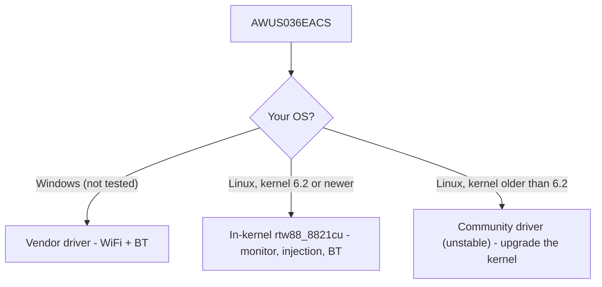

# ALFA AWUS036EACS——Nano WiFi + 蓝牙组合

> **一句话定位（Quick Summary）**：**AWUS036EACS** 是 ALFA 的 **nano WiFi + 蓝牙组合**——一支 **RTL8821CU AC600** 双频 dongle，集成 **BT 4.2**。在 **kernel 6.2 或更新版本**由内置的 `rtw88_8821cu` 驱动支持；在我们的 ASUS GX10 / Ubuntu 24.04 ARM64 测试中，监听模式、双频 100% 的数据包注入、AP、WPA3 AP（2.4 GHz，仅 AP 端）、端到端 handshake 捕获与蓝牙皆可用。Windows 上即插即用是原厂的说法，我们未测试。仅限在自有或已授权的网络使用。

## 规格总览 (Spec overview)

| 项目 | 规格 |
|---|---|
| 芯片 | Realtek RTL8821CU |
| Wi-Fi 等级 | AC600（150 + 433 Mbps） |
| 接口 | USB 2.0 |
| 频段 | WiFi：2.4 + 5 GHz ｜ BT：2.4 GHz |
| 蓝牙 | BT 4.2（Linux 上实测可用） |
| 天线 | 内置 2 dBi（无外置 RP-SMA） |
| 安全性 | 依原厂规格为 WEP / WPA / WPA2 / WPA3-SAE（Linux 上实测 WPA2 与 WPA3-SAE 的 AP；WEP/WPA 未测试） |
| Linux 驱动 | `rtw88_8821cu`——**kernel ≥ 6.2 内置**（见 [RTL8821CU 驱动页面](/alfa-network/drivers/rtl8821cu/)） |
| 监听模式 | ✅ 2.4 + 5 GHz（GX10 实测） |
| 数据包注入 | ✅ 2.4 与 5 GHz 皆 100%（GX10 实测） |

## 实测：ASUS GX10 / Ubuntu 24.04 ARM64

**测试环境**：ASUS Ascent GX10（NVIDIA GB10）、Ubuntu 24.04 LTS ARM64、kernel `6.17.0-1014-nvidia`，测试日期 2026-11-16 至 2026-11-19，测试设备为 iPhone 7 Plus（WPA3 另用 iPhone 15 Pro）。

| 项目 | 结果 |
|---|---|
| 芯片 | Realtek RTL8821CU（WiFi + 蓝牙复合设备） |
| USB ID | `0bda:c820` |
| 内核驱动 | `rtw88_8821cu`（内置于内核） |
| 固件 | WiFi 24.11.0（H2C version 12，取自 `dmesg`）；蓝牙 `rtl_bt/rtl8821c_fw.bin` |
| 是否需要 DKMS | 否（kernel ≥ 6.2 不需要） |

| 功能 | 2.4 GHz | 5 GHz |
|---|---|---|
| Monitor | ✅ | ✅ |
| Injection | ✅ 100% | ✅ 100% |
| AP 热点 | ✅ | ✅（802.11a、20 MHz 实测；VHT80 未测） |
| WPA3-SAE（AP 端） | ✅ | 未测试 |

| 高级功能 | 结果 |
|---|---|
| WPA handshake 捕获 | ✅ 端到端（deauth 收到 79 个 ACK，已转出 `.22000`） |
| VIF | 🟡 被动 monitor VIF 可与 station 在同一频道并存（software monitor）；驱动未声明接口组合 |
| Active monitor | ❌ `Operation not supported (-95)` |
| IBSS（Ad-hoc） | ❌ `iw` 有列出但加入失败 |
| Mesh（802.11s） | ❌ `-95` |
| Wi-Fi Direct（P2P） | ❌ `-95` |
| 蓝牙 | ✅ 可用：固件可加载、控制器可启动，BR/EDR 与 LE 扫描皆扫到设备；WiFi 与蓝牙可共存（WiFi 连接时 BR/EDR 扫描正常；同时段的 LE 扫描扫到 0 台） |

在你自己的机器上验证：

```bash
lsusb | grep -i 0bda:c820
sudo dmesg | grep -i 8821cu
iw phy $(cat /sys/class/net/$(ls /sys/class/net | grep '^wlx' | head -1)/phy80211/name) info | sed -n '/Supported interface modes/,/Band 1/p'
iw dev
bluetoothctl list
```

完整测试报告：[AWUS036EACS 于 ASUS GX10 / Ubuntu 的实测报告](https://yupitek.com/zh-cn/blog/awus036eacs-asus-gx10-ubuntu-test-report/)。

**备注**：
- 复合设备：重新插拔后，WiFi 功能的 probe 可能卡住，不会出现 `wlx` 接口。请换一个 USB 端口。
- 反复切换模式后，WiFi 这一侧可能停摆（RX 收不到数据包，`ip link set up` 回 `Operation already in progress`）。请拔下再插回（最好换一个端口），并在插上后第一件事就运行下一项测试。
- 请勿运行 `airmon-ng check kill`；`hcxdumptool` 8.x 在 5 GHz 无法启动（arm 失败；后续重测时 2.4 GHz 可以启动）——请改用 `airodump-ng` + `aireplay-ng`。
- 5 GHz 注入前请先运行 `sudo iw reg set US`，测完再还原你原本的区域设置。
- 6 GHz：不适用。Kali 与 NetHunter：未实机测试。

## 总览

EACS 是为想要**在一支小巧不起眼的U盘里同时拥有 WiFi + 蓝牙**的买家设计的：桌机、嵌入式工业电脑或小型 ARM 主机都适用。AC600 的速度加上 2 dBi 内置天线，让它成为「够用的上网 + 蓝牙键盘／鼠标」升级；天线短，所以最好靠近 AP 使用。

早期社区的说法是 RTL8821CU 没有可用的 Linux 驱动。这个说法已经过时：主线的 `rtw88_8821cu` 驱动（kernel ≥ 6.2）可正常工作，在我们的测试中，双频注入皆达 100%，与 AWUS036ACH 并列，领先我们测过的其他 ac 等级网卡适配器。只有比 6.2 更旧的 kernel 才需要依赖不稳定的社区驱动。

## 安装与驱动

### Linux，kernel 6.2 或更新版本

不需要安装任何东西——内置的 `rtw88_8821cu` 会自动绑定，蓝牙部分由 `btusb` 处理。请见 [RTL8821CU 驱动页面](/alfa-network/drivers/rtl8821cu/)。

### Linux，较旧的 kernel（仅限 < 6.2）

存在一个社区驱动（`brektrou/rtl8821CU`），可能可以在旧 kernel 上编译，但请预期不稳定。建议升级 kernel；驱动页面有详细说明。

### Windows

在 Windows（我们未测试）上，驱动预期会自动安装：

1. 将网卡适配器插入 USB 端口。
2. Windows 自动安装 RTL8821CU 驱动。WiFi 与蓝牙都会出现在设备管理员中。

```powershell
Get-PnpDevice -PresentOnly | Where-Object { $_.Class -eq "Net" }
```

**预期输出**（我们未验证）：列出一张 `802.11ac NIC` 网络适配器与一个蓝牙射频。



## 兼容性

| 平台 | 支持 | 注意事项 |
|---|---|---|
| Ubuntu 24.04 ARM64（GX10，kernel 6.17） | ✅ 已实测 | 内置于内核，WiFi + 蓝牙 |
| Linux kernel ≥ 6.2 | ✅ | 内置 `rtw88_8821cu` |
| Linux kernel < 6.2 | 🔧 | 仅有社区驱动，可能不稳定 |
| Kali Linux | ✅（我们未实机测试） | kernel ≥ 6.2 时内置于内核 |
| Windows | 我们未测试 | 原厂驱动；预期 WiFi + 蓝牙可用 |
| NetHunter / Android | ❓ | 未测试 |
| Raspberry Pi | ❓ | 我们未测试（kernel ≥ 6.2 时内置于内核） |
| macOS | 我们未测试 | 支持有限；Apple Silicon 不支持 |

## 疑难排解

| 症状 | 原因 | 修复 |
|---|---|---|
| `lsusb` 显示 `0bda:c820` 但没有 `wlx` 接口 | 复合设备的 WiFi probe 在重新插拔后卡住 | 换一个 USB 端口；拔下再插回 |
| 多次切换模式后，扫描或捕获收到 0 个数据包 | 复合设备的 WiFi RX 停摆 | 拔下再插回（换一个端口）；插上后第一件事就做下一项测试 |
| 找不到蓝牙设备（Windows；我们未测试） | 驱动／服务冲突 | 检查设备管理员；从 ALFA 支持网站重新安装驱动 |
| Linux kernel < 6.2：没有稳定的驱动 | 只有社区驱动 | 升级到 kernel ≥ 6.2 |
| 距离短 | 内置 2 dBi 天线 | 设计如此；请靠近 AP 使用 |

## 相关资源

- [RTL8821CU 驱动页面](/alfa-network/drivers/rtl8821cu/)
- [AWUS036ACM](/alfa-network/products/awus036acm/)——有外置天线的 MediaTek 替代款
- [AWUS036ACS](/alfa-network/products/awus036acs/)——口袋型监听模式替代款
- [网卡适配器比较](/alfa-network/wifi-adapter-comparison/)
- [兼容性矩阵](/alfa-network/linux-compatibility-matrix/)
