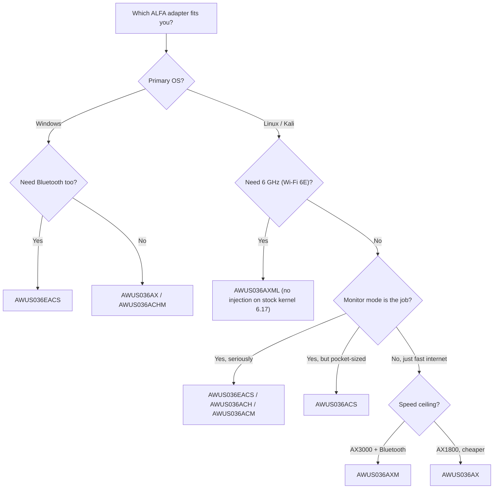

# ALFA 无线网卡对比

> **结论先行（Bottom line）**：如果你是使用 Kali Linux 做课程或实验的大学生，买 **AWUS036ACM**——它的 MediaTek MT7612U 芯片组内置于 Linux 内核，监听模式开箱即用，而且价格低于旗舰型号。如果你需要 6 GHz，**AWUS036AXML**（USB-C）实测可运作于 6 GHz（**AWUS036AXM** 同芯片，6 GHz 推测可用、未测试）——但两者在 stock kernel 6.17 上**封包注入未通过**，不适合注入/渗透用途。如果你需要紧凑的 WiFi + 蓝牙组合，**AWUS036EACS** 在 kernel ≥ 6.2 的 Linux 上由内核内置 `rtw88_8821cu` 支持（监听与注入实测可用，蓝牙实测可用；Windows 未实测）。**内核够新（kernel ≥ 6.17）时，9 款网卡全部由内核内置驱动支持，插上即用。**

*💡 点击上方图片可开启高分辨率放大灯箱，清晰检视完整型号与芯片规格。*
## 完整规格对比表

九款网卡适配器，一张表。「监听模式」指把接口切换为 RFMON，以便捕获信道上的每一个数据包——这是 Wireshark、Aircrack-ng、Wifite 等工具的基本要求。下表「监听模式 / 注入」一栏为 GX10 / Ubuntu 24.04（kernel 6.17.0-1014-nvidia）实测结果，Realtek 型号需 EACS ≥ 6.2、ACH / ACS ≥ 6.13、AX / AXER ≥ 6.17（旧内核才需 DKMS）。

| 型号 | 芯片组 | Wi-Fi 等级 | 接口 | 频段 | 最高速度 | 监听模式（Linux） | 天线 |
|---|---|---|---|---|---|---|---|
| [AWUS036ACH](/alfa-network/products/awus036ach/) | RTL8812AU | AC1200 | USB 3.0 | 2.4 + 5 GHz | 300 + 867 Mbps | ✅ 监听 / 注入 100%（`rtw88_8812au` 内置，kernel ≥ 6.13） | 2 × 外置 5 dBi，RP-SMA |
| [AWUS036ACHM](/alfa-network/products/awus036achm/) | MT7610U | AC600 | USB 2.0 | 2.4 + 5 GHz | 150 + 433 Mbps | ✅ 监听 / 注入 2.4G 96–100%，5G 仅广播（`mt76x0u` 内置） | 1 × 可拆卸 5 dBi，RP-SMA（单天线） |
| [AWUS036ACM](/alfa-network/products/awus036acm/) | MT7612U | AC1200 | USB 3.0 | 2.4 + 5 GHz | 300 + 867 Mbps | ✅ 监听 / 注入 63–83%（`mt76x2u` 内置） | 2 × 外置 5 dBi，RP-SMA |
| [AWUS036ACS](/alfa-network/products/awus036acs/) | RTL8811AU | AC600 | USB 2.0 | 2.4 + 5 GHz | 150 + 433 Mbps | ✅ 监听 / 注入 100%（`rtw88_8821au` 内置，kernel ≥ 6.13） | 1 × 外置 2 dBi，RP-SMA（55 mm 机身） |
| [AWUS036AX](/alfa-network/products/awus036ax/) | RTL8832BU | AX1800 | USB 3.2 | 2.4 + 5 GHz | 574 + 1201 Mbps | ✅ 监听强 / 注入 96%（`rtw89_8852bu` 内置，kernel ≥ 6.17） | 2 × 外置 6 dBi，RP-SMA |
| [AWUS036AXER](/alfa-network/products/awus036axer/) | RTL8832BU | AX1800 | USB 3.2 | 2.4 + 5 GHz | 574 + 1201 Mbps | ✅ 监听强 / 注入 73%（`rtw89_8852bu` 内置，kernel ≥ 6.17） | 内置（10.5 g 纳米机身） |
| [AWUS036AXM](/alfa-network/products/awus036axm/) | MT7921AU（`mt7921u`） | AX3000 级 | USB 3.2 | 2.4 + 5 + 6 GHz（6 GHz 推测、未测试） | 最高 600 + 1200 + 1200 Mbps | 🟡 监听可用（接收弱）；注入未通过（stock kernel 6.17） | 2 × 外置 5 dBi，RP-SMA + BT 5.2 |
| [AWUS036AXML](/alfa-network/products/awus036axml/) | MT7921AUN（`mt7921u`） | AXE3000 | USB-C | 2.4 + 5 + 6 GHz（6 GHz 实测可用） | 最高 600 + 1200 + 1200 Mbps | 🟡 监听可用（接收弱）；注入未通过（stock kernel 6.17） | 2 × 外置 5 dBi，RP-SMA + BT 5.2 |
「+」分隔两个频段：**2.4 GHz + 5 GHz**（AXE 型号再加 + 6 GHz）。「300 + 867」的网卡适配器是 **AC1200** 等级：300 Mbps 是 2.4 GHz 上限（2 个空间流 × 150 Mbps），867 Mbps 是 5 GHz 上限（2 × 433 Mbps）。实际吞吐量通常为链路速率的 50–70%——物理损耗、墙壁和 USB 总线开销吃掉了其余部分。

## 哪款适合你？

### 如果你需要 Kali / 监听模式 / 数据包注入 → AWUS036ACM

MT7612U 芯片组**自 Linux 4.19 起内置于内核**，这意味着：在任何较新的 Kali 或 Ubuntu 上插上它，`ip link` 就已经显示 `wlan0`。监听模式通过标准 `iw` 命令即可工作，数据包注入实测可用（2.4 GHz 63–83%、5 GHz 76%）。

如果你要的是**注入回应率最高**的网卡，GX10 实测中 **AWUS036EACS**（2.4 / 5 GHz 均 100%）、**AWUS036ACH**（均 100%）与 **AWUS036ACS**（100% / 96%）更强，内核够新时（EACS ≥ 6.2、ACH / ACS ≥ 6.13）同样插上即用；选型建议：渗透测试首选 EACS / ACH / ACS，最强接收与长距离监听选 AXER / ACH，Wi-Fi 6 + AP 选 AX / AXER。它还提供 19–23 dBm 发射功率（约 100–200 mW，依 ALFA 规格表），搭配两根外置天线——对实验练习来说确实有用的覆盖范围。完整工作流见 [Kali 设置指南](/alfa-network/linux-setup-kali/)。

### 如果你需要 6 GHz（Wi-Fi 6E）→ AWUS036AXML

AXML 是产品线中**唯一实测 6 GHz 可运作**的网卡适配器（6 GHz WPA3-SAE AP，ch37 / 6135 MHz，iPhone 15 Pro 以 802.11ax 连上）。它使用 MediaTek **MT7921AUN**，其 `mt7921u` 驱动程序自内核 5.18 起进入主线——没有 DKMS 的烦恼；蓝牙也实测可用。它也是唯一的 USB-C 型号，是现代超极本或平板电脑的完美搭档。**但它在 stock kernel 6.17 上封包注入未通过**，不推荐用于注入 / 渗透用途。AXM 同芯片，6 GHz 推测可用但**未测试**。参见 [Ubuntu 设置指南](/alfa-network/linux-setup-ubuntu/)。参见 [Wi-Fi 6E 设置说明](/alfa-network/linux-setup-ubuntu/)。

### 如果你想要纯客户端网卡适配器（快速、稳定、不做渗透测试）→ AWUS036AXM 或 AWUS036AX

AXM 是两者中更快的（AX3000，依 ALFA 规格 5 GHz 上最高 1200 Mbps），并依规格表提供**蓝牙 5.2**——一个适配器搞定 WiFi + BT（AXM 的蓝牙未实测）；它的 monitor 接收较弱、注入未通过，**不推荐注入 / 渗透用途**。AX 提供 Wi-Fi 6 + WPA3，kernel ≥ 6.17 内置 `rtw89_8852bu`，实测 monitor 接收强、注入可用（2.4 GHz 96%），不需要 DKMS（仅旧内核才需要）。

### 如果你带着笔记本旅行 / 想要口袋级网卡适配器 → AWUS036ACS 或 AWUS036AXER

ACS（55 mm 机身）和 AXER（10.5 g，内置天线）放进背包就消失不见。ACS 是预算级监听模式伴侣；AXER 是日常使用的 Wi-Fi 6 纳米款。

### 如果你需要小巧的 WiFi + 蓝牙组合 → AWUS036EACS

EACS 在 **kernel ≥ 6.2** 的 Linux 上由内核内置的 `rtw88_8821cu` 驱动，GX10 实测监听模式、两频注入（均 100%）、AP、WPA3 与蓝牙都可用（旧资料中「Linux 不推荐」已不适用；仅旧内核 < 6.2 才没有内置驱动）。依规格表为 WiFi AC600 + BT 4.2 二合一（Windows 未实测）。它没有外置天线，距离有限；重新插拔时若 Wi-Fi probe 卡死，请换一个 USB 口。

## 如果无法决定——买 ACM

AWUS036ACM 是社区共识之选：内核内置驱动、久经考验的监听模式 + 注入（GX10 实测可用）、双频、高功率，而且完全在学生预算之内。你会在[故障排查](/alfa-network/troubleshooting/)和[驱动](/alfa-network/drivers/mt7612u/)页面中到处看到它被称作「无聊但可靠的选择」——而在这个世界里，无聊意味着*它就是能用*。

下一步：在[兼容性矩阵](/alfa-network/linux-compatibility-matrix/)中核对你的操作系统，或直接进入 [Ubuntu](/alfa-network/linux-setup-ubuntu/) / [Kali](/alfa-network/linux-setup-kali/) 设置指南。