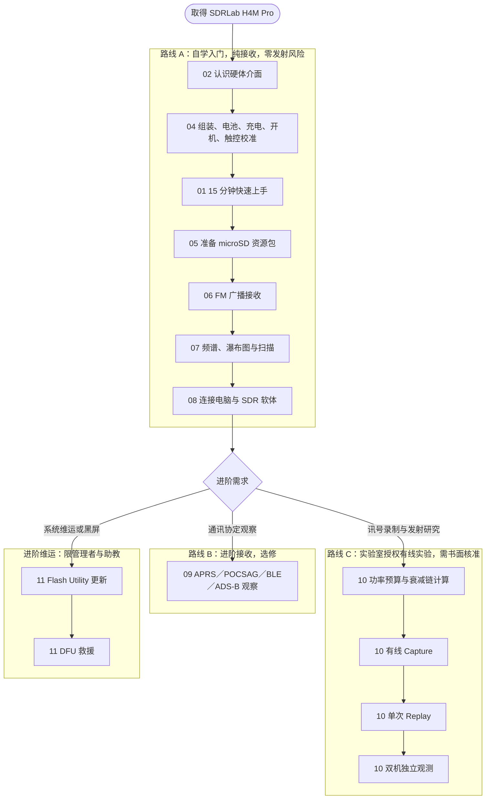

# SDRLab H4M Pro 操作手册（研究生与实验室适用）

> **适用装置**：SDRLab H4M Pro（HackRF Pro r1.2.1 射频主机板与 Mayhem Signature-Edition PortaPack H4M Pro 面板组合；资料来源为[供应商官方产品页](https://opensourcesdrlab.com/products/hackrf-pro-h4m-pro?VariantsId=10426)）。  
> **适用对象**：大专院校理工科研究生、实验室专案研究人员（初次接触软体定义无线电 SDR）。  
> **参考固件**：首批出货为供应商的 `Pro_v2.4.0`（依 Mayhem v2.4.0 修改）；更新范例使用 v2.4.0.3（硬体目标 `hpro`）。  
> **手册版本**：03  
> **官方手册对照**：已对照供应商官方《HackRF Pro + PortaPack H4M Pro User Manual》（2026-08-11 发布）。  
> **更新日期**：2026-10-02  
> **发布平台**：doc.yupitek.com（简体中文正式版）  

:::warning 型号区隔重要提醒
SDRLab H4M Pro 与 H4M 在射频主机板、电源（**18650 电池** vs 内建软包）、时钟（Pro 内建 TCXO）与介面配置上都不同。**请勿交叉套用 H4M 的固件（`firmware_hackrf.bin`）、`hackrf` SD 资源包、刷写指令或电气数值**，以免造成装置故障。本手册只适用 H4M Pro；如果你的装置是 H4M，请阅读 H4M 手册。
:::

:::info 商标与产品说明
本产品并非 Great Scott Gadgets 制造。「HackRF」是 Great Scott Gadgets 的商标；依其授权条件，可为了命名或描述 HackRF 的复制品或衍生作品而使用，并须标示出处。本手册所述 H4M Pro 的产品资讯，以供应商官方产品页与官方使用手册为准。
:::

---

## 目录

- [00 先读我：安全 5 原则与学习路线图](#00-先读我安全-5-原则与学习路线图)
- [01 15 分钟快速上手（第一次成功：收听 FM 广播）](#01-15-分钟快速上手第一次成功收听-fm-广播)
- [02 认识 H4M Pro 硬体与控制介面](#02-认识-h4m-pro-硬体与控制介面)
- [03 采购与必备器材清单](#03-采购与必备器材清单)
- [04 组装、电池、充电、第一次开机与触控校准](#04-组装电池充电第一次开机与触控校准)
- [05 准备 microSD 卡与部署资源包](#05-准备-microsd-卡与部署资源包)
- [06 第一次接收：公开 FM 广播（详细教学）](#06-第一次接收公开-fm-广播详细教学)
- [07 看懂频谱、瀑布图、增益控制与扫描](#07-看懂频谱瀑布图增益控制与扫描)
- [08 连接电脑操作（SDR 外接模式）](#08-连接电脑操作sdr-外接模式)
- [09 【选修】进阶接收：APRS、POCSAG、BLE 与 ADS-B 观察](#09-选修进阶接收aprspocsagble-与-ads-b-观察)
- [10 【实验室授权】有线 Capture、单次 Replay 与 TX 实验](#10-实验室授权有线-capture单次-replay-与-tx-实验)
- [11 【进阶】固件更新与 DFU 救援指南](#11-进阶固件更新与-dfu-救援指南)
- [12 排错与常见问题（FAQ）](#12-排错与常见问题faq)
- [13 核心术语对照与概念速查](#13-核心术语对照与概念速查)
- [14 学习验收与实验记录表](#14-学习验收与实验记录表)
- [附录 A：接收频段与电台查询指引](#附录-a接收频段与电台查询指引)
- [附录 B：完整硬体配件规格与采购建议](#附录-b完整硬体配件规格与采购建议)
- [附录 C：射频功率预算与衰减链计算工作表](#附录-c射频功率预算与衰减链计算工作表)
- [附录 D：官方资源与延伸阅读清单](#附录-d官方资源与延伸阅读清单)

---

## 00 先读我：安全 5 原则与学习路线图

软体定义无线电（SDR, Software-Defined Radio）是极为强大的研究与教学工具。在开始任何操作之前，请全体读者务必恪守以下 5 项核心原则：


:::warning 开始之前，请记住安全 5 原则
1. **先练习「纯接收」**：本手册前半部只专注于讯号的接收、频谱观察与资料解调，不涉及任何发射操作。
2. **发射（TX）与重放（Replay）必须取得实验室书面授权**：严禁以天线进行空中辐射发射练习。所有发射实验必须在完全受控的有线同轴链路中进行，并经指导教授或实验室管理者书面审核。
3. **天线只用于接收**：装上天线时，切勿启动任何发射或重放功能。
4. **Bias-Tee 与 RF Amp 预设保持 OFF**：初学接收与一般实验不需要开启同轴供电（Bias-Tee）或内部射频前置放大器（RF Amp），避免烧毁输入端。
5. **有疑问立即停机咨询**：所在地法规（如台湾 《无线电管理条例》）及学校实验室规范具有最高法律效力；遇到异常发热、讯号过载或不明操作时，请立即断电并向指导教授或实验室管理者请益。
:::

### 核心限制与法律规范

1. **接收边界**：接收并解调合法公开的广播讯号（如商用 FM 广播）属于合法学习范畴。然而，未经授权拦截、记录、公开或解密非公开通讯（如警消、军用、航空、他人私人通讯）受刑法及电信法规严格规范与处罚。
2. **发射许可**：业余无线电频段发射需要执照与合规电台；ISM 频段亦有严格的功率与场强限制。有线实验即使不产生空中辐射，亦必须遵守设备电气安全界限。GSG 对 HackRF Pro 原设计提供的规格，**不能直接视为 H4M Pro 这个衍生板的接收输入上限**；也**绝对不要套用 HackRF One 的 −5 dBm 数值**。实际额定请以供应商资料确认；规格不明时，请停止操作并询问指导教授或实验室管理者。

### 学习路线图



### 核心物理量快速导读：dB 与 dBm

在射频领域中，我们会频繁遇到 **dB** 与 **dBm**：
- **dB（分贝，Decibel）**：代表两个功率的**相对比值**，计算公式为 `dB = 10 * log10(P1 / P2)`。
  - +3 dB 代表功率增为 2 倍；-3 dB 代表功率减半。
  - +10 dB 代表功率为 10 倍；+30 dB 代表功率为 1,000 倍。
  - 衰减器标示 30 dB，表示通过的讯号功率会被衰减为原来的 $1/1000$。
- **dBm（毫瓦分贝）**：代表相对于 **1 mW（毫瓦）** 的**绝对功率值**，计算公式为 `P(dBm) = 10 * log10(P(mW) / 1 mW)`。
  - 0 dBm = 1 mW。
  - +10 dBm = 10 mW；+20 dBm = 100 mW。
  - -10 dBm = 0.1 mW；-30 dBm = 0.001 mW（换算示例）。
- **运算规则**：发射功率（dBm）减去衰减量与线损（dB）等于接收端输入功率（dBm）：
  ```text
  P_RX = P_TX - 衰减量 - 线损
  ```

---

## 01 15 分钟快速上手（第一次成功：收听 FM 广播）


本节旨在让你在 15 分钟内体验到软体定义无线电的魅力，建立信心后再深入各项原理。

| 步骤 | 核心动作 | 预期成果 |
|:---:|---|---|
| **Step 0** | 依第 04 章组装、安装 18650 电池、确认充电并完成触控校准（只需做一次） | Battery 状态正常，触控准确 |
| **Step 1** | 将你的接收天线锁到 `ANT` 端子（盒内是否附天线依订单而定，见第 02 章） | 天线固定良好，手指转紧即可 |
| **Step 2** | 确认 microSD 卡已插入机身卡槽（若尚未准备可先跳过，仍可开机测试） | 卡片卡扣就位 |
| **Step 3** | 将 `POWER` 开关拨至 ON（位置以机身丝印为准） | 萤幕亮起，显示 Mayhem 主选单 |
| **Step 4** | 透过旋钮与方向键进入 **Receive** → **Audio** | 进入音讯接收介面 |
| **Step 5** | 将 `mode` 切换为 **WFM**，输入你所在地电台的 FM 频率（查询方式见附录 A），慢慢调大 `volume` | 扬声器传出清晰广播声，画面上出现显著讯号峰 |

### 快速上手操作步骤

```text
主选单 (Main Menu)
  └─ Receive
       └─ Audio
            ├─ mode: WFM
            ├─ frequency: 你所在地电台的频率（请见附录 A）
            ├─ Amp: OFF
            ├─ LNA 16 / VGA 20: 官方手册的 FM 起始值，听不到再逐步调整
            └─ volume: 依听感调整
```

1. **接妥天线**：将天线接头对准机身 `ANT` SMA 母头，顺时针用手指旋紧。若使用伸缩天线，可拉长到约 75 cm（约为 100 MHz 的 1/4 波长）。
2. **开机进入介面**：拨动电源开关开机。在主画面中，按方向键选择 **Receive**，按中央确认键进入；接著选 **Audio** 并按中央键确认。
3. **设定调变模式**：使用方向键将游标移至 **mode** 栏位，转动旋钮切换为 **WFM**（宽频调频广播）。
4. **设定频率**：移至 **frequency** 栏位，输入你所在地电台的频率。请先到该电台的官方网站查询；每个地区的频率不同，不要直接抄别人的数字。
5. **安全调整音量**：确认画面上的 `Amp` 保持为 **OFF**。慢慢旋转调整 **volume**，即刻可听见熟悉的电台广播声音！
6. **安全退出**：按实体 **Back** 键（或选取画面上的返回项目）退出至主选单。

恭喜！你已经成功完成了第一次 SDR 射频接收！接下来请跟随手册完整建立系统环境。

---

## 02 认识 H4M Pro 硬体与控制介面


### 两层架构解析


SDRLab H4M Pro 采用模组化叠层架构：
1. **底层：射频主机板（HackRF Pro r1.2.1 衍生板）**：
   - 负责射频调谐、混频、I/Q 取样与数位讯号转换。
   - 官方产品页列出的规格见下表。
   - 增益、接收输入上限等电气特性，请以原厂资料为准，**不要沿用 HackRF One 的数值**。
   - 核心收发架构为半双工（同时间只能接收或发射）。
2. **顶层：PortaPack H4M Pro 面板**：
   - 搭载触控萤幕、控制轮、按键、扬声器与 microSD 卡槽。
   - 电源为**可更换的 18650 电池**（电池舱在机身背面；**商品通常不含电池**）。
   - 运行开源 **Mayhem** 固件，使 H4M Pro 成为无需外接电脑即可独立运作的掌上型频谱与无线电终端。

#### H4M Pro 官方规格摘要

| 项目 | H4M Pro（依官方产品页） | 对照：HackRF One（H4M 使用） |
|---|---|---|
| 射频主机板 | HackRF Pro r1.2.1 | HackRF One 相容板 |
| 工作频率范围 | 100 kHz ～ 6 GHz | 1 MHz ～ 6 GHz |
| 内建时钟 | 25 MHz、0.5 ppm 高稳定度 TCXO | 无内建 TCXO |
| 主机板 USB | USB-C（USB 2.0） | Micro-B（USB 2.0） |
| 射频防护 | 加强的内部射频遮蔽；天线埠加强突波保护 | 基本遮蔽 |
| 电源 | 可更换的 18650 电池（由原本的 104050 软包电池改版） | 内建软包电池 |
| 面板改版 | 喇叭与 microSD 卡槽重新配置；前面板 PCB 加入防伪图样 | — |

官方使用手册另列出面板与介面规格如下：

| 项目 | 规格（官方使用手册） |
|---|---|
| 显示 | 3.2 吋彩色**电阻式**触控萤幕 |
| 实体控制 | 5 向旋钮（旋转、上下左右四方向、中央按压） |
| 音讯 | 内建麦克风、内建喇叭、3.5 mm 耳机孔 |
| 电源管理 | 18650 电池管理晶片，USB 充电 |
| 建议电池 | 3.7 V 标称／4.2 V 最大充电、2500 mAh、9.25 Wh |
| 储存 | microSD 卡槽，FAT32 或 exFAT |
| 扩充 | GPIO 扩充埠 |
| 天线埠 | SMA；Bias-Tee 3.3 V 直流供电可在固件中切换 |
| 射频与取样 | MAX2831 收发晶片；MAX5865 ADC/DAC（8-bit 正交）；采样率最高 20 Msps、8-bit I/Q |
| 双工 | 半双工（同一时间只能接收或发射，不能同时） |
| 参考时钟 | 内建 25 MHz、0.5 ppm TCXO；支援外部时钟输入／输出 |
| 预载固件 | `Pro_v2.4.0`（依 Mayhem v2.4.0 修改） |

**增益、输入上限等电气额定仍须依原厂资料确认，不能由这些表格推论。** 关于正品辨识，官方表示前面板有防伪图样，并会另外提供说明影片，请以官方说明为准。


### 盒内配件清点

请依你的**订单与出货清单**逐项清点。下列是常见项目，**不一定每份订单都有**，不要因为商品照片有就认为是标准配件：
- [ ] HackRF Pro r1.2.1 射频主机板
- [ ] PortaPack H4M Pro 面板（Mayhem Signature Edition）
- [ ] USB 资料连接线（接头型式依批次而定）
- [ ] 接收天线（SMA 公头；官方手册列有 ANT500 伸缩天线，或依目标频段选用专用天线；是否随附依订单而定）
- [ ] 其他选购天线（例如特定频段的胶棒天线）

供应商商品页标示**不随附 18650 电池**，请另行准备（见第 03 章）。如果有缺件、外观损伤或连接埠变形，请先拍照留存，再联络供应商。Yupitek 不附 microSD 卡，也不预载资源，请自备。依官方手册，HackRF Pro 主机板与 PortaPack H4M Pro 面板是成套供应，使用前要先依第 04 章的 4.1 组装。

### 实体接口与端子定义

:::tip 接口辨识准则
接线时请**一律以机身金属壳或外壳丝印文字为准**，切勿单凭手册或网路照片的方向猜测！
:::

| 丝印名称 | 物理介面 | 核心用途 | 初学阶段连接建议 |
|---|---|---|---|
| **`ANT`** | SMA 母头（外螺内孔） | 射频输入／输出端子；Bias-Tee 3.3 V 直流供电可在固件中切换 | **可以连接**（仅限纯接收天线）；Bias-Tee 保持 OFF |
| **`CLK IN`** | SMA 母头 | 外部参考时钟输入（官方规格列为支援；电气额定请查原厂资料） | **先不要连接**（规格未确认前保持空置） |
| **`CLK OUT`** | SMA 母头 | 参考时钟输出（官方规格列为支援；电气额定请查原厂资料） | **先不要连接**（规格未确认前保持空置） |
| **`POWER`** | 拨动开关 | 电源开关。依供应商手册，**开关在 ON 时才会充电** | 位置与方向以机身丝印为准 |
| **USB 埠（2 个）** | USB 端子（HackRF Pro 主机板为 USB-C） | 不同的 USB 埠可能分别负责**资料传输**与**充电**，不要只因接头相同就推定用途 | 以机身丝印与供应商手册确认用途；**不要同时试插两个埠** |
| **电池舱** | 背面舱盖 | 安装 18650 电池 | 只依第 04 章步骤操作 |
| **microSD** | TF 弹压式卡槽 | 储存固件扩充应用（APPS）、设定与录音（位置与 H4M 不同，以实机为准） | 关机状态下插拔专用存储卡 |
| **GPIO** | 排针端子 | 外部除错与硬体扩充介面（接脚定义请以原厂资料为准） | **严禁连接**（保持悬空，防止短路） |

### 控制元件统一命名与操作指引

为确保操作步骤清晰无误，本手册全文统一使用以下控制元件名称：

| 控制元件名称 | 对应硬体 | 核心操作功能 |
|---|---|---|
| **旋钮（Dial）** | 5 向旋钮的旋转动作 | 改变当前选取栏位的数值（如调整频率数字、音量大小、增益等级） |
| **方向键（D-pad）** | 5 向旋钮的上下左右四个方向 | 在萤幕各栏位与功能表之间移动选取游标（焦点） |
| **中央确认键（Select）** | 5 向旋钮的中央按压 | 确认选取、进入子选单或触发动作 |
| **返回键（Back）** | 机身上标示 Back 的实体按键，或画面上的返回项目 | 退出当前 App、返回上一层选单 |
| **触控萤幕（Touchscreen）** | 3.2 吋电阻式触控萤幕 | 轻触直接选取目标。电阻式萤幕**需要先完成触控校准**（见 4.5）；输入频率数字时，旋钮比点选更容易。若触控没有反应，请改用旋钮与方向键，并避免大力按压萤幕，同时记下你的版本资讯以便向供应商求助 |

### 接收天线安装指南


1. **检查接口形式**：H4M Pro 机身的 `ANT` 接头为标准 SMA 母头（外螺纹，中心为金属插孔）。随附天线接头应为标准 SMA 公头（内螺纹，中心有金属针）。请目视确认中心针笔直无偏折。
2. **安装动作**：将天线垂直对准 `ANT` 端子，轻推就位后，用手指旋转外金属螺套直到锁紧。
3. **安全警语**：切勿使用板手或钳子暴力锁死，也不要在天线未固定时旋转整台主机，以免造成 SMA 端子内部排针扭断或焊点破裂。初次接收时，Bias-Tee 与 Amp 都保持 OFF。大型户外天线另有雷击与强讯号风险，请不要在初学阶段使用。

---

## 03 采购与必备器材清单

### 1. 纯接收自备清单（每位读者必备）


- **microSD 卡**：


  - 规格：建议 **16 GB 至 32 GB**，Class 10 / A1 等级，向可靠通路购买真品。这些标章只是入门的保守选择，不保证高采样率录制时完全不丢样。
  - 格式：官方手册指出 FAT32 或 exFAT 都可使用；本手册的格式化范例以 FAT32 为主。
  - 原因：低品质或老化的卡，是录制 IQ 时丢样（会悄悄损毁录制档）与刷写失败（可能造成无法开机）的主要原因；容量越大也越容易买到扩容伪卡。
  - 购买后请保留发票与卡片型号，格式化前先测试完整容量与可写性（测试可能清除全部资料，请使用可信来源的测试软体，并确认选对磁碟）。


- **18650 锂电池（另购；商品通常不含）**：


  - 请依**官方网站**公布的建议参数，选用**单颗**电池（[官方产品页](https://opensourcesdrlab.com/products/hackrf-pro-h4m-pro?VariantsId=10426)、[官方 H4M Pro 使用手册](https://blog.opensourcesdrlab.com/archives/HackRF-Pro-PortaPack-H4M-Pro-User-Manual)）。
  - **官方建议的 18650 电池参数**：

    | 项目 | 建议参数 |
    |---|---|
    | 类型 | 3.7 V 可充电锂离子电池 |
    | 标称容量 | 2500 mAh |
    | 标称能量 | 9.25 Wh |
    | 标称电压 | 3.7 V |
    | 最大充电电压 | 4.2 V |

  - 本手册**不指定电池型号与购买来源**：这款产品销往多个国家，各地可买到的型号与适用法规不同。请向可靠的通路购买，并核对电池标签与上表参数相符。官方产品页另有测试时使用的电池照片，可供辨识外形。
  - 确认电池外观完好、没有破皮或鼓胀，并核对制造商标示的保护要求与尺寸。
  - 严禁反接、短路、混用不明电池。
- **microSD 读卡机**：
  - 用于将 Mayhem SD 资源包解压缩写入存储卡根目录。
- **可信电脑与操作系统**：
  - Windows 10/11、macOS (Intel/Apple Silicon) 或 Linux (Ubuntu/Debian)。
- **被动接收天线**：
  - 随附伸缩天线（适合 70 MHz – 1 GHz）或特定频段胶棒天线（如 433 MHz / 915 MHz）。

### 2. 实验室有线安全套件清单（进行第 10 章实验时由实验室统一提供）


:::danger 有线实验防护原则
进行任何射频发射（TX）或重放（Replay）实验时，**严禁将两台 SDR 的 `ANT` 端口以同轴线直接互连**！若无足够衰减，发射功率将直接烧毁接收端低杂讯放大器（LNA）。
:::

- **50 Ω 射频同轴电缆**：优质双层遮蔽 RG-316 或 RG-142，SMA 公对公接头。
- **固定射频衰减器组（Attenuators）**：
  - 阻抗：50 Ω。
  - 耐受功率与衰减量：**必须依第 10.3 节的功率预算计算后选用**，首级衰减器要能承受发射端的最大功率。
  - 附录 B 的规格只是常见配置举例，**不能直接当作安全依据**；30 dB 也不是通用的安全值。
- **隔直器（DC Block）**：
  - 串联于射频链路中，物理阻绝任何直流偏置电压，保护敏感前端晶片。
- **50 Ω 射频假负载（Dummy Load）**：
  - 用于终端阻抗匹配吸收功率，非直接保护接收端。
- **第二台独立接收量测设备**：
  - 频谱分析仪、功率计，或另一台受完整衰减保护的 SDR 装置。

### 3. 官方软体与资源下载管道


请务必从官方开源储存库下载，切勿使用来路不明的网盘或二次打包映像档：
- **供应商 Mayhem 发行页**：[GitHub OpenSourceSDRLab/mayhem-firmware Releases](https://github.com/OpenSourceSDRLab/mayhem-firmware/releases)
- **Mayhem 官方发行页**：[GitHub portapack-mayhem/mayhem-firmware Releases](https://github.com/portapack-mayhem/mayhem-firmware/releases)

**官方说明（产品页）**：首批出货的固件是依 Mayhem v2.4.0 修改的版本，名称为 `Pro_v2.4.0`，开机后**萤幕左下角**显示的版本号就是 `Pro_v2.4.0`。如果要复制 SD 卡内容，可暂时使用供应商 [v2.4.0 发行页](https://github.com/OpenSourceSDRLab/mayhem-firmware/releases/tag/v2.4.0)的压缩档，使用后 APPS 图示就不会再反灰，可以正常使用。你也可以自行更新到官方 Mayhem 固件；官方表示开发团队近期已针对 HackRF Pro 与 H4M Pro 做了适配，可考虑 nightly 版本。

请依你的情况选择：

| 你的情况 | 做法 |
|---|---|
| 首批出货，开机左下角显示 `Pro_v2.4.0` | 到供应商 v2.4.0 发行页，在 **Assets** 下载 SD 资源压缩档，解压缩到卡根目录（第 05 章） |
| 版本不是 `Pro_v2.4.0` | 先记录你的完整版本字串，向供应商确认相配的资源，不要直接覆盖 |
| 决定更新固件（见第 11 章） | SD 资源包与固件必须是**同一版本、同一硬体目标**。范例：v2.4.0.3 的 `COPY_TO_SDCARD_hpro_mayhem_v2.4.0.3.zip`（空间有限可选同版本的 `-no-world-map` 版，两者只选一个）与 `FIRMWARE_mayhem_v2.4.0.3.zip` |

- 固件 ZIP 内含多个硬体目标，H4M Pro 必须使用 `firmware_hpro.bin`，**不要使用** `firmware_hackrf.bin`。
- **`hackrf` 与 `hpro` 资源不能混用，也不能只看版本号相同**：下载前务必确认档名中的目标是 `hpro`。

#### 下载档案 SHA-256 检查码计算指南

下载完成后，请在终端机中计算杂凑值，并与官方发行页（GitHub Releases）上的 SHA-256 比对，确保档案完整、来源正确。如果还不熟悉终端机，请先看第 08 章的「第一次使用终端机」：
- **Windows（PowerShell 或 CMD）**：
  ```cmd
  certutil -hashfile <资源包档名>.zip SHA256
  ```
- **macOS（Terminal）**：
  ```sh
  shasum -a 256 <资源包档名>.zip
  ```
- **Linux（Bash）**：
  ```sh
  sha256sum <资源包档名>.zip
  ```

---

## 04 组装、电池、充电、第一次开机与触控校准

### 4.1 组装 HackRF Pro 与 PortaPack H4M Pro


依官方手册，主机板与面板是成套供应，第一次使用前需要先组装。

1. **关机并移除所有线材**：电源开关在 OFF，拔除 USB 线与任何射频（RF）线材。
2. **对准排针**：把 PortaPack H4M Pro 对准 HackRF Pro 的扩充排针。
3. **平行均匀按压**：两块板从头到尾保持平行，均匀往下压。**不要从一端摇晃面板**，否则会折弯排针。
4. **确认到位**：正确就位时，两块板贴合，连接器沿线**没有可见的缝隙**。

**如果不对**：板子无法贴合，或有一端翘起，请停止，不要加大力道，先检查排针是否歪斜，并联络供应商。

### 4.2 安装 18650 电池

H4M Pro 使用可更换的 18650 电池，**第一次开机前必须先安装**。这一步的风险最高，请逐步确认。

:::danger 18650 锂电池安全
- 只使用单颗、外观完好、符合官方网站建议参数的 18650 电池（见第 03 章）。
- **正负极方向必须与电池舱内的标记一致**。无法确认方向时，不要安装，请联络供应商。
- 严禁反接、短路、混用不明电池。依官方手册，极性接反会烧毁电源管理晶片。
- 发现发热、异味或鼓胀，立即断电并远离可燃物。
:::

1. **完全关机**：将电源开关拨到 OFF，拔除 USB 线与所有射频（RF）线材。
2. **检查电池**：确认电池外皮没有破损，两端接点干净。
3. **打开电池舱**：在机身背面打开电池舱盖。
4. **对照极性**：电池舱内压铸有正负极标记。把电池两端与标记对照，确认方向。**不要依商品照片推测方向**；官方手册同样要求依电池座上压铸的正负极标记放入；若标记不清楚或与你的电池不一致，停止并向供应商确认。
5. **放入电池**：方向、尺寸与电压都确认无误后，轻放入电池。不要强行压入尺寸不合的电池。
6. **盖好舱盖**，再进行下一节的充电与开机。

**你应该看到**：电池稳固放入，舱盖可正常盖上，没有异味或发热。

### 4.3 充电、holding 与温度


依供应商的 H4M Pro 手册，**电源开关在 ON 时才会充电**；开关在 OFF 时，画面可能停在 `holding`，表示没有充电。官方手册指出，这是最常被回报成「电池坏掉」的状况，实际上并非故障。

1. 确认电池已依 4.2 正确安装，并确认机身标示为**充电用途**的 USB 埠。
2. 接上符合供应商规定的可靠 USB 电源与可传输电力的线材。**不要同时试插两个 USB 埠。**
3. 把电源开关拨到 **ON**。
4. 点选标题列右上方的电池图示（或在选单中打开 **Battery**），查看 `charge` 栏位是 `charging` 还是 `holding`，并留意电压。百分比只是估计值，不是实测容量。
5. 如果显示 `holding`，依序确认电源开关、线材、USB 埠、电源供应器与电池接点。一次只换一项，**不要直接判定电池故障**。
6. 充电期间若外壳异常发热、有异味或电池膨胀，立即拔掉 USB 并远离可燃物，通知实验室管理者。
7. 充电完成后拔掉 USB。

不同批次的行为若与供应商手册不同，请停止并储存画面向供应商求证。

### 4.4 首次开机自检（Self-Check）

1. **环境准备**：将 H4M Pro 放置于绝缘、稳固的工作桌面上，先不要连接任何 RF、CLK 或 GPIO 线材。
2. **开机动作**：将电源开关推向 ON 位置。
3. **开机画面查验**：
   - 萤幕亮起并载入 Mayhem 启动画面。
   - 主画面上方会显示时间、microSD 卡状态图示、电池电压与状态。
   - 主画面中央为功能选单（例如 **Receive**、**Transmit**、**Capture**、**Replay** 等，实际项目依版本而异）。
   - 如果还没有放入 microSD 卡，部分图示会呈灰色，这是正常现象，等第 05 章部署资源后再处理，不要由单一灰色图示判定硬体故障。
4. **检查固件版本字串**：


   - 开机后，**萤幕左下角**会显示版本号（供应商首批出货为 `Pro_v2.4.0`）。也可在主画面或 **Settings** 中找到 **About**（版本资讯）；不同版本的位置可能略有不同。
   - 记录完整版本字串（例如带有 `Pro_` 或 `n_` 等字首的版本、版本号与提交码），并拍照留存。
   - 这个版本字串决定你在第 05 章该下载哪一组资源包。
5. **关机动作**：操作完毕后，先透过返回键退回主选单，再将电源开关推向 OFF。

#### 开机验收标准（官方手册：四项必须同时成立）

1. 左下角显示完整的固件版本，**没有红色的 FLASH ERR**。
2. 右上角的 SD 图示是**绿色**，表示卡片已被辨识。
3. 主选单所有应用图示都是亮的，点选能正常开启。
4. 右下角时钟显示即时的 UTC 时间。

如果出现下列异常，请依表处理：

| 症状 | 原因与处置 |
|---|---|
| 左下角出现红色 FLASH ERR | 固件校验不符，请重新刷写固件（见第 11 章，限管理者） |
| 应用图示反灰 | SD 资源与固件版本不符，请重新部署完整的 SD 资源包（第 05 章） |
| SD 图示不是绿色 | 卡片没有被辨识，请重新格式化为 FAT32 或 exFAT，或更换卡片 |
| 时钟停止，或每次重新开机日期就加一天 | 内部钮扣电池耗尽，或没有插入 SD 卡 |


### 4.5 触控校准

H4M Pro 的触控萤幕是**电阻式**。没有校准时，后面的操作都不可靠，所以请在第一次开机后先完成校准。

1. 进入 **Main menu → Settings → Calibration**。
2. 依画面提示，依序点选每个十字目标。**每个点都要按住至少 1 秒再放开**；放开太早，是校准资料不准的常见原因。
3. 校准完成后重新开机，确认触控位置准确。

**如果不对**：重新开机后触控仍然偏移，官方手册指出是机内的钮扣电池耗尽。更换电池后，校准资料才会永久保存；否则每次关机后校准都会消失。更换请交由供应商或有经验的人员处理。

### 4.6 标题列、主选单与实体控制

#### 标题列图示

标题列右侧由左至右依序是：萤幕截图、休眠、静音模式（stealth）、频率转换器、Bias-Tee 直流供电、外部时钟输出、静音、萤幕亮度、电池百分比、SD 卡状态。

:::danger Bias-Tee 警告
Bias-Tee 开启时图示会变黄，此时天线埠会输出 **3.3 V 直流电**。只有在接上主动式天线或外接 LNA 时才可以开启。**接被动式天线时绝对不要开启**：这是标题列中唯一可能损坏硬体的开关。
:::

#### 主选单的八个模组

| 模组 | 功能 |
|---|---|
| 1 Receive | 接收类应用：音讯解调、宽频扫描 |
| 2 Transmit | 发射类应用：IQ 重放、自订发射（**初学阶段不要使用**） |
| 3 Recon | 自动全频段扫描与频率撷取 |
| 4 Capture | 原始 IQ 讯号录制 |
| 5 Replay | 播放与发射已储存的 IQ 档 |
| 6 Looking Glass | 超宽频即时频谱扫描 |
| 7 Utilities | 工具箱：固件更新、截图、档案 |
| 8 Settings | 全域参数设定 |

实际项目依版本而异。

#### 资讯列

资讯列左侧显示目前的 Mayhem 固件版本；固件损毁时会显示红色 FLASH ERR。右侧显示即时 UTC 日期时间。钮扣电池耗尽时，时钟会停止；没有插入 SD 卡时，每次重新开机日期会加一天。

#### 实体控制

5 向旋钮在电阻式触控不好点选时最好用：**旋转**可以增减数值，**按上下左右**可以在栏位间移动，**按中央**确认。调整频率数字时，用旋钮比点选容易得多。

### 4.7 电池容量设定（选用）

官方手册的做法：

1. 开机后，点选标题列右上方的电池图示，进入电池设定。
2. 把预设的 **1500 mAh** 改成实际容量并储存。官方建议的电池容量是 **2500 mAh**；若你的电池标签上的容量不同，请以标签为准。
3. 之后标题列会较准确地显示剩余百分比、即时电压与预估续航。

容量值只是剩余电量估算用的参考值：**保持 1500 mAh 并不会损坏任何东西**，只是百分比与预估续航会不准。容量设定也**不会增加电池的实际容量**。如果你的版本没有这个设定，可以略过。

---

## 05 准备 microSD 卡与部署资源包


microSD 卡是 H4M Pro 运行外部 App（如 Audio 接收、Capture 录音、频谱分析）的必要储存媒介。若未插卡或档案结构不正确，主选单的许多图示将显示为灰色无法点击，或出现 `ExtAppErr` 错误。

### 5.1 各操作系统格式化 FAT32 指南

官方手册指出 FAT32 或 exFAT 都可使用；以下范例以 FAT32 为主。

请务必将 microSD 卡格式化为 **FAT32** 档案系统（Master Boot Record 分割区表）：

<details>
<summary>点击展开：Windows 格式化步骤</summary>

1. 将卡插入读卡机并连接电脑。
2. 开启「档案总管」，在该磁碟机代号上按滑鼠右键，点选「格式化」。
3. 档案系统选择 **FAT32**，配置单元大小选择「预设配置大小」。
4. 勾选「快速格式化」，点击「开始」。
*(若卡片大于 32 GB 且系统选单没有 FAT32，请先查阅 [Mayhem 官方格式化说明](https://github.com/portapack-mayhem/mayhem-firmware/wiki/How-to-Format-SDCard)，再使用可信来源的工具。)*
</details>

<details>
<summary>点击展开：macOS 格式化步骤</summary>

1. 开启「磁碟工具程序（Disk Utility）」。
2. 于左侧选取外接存储卡装置，点击上方「清除（Erase）」。
3. 名称输入 `H4MPRO`，格式选择 **MS-DOS (FAT)**，架构选择 **主开机纪录 (MBR)**。
4. 点击「清除」完成格式化。
*(或在 Terminal 执行：`diskutil eraseDisk FAT32 H4MPRO MBRFormat /dev/diskN`，请确认 diskN 编号)*。
</details>

<details>
<summary>点击展开：Linux 格式化步骤</summary>

:::danger 先确认磁碟代号
格式化会清除整张卡的资料。请用容量与装置名**双重确认**是 microSD 卡，选错会清除其他磁碟。
:::

1. 透过 `lsblk` 确认存储卡分割区代号（例如 `/dev/sdb1`）。
2. 确认无误后执行指令：
   ```bash
   sudo mkfs.vfat -F 32 /dev/sdb1
   ```
</details>

### 5.2 解压缩与目录结构确认

1. 下载第 03 章依你的情况选定的 SD 资源包（档名含 `hpro` 或来自供应商 v2.4.0 发行页）。
2. 解压缩 ZIP 档案，**将压缩档内的所有资料夹与档案直接复制到存储卡的最顶层（根目录）**。
3. 检查存储卡根目录，确保结构如下，**千万不要包覆一层包含 ZIP 档名的多余母资料夹**：

```text
microSD 卡根目录 (/)
├── APPS/             <-- 外部扩充程序 (.ppd 应用，若遗失主选单会反灰)
├── SETTINGS/         <-- 系统偏好设定储存目录
├── FREQMAN/          <-- 频率管理器清单档案目录 (.TXT)
├── CAPTURES/         <-- 射频录音与 IQ 资料记录目录 (.C16 / .TXT)
└── LOOKINGGLASS/     <-- 宽频扫描预设频段目录
```

实际资料夹依资源包版本而异，以你下载的资源包内容为准。官方手册提醒：**每次更新固件后，SD 资源包都必须重新部署**；两者版本不相配时，主选单的 App 图示会反灰。更新时不要把旧的 `APPS` 整个覆盖新资源包；电脑与 H4M Pro 也不要同时写入同一张卡。

4. **安全退出并插卡**：
   - 在电脑操作系统中执行「安全移除硬体 / 推出磁碟」。
   - **务必在 H4M Pro 完全关机状态下**，将金属接点朝向正确方向（依机身插槽图示），轻推插入卡槽直到听到清脆卡扣声。
   - 开机后，如果萤幕上方出现存储卡图示，且主选单图示正常显示，通常表示资源包已部署成功。最后仍要以第 06 章的实际接收来确认。

---

## 06 第一次接收：公开 FM 广播（详细教学）

**目标**：透过 H4M Pro 接收并解调所在地公开商用宽频 FM 广播电台。  
**预估耗时**：约 10 分钟  
**所需器材**：已就绪的 H4M Pro、伸缩天线（已接于 `ANT`）、耳机（可选）。  

### 操作步骤（一步一动）

1. **进入音讯接收模组**：
   - 开机进入主选单，使用方向键移至 **Receive**，按中央确认键进入。
   - 移至 **Audio**，按中央确认键进入音讯接收画面。
2. **选择解调模式（Mode）**：
   - 将游标移至 **mode** 栏位。
   - 转动旋钮切换至 **WFM**（Wideband FM，宽频调频）。
    - *(说明：一般 FM 音乐电台使用 WFM；NFM 为对讲机使用的窄频调频，在此会严重失真。官方手册的 FM 范例：频宽 200 kHz。)*
3. **输入中心频率（Frequency）**：
   - 将游标移至 **frequency** 栏位。
   - 按下中央确认键选取特定位数，转动旋钮输入你所在地的电台频率（格式例如 `100.700 MHz`，**这只是格式范例，不是通用频率**，请参照附录 A 查询）。
4. **确认高频放大器关闭（Amp OFF）**：
   - 目视确认画面上的 **Amp** 显示为 **OFF**。
5. **初始化增益（Gain）**：
   - 官方手册的 FM 起始值是 **LNA 16、VGA 20**（AMP 保持 0）。听不到或讯号太弱时再逐步调整，每次只调一项。
6. **调大音量（Volume）**：
   - 移至 **volume** 栏位（画面右侧的音量滑杆），顺时针旋转旋钮慢慢调大，直到内建喇叭或 3.5 mm 耳机传出声音。
7. **微调静噪门槛（Squelch）**：
   - 若无声音，确认 **squelch**（SQ）数值是否过高；尝试将它调至最低（0 或 OFF），使背景白杂讯出现，确认喇叭运作正常。官方手册指出，过高的 SQ 预设值可能挡掉所有音讯输出，这是「看得到载波却没声音」最常见的原因。
8. **微调天线与频率**：
   - 适度微调天线长度与摆放角度，观察萤幕上频谱峰值变高、杂音消失、人声与音乐清晰。
9. **正常退出**：
   - 收听完成后，按下实体 **Back** 键安全退出至选单。

:::tip 你应该看到与听到的结果
萤幕正中央会出现一个显著且稳定的讯号峰，瀑布图有明显亮带持续下移，耳机或扬声器传出清晰的广播内容。
:::

### 故障排除与中断条件

- **有讯号峰但只有沙沙杂音**：检查 `mode` 是否设为 **WFM**；若设为 NFM 则无法正确解调立体声广播。
- **完全没有声音**：确认音量不是 0，并检查是否插著耳机（**插上耳机时，内建喇叭会停用**）。
- **完全无声音且无讯号峰**：检查天线是否确实锁在 `ANT` 端子、频率数值是否输入错误（注意 MHz 与 kHz 单位）。
- 💡 **这个测试的用途**：FM 广播是确认整条接收链（天线、射频前端、解调、音讯输出）是否正常最快的方法。之后的实验听不到声音时，回来做这个测试，可以判断问题在音讯路径还是在接收本身。
- ⛔ **请立刻停止**：若机器突然急剧发热、萤幕异常反复重启，请立即关闭电源开关。

---

## 07 看懂频谱、瀑布图、增益控制与扫描

### 7.1 频谱图（Spectrum）与瀑布图（Waterfall）原理


进入频谱或音讯页面时，画面通常分为上下两半部：

```text
+-------------------------------------------------------+
|  频谱图 (Spectrum)                                    |
|         ^ 幅度 (Amplitude / dBFS)                     |
|         |           /\ (强讯号峰)                     |
|         |          /  \                               |
|         |  /\_    /    \    _/\ (噪底 Noise Floor)    |
|         +---\----/------\--/--------------------> 频率|
+-------------------------------------------------------+
|  瀑布图 (Waterfall)                                   |
|  时间 (t) 向下滚动                                    |
|  t0  [      ..  ======  ..    ] (颜色深浅代表相对强度)|
|  t1  [      ..  ======  ..    ]                       |
|  t2  [      ..  ======  ..    ]                       |
+-------------------------------------------------------+
```

- **上半部：频谱图（横轴频率，纵轴讯号强度）**：即时呈现当前通过接收机滤波器的所有频率分量强度。
- **下半部：瀑布图（横轴频率，垂直方向为时间轴）**：新资料从最上方加入并向下滚动。颜色的亮暗代表讯号强弱（例如蓝色代表弱杂讯，黄红白色代表强发射讯号），非常适合用来捕捉间歇性发射或突发封包。

### 7.2 增益控制链（Gain Staging）与过载排查


SDRLab H4M Pro 具备多级增益。**H4M Pro 与 HackRF One 的增益校准不同，不要套用 HackRF One 的数值**；各级的可调范围与步进以你的画面显示为准：
1. **RF Amp（射频前置放大器）**：**初学阶段强烈建议一律 OFF**。当天线接收到强讯号时，开启 Amp 会让接收前端饱和。
2. **LNA Gain（低杂讯放大器增益）**：主要用来提高前端微弱讯号的讯噪比（SNR）。
3. **VGA Gain（基频可变增益放大器）**：放大降频后的基频讯号，供 ADC 取样。

调整原则：先把增益降到低档，再逐步调高；每次只调一项，并记下变化。

官方手册对三个增益的说明：**LNA 与 VGA 提高灵敏度，是平常要调的两个**；调太高会让前端饱和，调太低则讯号被淹没。**AMP 是前端射频放大器**：讯号强或距离近时保持 0，只有讯号确实又弱又远时才开。实际步骤是：AMP 设 0 → 提高 LNA 直到看见讯号 → 微调 VGA 取得对比。如果画面饱和，先降 LNA，再动别的。

#### 讯号状态判定与调整指引（依瀑布图颜色）


官方手册的瀑布图颜色判读如下；实际颜色可能因版本与配色而异。

| 瀑布图外观 | 意义 | 处置 |
|---|---|---|
| 整片绿色、没有结构 | 前端饱和，增益太高 | 先降 LNA，再降 VGA；AMP 设 0；离讯号源远一点 |
| 整片深蓝、完全没有线 | 增益太低，或频率不对 | 提高 LNA／VGA；确认频率与天线 |
| 深色背景加上清楚的亮线 | 正常 | 继续 |

更细的现象对照：

| 萤幕观察现象 | 潜在成因分析 | 正确处置步骤 |
|---|---|---|
| **讯号峰明显，噪底平坦低沉** | 增益设定适当，天线匹配良好 | 维持当前参数，进行稳定观测。 |
| **整个频谱噪底全部上浮，冒出无数假峰（Spurs）** | 前端过载（Overload / Saturation） | **立刻降低 LNA 与 VGA 增益**，确保 Amp 为 OFF。 |
| **频谱平坦，看不到目标讯号峰** | 频率偏离、天线长度不配或讯号过弱 | 重新确认目标频率，适当拉长天线，再以小步调升 LNA。 |
| **有显著峰值，但解调声音破碎失真** | 讯号过强导致基频截波，或解调频宽设太窄 | 调降 VGA 增益，并检查解调频宽设定。 |

#### 中心频率与 DC 尖峰

画面正中央若永远有一条垂直线，那是 HackRF 的 **DC 尖峰与本地振荡器泄漏**，属于零中频架构的特性，**不是讯号**。目标讯号靠近中心时会被它盖住，所以标准做法是把调谐中心频率**偏移目标 50–100 kHz**，再让解调频宽涵盖目标。

#### 解调频宽

频宽必须大到涵盖讯号加上发射端的频率误差。**选太窄是比较常见的错误**：低成本的 315 MHz 遥控器可能漂移数十 kHz，8.5 kHz 的滤波器会丢掉它，16 kHz 则可以抓住。选太宽会损失灵敏度、让邻近讯号进来，但很少直接让实验失败。

#### 常见频段起始参数（官方手册）

:::caution 频率与法规因地区而异
下表只是接收参数的参考，各地区对这些频段的接收与使用规定不同，请先确认当地规定。
:::

| 频段 | 扫描范围（MHz） | 步进 | 解调／频宽 | 静噪 | LNA／VGA／AMP |
|---|---|---|---|---|---|
| 中波 AM | 0.525–1.605 | 9 kHz | AM/DSB 9k | −65 | 28/28/0 |
| 短波 49 m | 5.900–6.200 | 5 kHz | AM/DSB 9k | −65 | 32/30/0 |
| FM 广播 | 87.0–108.0 | 100 kHz | WFM/200k | −50 | 16/20/0 |
| 航空通讯 | 118.0–137.0 | 25 kHz | AM/DSB 9k | −60 | 24/25/0 |
| UHF 对讲机 | 400.0–470.0 | 12.5 kHz | NFM/11k | −60 | 24/25/0 |
| 315 MHz 遥控 | 314.0–316.0 | 25 kHz | NFM/16k | −60 | 32/30/0 |
| 433 MHz ISM | 433.0–434.8 | 25 kHz | NFM/16k | −60 | 32/30/0 |

这些是一般环境下可用的起点：LNA 与 VGA 请依当地讯号环境调整，解调模式、频宽与步进则照表使用。

### 7.3 频率扫描工具：Recon 与 Scanner

1. **Recon（范围频段侦察）**：
   - 适用情境：搜寻某个频率区间（例如 $144.000 MHz ~ 146.000 MHz$ 业余段）内有哪些使用中的频道。
   - 核心参数（栏位名称依版本而异）：
     - 范围的下限与上限：搜寻的起始与终止频率。
     - 步进（Step）：步进间隔（例如语音频道设为 $12.5 kHz$ 或 `25 kHz`）。
     - 静噪（Squelch）：静噪门槛，当讯号强度超越门槛时才会停止并播放该频道。
   - **官方手册的 Recon 操作要点**：
     1. 在 **CONFIG** 页勾选 auto start scan，载入频率范围档后储存；选择 **SEARCH** 手动范围扫描模式。
     2. 填入目标的 START 与 END 频率后，**一定要按 SEARCH 才会套用**，并确认第三行的 R 值已更新。只填范围而没按 SEARCH，会继续使用旧范围，这是 Recon 看起来「什么都扫不到」最常见的原因。
     3. 每个频段用固定的静噪参考：FM 广播 −50 dB、对讲机 −60 dB。接收功率超过门槛时，装置会自动锁定并记录该频率。
   - ⚠️ CONFIG 页中**黄色标记的选项是发射开关**。只做接收或扫描时，不要启用。
2. **Scanner（指定频率清单巡查）**：
   - 适用情境：读取 microSD 卡内的自订频率库进行轮流巡更监听。
   - 频率档案路径：放在存储卡 `FREQMAN/` 目录下之 `.TXT` 档。

#### 最小自订 FREQMAN 频率清单范例

若欲建立自己的频率监听库，**建议先复制 `FREQMAN/` 里资源包内附的既有档案，照它的格式修改**。以下是格式示意，档名与数值都请换成你所在地合法可接收的频率：

```text
f=<频率，单位 Hz>,d=<名称>,m=WFM
f=<频率，单位 Hz>,d=<名称>,m=NFM
```
- 每行以逗号分隔：`f=` 代表频率（以 Hz 为单位）、`d=` 代表名称标签、`m=` 代表预设解调模式。支援的栏位依版本而异，请以内附档案为准。
- 先测试一个已知的电台频率，确认清单可用，再逐步扩充。

---

## 08 连接电脑操作（SDR 外接模式）

当你需要更强大的运算能力、录制高频宽讯号，或搭配 GNU Radio 进行演算法开发时，可以将 H4M Pro 连接电脑，切换至 **HackRF 模式**。

### 四种运作模式解析


| 模式名称 | 主机角色 | 萤幕状态 | 适用场景 |
|---|---|---|---|
| **Standalone Mayhem** | 掌上独立运作 | 显示 Mayhem 彩色选单与 App | 现场移动监测、快速检视、随身收听 |
| **HackRF USB Peripheral** | 电脑的外接 SDR 射频介面卡 | 面板停止 App 运作，转由电脑控制 | 搭配 SDRangel、SDR++、GQRX、GNU Radio、URH 等桌面软体 |
| **DFU Recovery** | 晶片底层引导救援 | 萤幕可能全暗；不能只凭萤幕或灯号判断 | 固件损毁修复（见第 11 章，限管理者） |
| **SD over USB** | 读卡机模式（若你的版本支援） | 依版本而异 | 免拆卡透过 USB 存取 microSD 档案 |

### 进入 HackRF 模式步骤

1. 退出 H4M Pro 当前正在运行的所有 App，回到主选单。
2. 在选单中找到并点击 **HackRF**（部分版本显示为 **HackRF Mode**）。
3. 使用优质 USB 资料线，连接到机身标示为**资料传输**用途的 USB 埠（H4M Pro 的两个 USB 埠用途不同，请依丝印确认），另一端接电脑。

---

### 各操作系统安装与驱动验证

<details>
<summary>点击展开：Windows</summary>

1. **先安装 USB 驱动**：依官方手册，执行供应商「配套资源包」中的 `dpinst.exe`，安装 HackRF Pro 的 USB 驱动。
2. 将 H4M Pro 以资料用 USB 埠连接电脑。接上资料线后，开启「装置管理员」，确认出现新的 **COM 埠**。
3. 安装开源 SDR 环境 [radioconda](https://github.com/ryanvolz/radioconda/releases)，或依 [GSG 官方安装文件](https://hackrf.readthedocs.io/en/latest/installing_hackrf_software.html)安装 HackRF 工具。
4. 让 H4M Pro 进入 HackRF 模式，开启命令提示字元（CMD），输入：
   ```cmd
   hackrf_info
   ```
5. 如果装置没有被辨识，请先确认 USB 线可传输资料，以及 H4M Pro 已进入 HackRF 模式。DFU、serial 与射频（radio）介面的驱动各不相同，不要把驱动强装到不属于它的介面上。

</details>

<details>
<summary>点击展开：macOS</summary>

1. 开启 Terminal，透过 Homebrew 安装：
   ```bash
   brew install hackrf
   ```
2. 将 H4M Pro 连接电脑并切入 HackRF 模式，于 Terminal 执行：
   ```bash
   system_profiler SPUSBDataType | grep -A 5 -i "HackRF"
   hackrf_info
   ```

</details>

<details>
<summary>点击展开：Linux（Ubuntu／Debian）</summary>

1. 开启终端机，安装官方套件：
   ```bash
   sudo apt update
   sudo apt install hackrf
   ```
2. 执行检测：
   ```bash
   hackrf_info
   ```
3. 如果出现 `Permission denied`，表示一般使用者没有存取 USB 装置的权限。请确认套件已安装 udev 规则，重新载入规则并重新插拔装置，必要时重新登入：
   ```bash
   sudo udevadm control --reload-rules && sudo udevadm trigger
   ```

</details>

### 第一次使用终端机

- **Windows**：按 `Win` 键，输入 `cmd`，开启「命令提示字元」。
- **macOS**：按 `Command + 空白键`，输入 `Terminal`，按 Enter。
- **Linux**：按 `Ctrl + Alt + T`，或从应用程序选单开启「终端机」。
- 贴上指令后按 Enter 执行。指令中的档名、磁碟代号请换成你自己的。


#### `hackrf_info` 输出范例

连接成功时，命令列会回传类似以下的资讯。**这只是格式范例**，内容请以你的实际输出为准；若显示的板型与 HackRF Pro 不符，请停止并向供应商确认：

```text
Found HackRF
Index: 0
Serial number: <你的序号>
Board ID Number: <板型编号与名称，应与 HackRF Pro 对应>
Firmware Version: <版本>
```
若输出 `No HackRF boards found`，请重新检查 USB 线是否具备资料传输功能（非纯充电线），并确认装置已确实进入 HackRF 模式。H4M Pro 使用 HackRF Pro 主机板，若工具版本过旧，可能无法正确辨识板型；请先依 [GSG 官方安装文件](https://hackrf.readthedocs.io/en/latest/installing_hackrf_software.html)更新工具，不要急著刷写固件。

### 电脑端接收软体实作（以开源 SDR++ 为例）

1. **下载与安装**：前往 [SDR++ 官方网站](https://www.sdrpp.org/) 下载对应操作系统版本。
2. **来源选取（Source）**：在 Source 下拉选单中选取 **HackRF**，点击 Refresh 后按下 **Play** 启动串流。（SDR++ 只是范例，GQRX、SDR# 等相容软体也可使用。）
3. **电台收听**：
   - 于频率栏位输入与第 06 章相同的 FM 广播频率。
   - Radio 解调面板中切换至 **WFM**。
   - 调整电脑喇叭音量，即可在电脑端享受超高解析度瀑布图与纯净的广播音讯。

---

## 09 【选修】进阶接收：APRS、POCSAG、BLE 与 ADS-B 观察

在深入通讯协定分析时，SDR 可以作为优秀的基频封包观察器。

:::warning 协定观察之隐私与授权界限
本节仅限用于接收公开广播资讯（如 APRS 气象封包）或实验室自有发射装置的封包除错。严禁针对私人传呼（POCSAG）或他人蓝牙装置进行恶意拦截或隐私资讯搜集。
:::

### 1. APRS 业余无线电封包接收

- **协定说明**：APRS（Automatic Packet Reporting System）广泛应用于业余无线电，以 AFSK 1200 bps 调变传送电台位置、气象与遥测数据。
- **操作流程**：
  1. 于主选单进入 **Receive** → **APRS**。
  2. 设定当地业余无线电 APRS 频率（例如台湾常见为 `144.640 MHz`，美国为 `144.390 MHz`；实际频率请以当地主管机关与业余无线电社团的最新公告为准）。
  3. 当周遭有业余电台发射时，萤幕将解析出发射台呼号（Callsign）、经纬度座标与即时讯息文字。

### 2. POCSAG 实验寻呼讯号观察

- **协定说明**：POCSAG 是传统寻呼机（Pager）采用的 FSK 协定。
- **操作限制**：仅限使用实验室自备之低功率寻呼机测试讯号源进行验证。
- **操作流程**：进入 **Receive** → **POCSAG**，设定测试频率与鲍率（如 512 / 1200 bps），比对自行发送的无敏感内容测试字串。
- **官方手册的提示**：POCSAG 不需要特定频率，只要收发两端设成相同频率即可。讯息类型是决定结果的关键设定：发射端要设为 **Alphanumeric**，预设内容 `PORTAPACK` 才会被解码成可读文字；其他类型会显示数字或空白，即使连线本身已经正常。看到封包到达却看不到文字时，先检查讯息类型。

### 3. BLE 广播封包观察

- **协定说明**：BLE（Bluetooth Low Energy）在 2.4 GHz 频段的三个主要广播频道（37、38、39 频道，分别对应 2402、2426、2480 MHz）发送 Advertisement 封包。
- **操作流程**：进入 **Receive** → **BLE RX**，可观察周遭自有 iBeacon 或物联网感测器发射之 MAC 位址与广播数据强度。
- **官方手册的接收设定**：模式选 **Auto**（会在三个广播频道间跳频）；**Sort** 设为 **Hits**，让最常出现的装置排在清单最上面；增益设为 24；每次测试前按 **clear** 清掉上一轮的残留项目。

### 4. ADS-B 航机讯号接收（只接收）

- **协定说明**：ADS-B 是 1090 MHz 的航空监视讯号，航机会持续广播自己的位置与识别资料。

:::danger 只接收，不发射
1090 MHz 是航空监视频率。向真实空域发射伪造的航机轨迹是违法的，也会造成飞航安全危害。官方手册与本手册都把 ADS-B 当作**纯接收实验**，不进行任何 ADS-B 发射。
:::

- **操作流程**：
  1. 进入 **Receive** → **ADS-B**。
  2. 官方手册建议把 LNA 与 VGA 都设为 **32** 作为起始参考，然后稍待一会；范围内的航机通常在几秒内出现在清单中。
  3. 清单会显示每架航机的 ICAO 位址、航班号、经纬度、高度与速度；选取一笔可以查看详细资料。
- **天线摆放**：1090 MHz 的接收很吃天线位置。**视野开阔、远离建筑与金属**，对解码到的航机数量的影响，比任何增益调整都大。

---

## 10 【实验室授权】有线 Capture、单次 Replay 与 TX 实验


:::danger 绝对安全禁令：本章所有实验必须符合以下前提
1. **书面审核**：必须取得指导教授或实验室管理者签核之实验计划书（载明频率、功率预算、时长与目的）。
2. **全封闭有线链路**：**严禁连接天线**！必须使用 50 Ω 遮蔽同轴电缆、串联足额固定衰减器与隔直器（DC Block）。
3. **单次发射原则**：**Loop 循环发射必须目视确认为 OFF**。发射时间以秒为单位，完成后立即停机。
4. **双机角色分立**：半双工装置不能见证自己的发射。观察发射必须使用第二台独立且具备衰减保护的接收机。
:::

### 10.1 IQ 讯号本质、复数采样率与 C16 格式规格


SDR 录制的并非音讯档，而是直接记录高频降频后的**同相（I, In-phase）**与**正交（Q, Quadrature）**基频向量样本：
- **C16 档案格式**：
  - 样本容器结构：以 16-bit 带符号整数（Signed 16-bit Little-Endian, `int16_t`）交错储存：`[I0, Q0, I1, Q1, I2, Q2, ...]`。
  - 每个复数样本占用大小：2 bytes (I) + 2 bytes (Q) = 4 bytes。


- **伴随元数据（Metadata TXT）**：
  - 每个 `.C16` 档案在录制时会自动生成同名的 `.TXT` 档（例如 `capture_01.C16` 伴随 `capture_01.TXT`），记录中心频率与精确采样率。

#### 采样率与资料储存速率对照表

```text
每秒资料量 (Bytes/s) = 采样率 (Samples/s) × 4 Bytes
```

| 采样率（Sample Rate） | 观测频宽上限 | 每秒资料写入量 | 5 秒录制资料量 | 存储卡负载评估 |
|:---:|:---:|:---:|:---:|---|
| **250 kHz** | ~200 kHz | 1,000,000 Bytes (~1 MB/s) | 5,000,000 Bytes (~5 MB) | 🟢 极低，任何合格卡均可 |
| **500 kHz** | ~400 kHz | 2,000,000 Bytes (~2 MB/s) | 10,000,000 Bytes (~10 MB) | 🟢 推荐入门实验采样率 |
| **1.0 MHz** | ~800 kHz | 4,000,000 Bytes (~4 MB/s) | 20,000,000 Bytes (~20 MB) | 🟡 需确保 microSD 为 A1 级 |
| **2.0 MHz** | ~1.6 MHz | 8,000,000 Bytes (~8 MB/s) | 40,000,000 Bytes (~40 MB) | 🟠 写入延迟高时可能丢样 |

*(提醒：硬体规格宣称的 20 Msps 是电脑端 USB 传输的数值，不要直接套用到 microSD 卡录制，否则可能严重丢样。表中的观测频宽只是约略值，实际可用频宽依滤波与设定而异。)*

---

### 10.2 研究生专用：Python C16 IQ 档案读取与分析脚本

完成 Capture 录制后，你可以将档案取出并在电脑中透过 Python 进行 FFT 讯号分析：

```python
import numpy as np
import matplotlib.pyplot as plt

def read_c16_iq(filename, num_samples=100000):
    """读取 Mayhem C16 格式复数 IQ 样本"""
    # 读取交错之 int16 阵列
    raw_data = np.fromfile(filename, dtype=np.int16, count=num_samples * 2)
    # 将 I 与 Q 重新组合为复数阵列：I 为实部，Q 为虚部
    i_samples = raw_data[0::2].astype(np.float32)
    q_samples = raw_data[1::2].astype(np.float32)
    complex_iq = i_samples + 1j * q_samples
    return complex_iq

# 范例执行
if __name__ == "__main__":
    c16_file = "CAPTURES/test_signal.C16"
    sample_rate = 500e3  # 500 kHz
    iq = read_c16_iq(c16_file, num_samples=50000)
    
    # 绘制前 500 点时域 I/Q 波形
    plt.figure(figsize=(10, 4))
    plt.plot(np.real(iq[:500]), label="I (In-phase)", color="blue")
    plt.plot(np.imag(iq[:500]), label="Q (Quadrature)", color="orange")
    plt.title("Mayhem C16 IQ Time-Domain Waveform")
    plt.xlabel("Sample Index")
    plt.ylabel("Sample Amplitude")
    plt.legend()
    plt.grid(True)
    plt.show()
```

---

### 10.3 射频功率预算与衰减链计算


在发射端（TX）与接收端（RX）连接前，必须进行严谨的链路功率计算：

```text
P_RX,worst = P_TX,max - A_min - L_min
```

- `P_TX,max`：发射端之最大可能输出功率（单位：dBm）。
- `A_min`：衰减器之最小标称衰减量（单位：dB）。
- `L_min`：同轴电缆与接头之最小线损（保守估算可设为 0 dB 或 1 dB）。
- `P_RX,allowed`：接收端设备允许之最大输入功率。**必须依原厂资料确认**，且要记录资料来源、容差与签核人。**不要套用 HackRF One 的 −5 dBm 数值**，GSG 对 HackRF Pro 原设计的规格也不能直接视为这个衍生板的上限。
- `M`：预留之安全余量（Safety Margin，必须 `≥ 10 dB`）。

#### 算例示范（示意算例，数字依实测器材为准）

```text
[发射端 H4M Pro TX] ---> [30 dB 衰减器] ---> [20 dB 衰减器] ---> [DC Block] ---> [接收端 H4M Pro RX]
  P_TX = +10 dBm        (耐受 5W)          (耐受 2W)       (隔离直流)      P_RX_allowed = X dBm（依原厂资料）
```

- 假设已知发射端在特定频段之最大输出 `P_TX,max = +10 dBm`（约 10 mW）。
- 链路串联两颗衰减器：`30 dB + 20 dB = 50 dB` 总衰减（`A_min = 50 dB`）。
- 保守估算线损 `L_min = 0 dB`。
- 计算接收端最坏情况输入功率：
  ```text
  P_RX,worst = +10 dBm - 50 dB - 0 dB = -40 dBm
  ```
- 计算安全余量：
  ```text
  M = P_RX,allowed - P_RX,worst = X - (-40 dBm)
  ```
- **判读**：余量 `M` 必须 `≥ 10 dB`。**`X` 要填入你依原厂资料确认的接收输入上限**；算例中的 `+10 dBm` 与衰减量都只是教学示意，实验时请改填实际器材数值，并取得书面核准后才能通电。

---

### 10.4 有线 Capture 录制操作流程


1. **接线检查**：讯号源保持关闭，将讯号源透过衰减链连接至 H4M Pro `ANT` 端子，串入 DC Block。
2. **进入 Capture**：进入主选单 **Capture**。
3. **设定采样率与频率**：
   - 频率设定为实验核准频率。
   - `Sample Rate` 设定为 **500 kHz**。
   - 确认格式为 **C16**。
4. **确认剩余空间与 Amp**：确认 microSD 卡空间充裕，Amp 保持 **OFF**。官方手册另外提醒：采样率 500 kHz 的重放相容性最好；避免选用黄色标示的高速档位，会造成丢样。
5. **开始录制**：按下萤幕上的 **Record** 钮，秒数开始累加。
6. **提供测试讯号**：开启受测讯号源，发射 3~5 秒之已知测试封包。
7. **停止录制**：关闭讯号源，并立即按下 H4M Pro 的 **Stop** 按钮。
8. **检查完整性**：查看萤幕上的 `Dropped / Loss` 数值。**必须为 0**；若有丢样则该档案不可用于后续重放。

---

### 10.5 严格单次 Replay 重放操作流程


:::caution 官方范例与本章的差别
官方手册的范例是以空中方式重放（TX gain 设为 16）。**本章的实验一律是核准的有线链路，不得直接套用该增益值**，请依 10.3 节核准的功率预算设定。
:::

1. **角色确认**：装置 A 作为发射端，装置 B（或频谱仪）作为接收端。两机均关机，完成 50 dB 衰减保护链连接。
2. **进入 Replay**：开机后进入 **Replay** 应用。
3. **选取档案**：从列表选取刚刚录制的单一 `.C16` 档案。频率与采样率会自动从同名 `.TXT` 载入，**务必核对与录制时一致**。
4. ⚠️ **关键安全检查：Loop 必须确认为 OFF**：
   - 目视确认萤幕上的 **Loop** 开关为 **OFF**。
   - *(说明：若 Loop 为 ON，发射将无限循环持续，造成射频过热与干扰风险！)*
5. **增益设定**：确认 Amp 为 **OFF**，TX Gain 设定在指导教授核准之低档位。
6. **接收端就绪**：接收端开启频谱分析仪或 Audio 接收 App，准备捕捉讯号。
7. **单次发射**：按一下 **Play**。观察进度条跑完 1 次后立即自动停止发射。
8. **停机复原**：按下实体返回键退出 Replay，关闭主机电源，拆卸同轴电缆并妥善归还实验器材。


#### 重放失败时的排查顺序（官方手册整理，依常见程度）

1. 缺少 `.TXT` 元数据，造成采样率与频率和录制时不一致。
2. 录制档含有丢样，波形已损毁；请重录并确保丢样为 0%。
3. 频谱扫描时中心频率读得不精确；请用较窄的范围重新量测。
4. 发射增益太低，或天线缺少／频段不对（本章为有线链路，请改查衰减与接线）。
5. 录制只撷取到传输的一部分；同一次录制中多按几次，确保至少有一份完整讯号。

另外，**把档案复制到电脑存档时，`.C16` 与 `.TXT` 一定要一起复制**，否则 Replay 无法自动带入正确的发射参数。

---

## 11 【进阶】固件更新与 DFU 救援指南


:::info 维运建议
**若机器目前运作正常，且能正常接收广播，请勿随意更新固件！** 遇到问题时，请先检查 microSD 卡（品质、格式、根目录与版本是否相配），不要先跳到刷写固件。
:::

本章属于进阶维运内容，请在指导教授、实验室管理者或助教的协助下操作。

### 11.1 使用内建 Flash Utility 更新固件


:::info 官方说明
官方产品页表示，开发团队近期已针对 HackRF Pro 与 H4M Pro 做了适配工作，并建议可考虑 nightly 版本。是否更新、更新到哪个版本，请先确认相容性与救援路径，再由指导教授、实验室管理者或助教协助。
:::

若官方发布了重大的稳定性修补程序，且当前固件提供 **Utilities** → **Flash Utility**：
0. 更新前先备份你的 `SETTINGS`、频率清单与录制档，并确认电源稳定（电池电量充足）。
1. 到供应商 Releases 查看 `.ppfw.tar` 是否**明确标示支援 `hpro` 目标**，且与 SD 资源相配。
2. 将符合条件的档案复制到 microSD 卡根目录，将卡插回，开机进入 **Utilities** → **Flash Utility**。
3. 选取档案，**先核对画面显示的硬体目标是 `hpro`**，再依画面提示确认。
4. 刷写过程中**切勿触碰电源开关或拔除存储卡**。完成后记录新的完整版本与错误讯息，并检查 APPS 与 FM 接收是否正常。

:::danger 不能只凭档名判定
供应商 v2.4.0.3 发行版中，`.ppfw.tar` 的档名为 `portapack-mayhem_OCI.ppfw.tar`，**没有明示 `hpro` 目标**。**不能只凭 `OCI` 字串就判定可用于 H4M Pro 并直接刷写。** 请先向供应商确认这个档案是否支援 H4M Pro。
:::

官方手册对两种档案的说明：`.ppfw.tar` 一次更新主固件与所有外部应用，是日常升级的首选；`.bin` 只更新主固件，用于救援或只需要替换核心固件时。若只更新 `.bin`，仍必须让卡上的 APPS 与固件版本保持配对。找不到档案或系统判定不相容时，请停止，改用其他已确认适用的方式。

**成功判断**：写入时萤幕会持续闪烁，出现写入成功提示后机器自动重新启动。重新开机后，主选单的外部应用图示是亮的、可以点选，就表示固件与 SD 卡档案版本相配。**写入期间不要关机、不要拔卡**；中断写入正是 11.3 要处理的情况。

**版本选择**：官方手册指出 v2.4.0.2 针对 ADS-B 接收品质做了改善。nightly 版本带有最新功能，也带有最新的错误；日常依赖的装置请使用稳定版，并在 SD 卡上保留一份已知良好的固件档，这样更新失败时，可以直接用 11.1 的方式回复，不需要电脑。

### 11.2 WebUSB 浏览器更新（hackrf.app）

官方手册的做法，适合快速切换稳定版、nightly 或自订固件：

1. **驱动**：Windows 先执行「配套资源包」中的 `dpinst.exe` 安装 USB 驱动。接上资料线后，在装置管理员确认出现新的 COM 埠。
2. **连线**：用 Chrome 或 Edge 开启 [https://hackrf.app](https://hackrf.app)，把 H4M Pro 以 USB 连接电脑并进入 **HackRF 模式**，在浏览器提示中允许 WebUSB 存取。页面会显示 **Device Connected**。
3. **更新**：进入 **Manage Firmware**，选择 stable、nightly 或本机自订档案，按下 upload。传输期间指示灯会闪烁，停止后装置会自动重新启动。
4. **注意**：选固件前，先确认页面显示的是正确的装置，并核对硬体目标（target）是否为 `hpro`。若无法确认，请停止；**不要用预设选项去猜板型**。
5. 网站更新可能只更新 flash 或外部 APPS，不等于替换存储卡上的全部资源，因此仍须完成第 05 章。

### 11.3 DFU 模式底层修复（黑屏救援）


若因中途断电导致开机黑屏、萤幕无反应，**请先与有经验的人员确认本机的按键位置、驱动与救援安排**，再进行下列步骤。这是风险最高的操作：它会擦除并重写全部内容。

1. **进入 DFU 模式（官方手册）**：
   - 按住 HackRF Pro 的 **DFU** 键，把 USB 线接到电脑，再放开 DFU 键。
   - DFU 模式下，HackRF Pro 的**所有指示灯会全暗**。这和 HackRF One 不同，是正确的现象，**不是故障**。
   - 另有说明提到同时按住 `DFU` 与 `RESET`，再先放开 `RESET`、后放开 `DFU` 的做法。两种做法的差异请向供应商确认；无论用哪一种，都以电脑是否辨识到 DFU 装置为准。
2. **电脑识别确认**：
   - 灯全暗不代表已成功列举。请在 Linux 执行 `lsusb`，或在 Windows 装置管理员查看，**必须看到 DFU 模式的装置**才继续。
3. **执行官方恢复工具**：
   - Windows：先执行 `dpinst.exe` 安装对应的 USB 驱动。解压缩**完整**固件 ZIP，确认 `firmware/firmware_hpro.bin` 与 `firmware/hackrf_hpro_usb.dfu` 都存在（**不要只取 `mayhem_flasher.bat`**）。
   - 执行 `mayhem_flasher.bat`。官方手册的做法是：输入 **3**，选择 [HackRF Pro / PortaPack]；再输入 **2**，选择 [Flash DFU then full Mayhem 一键恢复]。等终端机印出 `Firmware flashed successfully`。
   - **选项的顺序可能因脚本版本而异**。请以画面上的选项文字逐项核对，不要只按数字。任何会「还原 stock 固件」的选项都不要选，那会让 PortaPack 功能无法继续使用。
   - Linux / macOS：先用 `hackrf_info` 确认工具版本与板型，核对 `firmware_hpro.bin` 的来源与杂凑值，再由有经验的人员依官方文件使用 `hackrf_spiflash -w firmware_hpro.bin`。若工具版本、板型或供电条件不明，请停在只读辨识阶段，不要刷写。
4. **恢复判断（官方手册）**：MCU、FPGA 与 RF 三个指示灯都亮起，装置自动重新启动进入 Mayhem，且开机画面左下角不再出现红色的 FLASH ERR。
5. **失败时**：保存完整记录档与版本资讯，不要连续尝试其他型号或来源不明的档案，并联络供应商。

---

## 12 排错与常见问题（FAQ）

### 故障排除决策矩阵


| 遇到症状 | 第一步：你可以先自己检查 | 第二步：深入排查处置 | 什么时候找指导教授／助教 |
|---|---|---|---|
| **完全无法开机** | 1. 检查电源开关是否在 **ON**。<br />2. 确认 18650 电池已依极性标记正确安装，且电池有电。<br />3. 接上可靠的 USB 电源，查看 Battery 是 `charging` 还是 `holding`。 | 充电一段时间后再次尝试开机。若仍无反应，检视机身有无异常热度。 | 电池异常膨胀、发烫，或长时间充电依然无任何灯号反应。 |
| **接上 USB 却不充电，显示 `holding`** | 1. 确认电源开关在 **ON**。<br />2. 确认接的是充电用途的 USB 埠，且一次只接一个埠。 | 更换 USB 线与电源供应器，再检查电池接点与极性。**不要直接判定电池故障。** | 更换后仍不充电，或外壳发热、有异味、电池膨胀。 |
| **开机后功能图示全部反灰，或点击出现 `ExtAppErr`** | 1. 确认 microSD 卡是否确实推入到底卡扣锁定。<br />2. 关机拔卡，透过电脑读卡机检查卡片内容。 | 检查 `APPS` 资料夹是否直接位于存储卡根目录，避免双层目录嵌套。重新解压缩官方资源包。 | 重新更换多张已格式化 FAT32 存储卡后依然提示无法读卡。 |
| **收音机听不到任何广播声音** | 1. 检查天线是否锁紧于 `ANT`（非 CLK 埠）。<br />2. 确认 `mode` 设为 **WFM**。<br />3. 调大音量，将 `squelch` 降为 0。 | 查看频谱上有无凸起的讯号峰。若有峰无声，调降 VGA 增益，避免前端饱和。 | 尝试多个合法广播频率与不同天线，频谱依然呈现完全水平死线。 |
| **瀑布图整片通红，全萤幕布满假峰** | 1. 目视检查 **Amp** 是否为 **OFF**。<br />2. 将 **LNA Gain** 与 **VGA Gain** 调至最低档位。 | 逐步调升增益，直到讯号峰浮现且噪底保持深蓝色。 | 位于强大发射站旁导致接收机严重混叠，需申请外接带通滤波器。 |
| **Capture 录制时 `Dropped / Loss` 频繁增加** | 1. 检查采样率是否设得过高（降低至 500 kHz 或 250 kHz 测试）。<br />2. 检查存储卡剩余容量是否已满。 | 备份存储卡档案后，重新进行 FAT32 完整格式化，排除档案系统碎片化。 | 使用已验证之高速 A1 存储卡且在低速率下依然持续丢样。 |
| **电脑 `hackrf_info` 找不到装置** | 1. 确认 H4M Pro 萤幕已退出 App 并点进 **HackRF** 模式。<br />2. 更换确认具备数据传输功能的 USB 传输线。 | Windows 下查看装置管理员是否出现 HackRF 相关装置（不要对 DFU 或 serial 介面强装驱动）；Linux 下确认已安装 udev 规则并重新插拔。 | 电脑各连接埠均完全无法列举任何 USB 装置。 |
| **左下角出现红色 `FLASH ERR`** | 1. 记录画面上的完整版本资讯。<br />2. 不要自行连续尝试刷写。 | 固件校验不符，需要重新刷写固件（第 11 章）。 | 重新刷写后依然出现。 |
| **时钟停止，或每次开机日期加一天** | 确认 microSD 卡已插入。 | 内部钮扣电池耗尽；更换后时钟与触控校准才能保存。 | 需要更换钮扣电池时。 |
| **SD 图示不是绿色** | 关机后重新插拔 microSD 卡。 | 重新格式化为 FAT32 或 exFAT，或更换卡片。 | 换多张卡后依然不被辨识。 |
| **触控位置偏移** | 重新进入 **Settings → Calibration** 校准，每点按住 1 秒以上。 | 重新开机后仍偏移，表示钮扣电池耗尽。 | 需要更换钮扣电池时。 |
| **看得到载波，却完全没有声音** | 把 **squelch（SQ）** 降到 0；确认音量不是 0；确认没有插耳机（插上耳机时喇叭会停用）。 | 切到 WFM，调到一个本地电台，确认音讯路径本身正常。 | 以上都正常却依然无声。 |
| **画面中央永远有一条垂直线** | 这是 DC 尖峰，不是讯号。 | 把中心频率偏移目标 50–100 kHz。 | — |

### 常见问答集（FAQ）


**Q1：为什么我的 H4M Pro 没办法同时发射又同时接收讯号？**  
A：HackRF 核心架构为**半双工（Half-Duplex）**设计，内部仅有一套射频收发通道在天线开关间切换。因此在物理上同一时间只能处于接收态或发射态。要验证发射讯号，必须使用第二台独立设备接收。

**Q2：萤幕上的讯号峰越高，代表实际发射功率越强吗？**  
A：**不一定**。未经实验室标准讯号产生器校准的 SDR 频谱，其垂直刻度仅代表 ADC 的数位相对强度（dBFS），而非绝对功率值（dBm）。此外，天线阻抗匹配与不同频段的电路增益平坦度均会影响视觉峰值。

**Q3：录下来的 `.C16` 档案可以直接用电脑音乐播放器听吗？**  
A：**不能**。`.C16` 储存的是射频复数基频向量（I 与 Q 取样点），而非解调后的声学类比波形。必须透过 Mayhem 的 Replay 播放，或在电脑中以 Python、GNU Radio 执行相应的数学解调运算后才能转为声音。

---

## 13 核心术语对照与概念速查

### 三语专业术语对照表

| 繁体中文（台湾标准） | 简体中文 | English | 核心概念说明 |
|---|---|---|---|
| **软体定义无线电** | 软件定义无线电 | **Software-Defined Radio (SDR)** | 原本由固定硬体电路执行的滤波、混频与解调工作，改由软体演算法处理。 |
| **采样率** | 采样率 | **Sample Rate** | 类比数位转换器（ADC）每秒钟对射频讯号进行取样的样本次数。 |
| **丢样** | 丢样 | **Dropped Samples / Loss** | 因存储卡写入延迟或系统汇流排负载过大，导致取样点于记录中断裂遗失。 |
| **同相／正交** | 同相／正交 | **In-phase / Quadrature (I/Q)** | 以垂直正交的两个分量表示复数基频讯号的振幅与相位资讯。 |
| **宽频调频** | 宽带调频 | **Wideband FM (WFM)** | 商用广播使用的高音质大频宽调频调变方式（频宽约 150~200 kHz）。 |
| **窄频调频** | 窄带调频 | **Narrowband FM (NFM)** | 传统无线对讲机使用的小频宽通讯调变方式（频宽约 10~25 kHz）。 |
| **静噪** | 静噪 | **Squelch** | 设定讯号门槛，当空间杂讯低于门槛时自动将音讯切断静音。 |
| **步进** | 步进 | **Frequency Step** | 调整频率时每一次跳动的最小间隔单位（如 1 kHz, 12.5 kHz）。 |
| **半双工** | 半双工 | **Half-Duplex** | 单一装置同时间内只能单向接收或发射，无法同时双向通讯。 |
| **同轴供电** | 同轴供电 | **Bias-Tee** | 透过高频射频同轴线缆同时馈送直流电源给天线端的主动低杂讯放大器。 |
| **隔直器** | 隔直器 | **DC Block** | 串联于射频接头间，利用电容物理特性阻绝直流电流，仅允许高频交流讯号通过。 |
| **固定衰减器** | 固定衰减器 | **Attenuator** | 精密耗散射频功率的被动电阻网路，用以保护后端接收前端不致过载损毁。 |
| **假负载** | 假负载 | **Dummy Load** | 吸收全部发射功率并转为热能的 50 欧姆端接负载，避免射频能量空载反射。 |
| **瀑布图** | 瀑布图 | **Waterfall** | 将频谱强度以时间序列连续向下滚动展现的时间-频率能量图。 |
| **解调** | 解调 | **Demodulation** | 从接收到的高频调变载波中还原出原始基频讯号（声音或数位封包）。 |
| **更新固件** | 刷写固件 | **Firmware Flash** | 将底层微控制器操作系统程序码烧录写入晶片之非挥发性快闪记忆体中。 |
| **救援模式** | 恢复模式 | **DFU (Device Firmware Upgrade)** | 晶片硬体唯读记忆体中固化的极限通讯模式，供死机时恢复底层程序码。 |

---

## 14 学习验收与实验记录表

### 学习自我验收自检问题


在申请进入实验室有线发射（第 10 章）之前，研究生应能够向指导教授清楚说明以下观念：
1. **microSD 卡上的 APPS 与主机板刷写固件有何本质区别？**  
   *(提示：固件是驱动晶片的核心操作系统；APPS 是存放于存储卡上动态载入的应用扩充模组)*。
2. **为什么 H4M Pro 的 ADC 是 8-bit，录制出来的样本档却称为 C16？**  
   *(提示：官方规格列为 8-bit I/Q；C16 是磁碟上的储存容器格式，I 与 Q 各以带符号 16-bit 整数存放)*。
3. **进行有线 Replay 前，为什么必须在视觉上反复确认 Loop 为 OFF？**  
   *(提示：避免未受控的无线电封包无限循环发射，造成设备过热损坏与非预期射频干扰)*。
4. **为什么 30 dB 衰减器不能当作所有发射的通用保险？**  
   *(提示：安全与否取决于发射端最大功率是否超过衰减器耗散上限，以及衰减后是否低于接收端经确认的输入上限)*。
5. **为什么不能要求单台 H4M Pro 见证自己在发射时的波形？**  
   *(提示：射频主机板为半双工硬体架构，发射时接收通道关闭)*。

---

### 标准实验记录表模板

本表格供读者每次进行射频量测与授权实验时影印或转为 Markdown 填写存档：

```text
================================================================================
SDRLab H4M Pro 射频实验安全稽核与操作记录表
================================================================================
【实验基本资讯】
实验日期：____年__月__日    实验地点：__________________ 实验室
操作人员：________________  指导教授／核准负责人：________________
装置序号：________________  固件版本（Firmware Tag）：____________
microSD 规格：____ GB (FAT32)    SHA-256 验证：[ ] 通过 / [ ] 未核对

【射频操作参数】
实验目标频率（Center Frequency）：_____________ MHz
预计取样频宽（Sample Rate）：________ kHz (C16)
调变模式（Mode）：[ ] WFM  [ ] NFM  [ ] RAW/IQ  [ ] 其他:______
硬体设定状态：Bias-Tee: [X] OFF    RF Amp: [X] OFF    LNA: ___ dB    VGA: ___ dB

【有线链路安全预算（发射/重放实验必填）】
发射端最大可能功率 (P_TX,max)：________ dBm
预计串联衰减器量 (A_min)：      ________ dB (衰减器型号/耐瓦数: _________)
预计同轴电缆线损 (L_min)：      ________ dB
最坏接收端输入 (P_RX,worst = P_TX - A - L)：________ dBm
接收端输入上限 P_RX,allowed（原厂资料依据：________）：______ dBm
安全条件比对：P_RX,worst ≤ P_RX,allowed - M？ [ ] 符合 (余量 Margin: _____ dB)
隔直器（DC Block）已串接：[ ] 是，已确认
发射循环开关（Loop）：    [X] 目视确认已关闭 (OFF)

【观测与验证成果】
录制档名：________________.C16 (伴随 .TXT 中继档：[ ] 有)
档案大小：________________ Bytes (换算时长：约 _____ 秒)
丢样状态（Loss/Dropped）：[ ] 0 (零丢样) / [ ] 有丢样 (数值: _____)
独立观测端（仪器或 RX-B）记录现象：
________________________________________________________________________________
操作异常纪录与中断处置：
________________________________________________________________________________
指导教授／实验室管理者签核：____________________  日期：____年__月__日
================================================================================
```

---

## 附录 A：接收频段与电台查询指引


:::caution 频率与法规因地区而异
下表是一般性的频率范围，各国与地区的可用性、功率与执照规定不同。**ISM 栏的频段不代表在你所在地一定可免执照使用**，请以所在地主管机关（台湾为 无线电管理部门）的最新公告为准。
:::

| 业务类别 | 常用频率区间 | 调变与特性 | 查询方式与法令依据 |
|---|---|---|---|
| **商业调频广播（FM）** | $88.0 MHz ~ 108.0 MHz$ | WFM（宽频立体声调频，频道间隔 100/200 kHz） | 查询当地广播电台官方网站公告，或参阅主管机关频率指配表。 |
| **业余无线电（VHF）** | $144.0 MHz ~ 146.0 MHz$ | NFM / AFSK（对讲语音、APRS 封包 144.640 MHz） | 中华民国业余无线电促进会（CTARL）频道表。 |
| **业余无线电（UHF）** | $430.0 MHz ~ 432.0 MHz$ | NFM / 数位语音 | 遵守业余人员等级与电台操作执照规范。 |
| **ISM 免执照低功率频段** | $433.05 ~ 434.79 MHz$<br />`920 ~ 928 MHz`<br />$2400 ~ 2483.5 MHz$ | FSK, LoRa, BLE, Wi-Fi 等微功率遥测 | 仅限合法低功率物联网设备接收观察；严禁外加天线进行未授权发射。 |
| **航空通讯（AM 语音）** | $118.0 MHz ~ 136.975 MHz$ | AM（调幅航空语音） | **绝对禁止任何发射**；纯接收亦受电信法规严格通讯保密规范约束。 |

---

## 附录 B：完整硬体配件规格与采购建议

:::caution 以下是常见配置举例
衰减器的衰减量与耐受功率，必须依第 10.3 节与附录 C 的功率预算计算后选用，不能直接套用下列数字。
:::

1. **射频连接线材（Coaxial Cables）**：
   - 建议选择 **RG-316/U** 铁氟龙高温双层遮蔽同轴线，或 **RG-142** 高隔离同轴线，长度建议 50 cm 至 100 cm。
   - 接头两端必须为标准 SMA 公头（内螺纹带针），阻抗严格要求为 **50 Ω**。
2. **固定射频衰减器（Fixed Attenuators）**：
   - 推荐配置：20 dB (2W) 两颗、30 dB (5W) 一颗。
   - 频宽要求：DC 至 3 GHz 或 DC 至 6 GHz。
   - 材质：全黄铜镀金或不锈钢外壳，散热片构造。
3. **隔直器（DC Block）**：
   - 内隔直（Inner DC Block）：工作频率 `10 MHz ~ 6 GHz`，耐压 ≥ 50 V。
4. **50 Ω 射频负载（Termination Load）**：
   - SMA 公头标准假负载，耐受功率 1 W ~ 2 W，VSWR ≤ 1.15。

---

## 附录 C：射频功率预算与衰减链计算工作表

在进行进阶实验时，请套用此试算表完成计算：

```text
[步骤 1] 确认发射端可能出现之最大功率：
         P_TX,max = ______ dBm

[步骤 2] 计算有线保护链路之最小衰减值：
         第 1 级衰减器 A1 = ______ dB (额定耐温与功率: ___ W)
         第 2 级衰减器 A2 = ______ dB (额定耐温与功率: ___ W)
         同轴电缆与接头线损 L = ______ dB
         总衰减量 A_total = A1 + A2 + L = ______ dB

[步骤 3] 计算接收前端最坏情况之输入功率：
         P_RX,worst = P_TX,max - A_total = ______ dBm

[步骤 4] 验证硬体安全保护余量（Margin）：
         P_RX,allowed（依原厂资料确认，不可套用 HackRF One 的 -5 dBm）= ______ dBm
         Margin M = P_RX,allowed - P_RX,worst = (______) - (______) = ______ dB
         审核结果：Margin 是否 ≥ 10 dB？ [ ] 是 (核准操作) / [ ] 否 (增加衰减器)
```

---

## 附录 D：官方资源与延伸阅读清单

- **H4M Pro 供应商产品页**：[https://opensourcesdrlab.com/products/hackrf-pro-h4m-pro?VariantsId=10426](https://opensourcesdrlab.com/products/hackrf-pro-h4m-pro?VariantsId=10426)
- **H4M Pro 官方使用手册**：[https://blog.opensourcesdrlab.com/archives/HackRF-Pro-PortaPack-H4M-Pro-User-Manual](https://blog.opensourcesdrlab.com/archives/HackRF-Pro-PortaPack-H4M-Pro-User-Manual)
- **H4M Pro 官方技术部落格**：[https://blog.opensourcesdrlab.com/archives/hackrf-pro-h4m-pro](https://blog.opensourcesdrlab.com/archives/hackrf-pro-h4m-pro)
- **供应商 Mayhem 发行页**：[https://github.com/OpenSourceSDRLab/mayhem-firmware/releases](https://github.com/OpenSourceSDRLab/mayhem-firmware/releases)
- **供应商 GitHub 讨论区**：[https://github.com/orgs/OpenSourceSDRLab/discussions/5](https://github.com/orgs/OpenSourceSDRLab/discussions/5)
- **供应商 Reddit 社群**：[https://www.reddit.com/r/OpenSourceSDRLab/](https://www.reddit.com/r/OpenSourceSDRLab/)
- **供应商技术支援信箱**：support@opensourcesdrlab.com
- **供应商 YouTube 频道（影片教学）**：[https://www.youtube.com/@OpenSourceSDRLab](https://www.youtube.com/@OpenSourceSDRLab)
- **PortaPack-Mayhem 官方储存库**：[https://github.com/portapack-mayhem/mayhem-firmware](https://github.com/portapack-mayhem/mayhem-firmware)
- **Mayhem 官方使用百科（Wiki）**：[https://github.com/portapack-mayhem/mayhem-firmware/wiki](https://github.com/portapack-mayhem/mayhem-firmware/wiki)
- **Great Scott Gadgets (HackRF 官方文件)**：[https://hackrf.readthedocs.io/](https://hackrf.readthedocs.io/)
- **SDR++ 跨平台开源软体**：[https://www.sdrpp.org/](https://www.sdrpp.org/)
- **GNU Radio 开源软体无线电工具**：[https://www.gnuradio.org/](https://www.gnuradio.org/)
- **台湾国家通讯传播委员会（无线电管理部门）法规查询**：[https://ncclaw.ncc.gov.tw/](https://ncclaw.ncc.gov.tw/)
- **Yupitek 官方技术文件库**：[https://doc.yupitek.com](https://doc.yupitek.com)
