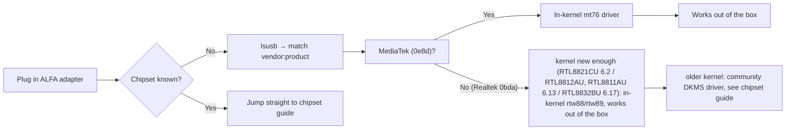

# ALFA 驅動程式指南——總覽

> **一句話定位（One-liner）**：Linux 上的每支 ALFA 無線網路卡都由**七顆晶片**之一驅動——三顆 MediaTek 晶片（mt76 系列）自 kernel 4.19 / 5.18 起、四顆 Realtek 晶片（rtw88 / rtw89）分別自 kernel 6.2（RTL8821CU）、6.13（RTL8812AU、RTL8811AU）、6.17（RTL8832BU）起使用**內建於核心**的驅動程式、插上即可用（ASUS GX10 / Ubuntu 24.04 + kernel 6.17 實測）；只有 **kernel 低於該晶片內建版本** 的舊系統，Realtek 系列才需要社群 **DKMS** 驅動程式。在下方找到你的晶片並跳到它的指南。

## 晶片對照表

| 晶片 | 無線網路卡 | 驅動程式繫結 | 內建於核心？ | 指南 |
|---------|----------|----------------|------------|-------|
| MT7612U | AWUS036ACM | `mt76x2u` | ✅ 內建（4.19+） | [MT7612U 指南](/alfa-network/drivers/mt7612u/) |
| MT7610U | AWUS036ACHM | `mt76x0u` | ✅ 內建（4.19+） | [MT7610U 指南](/alfa-network/drivers/mt7610u/) |
| MT7921AU / MT7921AUN | AWUS036AXM（MT7921AU）、AWUS036AXML（MT7921AUN） | `mt7921u` | ✅ 內建（5.18+）；stock 6.17 上封包注入未通過 | [MT7921AUN 指南](/alfa-network/drivers/mt7921aun/) |
| RTL8812AU | AWUS036ACH | `rtw88_8812au` | ✅ 內建（6.13+） | [RTL8812AU 指南](/alfa-network/drivers/rtl8812au/) |
| RTL8811AU | AWUS036ACS | `rtw88_8821au` | ✅ 內建（6.13+） | [RTL8811AU 指南](/alfa-network/drivers/rtl8811au/) |
| RTL8832BU | AWUS036AX、AWUS036AXER | `rtw89_8852bu` | ✅ 內建（6.17+） | [RTL8832BU 指南](/alfa-network/drivers/rtl8832bu/) |
| RTL8821CU | AWUS036EACS | `rtw88_8821cu` | ✅ 內建（6.2+） | [RTL8821CU 指南](/alfa-network/drivers/rtl8821cu/) |

## 如何挑選

1. **確認晶片**——執行 `lsusb` 並把 `vendor:product` 配對到你的無線網路卡規格表。
2. **MediaTek 晶片？** 你完成了——驅動程式在核心內（MT7612U、MT7610U 自 4.19，MT7921AU / AUN 自 5.18）。直接前往指南，用 `dmesg` / `iw dev` 確認並啟用監聽模式（monitor mode）。
3. **Realtek 晶片？** 先用 `uname -r` 確認 kernel：kernel 夠新時驅動程式已內建，不需 DKMS（RTL8821CU ≥ 6.2、RTL8812AU / RTL8811AU ≥ 6.13、RTL8832BU ≥ 6.17；Ubuntu 24.04 對應 GA 6.8、HWE 6.14、6.17）；低於該版本的舊系統才需依照對應指南建置社群 DKMS 模組（核心更新後需要 `sudo dkms autoinstall`）。

4. **需要封包注入？** MT7921 系列無線網路卡（AWUS036AXM / AXML）在 stock kernel 6.17 上封包注入測試未通過；請見[無線網路卡比較](/alfa-network/wifi-adapter-comparison/)。

完整的系統教學在 [Linux 設定指南](/alfa-network/linux-setup-ubuntu/) 與[相容性矩陣](/alfa-network/linux-compatibility-matrix/) 中。
