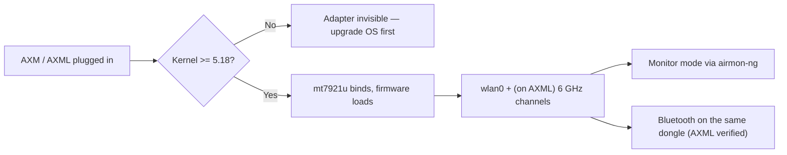

# MT7921AUN 驅動程式指南（AWUS036AXM / AWUS036AXML）

> **一句話定位（One-liner）**：**MediaTek MT7921AU / MT7921AUN** 驅動 **AWUS036AXM**（MT7921AU，Wi-Fi 6、AX3000）與 **AWUS036AXML**（MT7921AUN，Wi-Fi 6E、含 6 GHz 頻段的 AXE3000），兩者共用 `mt7921u` 驅動程式。它的 `mt7921u` 驅動程式**自核心 5.18 起進入主線**——備受喜愛的 MT7612U 的現代繼任者，也是這個產品線在 Linux 上通往 6 GHz 的唯一路徑。

## 實測：ASUS GX10 / Ubuntu 24.04 ARM64

測試平台：ASUS Ascent GX10（NVIDIA GB10）、Ubuntu 24.04 LTS ARM64、kernel 6.17.0-1014-nvidia（2026-11-16～11-19）。兩張卡皆由內建的 `mt7921u` 驅動（USB ID `0e8d:7961`），插上即可用，不需 DKMS。

| 項目 | AWUS036AXM | AWUS036AXML |
|---|---|---|
| Monitor 2.4G / 5G | ✅ 弱 / ✅ 弱 | ✅ 弱 / ✅ 弱 |
| Injection 2.4G / 5G | ❌ 未通過 / ❌ 未通過 | ❌ 未通過 / ❌ 未通過 |
| AP 2.4G / 5G | ✅ / ✅（80 MHz） | ✅ / ✅（80 MHz） |
| WPA3-SAE（AP 端） | ✅（2.4 GHz） | ✅（2.4 + 6 GHz） |
| VIF | ✅ | ✅ |
| WPA handshake 擷取 | ❌（注入未通過） | ❌（注入未通過） |
| Active monitor | 🟡 | 🟡 |
| IBSS / mesh | N/A | N/A |
| P2P | 未測試（需第二台設備） | 未測試（需第二台設備） |
| 6 GHz | 推測可用，AXM 未單獨實測（未測試） | ✅ 實測可運作（6 GHz WPA3-SAE AP，ch37 / 6135 MHz，iPhone 15 Pro 以 802.11ax 連上） |
| 藍芽 | 未測試 | ✅ 實測可用（控制器 UP、掃到 31 個 BLE + 1 個經典藍芽裝置，Wi-Fi 與藍芽可共存） |

### 封包注入在 stock kernel 6.17 未通過

`aireplay-ng --test` 與 deauth 在 stock kernel 6.17 上回 `No Answer` / `Found 0 APs`，因此無法 deauth 或擷取 handshake。原因並非晶片先天限制：mt7921 以韌體專屬的 sniffer 模式（`MCU_UNI_CMD(SNIFFER)`）做 monitor，其 RX 行為與 kernel 6.16+ mac80211 chanctx 回歸共同導致注入失敗；社群在同型號以 git／patched 驅動可讓 active-monitor + 注入運作，惟韌體仍鎖定速率（1/6 Mbps，不可注入 HT/VHT）。monitor 可用但接收較弱（client / data 封包擷取量偏少），`iw` 在 monitor 模式回報 TX 功率 3 dBm。若需要注入或滲透測試用途，請改選 [AWUS036ACM](/alfa-network/products/awus036acm/)、[AWUS036ACH](/alfa-network/products/awus036ach/) 等型號。

## 概念：MT7921AU / MT7921AUN 給你什麼

這是 ALFA 產品線中 MediaTek 最新的無線電，一個 **2×2:2 802.11ax** 設計，同一個 dongle 上還包含**藍芽**（AXML 已實測；AXM 未測試）。對 Linux 使用者有三件事很重要：

1. **內建於核心的驅動程式**（`drivers/net/wireless/mediatek/mt76/mt7921/`）自 **Linux 5.18** 起——沒有 DKMS、沒有編譯。
2. **Wi-Fi 6E**：AXML 版本開啟 **6 GHz 頻段**（5 GHz 以上的頻道 1–233），這是目前可用頻譜中壅塞度最低的。
3. **需要韌體 blob**——驅動程式從 `linux-firmware` 載入 `mt7921` 韌體，所以請保持該套件更新。

主要警告：因為驅動程式需要 **5.18+ 核心**，較舊的作業系統版本看不到這支無線網路卡。Ubuntu 24.04（實測 kernel 6.17）沒問題；Ubuntu 20.04 不行。



## 前置需求

- [ ] 核心 **5.18 或更新**的 Linux（`uname -r`）
- [ ] 已安裝且夠新的 `linux-firmware` 套件
- [ ] `sudo` 權限
- [ ] AWUS036AXM 或 AWUS036AXML

## 步驟 1：核心檢查

```bash
uname -r
```

**預期輸出**（範例）：

```text
6.8.0-51-generic        # Ubuntu 24.04 GA — OK（範例）
6.17.0-1014-nvidia      # 本次 GX10 測試平台 — OK（實測）
5.15.0-91-generic       # Ubuntu 22.04 base — TOO OLD for mt7921u（範例）
```

在 5.15 或更舊：`sudo apt update && sudo apt upgrade`（或在 Ubuntu 22.04 上安裝 HWE 核心）。驅動程式在舊核心上不存在——這是硬性需求，不是設定細節。

## 步驟 2：驗證驅動程式與韌體

插上無線網路卡：

```bash
lsusb | grep 0e8d:7961
sudo dmesg | grep mt7921u | tail -3
```

**預期輸出**（GX10 以 AWUS036AXML 實測；AXM 的輸出相同，僅匯流排／裝置編號與 `wlx` MAC 不同）：

```text
Bus 004 Device 002: ID 0e8d:7961 MediaTek Inc. Wireless_Device
mt7921u 4-1:1.3: HW/SW Version: 0x8a108a10, Build Time: 20240219110958a
mt7921u 4-1:1.3: WM Firmware Version: ____010000, Build Time: 20240219111038
mt7921u 4-1:1.3 wlx00c0cabd65b9: renamed from wlan0
```

驅動程式會從 `linux-firmware` 載入 `mediatek/WIFI_MT7961_patch_mcu_1_2_hdr.bin` 與 `mediatek/WIFI_RAM_CODE_MT7961_1.bin`。沒有 `dmesg` 那一行但 `lsusb` 顯示裝置？更新韌體：

```bash
sudo apt install linux-firmware
```

然後重新插上無線網路卡。

## 步驟 3：確認介面與頻段

```bash
iw dev
iwlist wlan0 freq | grep -E "^          Channel" | sort -u | tail -5
```

**預期輸出**：一個介面那一行，而對 AXML 來說頻率清單應包含 **6 GHz 頻道**（「6 GHz band」下的 `Channel 1 ... Channel 233`）。如果 AXML 上只看到 2.4/5 GHz 專案，你的法規領域可能隱藏了 6 GHz——`sudo iw reg set TW`（使用你的國家程式碼）並把介面 down/up。

## 步驟 4：連線

```bash
nmcli device wifi connect "MySSID" password "my-passphrase"
```

**預期輸出**：`Device 'wlan0' successfully activated with 'MySSID'.`

## 步驟 5：監聽模式（僅被動接收）

```bash
IF=$(ls /sys/class/net | grep '^wlx' | head -1)
sudo nmcli dev set $IF managed no
sudo ip link set $IF down
sudo iw dev $IF set type monitor
sudo ip link set $IF up
sudo iw dev $IF set channel 36
```

**預期輸出**：`iw dev $IF info` 顯示 `type monitor`，可側錄 beacon。請勿使用 `airmon-ng check kill`（會關閉 NetworkManager）。`aireplay-ng --test` 注入在 stock kernel 6.17 上未通過（見上方說明）。

> **你可能會想問**——*「監聽模式在 6 GHz 上可用嗎？」* 6 GHz 監聽未測試；6 GHz 僅實測 AXML 的 AP 與連線。

## 步驟 6：藍芽

AXML 的藍芽已在 GX10 實測（控制器 UP、掃描正常）；AXM 的藍芽**未測試**，下列指令因兩者同晶片而適用。配對方式：

```bash
bluetoothctl
power on
scan on
pair <MAC>
```

**預期輸出**：你的裝置顯示 `Pairing successful`（配對本身不在我們的測試範圍內，我們驗證的是控制器與掃描）。如果 `bluetoothctl` 什麼都沒看到，載入藍芽堆疊模組：`sudo modprobe btusb` 並重試。

## 疑難排解

| 症狀 | 原因 | 修復 |
|---|---|---|
| `lsusb` 什麼都沒顯示 | 電源（AXML 耗電較大）/ 傳輸線 | 供電 hub；含資料線的 USB-C 傳輸線 |
| `lsusb` 正常，沒有 `wlan0` | 核心 < 5.18，或韌體缺失 | 升級核心；`sudo apt install linux-firmware`；重新開機 |
| `dmesg` 顯示韌體載入失敗 | 韌體 blob 過期 | 更新 `linux-firmware`，拔下/重新插上 |
| 6 GHz 頻道消失（AXML） | 法規領域未設定 | `sudo iw reg set <CC>`；重新啟動介面 |
| 找不到 BT 裝置 | `btusb` 未載入 | `sudo modprobe btusb` |
| 監聽模式在 2.4/5 GHz 可用但 6 GHz 不行 | 6 GHz 監聽未測試，或沒有 6 GHz AP | 在 5 GHz 重測；使用 6 GHz AP |
| 注入 0/30 / Found 0 APs / deauth 無效 | stock kernel 6.17 上 mt7921u 注入未通過（韌體 sniffer-mode 限制） | 非設定問題；請改用 ACM / ACH 等型號做注入 |
| 重插後 `lsusb` 有裝置但沒有 `wlx` 介面（AXML） | BT+WiFi 複合裝置重插競態 | 換一個 USB 孔重插 |

## 參考資料

- [AWUS036AXM 產品頁面](/alfa-network/products/awus036axm/) 與 [AWUS036AXML 產品頁面](/alfa-network/products/awus036axml/)
- [Ubuntu 設定指南](/alfa-network/linux-setup-ubuntu/) 與 [Kali 設定指南](/alfa-network/linux-setup-kali/)
- [相容性矩陣](/alfa-network/linux-compatibility-matrix/)
- 主線驅動程式原始碼：Linux 核心樹中的 `drivers/net/wireless/mediatek/mt76/mt7921/`
- [linux-firmware](https://git.kernel.org/pub/scm/linux/kernel/git/firmware/linux-firmware.git/)——MT7921 的韌體 blob