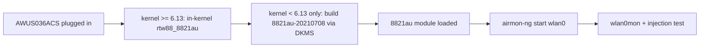

# RTL8811AU 驅動程式指南（AWUS036ACS）

> **一句話摘要**：**Realtek RTL8811AU** 是 55 mm **AWUS036ACS** 內部的 1×1 AC600 晶片——口袋尺寸的監聽模式好夥伴。在 **kernel ≥ 6.13** 由核心內建的 `rtw88_8821au` 驅動程式支援，插上即可用（ASUS GX10 / Ubuntu 24.04 + kernel 6.17.0-1014-nvidia 實測，USB ID `0bda:0811`，韌體 42.4.0）；只有 **kernel < 6.13** 的舊系統才需要透過 DKMS 安裝社群驅動程式。

## kernel ≥ 6.13：內建驅動程式（免安裝）

測試平台：ASUS Ascent GX10（NVIDIA GB10）、Ubuntu 24.04 LTS ARM64、kernel 6.17.0-1014-nvidia（2026-11-16～11-19）。AWUS036ACS 由 `rtw88_8821au` 驅動，不需 DKMS。驗證：

```bash
lsusb | grep -iE '0bda:0811'
sudo dmesg | grep -i 8821au
iw dev
```

預期輸出：`0bda:0811` 裝置、類似 `rtw88_8821au ... Firmware version 42.4.0, H2C version 0` 的一行，以及一個介面（在 GX10 上名為 `wlx` + MAC）。

實測：monitor 2.4G / 5G ✅，injection 2.4G 100%、5G 96%，AP 2.4G / 5G（頻寬未確認）、WPA3-SAE（AP 於 5 GHz 實測）、VIF ✅，WPA handshake 端到端擷取 ✅；不支援 IBSS / mesh / active monitor / P2P（`-95`）。

以下「概念」與步驟 1–2 為舊 kernel（< 6.13）的 DKMS 做法。

## 概念：同一家族，單一串流

RTL8811AU 基本上是 RTL8812AU 家族的 1×1 版本：單一空間串流、5 GHz 最高 433 Mbps、耗電較低、電路板較小。ALFA 將它包進小巧的 ACS 機身，搭配一支外接 2 dBi RP-SMA 天線——你可以在能藏進鉛筆盒的體積中，獲得經典的 ALFA 滲透測試功能。

就舊 kernel（< 6.13）而言，**核心內沒有支援監聽模式的驅動程式**，因此需使用社群的 `8821au-20210708` DKMS 驅動程式；kernel ≥ 6.13 則不需要。請注意，此驅動程式也涵蓋 RTL8821AU 變體，所以如果你在類似的網路卡上看到 `dkms status` 顯示相同的模組名稱，不必驚慌。



## 前置需求

- [ ] 舊 kernel（< 6.13）的 Linux（Ubuntu / Kali / Debian）——kernel ≥ 6.13 不需要本節
- [ ] `sudo apt install -y build-essential dkms git`
- [ ] `sudo` 權限
- [ ] AWUS036ACS

## 步驟 1（僅適用 kernel < 6.13）：複製並建置

```bash
cd /opt
sudo git clone https://github.com/morrownr/8821au-20210708.git
cd 8821au-20210708
sudo sh install-driver.sh
```

**預期輸出**（範例；DKMS 路徑未在我們的 GX10 上測試）：

```text
DKMS: install completed.
```

## 步驟 2（僅適用 kernel < 6.13）：載入並驗證

```bash
sudo modprobe 8821au
iw dev
```

**預期輸出**：一行 `Interface wlan0`（或 `wlan1`）。如果網路卡重新插拔後才出現，請將模組加入自動載入：

```bash
echo 8821au | sudo tee /etc/modules-load.d/alfa.conf
```

## 步驟 3：監聽模式 + 封包注入

（內建與 DKMS 驅動程式皆適用；請勿使用 `airmon-ng check kill`，會關閉 NetworkManager。）

```bash
IF=$(ls /sys/class/net | grep '^wlx' | head -1)
sudo nmcli dev set $IF managed no
sudo ip link set dev $IF down
sudo iw dev $IF set type monitor
sudo ip link set dev $IF up
sudo iw dev $IF set channel 6
sudo aireplay-ng --test $IF
```

**預期輸出**（GX10 實測）：

```text
Injection is working!
30/30: 100%
```

本機實測（kernel 6.17 內建驅動程式）：2.4G 注入 100%（30/30）、5G 96%（29/30）；5G 注入前先 `sudo iw reg set US`，測完還原。

## 步驟 4：恢復正常

```bash
sudo ip link set dev $IF down
sudo iw dev $IF set type managed
sudo nmcli dev set $IF managed yes
sudo ip link set dev $IF up
```

## 疑難排解

| 症狀 | 原因 | 修復 |
|---|---|---|
| DKMS 建置失敗（僅適用 kernel < 6.13 的 DKMS 安裝） | 缺少標頭檔 / 核心太新 | `sudo apt install linux-headers-$(uname -r)`；`cd 8821au-20210708 && git pull && sudo sh install-driver.sh` |
| 介面只有 managed 模式（僅適用 kernel < 6.13） | 核心內的 `rtl8811au` stub 搶先綁定 | `echo "blacklist rtl8811au" \| sudo tee /etc/modprobe.d/alfa-8811au.conf`；重新開機 |
| 注入 0/30 | 空頻道 | `sudo iw $IF set channel 6`；在 AP 附近測試 |
| 傳輸量低於預期 | 1×1 無線電（AC600）——硬體限制 | 並非 bug；5 GHz 實際預期約 150–250 Mbps |
| 重新開機後偵測不到（僅適用 kernel < 6.13 的 DKMS 安裝） | 模組未自動載入 | 將 `8821au` 加入 `/etc/modules-load.d/alfa.conf` |

## 參考資料

- [AWUS036ACS 產品頁面](/alfa-network/products/awus036acs/)
- [Kali 設定指南](/alfa-network/linux-setup-kali/)
- [Ubuntu 設定指南](/alfa-network/linux-setup-ubuntu/)
- [疑難排解索引](/alfa-network/troubleshooting/)
- 驅動程式 repo：[morrownr/8821au-20210708](https://github.com/morrownr/8821au-20210708)（RTL8811AU / RTL8821AU；先前的 `aircrack-ng/rtl8811au` repository 已不存在）
