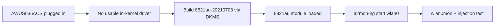

# RTL8811AU 驅動程式指南（AWUS036ACS）

> **一句話摘要**：**Realtek RTL8811AU** 是 55 mm **AWUS036ACS** 內部的 1×1 AC433 晶片——口袋尺寸的監聽模式好夥伴。就像它的大哥 RTL8812AU 一樣，需要透過 DKMS 安裝社群的 `rtl8811au` 驅動程式，但建置流程完全相同。

## 概念：同一家族，單一串流

RTL8811AU 基本上是 RTL8812AU 家族的 1×1 版本：單一空間串流、5 GHz 最高 433 Mbps、耗電較低、電路板較小。ALFA 將它包進小巧的 ACS 機身，搭配一支外接 2 dBi RP-SMA 天線——你可以在能藏進鉛筆盒的體積中，獲得經典的 ALFA 滲透測試功能。

就驅動程式而言，與 RTL8812AU 的情況並無不同：**核心內沒有支援監聽模式的驅動程式**，因此我們使用社群的 `8821au-20210708` DKMS 驅動程式。請注意，此驅動程式也涵蓋 RTL8821AU 變體，所以如果你在類似的網路卡上看到 `dkms status` 顯示相同的模組名稱，不必驚慌。



## 前置需求

- [ ] Linux（Ubuntu 20.04+ / Kali / Debian）
- [ ] `sudo apt install -y build-essential dkms git`
- [ ] `sudo` 權限
- [ ] AWUS036ACS

## 步驟 1：複製並建置

```bash
cd /opt
sudo git clone https://github.com/morrownr/8821au-20210708.git
cd 8821au-20210708
sudo sh install-driver.sh
```

**預期輸出**：

```text
DKMS: install completed.
```

## 步驟 2：載入並驗證

```bash
sudo modprobe 8821au
iw dev
```

**預期輸出**：一行 `Interface wlan0`（或 `wlan1`）。如果網路卡重新插拔後才出現，請將模組加入自動載入：

```bash
echo 8821au | sudo tee /etc/modules-load.d/alfa.conf
```

## 步驟 3：監聽模式 + 封包注入

```bash
sudo airmon-ng check kill
sudo airmon-ng start wlan0
sudo aireplay-ng --test wlan0mon
```

**預期輸出**：

```text
PHY	Interface	Driver		Chipset
phy0	wlan0		8821au		Realtek Semiconductor Corp. RTL8811AU
...
12:34:56  Injection is working!
12:34:56  30/30:  100%
```

## 步驟 4：恢復正常

```bash
sudo airmon-ng stop wlan0mon
sudo systemctl restart NetworkManager
```

## 疑難排解

| 症狀 | 原因 | 修復 |
|---|---|---|
| DKMS 建置失敗 | 缺少標頭檔 / 核心太新 | `sudo apt install linux-headers-$(uname -r)`；`cd 8821au-20210708 && git pull && sudo sh install-driver.sh` |
| 介面只有 managed 模式 | 核心內的 `rtl8811au` stub 搶先綁定 | `echo "blacklist rtl8811au" \| sudo tee /etc/modprobe.d/alfa-8811au.conf`；重新開機 |
| 注入 0/30 | 空頻道 | `sudo iw wlan0mon set channel 6`；在 AP 附近測試 |
| 傳輸量低於預期 | 1×1 無線電（AC433）——硬體限制 | 並非 bug；5 GHz 實際預期約 150–250 Mbps |
| 重新開機後偵測不到 | 模組未自動載入 | 將 `8821au` 加入 `/etc/modules-load.d/alfa.conf` |

## 參考資料

- [AWUS036ACS 產品頁面](/alfa-network/products/awus036acs/)
- [Kali 設定指南](/alfa-network/linux-setup-kali/)
- [Ubuntu 設定指南](/alfa-network/linux-setup-ubuntu/)
- [疑難排解索引](/alfa-network/troubleshooting/)
- 驅動程式 repo：[morrownr/8821au-20210708](https://github.com/morrownr/8821au-20210708)（RTL8811AU / RTL8821AU；先前的 `aircrack-ng/rtl8811au` repository 已不存在）
