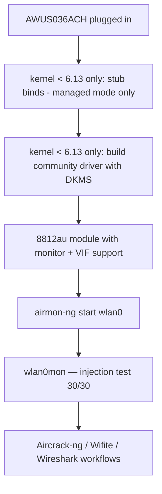

# RTL8812AU 驅動程式指南（AWUS036ACH）

> **一句話定位（One-liner）**：**Realtek RTL8812AU** 是 **AWUS036ACH** 內部傳奇的 2×2 雙頻晶片——你曾看過的每個 Kali 教學影片裡的那支無線網路卡。在 **kernel ≥ 6.13** 由核心內建的 `rtw88_8812au` 驅動程式支援，插上即可用（ASUS GX10 / Ubuntu 24.04 + kernel 6.17.0-1014-nvidia 實測，USB ID `0bda:8812`）；只有 **kernel < 6.13** 的舊系統才需要用 DKMS 建置社群 `rtl8812au` 驅動程式。

## kernel ≥ 6.13：內建驅動程式（免安裝）

測試平台：ASUS Ascent GX10（NVIDIA GB10）、Ubuntu 24.04 LTS ARM64、kernel 6.17.0-1014-nvidia（2026-11-16～11-19）。AWUS036ACH 由 `rtw88_8812au` 驅動（韌體 `rtw88/rtw8812a_fw.bin` 系統已內附），不需 DKMS。驗證：

```bash
lsusb | grep 0bda:8812
lsusb -t | grep rtw88_8812au
sudo dmesg | grep -iE 'rtw88_8812au' | tail -3
iw dev
```

實測：monitor 2.4G / 5G ✅，injection 2.4G 100%、5G 100%，AP、WPA3-SAE、VIF（STA+monitor）✅；不支援 active monitor / mesh / P2P（`-95`）。5G 接收在反覆切換模式後可能卡死，需拔插復原。

以下「概念」與步驟 1–3 為舊 kernel（< 6.13）的 DKMS 做法。

## 概念：最有名的 Wi-Fi 駭客晶片

RTL8812AU 以高功率（500 mW）無線電與兩支外接天線驅動 AC1200 AWUS036ACH。它的名聲來自 **aircrack-ng 社群**：多年的滲透測試工作把樹外驅動程式打磨成正好符合 Kali 需要的兩件事——**監聽模式（monitor mode）**與**封包注入（packet injection）**。

在舊 kernel（< 6.13）上，核心沒有支援監聽模式的驅動程式（僅有沒有監聽支援的 stub），必須改用社群驅動程式（`aircrack-ng/rtl8812au`）；代價是**你必須建置一次**——之後 DKMS 系統會在每次核心更新時自動重新編譯。kernel ≥ 6.13 已有內建的 `rtw88_8812au`，不需要這些步驟。



## 前置需求

- [ ] 舊 kernel（< 6.13）的 Linux（Ubuntu / Kali / Debian）——kernel ≥ 6.13 不需要本節
- [ ] 建置工具 + 網路：`sudo apt install -y build-essential dkms git`
- [ ] `sudo` 權限
- [ ] AWUS036ACH

## 步驟 1（僅適用 kernel < 6.13）：移除（沒用的）核心 stub

某些發行版附帶一個會搶走無線網路卡並拒絕監聽模式的 Realtek stub 驅動程式。先解除安裝它：

```bash
sudo modprobe -r rtl8812au 2>/dev/null
```

（如果指令報錯「not found」，很好——沒有 stub。`2>/dev/null` 隱藏雜訊。）

## 步驟 2（僅適用 kernel < 6.13）：用 DKMS 建置社群驅動程式

```bash
cd /opt
sudo git clone https://github.com/aircrack-ng/rtl8812au.git
cd rtl8812au
sudo make dkms_install
```

**預期輸出**（範例；DKMS 路徑未在我們的 GX10 上測試）：

```text
Kernel preparation unnecessary for this kernel.  Skipping...
...
DKMS: install completed.
```

驗證模組已向 DKMS 註冊：

```bash
dkms status
```

**預期輸出**（範例）：

```text
rtl8812au/5.6.4.2, 6.8.0-51-generic, aarch64: installed
```

## 步驟 3（僅適用 kernel < 6.13）：載入它

```bash
sudo modprobe 8812au
iw dev
```

**預期輸出**：出現一行 `Interface wlan0`（或 `wlan1`）。如果重新開機後 stub 又載入了，把它加入黑名單：

```bash
echo "blacklist rtl8812au" | sudo tee /etc/modprobe.d/alfa-8812au.conf
```

並把真正的模組加入自動載入：

```bash
echo 8812au | sudo tee /etc/modules-load.d/alfa.conf
```

## 步驟 4：監聽模式 + 注入

請勿執行 `airmon-ng check kill`（會關閉 NetworkManager）；只對該網卡的 `wlx...` 介面使用 `iw`：

```bash
IF=$(ls /sys/class/net | grep '^wlx' | head -1)
sudo nmcli dev set $IF managed no
sudo ip link set dev $IF down
sudo iw dev $IF set type monitor
sudo ip link set dev $IF up
sudo iw dev $IF set channel 6
sudo aireplay-ng --test $IF
```

**預期輸出**（GX10 實測）：

```text
Injection is working!
30/30: 100%
```

那個 `30/30` 那一行就是 AWUS036ACH 在做它出名的事（本機實測 kernel 6.17 內建驅動程式：2.4G 與 5G 皆 100%）。5G 注入前先 `sudo iw reg set US`，測完還原。

## 步驟 5：回到 managed 模式

```bash
sudo ip link set dev $IF down
sudo iw dev $IF set type managed
sudo nmcli dev set $IF managed yes
sudo ip link set dev $IF up
```

## 疑難排解

| 症狀 | 原因 | 修復 |
|---|---|---|
| （僅適用 kernel < 6.13 的 DKMS 安裝）`make dkms_install` 失敗並顯示 "No rule to make target" | repo 快照比你的新核心舊 | 再次 `sudo git pull && sudo make dkms_install` |
| （僅適用 kernel < 6.13）建置失敗：缺少標頭檔 | 標頭檔未安裝 | `sudo apt install linux-headers-$(uname -r)` |
| （僅適用 kernel < 6.13）無線網路卡只在 managed 模式 | 核心 stub 先搶走了它 | 把 `rtl8812au` 加入黑名單（步驟 3）並重新開機 |
| 注入 `0/30` | 沒有 AP 的頻道 | `sudo iw $IF set channel 6`；在 AP 附近測試 |
| 5 GHz 擷取 0 封包 | 反覆切換模式 / regdomain 後 RX 卡死 | 拔下再重新插上 |
| （僅適用 kernel < 6.13 的 DKMS 安裝）重新開機後無線網路卡消失 | 模組未自動載入 | `echo 8812au \| sudo tee /etc/modules-load.d/alfa.conf` |
| （僅適用 kernel < 6.13 的 DKMS 安裝）升級後 `dkms status` 顯示 Error | 重建靜默失敗 | `sudo dkms autoinstall` |

## 參考資料

- [AWUS036ACH 產品頁面](/alfa-network/products/awus036ach/)
- [Kali 設定指南](/alfa-network/linux-setup-kali/)——完整的監聽/注入工作流程
- [Ubuntu 設定指南](/alfa-network/linux-setup-ubuntu/)
- [疑難排解索引](/alfa-network/troubleshooting/)
- 驅動程式 repo：[aircrack-ng/rtl8812au](https://github.com/aircrack-ng/rtl8812au)