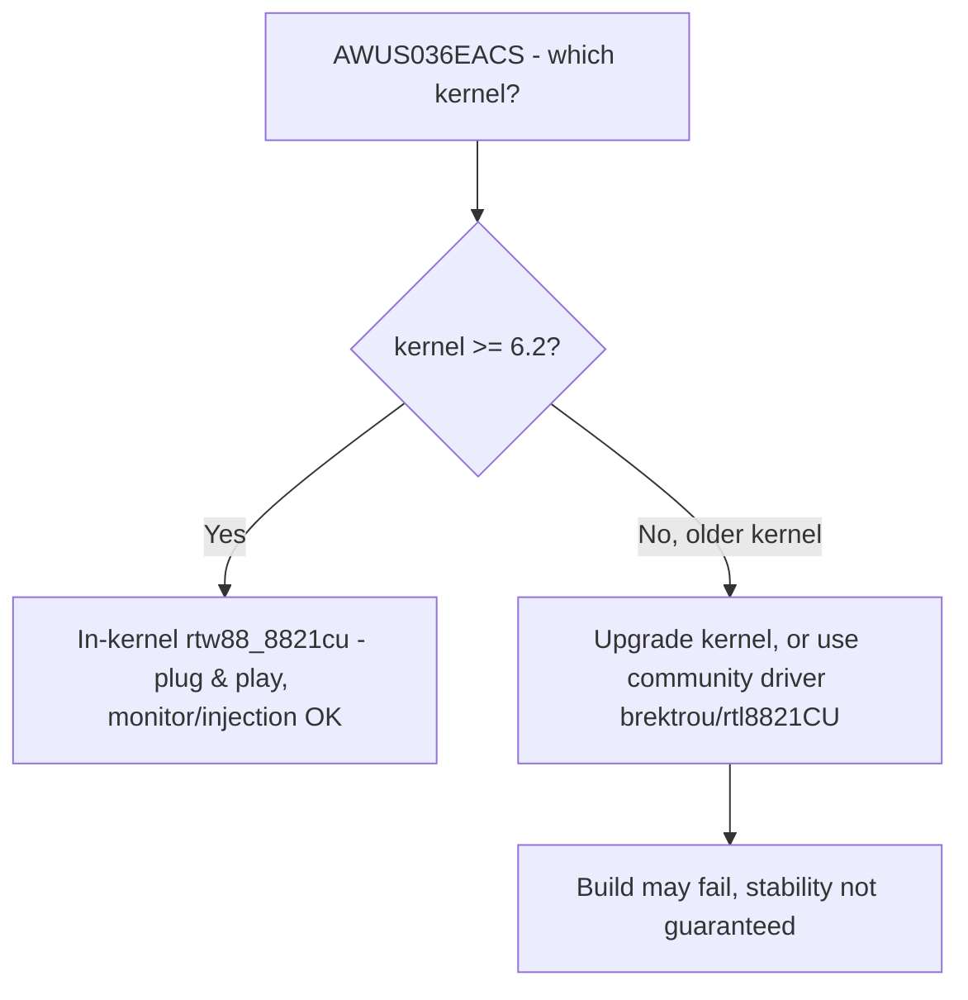

# RTL8821CU 驅動程式指南（AWUS036EACS）

> **一句話定位（One-liner）**：**Realtek RTL8821CU** 是 nano **AWUS036EACS** 內部的 WiFi 5 + 藍芽 4.2 組合晶片。在 **kernel ≥ 6.2** 由核心內建的 **`rtw88_8821cu`** 驅動程式支援，插上即可用；ASUS GX10 / Ubuntu 24.04（kernel 6.17.0-1014-nvidia）實測監聽模式（monitor mode）、封包注入（packet injection）、AP、WPA3-SAE 與藍芽皆可用。只有 **kernel < 6.2** 的舊系統才需要社群 DKMS 驅動程式。

## kernel ≥ 6.2：內建驅動程式（免安裝）

測試平台：ASUS Ascent GX10（NVIDIA GB10）、Ubuntu 24.04 LTS ARM64、kernel 6.17.0-1014-nvidia（2026-11-16～11-19）。

| 項目 | 結果 |
|---|---|
| USB ID | `0bda:c820` |
| 驅動程式 | `rtw88_8821cu`（in-kernel） |
| 韌體 | 24.11.0（H2C version 12） |
| Monitor 2.4G / 5G | ✅ / ✅ |
| Injection 2.4G / 5G | ✅ 100% / ✅ 100% |
| AP 2.4G / 5G | ✅ / ✅（5 GHz 為 802.11a、20 MHz 實測；VHT80 未測） |
| WPA3-SAE（AP 端） | ✅（2.4 GHz 實測） |
| WPA handshake 擷取 | ✅ 端到端（79 ACKs） |
| VIF | 🟡 被動 monitor 可與 managed 在同一頻道並存；不支援獨立的雙 VIF |
| Active monitor / IBSS / mesh / P2P | 不支援 / 不支援 / 不支援 / 不支援（active monitor、mesh、P2P 回 `-95`） |
| 藍芽 | ✅ 實測可用（hci 控制器 UP、可掃描 BLE 與傳統藍芽） |

驗證：

```bash
lsusb | grep -i '0bda:c820'
sudo dmesg | grep -i 8821cu
iw dev
```

**預期輸出**：`dmesg` 顯示 `rtw88_8821cu ... Firmware version 24.11.0, H2C version 12`，隨後出現 `wlx...` 介面。

注意：BT+WiFi 複合裝置重插後可能 WiFi probe 卡死（`lsusb` 有 `0bda:c820` 但沒有 `wlx` 介面）——請拔卡、換一個 USB 孔重插。5G 注入前請先 `sudo iw reg set US`，測完還原；請勿使用 `airmon-ng check kill`。

## 舊 kernel（< 6.2）：社群 DKMS 驅動程式（僅適用 kernel < 6.2）

kernel < 6.2 沒有內建 `rtw88_8821cu`，只能使用社群驅動程式，品質不保證：

- 最有名的 repo，[`brektrou/rtl8821CU`](https://github.com/brektrou/rtl8821CU)（RTL8821CU 社群驅動程式），可以針對較舊核心建置，但在較新核心上常常壞掉。
- 回報的問題包括無線網路卡不穩定、某些硬體上系統凍結，以及不可靠的監聽模式 / 沒有注入。
- 若可以，建議直接升級到 kernel ≥ 6.2 改用內建驅動程式。



### 前置需求（僅適用 kernel < 6.2）

- [ ] 舊 kernel 的 Linux
- [ ] `sudo apt install -y build-essential dkms git`

### 步驟（僅適用 kernel < 6.2）

```bash
cd /opt
sudo git clone https://github.com/brektrou/rtl8821CU.git
cd rtl8821CU
sudo make dkms_install
sudo modprobe 8821cu
iw dev
```

**可能的結果**：`DKMS: install completed.`（成功）或 `make: *** [Makefile:...] Error 1`（建置失敗）。成功時 `iw dev` 會出現一行 `Interface wlan0`。

## 建議路徑

| 你的目標 | 建議的無線網路卡 |
|---|---|
| Kali / 監聽模式 / 封包注入 | EACS 在 kernel ≥ 6.2 即可（兩頻注入皆 100%）；需要外接天線可選 [AWUS036ACM](/alfa-network/products/awus036acm/) 或 [AWUS036ACH](/alfa-network/products/awus036ach/) |
| 平價口袋監聽無線網路卡 | [AWUS036ACS](/alfa-network/products/awus036acs/) |
| WiFi + BT 組合 | **AWUS036EACS**（藍芽實測可用） |

## 疑難排解

| 症狀 | 原因 | 修復 |
|---|---|---|
| `lsusb` 有 `0bda:c820` 但沒有 `wlx` 介面 | BT+WiFi 複合裝置重插競態 | 換一個 USB 孔重插 |
| 反覆切換模式後掃不到東西 | RX stall | 拔插網路卡 |
| （僅適用 kernel < 6.2）`make dkms_install` 在較新核心上失敗 | 社群驅動程式未針對新核心維護 | 升級到 kernel ≥ 6.2 改用內建驅動程式 |
| （僅適用 kernel < 6.2）無線網路卡不穩定、隨機斷線 | 社群驅動程式的已知問題 | 升級 kernel 或更換無線網路卡 |
| 藍芽缺失 | `rtl_bt` 韌體未載入 | `sudo apt install linux-firmware` |

## 參考資料

- [AWUS036EACS 產品頁面](/alfa-network/products/awus036eacs/)
- [無線網路卡比較](/alfa-network/wifi-adapter-comparison/)
- [相容性矩陣](/alfa-network/linux-compatibility-matrix/)
- [疑難排解索引](/alfa-network/troubleshooting/)
- 舊 kernel 的社群驅動程式：[brektrou/rtl8821CU](https://github.com/brektrou/rtl8821CU)
