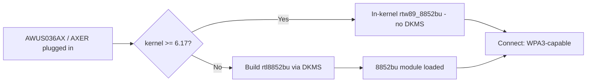

# RTL8832BU 驅動程式指南（AWUS036AX / AWUS036AXER）

> **一句話摘要**：**Realtek RTL8832BU** 是 **AWUS036AX** 及其 nano 版兄弟機種 **AWUS036AXER** 內部的 Wi-Fi 6（802.11ax）晶片。在 **kernel ≥ 6.17** 由核心內建的 **`rtw89_8852bu`** 驅動程式支援，插上即可用；ASUS GX10 / Ubuntu 24.04 實測 **monitor 2.4G / 5G 皆可用、封包注入可用**（AX 2.4G 96%、AXER 2.4G 73%，5G 亦可注入）。只有 **kernel < 6.17** 的舊系統才需要社群 `rtl8852bu` DKMS 驅動程式。

## kernel ≥ 6.17：內建驅動程式（免安裝）

測試平台：ASUS Ascent GX10（NVIDIA GB10）、Ubuntu 24.04 LTS ARM64、kernel 6.17.0-1014-nvidia（2026-11-16～11-19）。

| 項目 | AWUS036AX | AWUS036AXER |
|---|---|---|
| USB ID | `0bda:b832` | `0bda:b832` |
| 驅動程式 | `rtw89_8852bu`（in-kernel） | `rtw89_8852bu`（in-kernel） |
| 韌體 | `rtw89/rtw8852b_fw-1.bin`（rtw8852b_fw 0.29.29.5） | 同左（rtw8852b_fw 0.29.29.5） |
| Monitor 2.4G / 5G | ✅ 強 / ✅ 強 | ✅ 強 / ✅ 強 |
| Injection 2.4G / 5G | ✅ 96% / ✅ | ✅ 73% / ✅ |
| AP 2.4G / 5G | ✅ / ✅（80 MHz） | ✅ / ✅（80 MHz） |
| WPA3-SAE（AP 端） | ✅（2.4 GHz） | ✅（2.4 GHz） |
| WPA handshake 擷取 | ✅ 端到端 | ✅ 端到端 |
| VIF | ✅ STA+AP | ✅ STA+AP |
| Active monitor / IBSS / mesh | N/A | N/A |
| 藍芽 | 本機實測無 BT 介面 | 本機實測無 BT 介面 |

驗證：

```bash
lsusb | grep -iE '0bda:b832|0bda:1a2b'
sudo dmesg | grep rtw89_8852bu | tail -3
iw dev
```

`lsusb` 的描述字串在 AWUS036AX 為 `802.11ax WLAN Adapter`，在 AWUS036AXER 為 `802.11ac WLAN Adapter`，ID 相同。若 `lsusb` 顯示 `0bda:1a2b`（光碟模式），執行 `sudo usb_modeswitch -v 0bda -p 1a2b -K` 切換為 WLAN。

## 概念：Wi-Fi 6，Realtek 風格

RTL8832BU 是一顆 2×2 802.11ax 無線電（AX1800：574 + 1201 Mbps）。與較舊的 AC 網路卡相比，使用者最直接感受到的優勢是 **WPA3**——只支援 WPA3 的現代路由器會拒絕你舊的 AC 網路卡，但會欣然接受 AX。

## 舊 kernel（< 6.17）：社群 DKMS 驅動程式（僅適用 kernel < 6.17）

kernel < 6.17 沒有內建的 `rtw89_8852bu`，需使用社群驅動程式。目前持續維護的 repo 是 **[`morrownr/rtl8852bu-20250826`](https://github.com/morrownr/rtl8852bu-20250826)**；其 README 列出 AWUS036AX 與 AWUS036AXER 為支援機種。其安裝程式會將驅動程式註冊到 DKMS，使其在核心更新後自動重新建置。

> 本指南早期版本使用 `aircrack-ng/rtl88x2bu`。該 repository 已不存在，且 88x2bu 系列（RTL8812BU / RTL8822BU）屬於另一個 802.11ac 晶片家族——請勿將其用於 AWUS036AX / AXER。



### 前置需求（僅適用 kernel < 6.17）

- [ ] 舊 kernel 的 Linux（Ubuntu / Kali / Debian）
- [ ] `sudo apt install -y build-essential dkms git`
- [ ] AWUS036AX 或 AWUS036AXER

### 步驟 1：建置驅動程式（僅適用 kernel < 6.17）

```bash
cd /opt
sudo git clone https://github.com/morrownr/rtl8852bu-20250826.git
cd rtl8852bu-20250826
sudo sh install-driver.sh
```

**預期輸出**：腳本會以 DKMS 建置並安裝驅動程式。請回答其提示，並在它要求時重新開機。

### 步驟 2：載入並驗證（僅適用 kernel < 6.17）

```bash
sudo modprobe 8852bu
iw dev
```

安裝程式通常會設定好重新開機後自動載入；若沒有，請執行 `echo 8852bu | sudo tee /etc/modules-load.d/alfa.conf`。

## 連線（WPA3 開箱即用）

```bash
nmcli device wifi connect "MySSID" password "my-passphrase"
iw dev wlan0 link
```

**預期輸出**：`Device 'wlan0' successfully activated with 'MySSID'.`；在 5 GHz 頻段最高約 **1201 Mb/s**，依距離而降至較低速率（2×2 80 MHz）。

## 監聽模式與封包注入 {#monitor-mode-and-injection}

kernel ≥ 6.17 的內建驅動程式 `rtw89_8852bu` **支援 monitor mode 與封包注入**（本機實測：monitor 2.4G / 5G ✅；注入 AX 2.4G 96%、AXER 2.4G 73%，5G 亦可）。早期文件稱此驅動程式不支援監聽模式，是指舊 kernel 上的社群 DKMS 驅動程式，與實測不符。

```bash
IF=$(ls /sys/class/net | grep '^wlx' | head -1)
sudo nmcli dev set $IF managed no
sudo ip link set $IF down
sudo iw dev $IF set type monitor
sudo ip link set $IF up
sudo iw dev $IF set channel 6          # 5 GHz 改用 channel 36
sudo aireplay-ng --test $IF
```

請勿使用 `airmon-ng check kill`（會關閉 NetworkManager）；5G 注入前先 `sudo iw reg set US`，測完還原。不支援 active monitor、IBSS、mesh；hcxdumptool 8.x 在這兩張卡上都 `failed to arm`，請改用 airodump-ng + aireplay-ng。請參閱[無線網路卡比較](/alfa-network/wifi-adapter-comparison/)。

## 疑難排解

| 症狀 | 原因 | 修復 |
|---|---|---|
| `lsusb` 顯示 `0bda:1a2b` | 光碟模式 | `sudo usb_modeswitch -v 0bda -p 1a2b -K` |
| （僅適用 kernel < 6.17 的 DKMS 安裝）在非常新的核心上建置失敗 | repo 需要最新的 commit | `cd /opt/rtl8852bu-20250826 && sudo git pull && sudo sh install-driver.sh` |
| 看不到 WPA3 網路 | wpa_supplicant 太舊 | `sudo apt update && sudo apt upgrade` |
| （僅適用 kernel < 6.17 的 DKMS 安裝）核心升級後驅動程式失效 | DKMS 未重新建置 | `sudo dkms status`，然後重新執行 `sudo sh install-driver.sh` |
| （僅適用 kernel < 6.17）已安裝針對同一硬體的另一個核心外驅動程式 | 模組衝突 | 檢查 `sudo dkms status` 並移除舊驅動程式 |
| 連線速率高但傳輸慢 | USB 2.0 連接埠瓶頸 | 使用 USB 3.x 連接埠（AX 為 USB 3.2） |
| 反覆切換模式後掃不到東西 | RX stall | 拔下再重新插上 |

## 參考資料

- [AWUS036AX 產品頁面](/alfa-network/products/awus036ax/)與 [AWUS036AXER 產品頁面](/alfa-network/products/awus036axer/)
- [Kali 設定指南](/alfa-network/linux-setup-kali/)
- [Ubuntu 設定指南](/alfa-network/linux-setup-ubuntu/)
- [疑難排解索引](/alfa-network/troubleshooting/)
- 舊 kernel 的社群驅動程式：[morrownr/rtl8852bu-20250826](https://github.com/morrownr/rtl8852bu-20250826)
