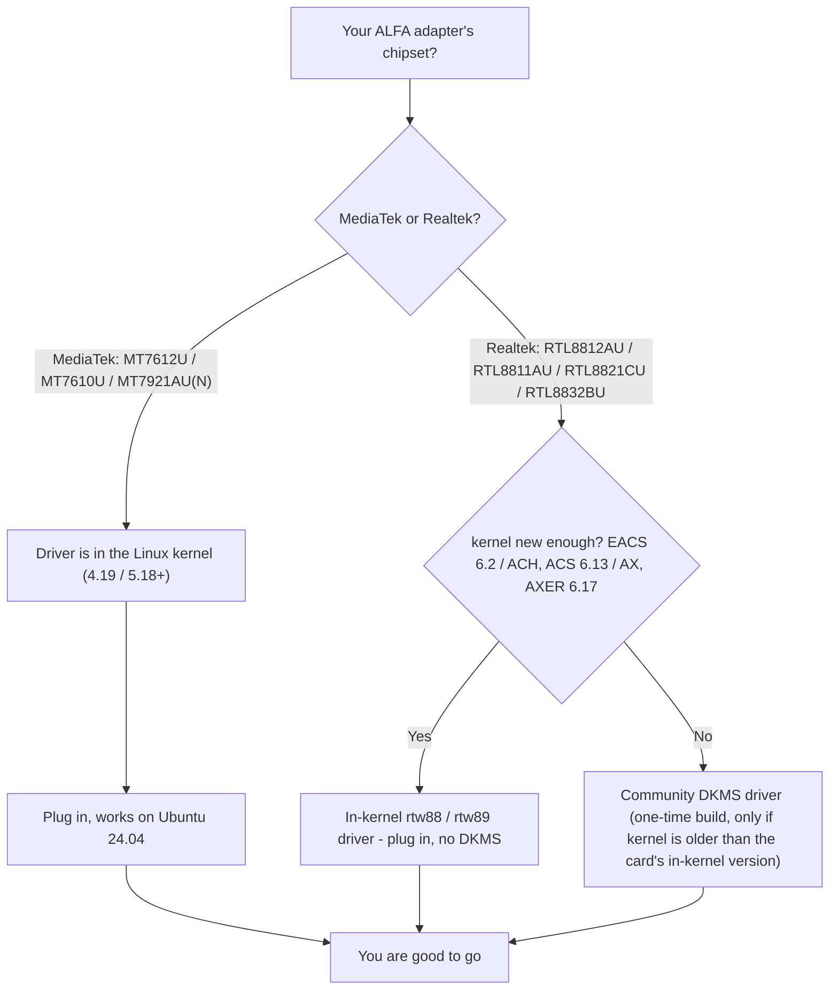

# ALFA Linux 相容性矩陣

> **結論先行（Bottom line）**：九款無線網路卡在 **kernel ≥ 6.17** 上都由 **kernel 內建驅動程式**支援，插上即可用，**不需要 DKMS**（ASUS GX10 / Ubuntu 24.04 + kernel 6.17.0-1014-nvidia 實測）。MediaTek mt76 系列（ACM、ACHM、AXM、AXML）更早就內建（`mt76x2u` / `mt76x0u` 自 4.19、`mt7921u` 自 5.18）；Realtek 系列各有自己的起始版本（EACS 6.2、ACH / ACS 6.13、AX / AXER 6.17），**kernel 低於該版本時才需要社群 DKMS 驅動程式**（ACM、ACHM、AXM、AXML 完全不需要 DKMS）。另有一項重要限制：AXM / AXML 的封包注入在 stock kernel 6.17 上未通過。




*💡 點擊上方圖片可開啟高解析度放大燈箱，清晰檢視三條驅動路徑圖解。*

## 矩陣

圖例：✅ 通過 · 🟡 部分 / 僅單機 · ⚠️ 有限制 · ❌ 不支援或失敗 · 未測試 = 尚未實機驗證

### 驅動程式與 DKMS 需求

| 無線網路卡 | 晶片 | 驅動程式 | 內建於核心的版本 | 是否需要 DKMS | GX10 / Ubuntu 24.04 實測 | Kali Linux | NetHunter / Android |
|---|---|---|---|---|---|---|---|
| AWUS036ACM | MT7612U | `mt76x2u` | ✅ 自 4.19 起 | 否 | ✅ 插上即用 | 未實機測試 | 未實機測試 |
| AWUS036ACHM | MT7610U | `mt76x0u` | ✅ 自 4.19 起 | 否 | ✅ 插上即用 | 未實機測試 | 未實機測試 |
| AWUS036ACH | RTL8812AU | `rtw88_8812au` | ✅ kernel ≥ 6.13 | kernel ≥ 6.13：否；舊 kernel（< 6.13）：需社群 DKMS | ✅ 插上即用 | 未實機測試 | 未實機測試 |
| AWUS036ACS | RTL8811AU | `rtw88_8821au` | ✅ kernel ≥ 6.13 | kernel ≥ 6.13：否；舊 kernel（< 6.13）：需社群 DKMS | ✅ 插上即用 | 未實機測試 | 未實機測試 |
| AWUS036EACS | RTL8821CU | `rtw88_8821cu` | ✅ kernel ≥ 6.2 | kernel ≥ 6.2：否；舊 kernel（< 6.2）：需社群 DKMS | ✅ 插上即用（含藍芽） | 未實機測試 | 未實機測試 |
| AWUS036AX | RTL8832BU | `rtw89_8852bu` | ✅ kernel ≥ 6.17 | kernel ≥ 6.17：否；舊 kernel（< 6.17）：需社群 DKMS | ✅ 插上即用 | 未實機測試 | 未實機測試 |
| AWUS036AXER | RTL8832BU | `rtw89_8852bu` | ✅ kernel ≥ 6.17 | kernel ≥ 6.17：否；舊 kernel（< 6.17）：需社群 DKMS | ✅ 插上即用 | 未實機測試 | 未實機測試 |
| AWUS036AXM | MT7921AUN | `mt7921u` | ✅ 自 5.18 起 | 否 | ✅ 插上即用 | 未實機測試 | 未實機測試 |
| AWUS036AXML | MT7921AUN | `mt7921u` | ✅ 自 5.18 起 | 否 | ✅ 插上即用（含藍芽、6 GHz） | 未實機測試 | 未實機測試 |

### 功能簡表（ASUS GX10 / Ubuntu 24.04 / kernel 6.17.0-1014-nvidia 實測）

| 無線網路卡 | Monitor（2.4G / 5G） | Injection 2.4G | Injection 5G | AP（2.4G / 5G） | WPA3-SAE AP（實測頻段） |
|---|---|---|---|---|---|
| AWUS036ACM | ✅ / ✅ | ✅ 63–83% | ✅ 76% | ✅ / ✅ | ✅（2.4 GHz） |
| AWUS036ACHM | ✅ / ✅ | ✅ 96–100% | ⚠️ 僅廣播 | ✅ / ✅ | ✅（2.4 GHz，須 `sae_pwe=0`） |
| AWUS036ACH | ✅ / ✅ | ✅ 100% | ✅ 100% | ✅ / ✅ | ✅（2.4 GHz） |
| AWUS036ACS | ✅ / ✅ | ✅ 100% | ✅ 96% | ✅ / ✅ | ✅（5 GHz） |
| AWUS036EACS | ✅ / ✅ | ✅ 100% | ✅ 100% | ✅ / ✅ | ✅（2.4 GHz） |
| AWUS036AX | ✅ / ✅（強） | ✅ 96% | ✅ | ✅ / ✅ | ✅（2.4 GHz） |
| AWUS036AXER | ✅ / ✅（強） | ✅ 73% | ✅ | ✅ / ✅ | ✅（2.4 GHz） |
| AWUS036AXM | ✅ / ✅（弱） | ❌ 未通過 | ❌ 未通過 | ✅ / ✅ | ✅（2.4 GHz） |
| AWUS036AXML | ✅ / ✅（弱） | ❌ 未通過 | ❌ 未通過 | ✅ / ✅ | ✅（2.4 + 6 GHz） |

> AXM / AXML 的封包注入在 stock kernel 6.17 上測試未通過（主因是 kernel 6.16 起的 mac80211 chanctx 回歸，並非晶片先天限制；社群修補版驅動可讓注入運作，但韌體仍把速率鎖在 1/6 Mbps），因此無法 deauth 或擷取 handshake。6 GHz 僅 AXML 實測可運作；AXM 推測可用但未測試。Kali Linux 與 NetHunter 皆未實機測試，僅在 Ubuntu（GX10）實測。

## 「內建於核心」對你意味著什麼

當某顆晶片的驅動程式位於 Linux 核心內，你的作業系統會隨附預先安裝。插上無線網路卡後 `dmesg` 會顯示它被驅動程式認領——不需要編譯、不需要 DKMS、不會因核心更新而壞掉。MediaTek mt76 系列很早就內建；Realtek 的 rtw88 / rtw89 USB 驅動程式則依機型分別自 kernel 6.2（EACS）、6.13（ACH、ACS）、6.17（AX、AXER）起涵蓋，因此判斷標準是 **kernel 版本，而不是品牌**。

只有 kernel 低於該機型內建版本的舊系統，Realtek 機型才需要社群 DKMS 驅動程式；[Kali 指南](/alfa-network/linux-setup-kali/) 與 [Ubuntu 指南](/alfa-network/linux-setup-ubuntu/) 保留了該情境的建置步驟（ACH、ACS < 6.13；EACS < 6.2；AX、AXER < 6.17）。若核心更新後 DKMS 驅動程式失效，請查[疑難排解索引](/alfa-network/troubleshooting/)。

## 各作業系統注意事項

### Kali Linux
未實機測試（本表僅在 Ubuntu 24.04 + GX10 實測）。Kali（rolling 發行版）核心通常較新，kernel ≥ 6.17 時預期九款都可使用內建驅動程式；若你的 Kali 核心較舊，只有內建版本高於你核心的 Realtek 機型（ACH、ACS 6.13；EACS 6.2；AX、AXER 6.17）才需要社群 DKMS 驅動程式。Kali/NetHunter 未實機測試，版本判斷依 kernel 版本。完整教學：[Kali 設定指南](/alfa-network/linux-setup-kali/)。

### Ubuntu
**Ubuntu 24.04 + HWE / kernel 6.17 實測**：九款全部插上即可用，不需 DKMS。MediaTek 機型的內建需求較低（`mt7921u` 需 kernel ≥ 5.18）；Realtek 機型需 EACS ≥ 6.2、ACH / ACS ≥ 6.13、AX / AXER ≥ 6.17。Ubuntu 24.04 GA kernel 6.8 內建 ACM、ACHM、AXM、AXML、EACS 的驅動；HWE 6.14 再加上 ACH、ACS；AX 與 AXER 需 kernel 6.17 以上。核心低於該版本時，Realtek 機型另需社群 DKMS 驅動程式。完整教學：[Ubuntu 設定指南](/alfa-network/linux-setup-ubuntu/)。

### NetHunter / Android
未實機測試。NetHunter 搭配 OTG 是最嚴苛的環境：Android 核心因手機而異，需確認手機核心版本與是否內建對應驅動程式；在舊核心上 Realtek 機型需要社群 DKMS 驅動程式（EACS < 6.2、ACH / ACS < 6.13、AX / AXER < 6.17），常常失敗。Kali/NetHunter 未實機測試，版本判斷依 kernel 版本。請參閱 [NetHunter 指南](/alfa-network/linux-setup-nethunter/)。

## 如何檢查你的核心

不確定你用的是哪個核心？執行：

```bash
uname -r
```

**預期輸出**（範例）：

```text
6.17.0-1014-nvidia      # GX10 / Ubuntu 24.04 — 實測平台，全部內建
6.8.0-51-generic        # Ubuntu 24.04 GA — ACM / ACHM / AXM / AXML / EACS 內建；ACH、ACS、AX、AXER 需 DKMS
6.14.0-27-generic       # Ubuntu 24.04 HWE — 再加上 ACH、ACS 內建；AX、AXER 仍需 DKMS
5.15.0-91-generic       # Ubuntu 22.04 base — 低於 5.18，mt7921u 不可用
```

判斷方式：核心 **≥ 6.17** → 九款全部內建，插上即可用；低於 6.17 時對照各卡版本：EACS 6.2、ACH / ACS 6.13、AX / AXER 6.17（更舊 → 需社群 DKMS），ACM / ACHM 永遠不需要 DKMS；核心 **< 5.18** → `mt7921u`（AXM / AXML）亦不可用，請先更新作業系統。

下一步：依照你的作業系統閱讀 [Ubuntu](/alfa-network/linux-setup-ubuntu/) 或 [Kali](/alfa-network/linux-setup-kali/) 指南，或跳到[晶片驅動程式頁面](/alfa-network/drivers/mt7612u/) 深入探討。
