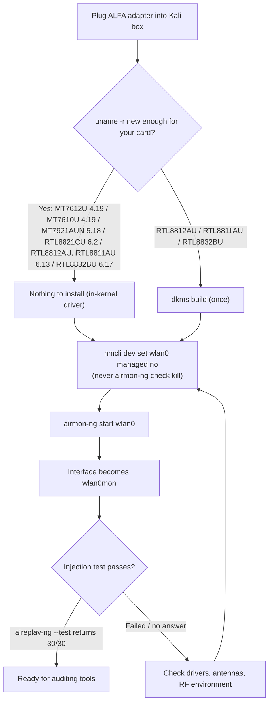

# ALFA 無線網路卡在 Kali Linux 上——監聽模式與封包注入

> **學習目標（Learning goal）**：完成本指南後，你的 ALFA 無線網路卡將進入**監聽模式（monitor mode）**並**證明封包注入（packet injection）可用**——這是每個 Wi-Fi 稽核工具（Aircrack-ng、Wifite、Wireshark、Bettercap）都依賴的兩項能力。
> **適用物件**：初學者–中階、Kali 使用者 ｜ **前置需求**：已安裝 Kali Linux（任何近期版本）、網路連線、你的 ALFA 無線網路卡。

## 概念：為什麼 Kali 不一樣

Ubuntu 把 Wi-Fi 無線網路卡當成*有禮貌的使用者端*：它們只擷取自己的流量。Kali 的整套工具鏈——Aircrack-ng、Reaver、Wifite——假設無線網路卡能做兩件額外的事：

1. **監聽模式（monitor mode）**——擷取某個頻道上的*每一*個訊框，而不只是你的連線。
2. **封包注入（packet injection）**——傳送原始的自製訊框（deauth、probe requests、handshake replays）。

不是每顆晶片都能做到這兩件事。在我們的 GX10 實測（kernel 6.17）中，九款裡有七款兩者皆通過（ACHM 在 2.4 GHz 可注入、5 GHz 僅廣播）；**AWUS036AXM / AXML** 可進監聽模式擷取，但**封包注入失敗**。只要 kernel 夠新，每款都使用內建驅動程式、不需要安裝驅動程式；DKMS 只用於舊 kernel。

> **注意**：Kali/NetHunter 未實機測試，版本判斷依 kernel 版本。

各卡內建起始版本（依 Linux Kernel Driver Database）：ACM（MT7612U）、ACHM（MT7610U）4.19；AXM、AXML（MT7921AUN(N)）5.18；EACS（RTL8821CU）6.2；ACH（RTL8812AU）、ACS（RTL8811AU）6.13；AX、AXER（RTL8832BU）6.17。用 `uname -r` 確認。一般 Kali rolling 核心通常夠新；ASUS GX10（Ubuntu 24.04，kernel 6.17.0-1014-nvidia）九款皆不需 DKMS。



## 前置需求

- [ ] 已安裝 Kali Linux（Kali 未實機測試；請用 `uname -r` 對照上方各卡版本）
- [ ] `sudo` 權限與網路連線
- [ ] 你的 ALFA 無線網路卡——先查[相容性矩陣](/alfa-network/linux-compatibility-matrix/)
- [ ] （僅舊 kernel 上的 Realtek 機型：ACH / ACS < 6.13、EACS < 6.2、AX / AXER < 6.17）建置工具：`sudo apt install -y build-essential dkms git`

## 步驟 1：檢查核心看到了什麼

插上無線網路卡並確認它被偵測到：

```bash
lsusb | grep -iE "realtek|mediatek"
iw dev
```

**預期輸出**：你的無線網路卡出現在 `lsusb` 中，且 `iw dev` 至少有一個 `Interface wlan0`（或 `wlan1`）。

## 步驟 2：安裝驅動程式（僅限舊 kernel 上的 Realtek 晶片）

如果 `uname -r` 不低於你那張卡的內建版本（ACM / ACHM 4.19、AXM / AXML 5.18、EACS 6.2、ACH / ACS 6.13、AX / AXER 6.17），**跳到步驟 3**——驅動程式已經在你的核心裡。只有在 kernel 較舊時，Realtek 晶片（ACH = RTL8812AU、ACS = RTL8811AU、EACS = RTL8821CU、AX / AXER = RTL8832BU）才需要使用 DKMS 建置社群維護的驅動程式（RTL8812AU 使用 aircrack-ng；RTL8811AU 和 RTL8832BU 使用 morrownr）。MediaTek 晶片（ACM = MT7612U、ACHM = MT7610U、AXM / AXML = MT7921AUN(N)）完全不需要 DKMS。

### RTL8812AU（AWUS036ACH）— 僅 kernel < 6.13

```bash
sudo apt update
sudo apt install -y build-essential dkms git
cd /opt
sudo git clone https://github.com/aircrack-ng/rtl8812au.git
cd rtl8812au
sudo make dkms_install
```

**預期輸出**：以 `DKMS: install completed.` 結尾。

> 為什麼用 aircrack-ng 的 fork？Kali 的核心更新很快，而 aircrack-ng 維護者會在每次核心釋出後數天內更新這些驅動程式——在 rolling 發行版上這至關重要。[RTL8812AU 驅動程式頁面](/alfa-network/drivers/rtl8812au/) 有深入探討。

### RTL8811AU（AWUS036ACS）— 僅 kernel < 6.13

```bash
cd /opt
sudo git clone https://github.com/morrownr/8821au-20210708.git
cd 8821au-20210708
sudo sh install-driver.sh
```

### RTL8832BU（AWUS036AX / AWUS036AXER）— 僅 kernel < 6.17

```bash
cd /opt
sudo git clone https://github.com/morrownr/rtl8852bu-20250826.git
cd rtl8852bu-20250826
sudo sh install-driver.sh
```

重新插上無線網路卡（或 `sudo modprobe <module>`）並確認介面出現：`iw dev`。

> 核心內建的 `rtw89_8852bu` 驅動程式（AWUS036AX / AXER，kernel ≥ 6.17）支援監聽模式（接收強）與封包注入（2.4 GHz 實測 96 % / 73 %）；舊版社群 DKMS 驅動程式的監聽行為我們未實測。若要最高的注入成功率，請使用 AWUS036EACS 或 AWUS036ACH（兩頻皆 100 %）。

## 步驟 3：讓 NetworkManager 不要干擾網卡（請勿執行 `airmon-ng check kill`）

NetworkManager 可能會搶奪 Wi-Fi 介面的控制權。**請勿執行 `airmon-ng check kill`**：它會終止 NetworkManager 與 wpa_supplicant，讓整台機器斷網。請改為只讓 NetworkManager 忽略 ALFA 這張卡的介面：

```bash
sudo nmcli dev set wlan0 managed no
nmcli dev status
```

**預期輸出**：ALFA 介面顯示為 `unmanaged`，其他連線不受影響。

> ⚠️ 只操作 ALFA 無線網路卡的介面（在 GX10 上名稱為 `wlx` + MAC），不要動內建 Wi-Fi。用完後以 `sudo nmcli dev set wlan0 managed yes` 還給 NetworkManager。

## 步驟 4：啟動監聽模式

```bash
sudo airmon-ng start wlan0
```

（把 `wlan0` 換成步驟 1 中你的介面名稱。）

**預期輸出**：

```text
PHY	Interface	Driver		Chipset
phy0	wlan0		mt76x2u		MediaTek Inc. MT7612U
		(mac80211 monitor mode vif enabled for [phy0]wlan0 on [phy0]wlan0mon)
		(mac80211 station mode vif disabled for [phy0]wlan0)
```

你的介面現在是 **wlan0mon**。驗證：

```bash
iwconfig
```

**預期輸出**：`wlan0mon  IEEE 802.11  Mode:Monitor  ...`

## 步驟 5：證明封包注入可用

注入是每支 Wi-Fi 無線網路卡的技能檢定。對空執行 Aircrack-ng 自我測試（它會廣播）：

```bash
sudo aireplay-ng --test wlan0mon
```

**預期輸出**：

```text
12:34:56  Trying broadcast probe requests...
12:34:56  Injection is working!
12:34:56  Found 1 AP
12:34:56  30/30:  100%
```

**`30/30: 100%`**——這就是神奇的一行。它代表無線網路卡注入了 30 個 probe requests 並聽到全部 30 個，證明在監聽模式下 TX 與 RX 都正常運作。如果你看到 `Failed` 或很低的百分比，代表無線網路卡實際上沒有在注入——請見下方常見錯誤表。MT7921 系列（AWUS036AXM / AXML）在 stock kernel 6.17 上此測試會顯示 `Found 0 APs` / `No Answer`：這是已知的注入失敗，不是你的設定有誤。

## 步驟 6：把你的工具指向它

快速端對端健全性檢查——擷取並計數 10 秒的訊框：

```bash
sudo timeout 10 tcpdump -i wlan0mon -c 100
```

**預期輸出**：`100 packets captured`（或 10 秒內到達的任何數量——看到*任何* 802.11 訊框就證明擷取可用）。

完成後，把無線網路卡恢復到一般模式：

```bash
sudo airmon-ng stop wlan0mon
sudo nmcli dev set wlan0 managed yes
```

## 常見錯誤（FAQ）

| 錯誤 / 症狀 | 原因 | 修復 |
|---|---|---|
| `airmon-ng start` 顯示 `No such device` | 介面名稱是 `wlan1` 或驅動程式未載入 | 執行 `iw dev` 找出真正的名稱；Realtek 用 `sudo modprobe <module>` |
| `aireplay-ng --test` → `No such device` | 你還在 `wlan0`，不是 `wlan0mon` | 重新檢查 `iwconfig`；從步驟 4 重新啟動監聽模式 |
| `Injection is working!` 但 `0/30` 回覆 | 無線網路卡 TX 正常但 RX 過濾器壞了（某些 Realtek 驅動程式常見） | 嘗試鎖定頻道：`sudo iw wlan0mon set channel 6`；重測；升級 DKMS 驅動程式 |
| DKMS 建置失敗並顯示 "No rule to make target" | Kali 核心對 repo 快照來說太新 | `cd /opt/rtl8812au && sudo git pull && sudo make dkms_install` |
| 監聽模式幾分鐘後失效 | USB 省電 / 熱節流 | 使用供電 USB hub 或 USB 3.0 連線埠；`sudo iwconfig wlan0mon txpower 20` |
| `airmon-ng` 警告有處理程式「可能造成問題」 | NetworkManager / wpa_supplicant 正在執行 | **不要**執行 `airmon-ng check kill`（會終止 NetworkManager 並斷網）；改用 `sudo nmcli dev set wlan0 managed no` |
| AWUS036AXM / AXML 的 `aireplay-ng --test` 顯示 `Found 0 APs` / `No Answer` | MT7921 系列在 stock kernel 6.17 的已知注入失敗（kernel 6.16 起的 mac80211 chanctx 回歸） | 注入改用其他卡（EACS、ACH、ACS、ACM、AX、AXER）；AXM / AXML 當 AP 或一般使用者端沒問題 |
| 無線網路卡在 managed 模式正常，但 `iw` 中沒有列出 `monitor` | 驅動程式建置時未含監聽支援 | 用 aircrack-ng repos 重建（它們啟用 monitor + VIF） |

> **你可能會想問**——*「擷取這些東西合法嗎？」* 監聽模式與注入是技術能力，不是執照。在大多數司法管轄區，在你不擁有或未獲授權測試的網路上擷取或注入是非法的。每個課程實驗室都假設你在**自己的 AP 或實驗室網路**上測試。請留在那裡。

## 參考資料

- [本指南的 Ubuntu 版本](/alfa-network/linux-setup-ubuntu/)——使用者端模式設定
- [NetHunter 指南](/alfa-network/linux-setup-nethunter/)——在 Android 上的相同工作流程
- [晶片驅動程式頁面](/alfa-network/drivers/rtl8812au/)——各晶片細節與疑難排解
- [疑難排解索引](/alfa-network/troubleshooting/)
- [Aircrack-ng 檔案](https://www.aircrack-ng.org/doku.php)——官方工具檔案